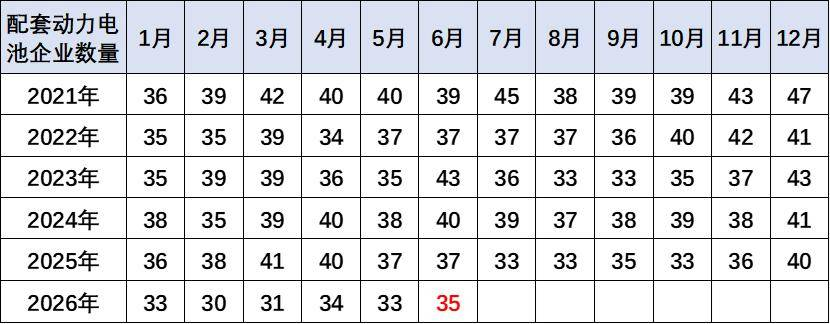
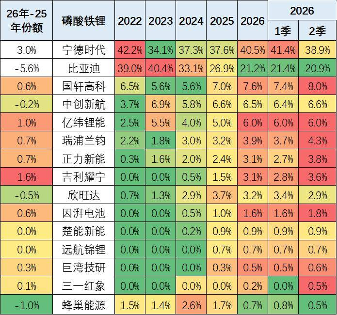

# 锂电池消费税调整，是对整车企业造电池的有力助推

- 公開日時: 2026-07-18 12:05（北京時間）
- 出典: [搜狐号・崔东树](https://www.sohu.com/a/1051814548_115312)
- テーマ（自動判定）: 電池
- 画像: 3枚

---

注：本分析文章仅代表崔东树个人观点，如有异议，请留言。

2026年7月17日，财政部、海关总署、税务总局联合发布《关于调整部分电池消费税政策的公告》（2026年第20号）。自2026年9月1日起，对锂离子蓄电池等成熟电池产品按2%税率征收消费税，2027年9月1日起升至4%；同时对钠离子电池、固态电池等新兴技术实施阶段性免税至2028年底。

我认为：锂电池消费税调整，是对整车企业造电池的有力助推，有利于中国汽车产业做大做强。我对此的核心判断是：这次政策调整意味着“油电同权”的大幕正式拉开。从购置税减半、车船税免征取消，到电池消费税恢复征收，新能源汽车的税收优惠“保护期”正在分阶段、有节奏地退出。燃油车长期承担全额车船税与燃油税，插混、增程式及新能源商用车却享受免税红利，形成“有排放、用道路、获收益却不承担税负”的漏洞。油电同权不是“一刀切”均等化，而是依据技术属性、排放特征、使用场景，建立权责匹配、税负公平的汽车税制体系。

但我更想强调一个我长期坚持的观点，整车企业一定要造电池。锂电池消费税的征收，将显著有利于整车企业造电池。

为什么这么说？大家看一下当前的利润格局就知道了。整车企业的利润正被电池企业大幅挤压——我援引2025年《财富》世界500强数据，上榜中国车企共实现147亿美元利润，其中某电池头部企业独占71亿美元。电池以外的整车企业只占了百分之十几的利润，我直言这一局面“惨不忍睹”，称整车企业“基本没钱了”。某电池头部企业2025年净利润达722亿元，已超过13家A股整车上市企业的利润总和。2026年1-5月汽车行业销售利润率仅3.4%，仍处于历史低位。

整车为王是产业链的共识，原因是整车企业掌握发动机等核心技术。而电池行业的整车企业配套有35家企业，这些企业能力都比整车企业强？我一直在说一个判断：未来整车企业造电池，或整车联合相关企业共同造电池的趋势日益明显。不造动力电池的车企，不可能成为世界级的整车企业。 电池成本至少占到整车价格的25%左右，电池技术在向高充电倍率、高比能量、固态电池等方向发展，掌握动力电池核心能力是车企构建长期竞争力的关键。

磷酸铁锂电池的产品差异优势明显。比亚迪仍然相对优秀，但今年年初处于国内调整期，出口表现很强，但没有统计到。

由于比亚迪全面转型磷酸铁锂电池，因此宁德时代、蜂巢、中创新航、LG等前四家的三元电池优势更加明显，近期长城汽车的蜂巢新能表现较好。

目前比亚迪已经是磷酸铁锂电池领域强者，而长城是三元电池装车的第二，而吉利等均已投入动力电池自研，并且部分车企已经具备大规模动力电池量产能力。

这次电池消费税政策，恰恰为整车企业造电池提供了制度性激励。 根据公告第五条和第六条，纳税人从生产企业购进已缴纳消费税的电池产品用于连续生产应税电池产品的，准予按照当期生产领用数量扣除已缴税款；纳税人自产自用的应税电池产品，用于连续生产应税电池产品的，不缴纳消费税。这意味着什么？整车企业如果自己造电池并直接装车，可以规避或抵扣消费税；而依赖外部采购的车企，则需要承担电池生产企业转嫁过来的税负成本。 当前锂电池电芯价格约0.35-0.40元/Wh，2%的消费税税率对应影响约0.007-0.008元/Wh，2%-4%的税率对单车成本的实际增额约在千元左右量级。虽然对单车影响有限，但对于年产百万辆的车企而言，累计增加的成本可达数亿元。自造电池者可以规避或抵扣这部分税负，外部采购者则只能被动承受成本上升。

从更宏观的视角看，近期随着车市生产规模扩大，PPI上行，上游碳酸锂成本上升，车企不造电池的问题严重，导致车企利润持续下滑。不造电池，不掌握供应链的主导权，主流车企生产节奏和盈利压力仍将急剧增大。电池消费税的加入，相当于给“造电池的车企”和“不造电池的车企”划出了一道新的成本分水岭。

同时，政策对钠离子电池、固态电池等下一代技术实施阶段性免税，实质上是为整车企业布局下一代电池技术提供了宝贵的政策窗口期。 在固态电池从实验室走向量产的关键阶段，免税政策降低了前期投入成本，鼓励车企加快技术储备。

税收优惠正在从终端消费环节向产业链上游制造环节延伸退出——不仅在新车销售环节逐步减少税收支持，也开始在动力电池等核心零部件的生产制造环节恢复征税。谁能率先完成电池自研自产的能力构建，谁就能在这一轮税制调整中获得成本优势，进而在下一阶段的市场竞争中占据主动。 随着国家反内卷工作持续推进，对改善行业利润的促进效果将逐步体现。这场围绕动力电池的博弈，行业方向已经清晰——整车企业必须把电池握在自己手里，优秀的大型整车企业一定要造电池。
