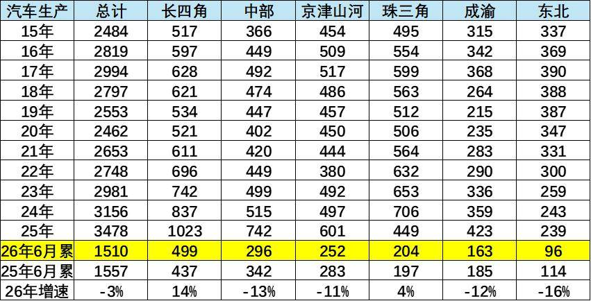
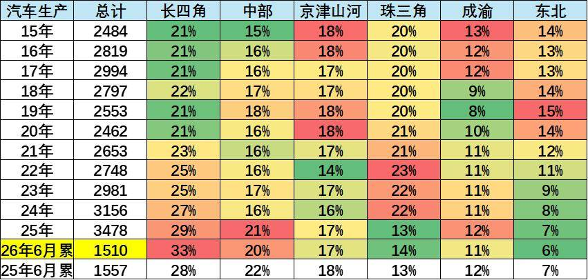
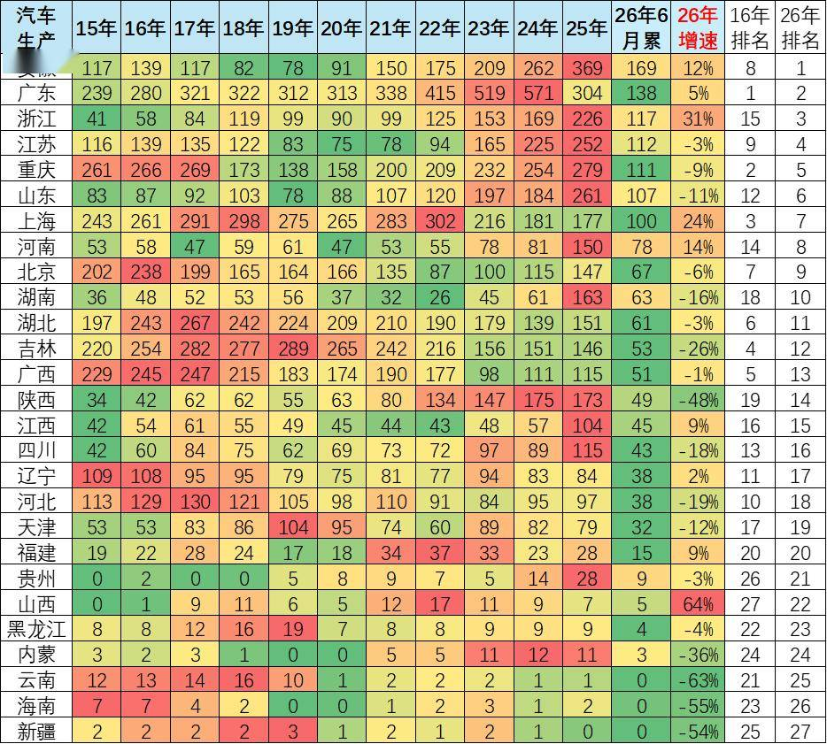
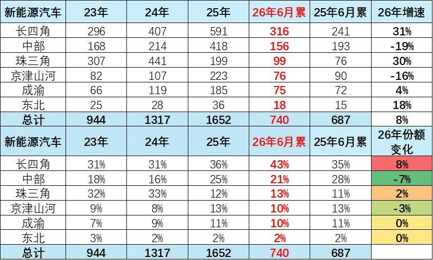
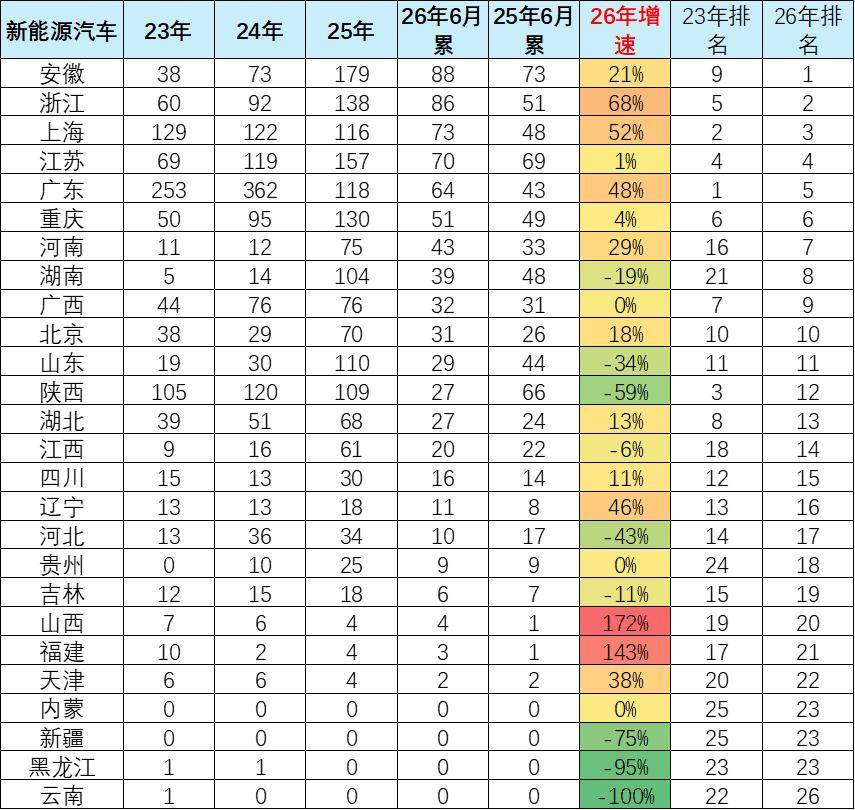
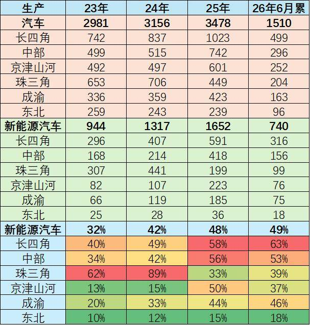
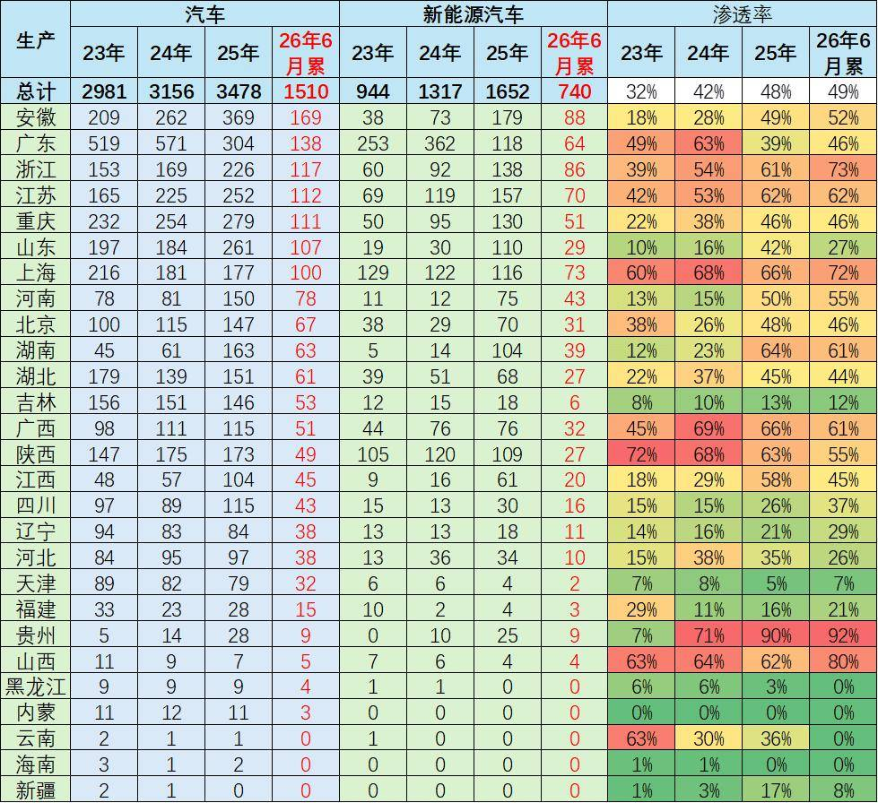

# 全国分省区汽车生产分析——长四角的汽车制造优势凸显

- 公開日時: 2026-07-21 14:41（北京時間）
- 出典: [搜狐号・崔东树](https://www.sohu.com/a/1052908107_115312)
- テーマ（自動判定）: 産業統計
- 画像: 7枚

---

注：本分析文章仅代表崔东树个人观点，如有异议，请留言。

汽车产业快速迭代升级，依托电动化变革，汽车产业结构日益集群化。依托2026 年上半年汽车产销数据，按照长四角（沪苏浙皖）产业统计口径为核心，从整体整车、分省份、新能源产销、电动化渗透率四大维度，剖析国内汽车产业区域重构、看到产能持续向长四角集聚、而珠三角和传统北方燃油基地衰退的行业格局。

1、长四角的概念与汽车生产总体特征

常规地理概念 “长三角” 仅指江浙沪，为匹配国内汽车产业真实集群格局，我将上海、江苏、浙江、安徽四省市整合命名为 “长四角” 汽车产业集群，区别于传统地理长三角口径。

核心逻辑：安徽合肥、芜湖近年整车与新能源产能爆发，蔚来、比亚迪、大众安徽、奇瑞等项目落地，与江浙沪形成完整协同产业链，整车、零部件、动力电池高度联动，已无法拆分单独统计。

安徽已跃升国内汽车产量第一大省，和江浙沪深度绑定，“长四角” 成为研判国内新能源产能转移、区域竞争格局的核心观测单元。如果安徽放到中部，则无法体现华东的产业聚集变化。

2026 年1-6 月国内汽车总产量1510万台，同比下滑3%，区域分化显著。长四角、珠三角实现正增长，长四角499万台，增速14% 领跑；珠三角204万台，小幅增4%。中部、京津山河、成渝、东北全部同比下滑，东北降幅最大达16%，传统汽车产区产能收缩明显。

对比历年数据，长四角近年产能扩张迅猛，2025 年全年产量破千，成为核心增长极；东北持续逐年走低，传统产业优势消退。中部、成渝产量起伏波动大，区域产业格局重构，新能源产能向长四角、珠三角集中是分化核心原因。

2015-2026 年国内汽车产业区域份额呈现极致分化。长四角份额从21% 一路攀升至2026 年上半年33%，稳居第一增长极；东北份额持续萎缩，由14% 跌至仅6%，传统基地持续失势。珠三角份额近年相对回落，2026 年上半年达14%；中部份额回升至20%，京津山河稳定在17%，成渝长期维持11% 左右。

份额变迁映射产能转移主线：新能源产能持续向长四角集聚，拉动其份额连年走高；东北传统燃油车企产能收缩，份额持续下行。2026 年上半年长四角份额同比提升5 个百分点，是唯一大幅扩容板块；中部、京津山河、东北份额同比均出现下滑，区域汽车产业重构趋势明确。

2、汽车分省生产特征

2026 年上半年各省汽车产量排名较2016 年大幅洗牌，安徽、浙江位次大幅跃升，长四角省份产能扩张显著。安徽产量169 万台增速12%，跃居全国首位；浙江增速31% 涨幅最强；上海同比增24%，三省构成国内核心产能集群。广东降到第而，传统东北、华北省份产量普遍大幅下滑。

老牌汽车基地衰退特征突出，吉林、陕西、云南降幅超25%，黑辽津冀产量持续萎缩。中部省份分化，河南增长14%、湖北小幅下滑；西南成渝稳定但四川减产18%。近十年产能持续向长四角集聚，燃油车传统产区产能逐步出清，产业区域重构态势清晰。

3、新能源汽车生产总体特征

2026年上半年新能源汽车总产量740万台，同比增8%，区域增长两极分化。长四角、珠三角、东北、成渝实现正增长，长四角316万台、增速31%领跑；中部、京津山河产量同比下滑，中部降幅达19%。长四角份额同比提升8个百分点，是产能扩张核心区域。

近三年新能源产能持续向长四角集中，其份额从2023年31%升至2026年上半年43%。珠三角小幅扩容，中部份额回落7个百分点，京津山河份额收缩3%；成渝、东北份额基本持平。传统中部、北方基地新能源产能增长乏力，产业集聚长四角趋势显著。

4、新能源汽车分省生产总体特征

2026 年上半年新能源汽车省份排名大幅重塑，长四角省份全面领跑。安徽以88 万台升至全国第一，浙江增速68%、上海增速52% 增长迅猛；广东虽增速48%，但全年产量下滑，位次由榜首降至第五。长四角四省包揽前四，成为国内新能源核心产能承载区。

区域增长分化显著，山西、福建基数低增速超140%，但产能体量偏小；陕西、云南、黑龙江降幅超59%，北方传统产区新能源产能萎缩明显。中部河南、湖北稳步增长，东北、华北多数省份产量同比下滑，新能源产业持续向长四角集聚。

5、汽车省区生产变化

2023-2026年上半年国内汽车电动化率持续走高，整体由32%升至49%，区域结构分化明显。长四角电动化进度领跑，2026年上半年达63%；珠三角电动化率从89%大幅回落至39%，产能结构发生显著调整。中部、成渝紧随其后，电动化率突破50%、46%，东北、京津山河转型节奏偏慢。

产量维度长四角双赛道同步扩容，2026年上半年整车499万台、新能源316万台，产能与电动化率双高。珠三角整车产量萎缩，新能源产能同步收缩；东北整车、新能源产量持续下行，电动化率仅18%。产业向长四角集聚、中部稳步跟进，传统基地转型滞后的格局清晰显现。

全国汽车新能源渗透率从2023 年32% 升至2026 年上半年49%，省份分化显著。长四角浙沪渗透率领跑，浙江73%、上海72%；贵州、山西、广西电动化转型进度靠前，渗透率超60%。东北、华北传统汽车省份转型缓慢，天津、黑龙江渗透率不足10%。

产量与渗透率呈现区域错配特征：安徽整车产量全国第一，渗透率52% 稳步提升；广东整车产能收缩，渗透率自63% 回落至46%。长四角省份兼具高产量与高渗透率，形成产业优势；北方多数省份整车与新能源产量双下滑，电动化转型滞后。

附：近日信息合集
