# 2026年1-6月汽车行业利润率3.8%、收入增1.8%、成本增2.8%、利润降20%

- 公開日時: 2026-07-27 11:44（北京時間）
- 出典: [搜狐号・崔东树](https://www.sohu.com/a/1055231490_115312)
- テーマ（自動判定）: 利益・収益
- 画像: 11枚

---

一、核心数据观点

26年1-6月，面对国际环境复杂演变和国内转型压力等多重挑战，国民经济开局良好、质效提升，装备制造业和高技术制造业利润快速增长，原材料制造业利润两位数增长，为全年经济平稳运行奠定坚实基础。2026年1-6月汽车生产1510万台，同比降4%。2026年1-6月的汽车行业收入51893亿元，同比增1.8%；成本46100亿元，增2.8%；利润1954亿元，同比降20%；汽车行业利润率3.8%，相对于下游工业企业利润率6.5%的平均水平，汽车行业仍偏低。

2026年1-6月行业销售利润率3.8%，6月5.2%，好于3-4月3.7%的月度表现。历年6月一般利润率较高，今年6月处于异常高位。近期随着车市生产规模扩大，PPI上行，上游有色和石油等矿业利润暴涨，钛酸锂价格近20万，26年1-6月锂电池出口吨单价10.48万元降12%（24年降26%、25年降21%），国内电池价格坚挺，锂电上市公司应付账期200天而应收账期要求60天，车企不造电池的问题严重，车企利润可持续下滑。

2026年各地大力度推动“两新”政策落地实施，逐步有效释放内需活力。但汽车行业效益改善明显落后其它消费品。随着国家反内卷工作持续推进，汽车行业受上游挤压严重，价格问题严重，油价暴涨，有色金属、半导体利润暴增，终端用户购车观望心态严重，车企运行压力持续加大，高质量发展受到上游的巨大冲击。

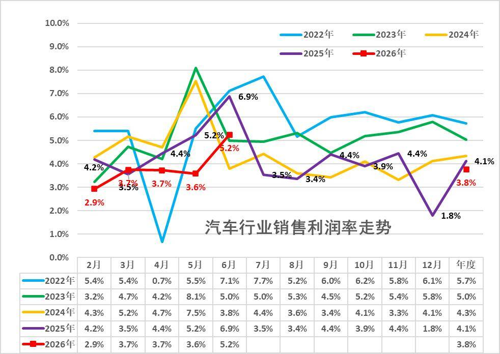

从历年销售利润率走势来看，2024年汽车行业利润表现已显疲软，销售利润率仅4.3%，较历史正常水平大幅下降；2025年行业销售利润率降至4.1%。2026年1-6月行业销售利润率进一步降至3.8%，6月5.2%，好于3-4月3.7%的表现。历年6月一般是利润率较高的时候，今年6月高端车冲刺异常猛，出口需求暴增，盈利拉动效果凸显。

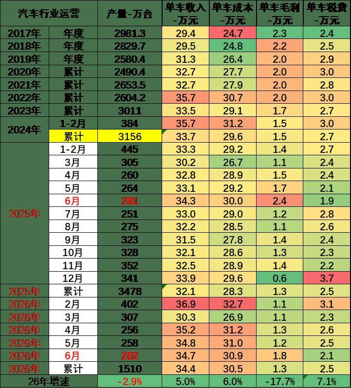

由于汽车行业的产销基本是一致的，统计口径一致，产销差距不大，因此我们用国家统计局产量测算统计局单车经济指标。

1-6月总体工业企业单位成本增长压力大。碳酸锂价格翻一倍，大宗商品价格高位运行，中下游行业原料成本压力有所加大。1-6月汽车行业产业链的总体单车收入34.4万元（有产业链的重复计算）增5%，单车成本增30.5万元增6%，单车税费2.5万元增7.1%，产业链单车毛利润1.3万元降17.7%。

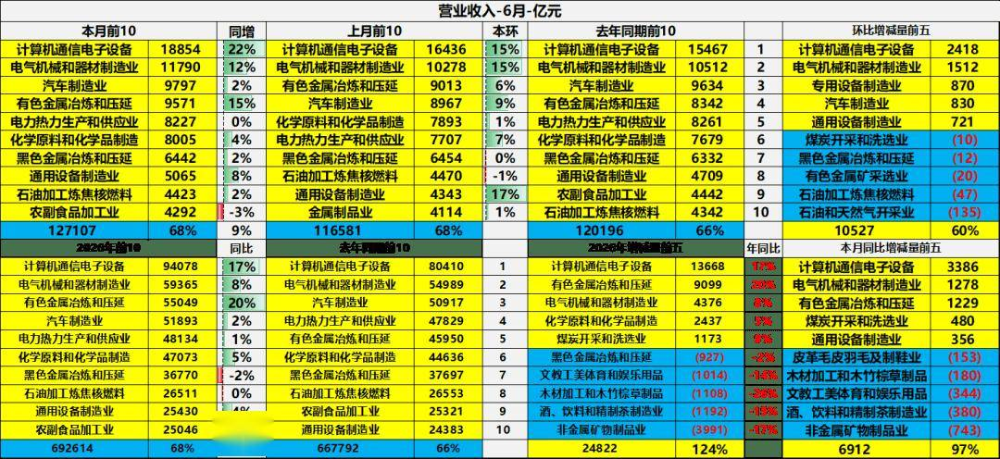

6 月规模以上工业营收前十行业合计 12.71 万亿元，电子制造、电气机械、汽车制造业稳居当月前三。电子行业当月营收 18854 亿元同比大增 22%，成为拉动主力；汽车制造业当月营收 9797 亿元，同比仅增 2%，增速相对平缓。环比维度电子、电气、专用设备增量领跑，而煤炭、黑色金属冶炼、油气开采等行业环比营收出现下滑，行业短期景气度分化明显。

2026 年前 6 个月前十行业累计营收 69.26 万亿元，有色冶炼以 20% 的累计同比增速表现亮眼，汽车制造业累计增速仅 2%。全年增量靠前行业集中在高新制造与基础原材料，黑色金属冶炼、文娱用品、非金属矿物制品等行业累计营收同比负增长。整体来看高端装备、电子信息产业持续高增，传统重工业复苏乏力，新旧动能转换特征突出。

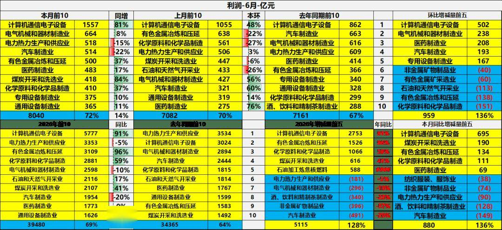

6 月规模以上工业十大盈利行业合计利润 8040 亿元，计算机通信电子设备以 81% 的超高同比增速成为当月盈利核心拉动力量，煤炭开采、有色金属冶炼利润同比同样大幅走高；汽车制造、电力热力利润同比分别下滑 22%、15%，盈利承压。环比来看电子、电气机械利润增量领跑，化工、有色冶炼利润环比收缩，行业盈利景气度短期分化显著。

2026 年上半年十大盈利行业累计利润 39480 亿元，计算机通信电子设备、有色金属冶炼同比涨幅分别达 91%、96%，撑起上半年利润增量。汽车制造利润同比下降 20%，电气机械、电力热力盈利同步走弱，整体呈现高新产业盈利强势修复、传统装备与汽车行业盈利疲软的新旧动能分化格局。。

二、具体分析

1、各类经济体的收入和利润结构

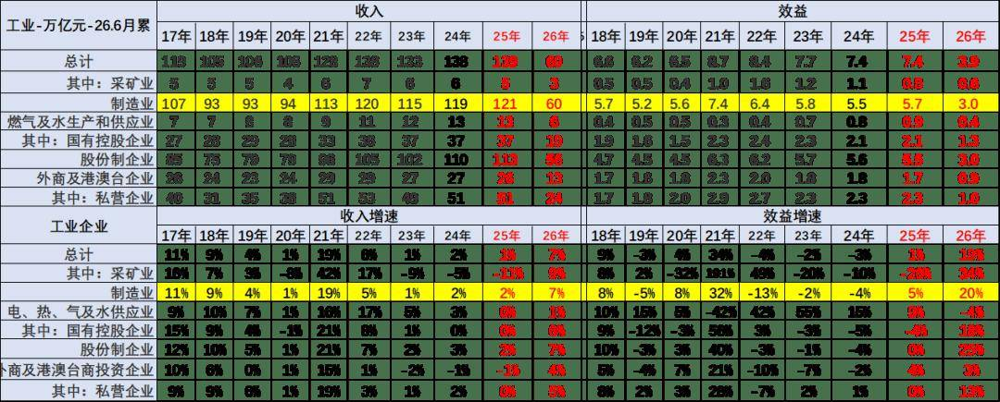

盈利效益端，2018 至 2025 年工业整体效益在 6.2-8.7 万亿元波动，2026 年上半年效益回落至 3.9 万亿元，但效益增速大幅反弹至 19%，其中制造业效益增速达 20%，成为盈利修复核心。分板块来看，采矿业效益增速高至 34%，电力热力水供应业小幅转负；所有制维度股份制企业效益增速 25% 领跑，国企、私企盈利同步回暖，外商投资企业增速仅 3%，不同主体盈利修复力度分化明显。。

今年总体工业领域的收入增长平稳，利润表现也是相对分化，其中近几年的国有企业的收入和利润波动较大。上游利润挤压下游，采矿企业的表现较好，利润增速很强。

注意：基础数据解读

规模以上工业企业利润总额、营业收入等指标的增速均按可比口径计算。报告期数据与上年所公布的同指标数据之间有不可比因素，不能直接相比计算增速。其主要原因是：（一）根据统计制度，每年定期对规模以上工业企业调查范围进行调整。每年有部分企业达到规模标准纳入调查范围，也有部分企业因规模变小而退出调查范围，还有新建投产企业、破产、注（吊）销企业等变化。（二）加强统计执法，对统计执法检查中发现的不符合规模以上工业统计要求的企业进行了清理，对相关基数依规进行了修正。（三）加强数据质量管理，剔除跨地区、跨行业重复统计数据。根据国家统计局最新开展的企业组织结构调查情况，2017年四季度开始，对企业集团（公司）跨地区、跨行业重复计算进行了剔重。（四）“营改增”政策实施后，服务业企业改交增值税且税率较低，工业企业逐步将内部非工业生产经营活动剥离，转向服务业，使工业企业财务数据有所减小。（五）根据第四次全国经济普查单位全面清查结果，对规模以上工业企业调查单位进行了核实调整。

2、收入利润结构变化

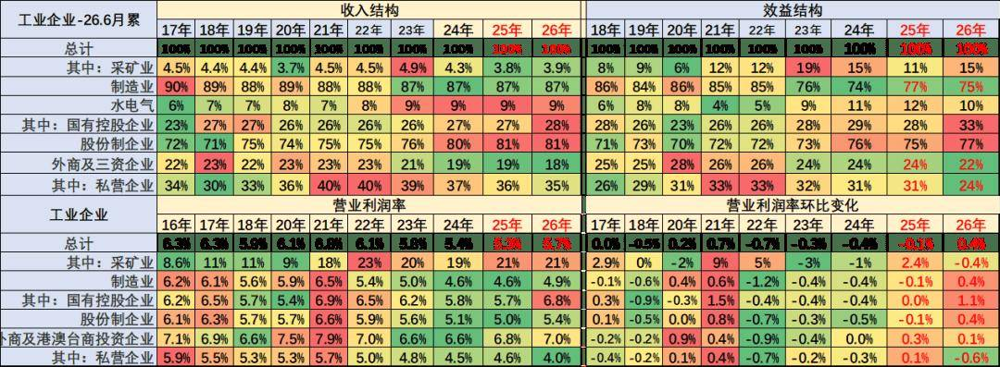

目前看国有企业表现很好，收入和利润占比持续增长，利润占比达到33%，增5个点；私营企业的利润占比达到24%降7个点，销售利润率4%的水平较低，私营企业较去年利润下滑较明显。

营业收入的利润率指标K型分化，主要是采矿业和煤水电等国有企业指标数值较高，私营企业利润率很差，制造业的利润占比75%，剔除半导体近期明显下降。

三、具体行业分析

1、采矿业利润分化

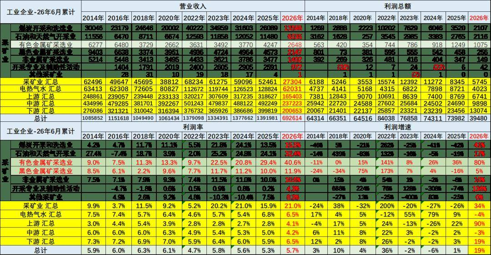

2026年1-6月的高基数和价格走高下，采矿利润增34%仍有很好利润，采矿业1-6月利润率在21%水平也是很好的。

2026年1-6月，有色行业利润暴增到40.6%，石油行业利润32.4%，近期的石油业的利润率增长惊人。总体采矿行业利润保持高位。对下游的冲击较大。

3、水电气行业利润保持高位

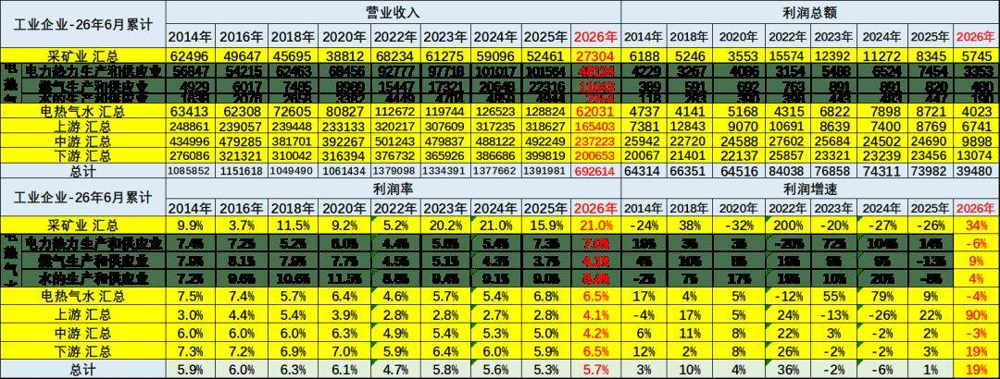

电热气水是高利润服务行业，2026年利润率5.7%。电力行业的利润下降6%处于历史高位，水的处理行业利润增4%，燃气行业利润2026年增9%，电力的利润2025年下降6%。

3、上游利润改善

2026年上游行业的销售收入和利润都是出现高增长，尤其是利润率回升到4.1%。其中有色金属等为代表的销售利润率逐步冲到高位，钢铁从去年年初的巨额亏损到今年仍是较差。化工原料和有色金属冶炼等行业利润还算较好。

4、中游利润表现较好

2026年1-6月中游行业的销售收入和利润增长较好。中游行业销售利润率从2018年6%下降到2026年的4.2%，近期企稳。2026年主要中游行业的销售利润率也有所下降，造船铁路等效益好.报废更新补贴带来废弃物资利用和非金属矿物制品业利润增长较大。

5、下游利润逐步改善

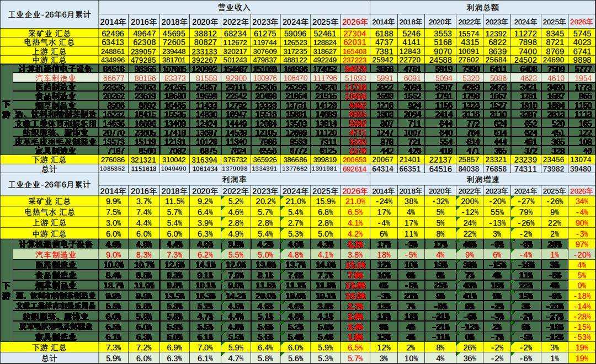

2026年1-6月总体下游工业利润增19%，计算机通讯行业利润出现增97%的异常良好的增长态势。而汽车业利润降20%，销售利润率3.8%（2014年9%），仍低于下游总体6.5%的利润水平，也大幅低于烟、酒、药等其它下游企业。

目前高利润的主要还是烟草、酒类、医药行业，酒类行业的利润大幅高于其他行业。食品行业盈利不强，但也同比提升明显。

四、汽车行业分析

1、汽车行业规模持续扩大

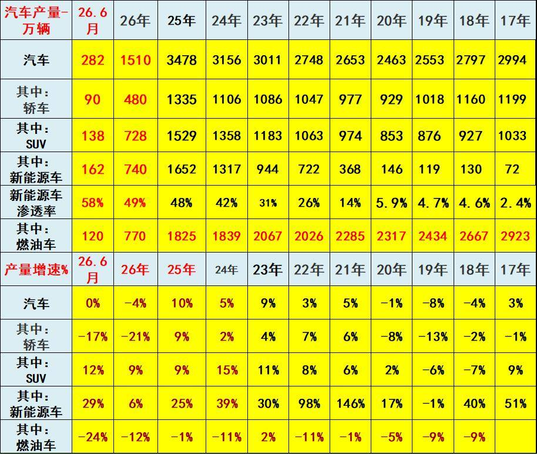

2022年汽车生产2748万台，产量同比增长3%；新能源汽车生产722万，增长98%，渗透率26%；燃油车生产2026万台，降11%。

2023年汽车生产3011万台，同比增9%；新能源汽车生产944万台，同比增30%，渗透率31%；燃油车生产2067万台，增2%。

2024年汽车生产3156万台，同比增长5%；新能源汽车生产1317万台，同比增39%，渗透率42%；燃油车生产1839万台，降11%。

2025年汽车生产3478万台，同比增10%；新能源汽车生产1652万台，同比增25%，渗透率48%；燃油车生产1825万台，同比降1%。

2026年1-6月汽车生产1510万台，同比降4%；新能源汽车生产740万台，同比增6%，渗透率49%；燃油车生产770万台，同比降12%。

2026年6月汽车生产282万台，同比降0%；新能源汽车生产162万台，同比增29%，渗透率58%；燃油车生产120万台，同比降24%。

2、汽车行业效益压力较大

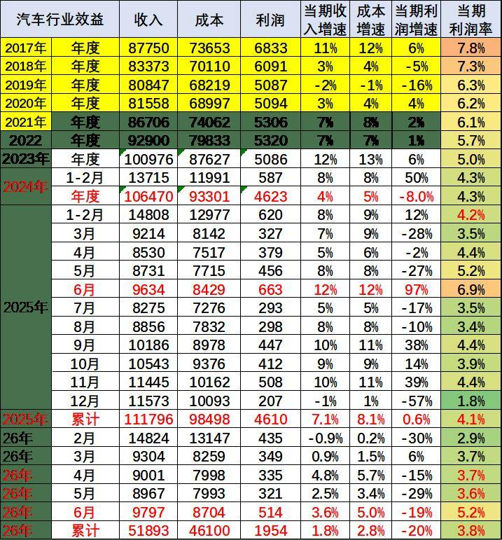

2026年1-6月汽车生产1510万台，同比降4%；新能源汽车生产740万台，同比增6%。2026年1-6月的汽车行业收入51893亿元，同比增1.8%；成本46100亿元，增2.8%；利润1954亿元，同比降20%；汽车行业利润率3.8%，相对于下游工业企业利润率6.5%的平均水平，汽车行业仍偏低。

近几年的锂电池出口价格持续下降，无论碳酸锂价格如何变化，出口锂电池价格持续下降。锂电池出口价格从2024年14.29万元下降26%，到25年的11.23万元，降21%。26年10.48万元降12%，其中6月中国出口的电池均价10.49万元、同比下降4%，4-6月退税降低后的降价幅度较去年的改善明显。中国对欧盟出口的锂电池价格下降较快，从2024年15.34万元下降25%，到25年的12.55万元，降18%。26年6月中国出口欧盟的电池均价11.02元/吨，降低18%，。。

近期随着车市生产规模扩大，PPI上行，上游碳酸锂成本上升，锂电池出口价格持续下降，国内电池价格暴涨，车企不造电池的问题严重，车企利润可持续下滑。

结合前几年的利润率下行趋势看，近期汽车行业利润下滑幅度仍较大，政策加持下的新能源政策优势明显，由于整车企业普遍不造电池，没有话语权，主流车企盈利压力仍将急剧增大。随着国家反内卷工作持续推进，未来更多整车企业目标成为国际大企业，车企造电池必然加速，未来整车为王，车企效益会逐步改善。

附：近日信息合集
