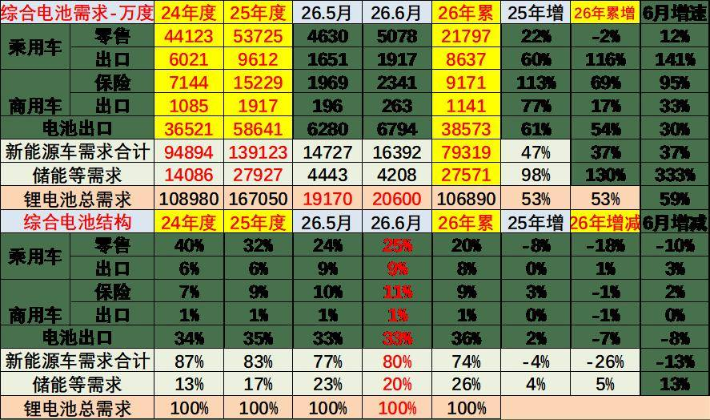
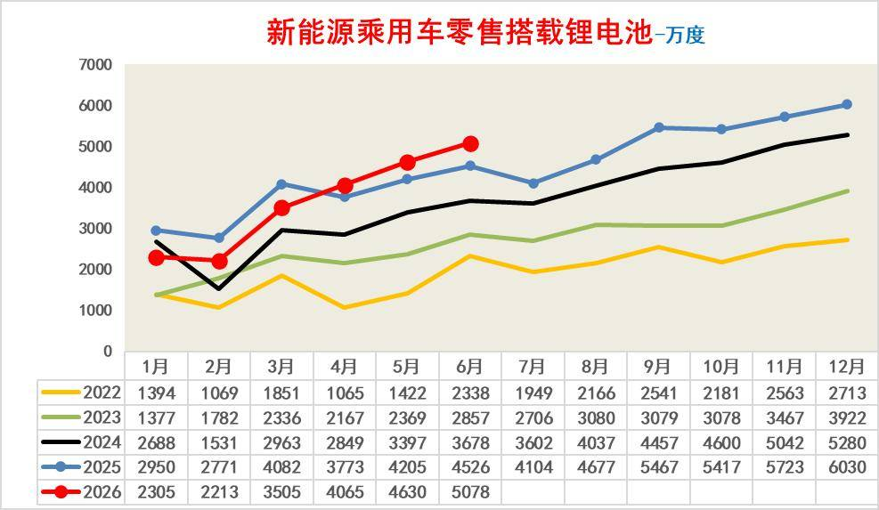
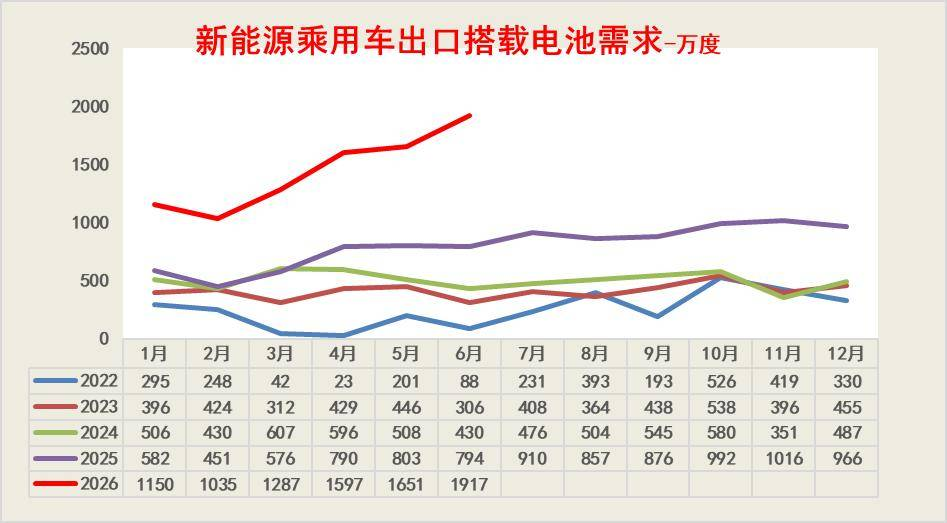
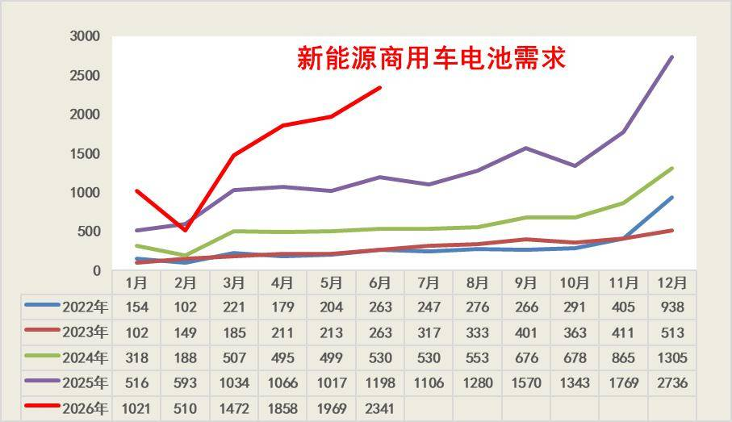
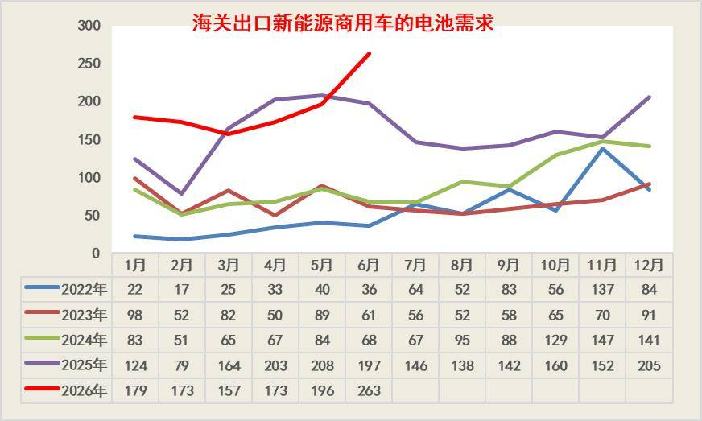
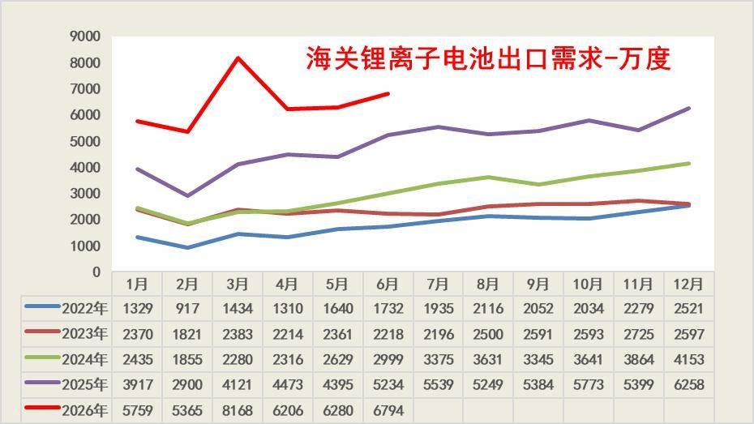
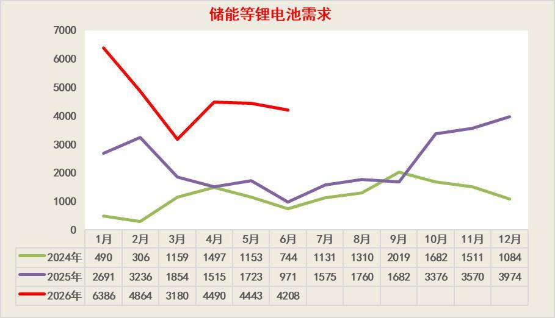

# 2026年6月锂电池全口径需求分析

- 公開日時: 2026-08-01 02:42（北京時間）
- 出典: [搜狐号・崔东树](https://www.sohu.com/a/1057373394_115312)
- テーマ（自動判定）: 電池
- 画像: 8枚

---

2026 年上半年锂电池全口径总需求达 106890 万度，同比大幅增长 53%，行业增长由过去新能源车单一拉动转向储能、海外出口、商用车多元支撑新格局。新能源车合计需求 79319 万度，同比增长 37%，但国内新能源乘用车零售需求同比小幅下滑 2%，正式步入存量竞争；整车出口、动力电池出口市场成为增量。锂电池海关出口维持 54% 稳健增速，新能源商用车内外销同步放量对冲内需疲软。需求结构显著重构，新能源车需求占比回落至 74%，储能占比升至 26%，储能与海外市场成为支撑行业高景气的核心支柱。根据产销测算的储能等需求是行业最大增长引擎，上半年需求 27571 万度，同比暴涨 130%，6 月单月增速高达 333%；高油价和风光新能源的发展带来了储能的爆发。

1、锂电池总体需求分析

2026 年上半年锂电池总需求 106890 万度，同比大增 53%，行业增长驱动力发生显著切换。新能源车合计需求 79319 万度，同比增长 37%，但国内乘用车零售需求同比下滑 2%，新车市场增长乏力；乘用车整车出口、动力电池替换保险需求表现亮眼，上半年增速分别达 116%、69%，成为新能源车板块主要增量。储能板块成为最大亮点，上半年需求 27571 万度，同比暴涨 130%，6 月单月增速 333%，叠加电池出口 54% 的稳健增长，储能与海外市场共同托举行业高景气。

需求结构占比印证行业长期拐点，新能源车整体占比由 2024 年 87% 回落至今年上半年 74%，储能占比从 13% 跃升至 26%，双轮驱动格局彻底确立。国内乘用车零售电池份额已萎缩至 20%，出口及动力电池后市场占比稳步抬升，弥补内需不足。电芯直接出口结构占比小幅回落，海外建厂带来一定长期压力。后续行业增量将高度依赖储能装机释放与车企海外出口放量，国内车市仅作为基本盘稳定需求。。

2、新能源乘用车国内零售锂电池分析

2022-2025 年国内新能源乘用车零售端搭载锂电池需求呈现逐年抬升的长期上行趋势，且月度季节性规律高度一致：2 月受春节假期影响形成全年需求低谷，3 月开始环比快速修复，6 月迎来上半年销量小高峰，9-12 月进入下半年交付旺季，年末达到全年峰值。2025 年全年月度需求全线高于前三年，12 月零售电池用量突破 6030 万度，为历年最高值，印证此前几年国内新能源车新车零售市场稳步扩容。但增长斜率逐年放缓，行业增量边际收窄特征显现。

2026 年上半年 1-6 月数据进一步验证内需增长乏力的现状，虽延续 “2 月触底、逐月走高” 的季节性节奏，6 月单月零售电池 5078 万度实现环比持续增长，但累计规模同比小幅下滑 2%，全年仅依靠终端以价换量拉动月度环比修复。对比 2025 年同期，2026 年各月多数月份未能实现同比正增长，国内新能源乘用车零售市场已由高速增量阶段转入存量竞争阶段，新车电池需求基本盘稳固，但难以继续作为锂电池行业核心增长驱动力。。

2023—2025 年国内新能源乘用车零售动力电池需求连续三年稳步扩容，但年度增速逐年逐级下行，从 2023 年全年 39% 降至 2025 年 22%，增长动能持续弱化。分季度看，上半年 1-6 月累计增速同样逐年回落，下半年 7-9 月、10-12 月增速下滑更为明显，反映国内新车市场渗透率见顶、存量竞争加剧的行业底色。各年份均保持 6 月环比正增长的季节性规律，年中促销拉动短期需求回暖是常态化特征。

6月储能等需求占电池总量20%，电池出口33%，新能源车占比46%，形成532的格局。

2026 年上半年数据正式确认内需拐点，1-6 月零售电池累计 217997 万度，同比下滑 2%，为近年首次上半年负增长。其中 1-5 月累计销量同比下降 6%，仅 6 月依靠车企冲量实现 12% 同比增长、10% 环比增长，靠单月阶段性回暖勉强托底上半年大盘。按照过往下半年增速进一步走低的历史规律，2026 年全年国内乘用车零售锂电需求大概率进入低速震荡阶段，基本盘属性凸显，不再具备拉动锂电行业高增长的能力。

。

3、新能源乘用车出口用锂电池分析

新能源乘用车出口搭载动力电池需求近五年保持极强的高增长韧性，成为对冲国内零售市场增长乏力的核心增量来源。2022 至 2025 年出口月度电池用量逐年稳步抬升，2025 年全年各月需求均大幅高于前三年，年末 11 月单月需求突破 1016 万度，海外市场放量趋势清晰，且月度仅受春节 2 月小幅扰动，整体波动远小于国内零售端。2026 年上半年增长直接进入爆发阶段，1-6 月单月数值从 1150 万度一路攀升至 1917 万度，走出陡峭上行曲线，6 月单月规模已是 2025 年同期两倍以上。海外新能源汽车订单持续释放、中国整车品牌全球化布局提速，直接带动出口端电池需求大幅扩容。在内需增速放缓、存量竞争加剧的背景下，乘用车出口锂电需求高速扩张有效托举动力电池整体大盘，也印证汽车出海是锂电产业链中长期最重要的增长支撑。。

2023 至 2025 年我国新能源乘用车出口保持连续扩容态势，虽年度同比增速从 64% 回落至 60%，增长斜率有所放缓，但海外市场底盘持续夯实。往年 6 月普遍呈现环比下滑特征，属于海外订单交付节奏的季节性调整，下半年 10-12 月出口增速再度抬升，成为全年放量主力。2026 年上半年出口迎来爆发式增长，1-6 月累计出口搭载电池需求 8637 万度，同比大幅提升 116%，其中 6 月单月销量 1917 万度，同比暴涨 141%，环比上涨 16%，打破历年 6 月环比走弱的惯例。在国内新能源乘用车零售电池需求上半年同比小幅负增长的背景下，汽车出海成为动力电池行业最强增长极，海外市场有效对冲内需疲软压力，也为锂电产业链长期增长打开充足空间。

4、新能源商用车内销用锂电池分析

新能源商用车动力电池需求呈现逐年跨越式增长，是动力电池第二增长曲线。2022—2025 年行业稳步放量，每年全年月度中枢持续上移，且具备极强季节性特征，每年 12 月为年终冲量高点，2025 年 12 月单月电池需求高达 2736 万度，较三年前 2022 年同期增长近 3 倍，重卡、轻卡、专用车电动化渗透率快速提升驱动长期上行。

2026 年商用车电动化进入加速爆发期，上半年走出陡峭上扬曲线，剔除 2 月春节季节性低谷外，单月需求量从 1 月 1021 万度攀升至 6 月 2341 万度，连续刷新历史月度纪录。相较于乘用车内需乏力、靠出口拉动的格局，商用车依赖政策强制替换、路权优势、运营成本优势实现内生高增长，对内可对冲乘用车国内零售端增量不足，对外海外电动商用车出口放量进一步打开空间，成为支撑动力电池整体需求稳健增长的重要底盘。

新能源商用车自 2023 年触底后开启连续三年爆发式增长，行业电动化渗透率进入快速兑现周期。2023 年全年销量 34460 台，同比小幅下滑 2%，为行业底部；2024 年销量同比翻倍增长 106%，2025 年再度实现 113% 高增，全年销量突破 15.2 万台，政策替换、路权红利与运营经济性驱动重卡、城配轻卡批量电动化。

从季度节奏看，每年下半年 7-9 月、10-12 月均维持高增速，年末冲量特征显著，且 6 月环比常年保持正增长，季节性波动远小于乘用车。2026 年上半年延续高景气，1-6 月累计销量 91771 台，同比增长 69%，其中 6 月单月销量 2341 台，同比增速 95%、环比增长 19%，增长韧性极强。在国内新能源乘用车内需增长承压的背景下，商用车成为动力电池内需端最稳固的增长基本盘，叠加海外电动商用车出口放量，进一步夯实锂电中长期需求托底能力。

。

5、新能源商用车出口用锂电池分析

海关口径锂离子电池出口规模自 2022 年起逐年稳步扩容，2026 年上半年实现跨越式冲高。2022 年单月出口量仅 0.92–2.52GWh，整体基数偏低；2023、2024 年持续爬坡，2024 年末 12 月达到 4.15GWh；2025 年全面突破，月度均值超 5GWh，12 月收官至 6.26GWh，海外新能源车、储能、电动设备需求持续释放。

2026 年外需进一步爆发，3 月单月出口 8.17GWh 创下历史月度高点，上半年各月均维持 5.3GWh 以上高位。新能源整车出海、海外储能大规模装机共同拉动锂电外需高增，强劲的出口体量对冲了国内动力电池产能过剩与价格内卷压力，为产业链提供稳定增量与盈利支撑。。

2023-2025 年呈现逐级抬升、2025 年爆发式放量特征：2023 年全年配套电池出口体量基数较低，同比增长 27%；2024 年稳步上行，全年同比增速 32%；2025 年海外电动环卫车、轻卡、重卡需求集中爆发，全年配套电池同比大幅增长 77%，上半年同比增幅高达 133%，6 月单月同比飙升 190%，成为锂电出口重要增量来源。

2026 年行业由高增转向稳健增长，上半年配套动力电池出口同比提升 17%，6 月单月同比增 33%、环比大涨 34%。新能源商用车出海具备较强贸易壁垒抗性，持续为锂离子电池海外出口提供稳定基本盘，对冲乘用车海外政策限制与国内产能内卷压力。

。

6、锂电池出口暴增

2022 至 2025 年我国海关锂离子电池出口量呈现逐年阶梯式攀升态势，2022 年单月出口仅 0.09–0.25GWh，基数较低；2023-2024 年伴随新能源汽车与海外储能需求稳步扩容，月度出口中枢持续上移，2024 年末单月出口突破 0.41GWh；2025 年外需全面放量，月度规模最高达 0.6258GWh。2026 年上半年出口迎来爆发式增长，3 月单月出口 0.8168GWh 创下历史月度高点，前六个月均保持 0.53GWh 以上高位运行。新能源乘用车、高带电量新能源商用车批量出海叠加全球储能装机热潮，共同托举锂电出口高景气，强劲的海外需求有效对冲了国内动力电池产能过剩、行业价格内卷的经营压力。。。

2023 至 2025 年我国海关动力电池出口（GWh）保持连续高增长，年度出口规模从 285.57GWh 增至 586.64GWh，2025 年全年同比大涨 61%，为三年增长峰值。分阶段来看，2023 年基数稳步抬升，上半年累计 133.67GWh，同比增长 60%；2024 年增速小幅回落至 28%，下半年海外需求发力拉动四季度增速走高；2025 年外需全面爆发，上半年出口 250.39GWh，同比大增 73%，6 月单月同比增幅高达 74%。2026 年上半年延续强劲态势，累计出口 385.73GWh，同比提升 54%，6 月单月 67.94GWh，同比增长 30%、环比上涨 8%。新能源整车出海叠加全球储能装机需求持续释放，电池出口成为行业对冲国内产能过剩与价格内卷的核心缓冲力量。

7、储能需求暴增

本表为剔除新能源车装车、电池海关出口后，测算为库存调整与国内储能等领域锂电池内需的总体规模。从2022-2026年储能锂电池月度需求数据来看，行业呈现持续高增长态势，需求规模四年内增长超2倍，复合增速强劲。每年2月受春节假期影响为传统淡季，需求触底后3月快速反弹，下半年尤其是四季度因项目集中交付成为全年高峰。这一增长背后，储能行业的快速扩张是核心驱动力，全球新能源装机配套的大储、户储项目持续放量，共同支撑需求上行。同时，行业“年初招标排产、年末集中交付”的节奏，决定了季节性波动特征。2026年需求的高增速，也预示着锂电池行业仍处于景气上行周期，市场规模有望持续扩大。

本表为剔除新能源车装车、电池海关出口后，测算为库存调整与国内储能等领域锂电池内需的总体规模。2023 年储能内需尚处起步阶段，上半年内需为负，依靠下半年发力全年达到 4825 万度，同比增长 98%；2024 年需求快速放量，全年需求 14086 万度，同比大幅提升 192%，储能市场正式进入规模化落地期；2025 年行业维持翻倍级高增，全年内需 27927 万度，同比增长 98%，上半年 1-6 月需求 11991 万度，同比增幅 124%。2026 年增长势能进一步强化，上半年累计储能内需高达 27571 万度，同比大涨 130%，6 月单月 4208 万度，同比增速 333%。持续高景气的储能内需，成为锂电池行业对冲汽车需求波动、消化过剩产能最核心的内需支撑板块。

附：近日信息合集

。
