# 世界企业500强的中国汽车公司总体较好

- 公開日時: 2026-08-02 17:31（北京時間）
- 出典: [搜狐号・崔东树](https://www.sohu.com/a/1057885501_115312)
- テーマ（自動判定）: 世界市場
- 画像: 22枚

---

近日《财富》公布了2025年世界最新500强名单，其中中国包含台湾地区企业，中国共有122家公司上榜，比去年减少8家，上榜公司数量再次仅次于美国，位居第二，是2021年以来数量最少的一年。

美国《财富》杂志公布的“世界500强排行榜”是衡量全球大型企业的最著名、最权威的榜单，该排行榜以企业营业收入总额为主要依据，每年公布全球营业收入总额最高的500家企业，可以了解全球最大企业的最新发展趋势。通过纵向不同年份和横向不同行业的比较，既可以了解企业的兴衰，也可以了解公司销售收益率、全员生产效率等经营质量的变化。与此同时，深入到国家或地区的研究可以揭示大企业群体分布的变化。

中国部分企业相对低调，有些没有持续参选世界500强，我特别列出近期的500强的中国企业变化，可见很多退出500强评选的企业是很优秀的。我个人理解的世界500强的名单目前不能代表真正的中国企业实力，因此建议对比数据时不能简单评价，中国企业仍是世界最强的。

世界企业500强的中国房地产建筑公司独步世界，互联网公司一般，医药企业很少。房地产危害居民财富问题严重，近期房地产企业退出500强对车市是好的，2025年500强的汽车及零部件行业的中国企业表现较好，比亚迪、上汽等自主集团的部分自主车企表现突出，中国新能源零部件企业的地位提升较大。

一、世界500强的总体格局

1、世界500强2025年业绩总体平稳

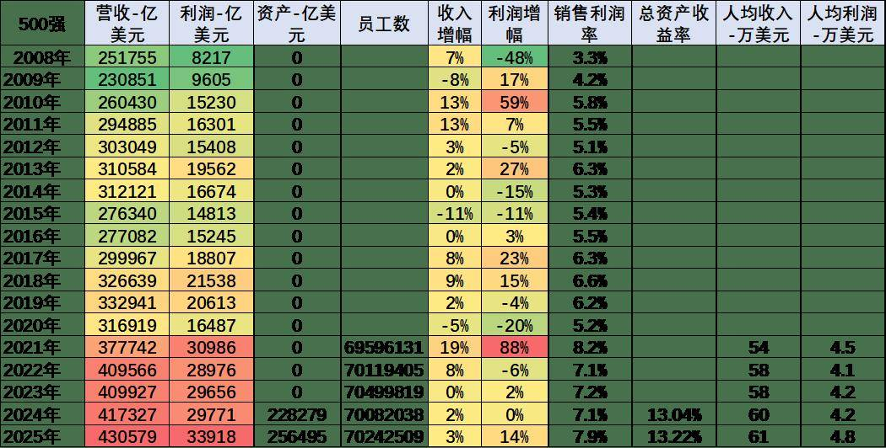

今年《财富》世界500强排行榜发布，今年上榜门槛从322亿美元增长至332亿美元，较一年前提高3%。500家公司的营业收入总和约为43.1万亿美元，比去年增长约3.2%。

2008 至 2025 年，全球 500 强企业整体营收与利润呈现震荡上行的长周期特征，先后经历多轮外部环境冲击。2008 年金融危机直接导致企业利润大幅下滑 48%，2009 年市场缓慢修复，2010 年迎来利润 59% 的大幅反弹；2015 年大宗商品下行、2020 年疫情冲击两次造成营收、利润双收缩，是周期内两大低谷。

自 2021 年起行业盈利水平显著抬升，当年利润增幅高达 88%，销售利润率跳升至 8.2%，后续虽小幅回落但始终维持 7% 以上的稳健水平，2025 年利润率进一步提升至 7.9%。人员规模稳定在 7000 万左右，人均创收从 54 万美元增长至 61 万美元，人均利润同步升至 4.8 万美元，资产总额在 2024 年后纳入统计并突破 22 万亿美元，总资产收益率稳定在 13% 以上，反映出头部企业规模扩张的同时运营效率持续优化，抗周期盈利能力不断增强。

2、中国公司表现优秀

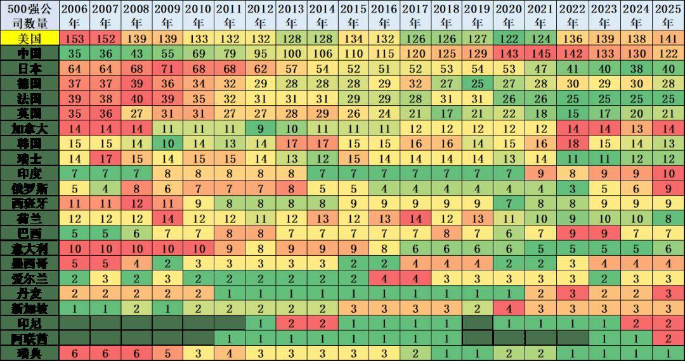

从数量看，中国的世界500强公司增长极其迅猛，这其中包含5家台湾省公司。2007年就有28家中国大陆企业进入世界500强，而到2013年，就有95家大陆企业进入世界500强，这是中国经济发展的高速黄金期；2014-2017年，中国的世界500强企业相对稳定的小幅增长；2018年进入500强企业大幅增长；2021年世界第一；2022年达到145家，遥遥领先；2026年统计的2025年122家，中国部分企业低调退出评选。

而美国进500强企业在2007年有153家，2009年下降到139家，2014年开始世界500强的美国企业，回落到120家左右，今年统计的有141家，表现较强。

中国是世界唯一独特的、持续发展的经济大国。印度、巴西、俄罗斯等发展中国家跟中国完全不在一个层次，其世界500强的企业，过去十年基本没有增长，因此金砖四国的概念我觉得意义不大。

3、中国历年500强公司变化

随着中国新能源车的发展，中国汽车产业链进入世界500强的逐步增多。2021年是比亚迪进入500强，2022年的宁德时代和立讯精密等汽车新能源零部件企业进入。2023年是奇瑞进入世界500强，但同时新疆广汇退出了世界500强，体现了行业的变迁。

2024年中国中华、中航等中字头企业更为低调，25年中国兵器等退出世界500强，其中绝大部分是很优秀的，只是低调。

4、500强总规模变化

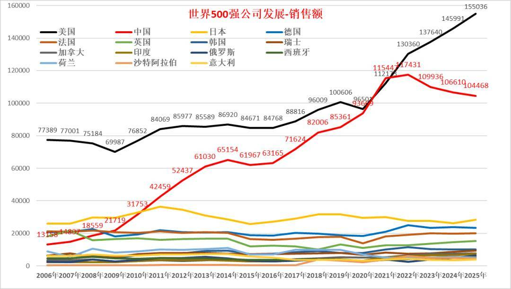

近几年世界500强企业财富增长迅猛，尤其是中国公司表现突出。自2009年以来，中国500强公司的总销售收入持续快速增长，好于美国企业，但近期因主力中字头集团不参与，加之房地产伤害财富巨大，因此中国规模暂时调整；而可以看到日本企业、德国企业等世界500强表现相对平稳，甚至像德国、法国、英国等企业的500强的表现相对疲软。

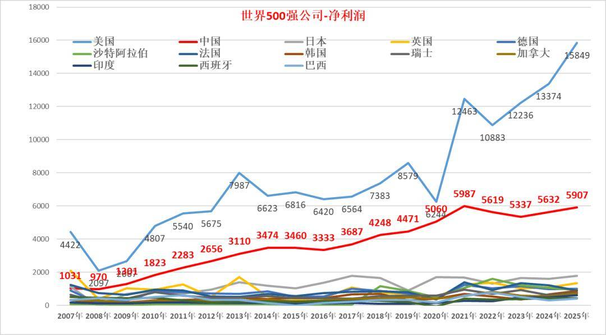

2021年中国公司利润持续保持高位，主要是产业优势明显，近期地产等个别行业出现破产特征。而美国的公司利润波动巨大。其他国家的走势分化，日本企业表现一般，其他国家的企业利润明显反弹。2025年的中国企业利润保持高位相对提升较大。

5、500强企业分布变化

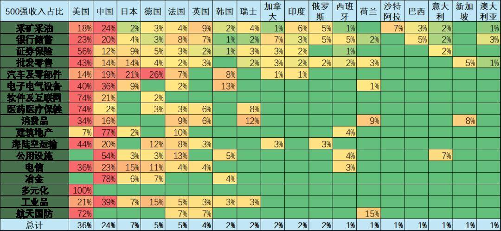

中国的500强企业主要是冶金、建筑、电子设备、航天、采矿等领域。

美国强的是医药、医疗保险、批发零售，软件、消费品等。过去日本相对中国更强的是汽车和批发零售领域，今年都被中国超越。

德国的汽车相对中国相近，但医药医疗上较强。

中国企业产业结构调整有独特优势，尤其是建筑地产表现突出。作为参照，美国大公司中的房地产、工程建筑和金属冶炼企业明显落后。在IT、生命健康和食品相关等领域存在众多大公司，中国正好与此形成反差，尤其在卫生健康、食品批发、保险管理式医疗、食品生产加工和娱乐等与人的生活和健康密切的产业里，有美欧、日本、巴西等国公司，中国企业还有很大机会。

6、世界500强的分化

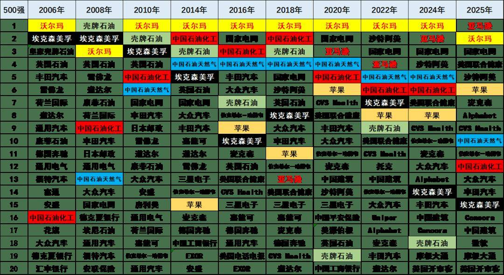

跨度近20年的头部榜单清晰折射出全球产业格局迭代与中美企业力量消长。2006至2018年，传统能源、跨国石油巨头与欧美制造车企长期霸榜，沃尔玛更是常年稳居全球第一，重化工业、传统零售业是全球经济核心支柱，中国仅有中石化、中石油零星进入TOP20。

2020年成为重要分水岭，数字科技企业强势上位，亚马逊、苹果、Alphabet陆续跻身前列，互联网与高科技商业模式重构全球营收版图。与此同时，中国央企竞争力持续兑现，国家电网、中石化、中石油、中国建筑、工行等稳定留在TOP20梯队，在能源、基建领域牢牢占据一席之地。至2025年榜单完成新旧交替，亚马逊登顶榜首，传统石油零售巨头位次下滑，科技龙头占据前排，中美头部企业构成榜单绝对主力，充分反映出全球经济从传统工业驱动向数字科技、新能源与高端服务业转型的长期趋势。。

7、2025年退出500强的企业不多

这是2024年的500强公司没有在2025年体现，部分企业属于主动退出。

2025年又有很多中国企业退出世界500强，这也是因为中字头企业低调，同时企业的兼并重组也是很多企业并入其它企业。

中国部分企业也日益低调，而国家开发银行、中国中化集团、中国建筑集团、正威国际集团、国家开发银行、中国航空工业集团、中国船舶工业集团、招商局集团、中国恒大集团、中国南方工业集团、来宝集团、天津物产集团、光大集团、安邦保险、中国电子科技集团、海航集团、中国华信能源、中国航天科技集团等超级巨无霸的优秀企业，近期没有参加评选，这也影响到整体的效益表现。

二、具体行业分析

1、国防军工是很优秀的

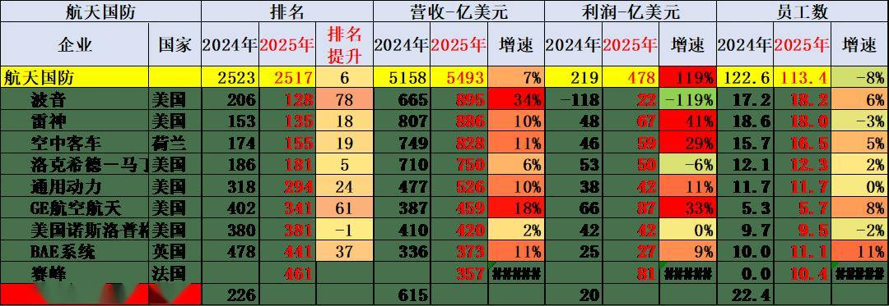

近期中国核心企业退出500强的评选，因此500强的数据不完全体现中国大公司实力。实际中国在世界500强的航天企业中，有中国兵器工业集团、中国航天工业集团、中国电子科技集团、中国船舶工业集团、中国航天科技集团、中国航天科工集团等诸多的优秀企业，这样也使中国企业与美国企业共同成为世界上的一个航天、军工、国防企业中的一个优秀体系，中国体系量相对是超强的。

2、公共基础和投资是很优秀的

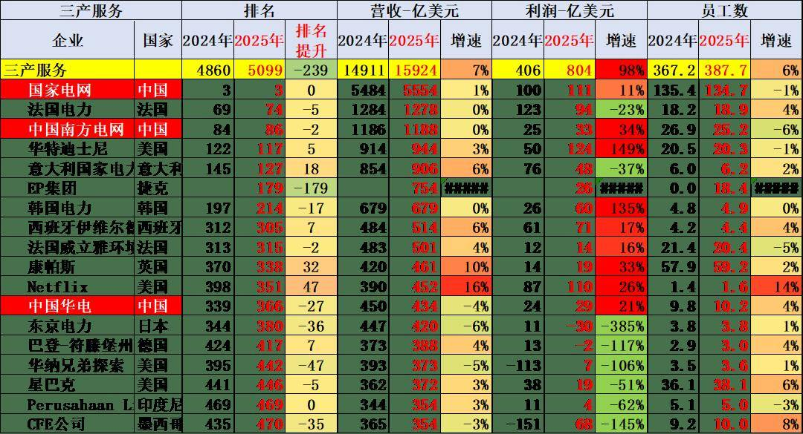

中国有强大的电网体系，从中国的国家电网、南方电网都是世界上领先的，再加上国家电力集团、华电集团等中国电力企业，在目前世界电力企业中，中国企业的地位是极其优秀的特征。

3、建筑地产企业是很优秀的

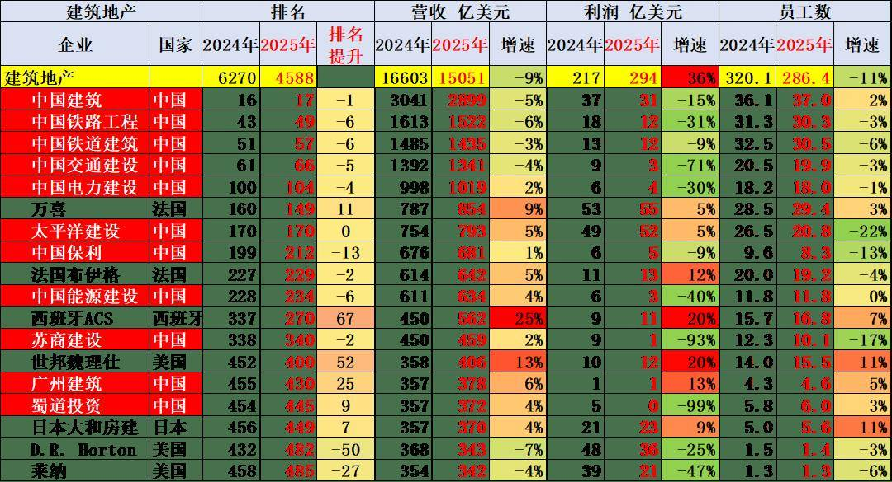

中国企业在世界上最强的就是建筑公司。由于地产的超级繁荣，导致投资规模大，这些房地产企业利润率总体相对较低，倒闭趋势明显。

虽然前期房价暴涨，房企利润并没有充分体现，这是体现企业能力不强，或费用偏高。由于投资巨大，才能托起这样的大的建筑体系，因此债务风险持续体现。恒大、碧桂园、龙湖等都有巨大的压力，目前基本已经退出。

4、证券保险

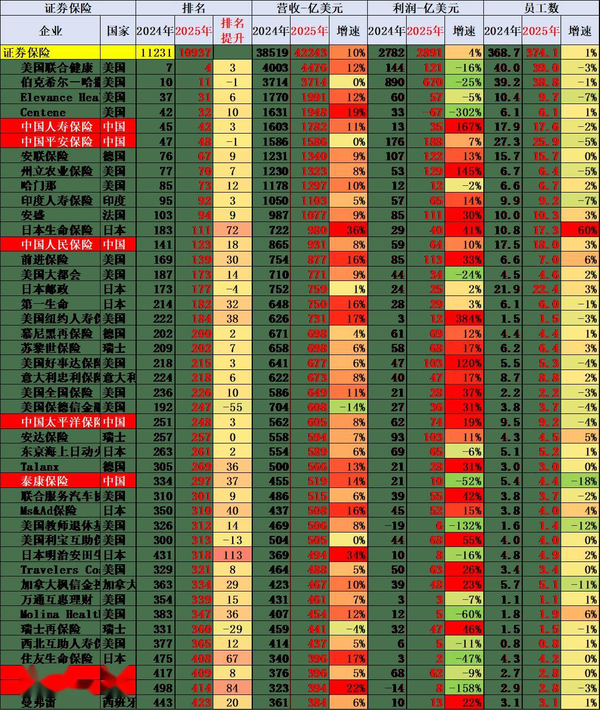

保险业是世界500强公司中占比最高的，中国企业表现很分化，在总共57家企业中，中国企业有7席，倒闭或被拆分也较多。

欧美国家相对强大的是证券和保险业，尤其是有诸多的保险体系，确保消费者财产安全。中国的保险体系也相对保守，有平安、人寿以及太平洋，尤其是中国平安的利润相对丰厚。

5、银行储蓄行业

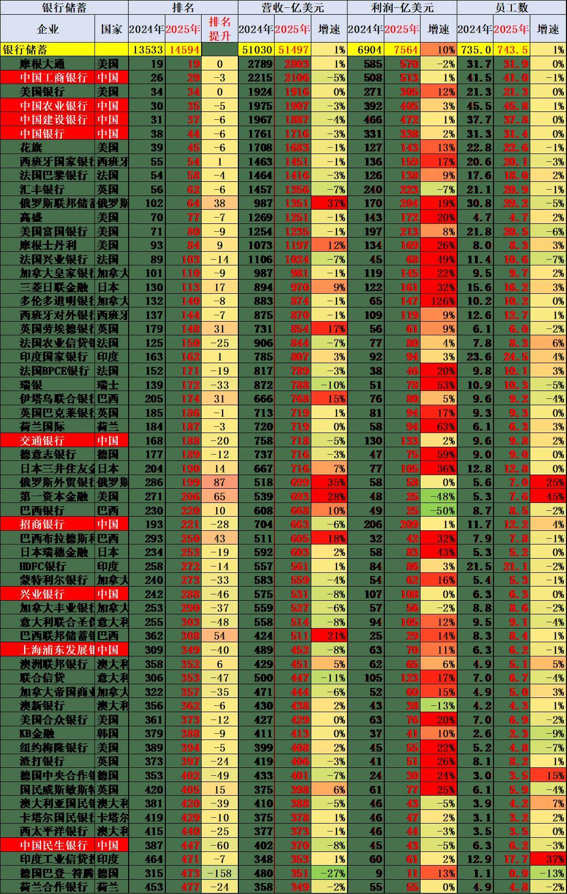

中国几大银行的利润很高，其房地产贷款利润也是偏高的，这对实体经济的增长有很好的平衡效果。

6、批发零售行业

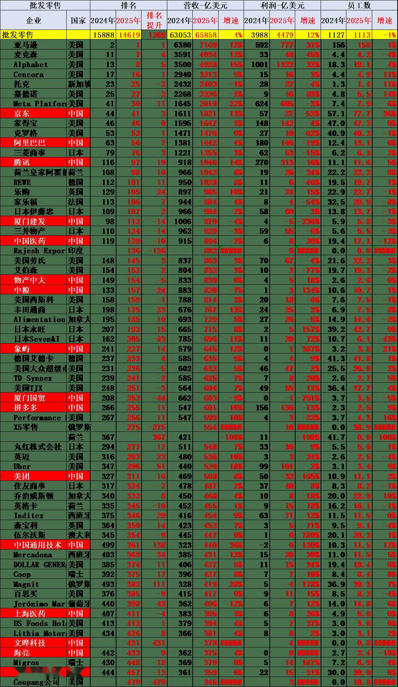

中国的批发零售行业因为分类而表现一般，不过厦门企业还是很好。美国商贸企业的超市零售业表现很好。

亚马逊的表现太强了，京东和阿里、拼多多等表现较好，中国刺激消费也是应该降低房价，刺激实体零售业。

7、采矿采油

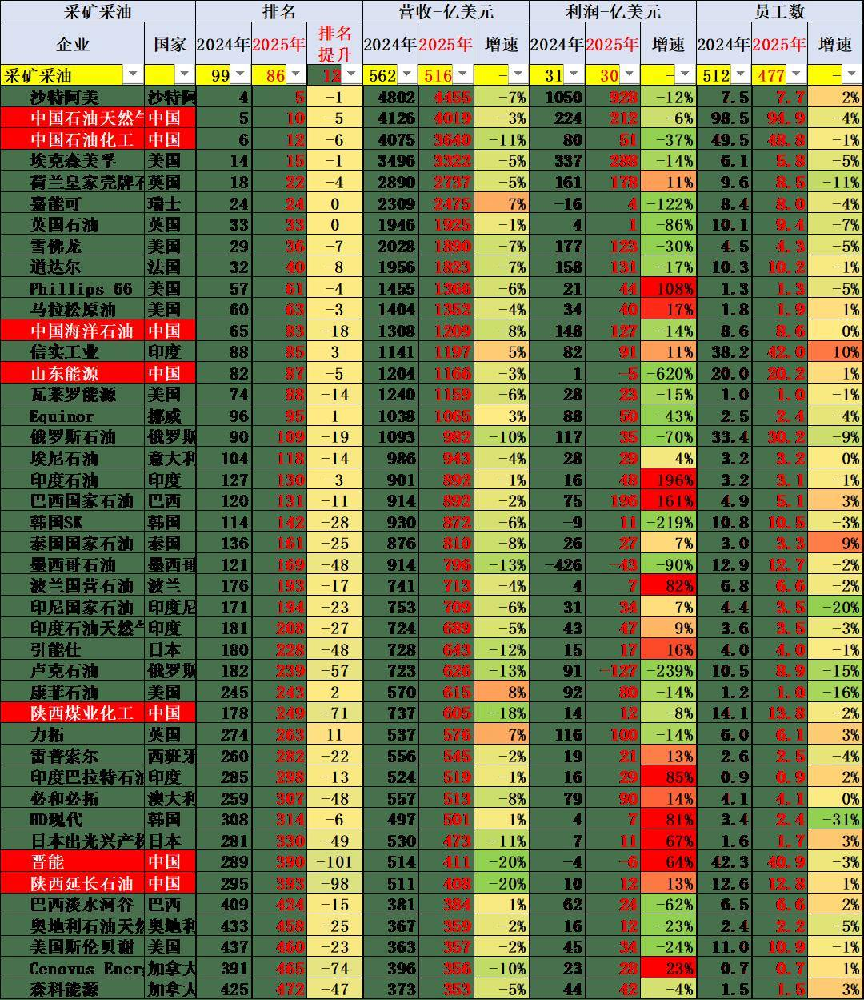

中国石油采油和炼油企业的规模超强，中石化和中石油两家规模都在4000亿美元，再加上中海油、延长石油等诸多能源体系。欧美国家的石油公司，规模比中国差距极大，但是他们的利润比我们好很多。

中国煤炭企业的世界地位也是较好的。值得关注的是澳大利亚的必和必拓和巴西的淡水河谷等企业效益很好，未来等效益下来后应该能有机会收购。

中国的能源企业都是效益较差，但实际运行实力很好。

8、电子电器设备

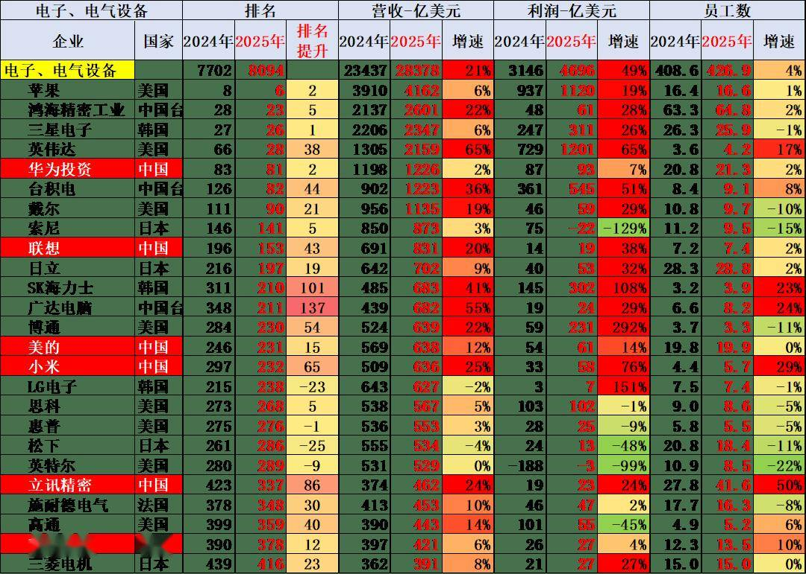

电子产品的利润极其丰厚，苹果的利润率达到24%，三星的利润率达到11%.。而芯片行业英特尔的利润率-35%，中国的台积电的利润率达到40%，因此总体来看，电子消费品的利润潜力极大。

作为世界最大的电子消费市场，中国电子产品制造能力也是超强的，联想、华为以及美的，海尔等进入世界500强。

9、电信领域

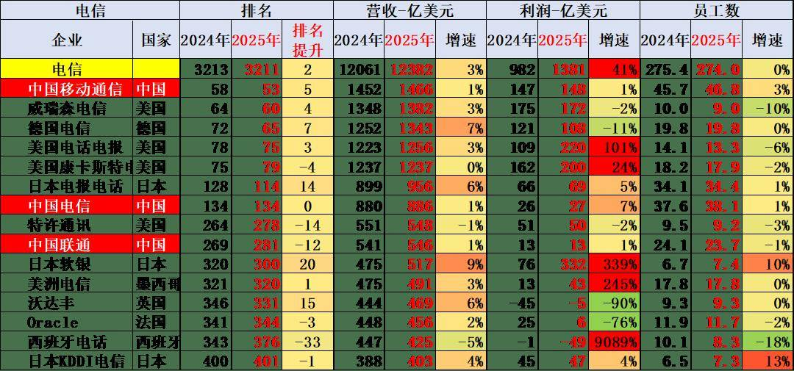

在电信领域，美国的电信企业表现较强，诸多电信企业都是美国企业，中国电信企业只有三家，因此表现的相对较差。

10、互联网企业表现一般

软件及互联网领域，美国企业占有绝对优势，前五位企业都是美国公司，而中国的互联网企业主要起到网络交易平台作用，与亚马逊相近，但京东与阿里巴巴的规模，仍无法与亚马逊相比。

由于缺乏谷歌等强大公司，中国互联网独立发展空间较大。

11、中国汽车企业较强

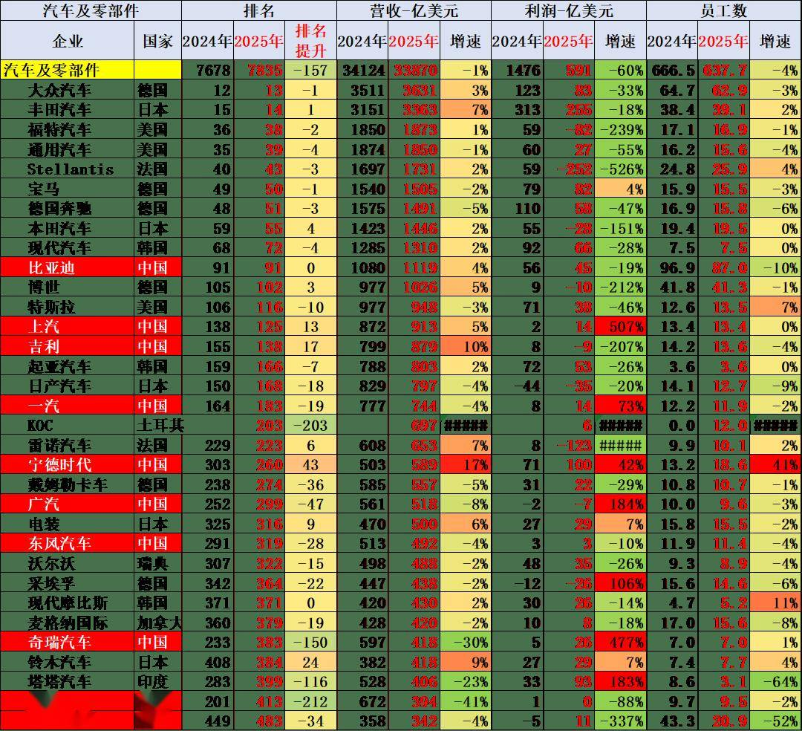

世界主力汽车公司总体表现良好，500强中的汽车公司销售收入稳步提升，中国各大汽车公司总体表现分化。比亚迪保持稳定，上汽从138位上升到125位，、中国一汽集团从164位下降到183位，东风汽车从291位下降到319位，北汽集团从201位下降到413位，广汽集团从252位下降到299位，吉利集团从155位上升到138位。新疆广汇下降到500位以外也是正常的。

中国的新能源汽车集团表现特别好，宁德时代和比亚迪近期的利润暴增，形成内部分流。

12、海陆空运输企业特征

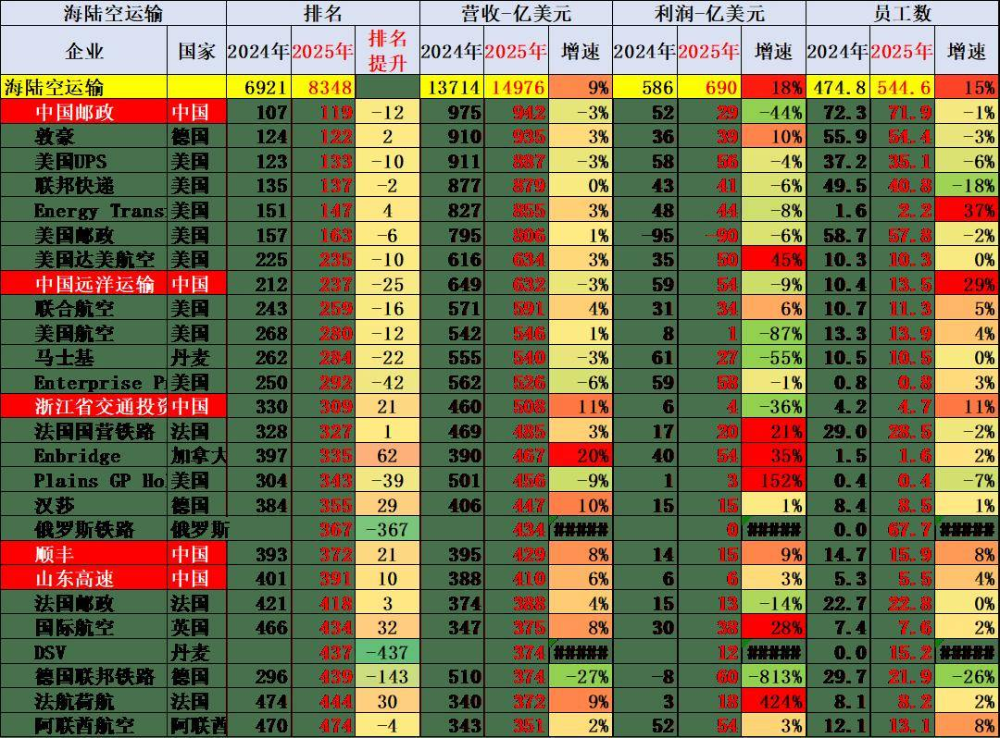

海陆空运输的中国企业表现一般，应该有很多公司是隐含的世界领军。中国铁路、中国航空应该都是世界级的。

13、冶金钢铁企业特征

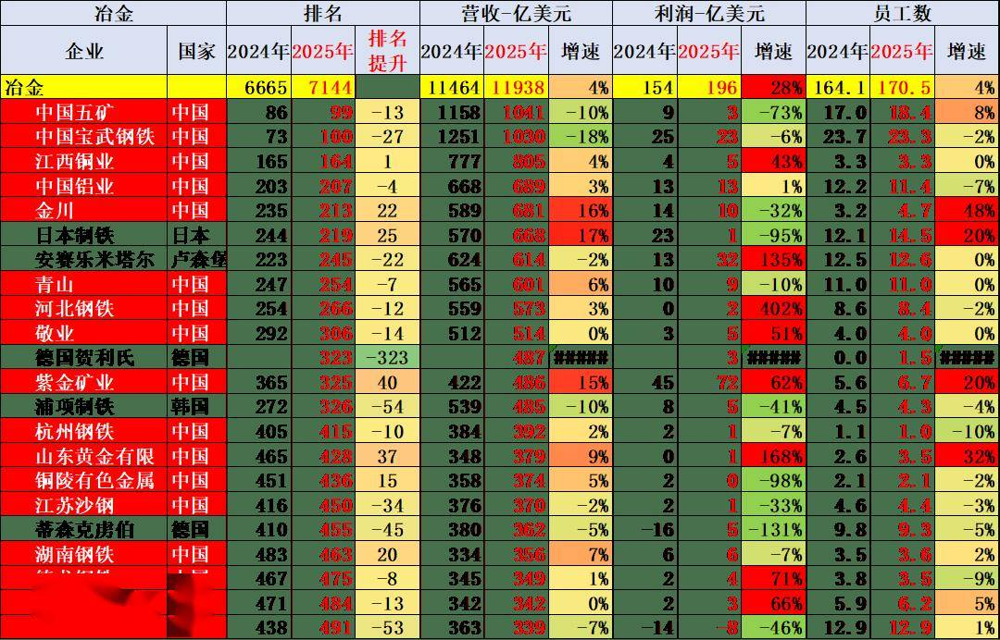

中国冶金企业的世界超强领军地位，各项矿产的需求和冶炼能力超强，尤其是稀土等世界绝对主导地位。

14、中国医药企业较为薄弱

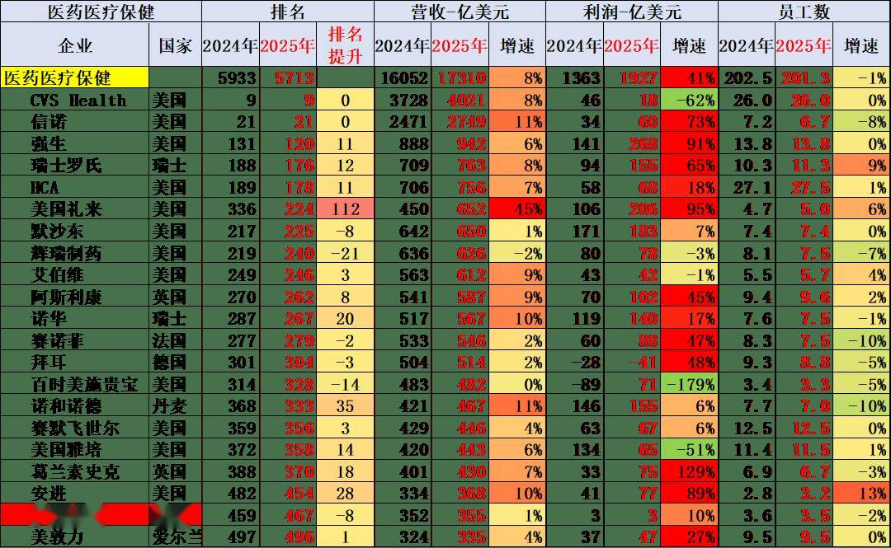

中国的医药企业在世界地位相对并不是很高，除了中国医药集团之外，广州医药表现相对较强，而可以看到像美国、瑞士等医药企业相对比较强，中国的医药企业在疫情之后没有获得一个大幅提升的特征。

15、中国消费品行业较为薄弱

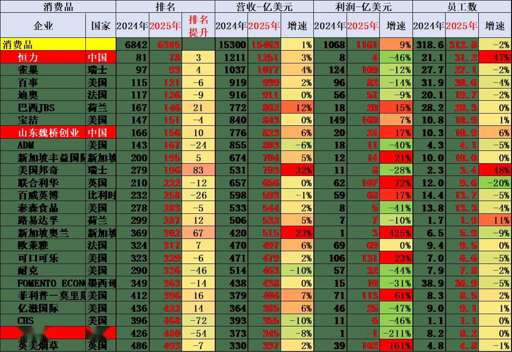

中国的消费品行业，龙头品牌相对较少。总体来看，被归纳到此类的产品相对偏少一些，而像雀巢、百事等美国产品，以及像英国等一些这样的产品应该说总体表现都是相对较强的。

16、中国工业品行业较丰富

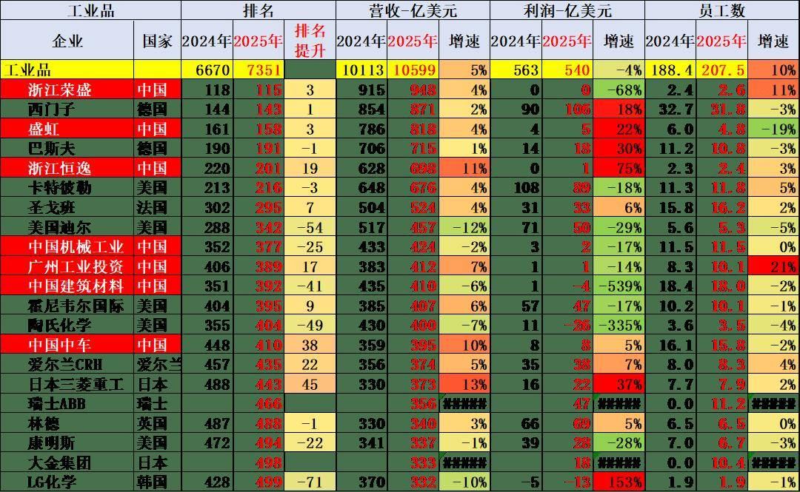

在工业品领域，中国的表现相对来说也是偏以机械和建筑领域为主的特征，尤其像中国建筑以及海螺型材等这些企业表现来看属于这个特征。

17、中国特色行业较强

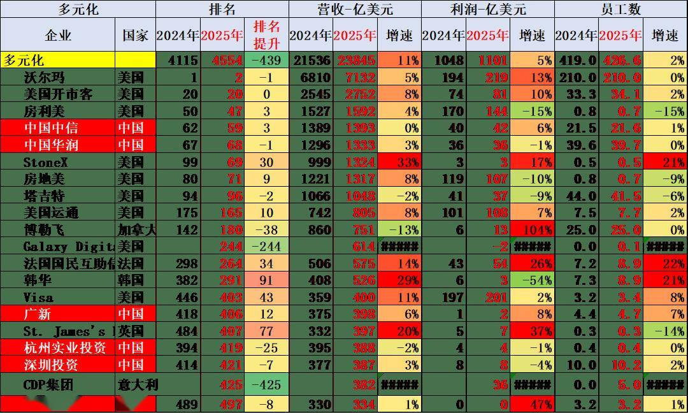

随着卖地收入的前些年暴增，城投公司体量暴增，这些中国优秀企业快速崛起，尤其是随着房地产资产等的高价值化，城市投资公司的实力大幅增强。

附：近日信息合集
