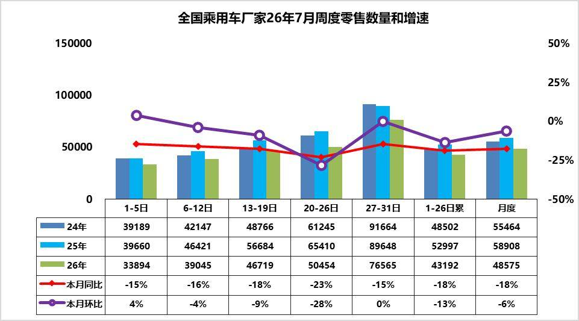
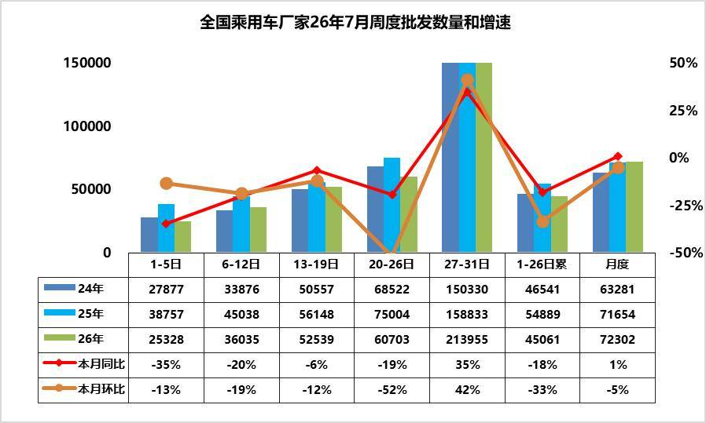
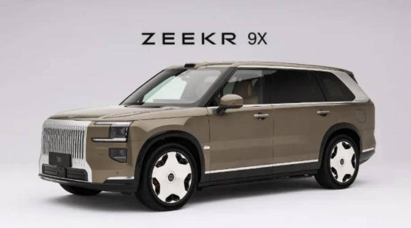
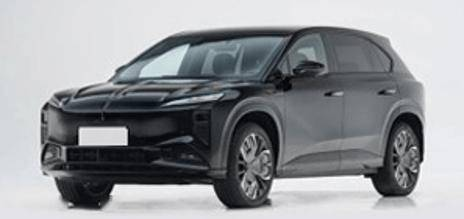
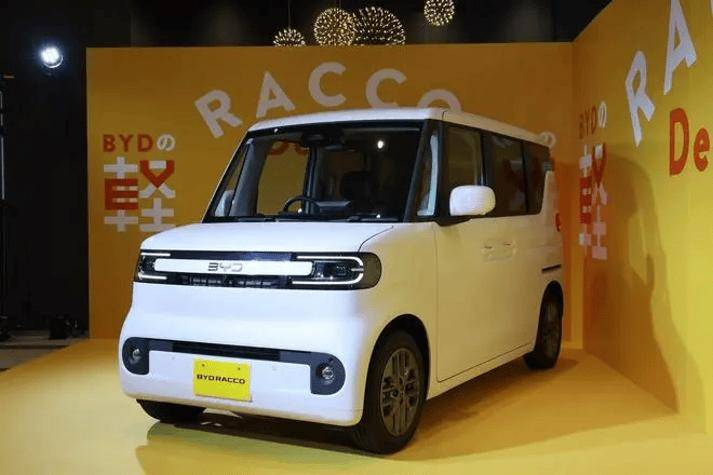

# 车市扫描-2026年29期（7月27日-7月31日）

- 公開日時: 2026-08-05 17:09（北京時間）
- 出典: [搜狐号・崔东树](https://www.sohu.com/a/1059150111_115312)
- テーマ（自動判定）: 車市スキャン（週次）
- 画像: 5枚

---

主要信息源自乘联分会每日新闻等

中国汽车流通协会

乘用车市场信息联席分会（乘联分会）

网站：http://www.cpcaauto.com

一、本周车市概述1.2026年7月全国乘用车市场零售相对平稳

【2026年7月1-31日乘联会市场分析要闻】

7月1-31日全国乘用车厂家批发224.1万辆，同比去年同期增长1%，较上月同期下降5%；今年以来累计批发1478.8万辆，同比去年同期下降5%。7月1-31日市场零售150.6万辆，同比去年同期下降18%，较上月同期下降6%；今年以来累计零售1020.7万辆，同比去年同期下降20%。

7月1-31日全国乘用车厂家新能源批发146.3万辆，同比去年同期增长24%，较上月同期下降1%；今年以来累计批发825.1万辆，同比去年同期增长8%。7月1-31日新能源车市场零售97万辆，同比去年同期下降2%，较上月同期下降4%；今年以来累计零售567.5万辆，同比去年同期下降12%。

2026年7月1-31日全国新能源市场零售渗透率64.4%；新能源厂家批发渗透率65.3%。

7月第1-5周全国纯燃料轻型车生产42.2万辆，同比去年同期下降54%，较上月同期下降13%。7月第1-5周混合动力与插混总体生产37.1万辆，同比去年同期下降18%，较上月同期增长0%。

7月第1周乘用车市场日均零售3.4万辆，同比去年同期下降15%，较上月同期增4%。

7月第2周乘用车市场日均零售3.9万辆，同比去年同期下降16%，较上月同期降4%。

7月第3周乘用车市场日均零售4.7万辆，同比去年同期下降18%，较上月同期降9%。

7月第4周乘用车市场日均零售5.0万辆，同比去年同期下降23%，较上月同期降28%。

7月第5周乘用车市场日均零售7.7万辆，同比去年同期下降15%，较上月同期降0.1%。

7月1-31日市场零售150.6万辆，同比去年同期下降18%，较上月同期下降6%；今年以来累计零售1020.7万辆，同比去年同期下降20%。

7月终端零售处于传统淡季，整体消费需求偏弱，成为批发数据走弱的核心根源。世界杯叠加盛夏高温天气导致线下到店客流锐减，无节假日消费加持，市场自然购车需求低迷，消费者观望情绪浓厚，家庭换购周期拉长，新车刚需释放不足。同时上半年终端价格战持续透支市场，车企、经销商优惠力度常态化，消费者持币待购心态加剧，进一步压制终端成交规模。受零售疲软影响，经销商库存周转效率降低，库存压力持续累积，倒逼渠道端减少向厂家拿货，形成“零售弱—补库弱—批发降”的连锁传导效应。

终端市场存在局部结构性回暖亮点，支撑整体市场基本盘。暑期毕业购车、家庭自驾出行带动家用轿车、SUV及代步新能源车刚需小幅释放，稳住基础零售量。此外，全国置换补贴政策持续落地，有效撬动老旧车型置换需求，为中端车型零售提供增量支撑。新能源车型凭借产品迭代、政策红利及性价比优势，市场韧性显著优于燃油车，持续对冲燃油车零售大幅下滑的缺口，缓解终端市场整体下行压力,7月增速下滑幅度好于6月。

2.2026年7全国乘用车厂家销量平稳

7第1周批发日均2.5万辆，同比去年7月同期下降35%，环比上月同期降13%。

7第2周批发日均3.6万辆，同比去年7月同期下降20%，环比上月同期降19%。

7第3周批发日均5.3万辆，同比去年7月同期下降6%，环比上月同期降12%。

7第4周批发日均6.1万辆，同比去年7月同期下降19%，环比上月同期降52%。

7第5周批发日均21.4万辆，同比去年7月同期增35%，环比上月同期增42%。

7月1-31日全国乘用车厂家批发224.1万辆，同比去年同期增长1%，较上月同期下降5%；今年以来累计批发1478.8万辆，同比去年同期下降5%。

7月厂家销量核心压制因素集中在淡季市场特征凸显，6月车企半年冲量提前透支市场需求，叠加去年同期行业高基数，大幅拖累本期批发数据。同时油价异常上升，终端需求疲软、渠道库存偏高，经销商现金流承压，主动补库意愿低迷，车企压库难度加大，多数品牌选择控产减量，进一步拖累批发出货量。

当前批发端有结构性支撑因素，对冲部分下行压力。政策层面，汽车以旧换新、地方购车补贴持续落地，叠加新能源新国标实施，合规新款车型集中铺货，为厂家批发提供结构性增量。生产层面，7月工作日相对充足，部分车企依托稳定产能保障新品出货，同时汽车出口持续维持高景气，海外订单有效分流国内富余产能，成为批发端重要托底力量。整体来看，利好以结构性对冲为主，暂时无法有效扭转国内批发总量下滑的整体态势。

3.2026年1-6月中国占世界汽车份额31%

根据世界汽车组织统计数据，全球汽车生产不断增长，2025年达到9638万台，较2024年的9272万台增4%，中国占世界生产份额36%。根据我们统计2025年全球汽车销量9689万台，同比增长6%。2026年6月的世界汽车销量达到860万台，同比增6%。2026年1-6月世界汽车销量达到4786万台，同比增3%。

随着美国、中国车市的年初相对负增长，2026年1-6月世界车市销量增长不强。2025年中国达到世界汽车的35.4%的份额；2026年初的中国份额31.4%，2026年初，中国汽车销量下滑较大，随着政策补贴促进中国商用车走强，6月份额回升到32.7%。年初较低是入门级销量萎缩因素的异常体现，乘用车弱、商用车强，出口暴增。期待能有改善低端收入和减少抑制低端消费政策，随着政策刺激效果逐步恢复显现，预计未来中国车市逐步走强。

2026年1-6月的全球汽车销量增3%，其中中国汽车销量下降4%，美国销量下降3%，印度汽车市场销量增19%，泰国汽车市场增14%，俄罗斯市场销量增10%，越南增31%。新兴市场拉动市场表现较好。

东升西降，除了丰田、现代起亚、铃木和塔塔等，其它国际品牌份额2026年出现较大幅下滑。相对于2019年的中国自主品牌全面提升世界份额。吉利、比亚迪、奇瑞、上汽、长安等自主表现较强。电动化发展也导致部分国际车企逐步走向衰落。除了铃木等印度市场较好的因素促进，其它国际品牌份额出现全面较大的下滑。

4.2026年6月乘用车区域市场流向收缩

在国家“两新”政策拉动乘用车内需消费的政策强力调整和高油价冲击环境下，2026年上半年全国乘用车零售市场呈现出低端消费萎缩、被动消费升级下的分化增长特殊走势。国内车市结构性下滑与区域消费政策的差异化，正深刻重塑国内乘用车区域市场的发展格局。

各地车市运行呈现四大核心特征：一是补贴政策对高端消费的拉动效应显著，经济型车市场持续低迷，轿车市场出现明显收缩，中西部消费潜力最大的地区总量下滑最大；二是高油价下的区域消费增长分化加剧，北方地区增长潜力可观但当期市场表现偏弱，华东、华南市场明显改善；三是油电混合动力车型成为部分区域市场的增长主力，插电式混动车型走势显著低迷；四是2026年高端车型、大空间三排座车型表现相对较强，北京、上海、广东等省市的大型SUV市场增长尤为突出。

5.2026年6月俄罗斯车市分析-自主车企份额55%

2026年6月俄罗斯汽车销量达12.2万辆，同比增22%。1-6月俄罗斯汽车销量达到66万辆的较高水平，同比增10%。2026年6月中国出口俄罗斯8.44万辆，自主品牌俄罗斯销量6.7万辆，当地销量是中国出口的80%，1-6月中国出口俄罗斯44.8万辆，自主品牌俄罗斯销量36万辆，当地销量是中国出口的81%，总体相对平衡。

2026年中国自主品牌在俄罗斯份额达到54.6%的较高水平，效益不错。2026年的国际车企的车型大量进入，德系和日系的表现较强，韩系的优势弱化。2026年6月自主车企在俄罗斯份额仍有54.9%，处于2026年峰值水平。面对俄罗斯的复杂环境，自主品牌多生孩子好打架的战略意义重大。自主品牌的整车官方出口，平行出口、绕道出口、本地化建厂、合资组装等各种模式齐上阵，大量的品牌群狼作战，实现了很好的效果。中国自主新能源车销量在俄罗斯车市总体表现是不错的，尤其是以增程式插电混动等高端车型，实现替代了欧美的豪华车的良好表现。新能源车中表现比较突出的是长安、极氪、岚图等品牌，这些品牌表现相对是极强的特征。而问界，比亚迪、小米等品牌也有一定的销量的表现。

中国车企在俄罗斯加速本土化生产与供应链重构，多项举措改善状态。首先是针对俄罗斯进口关税阶梯式上调深化KD组装模式，建立区域生产基地。通过本地化生产规避关税并缩短交付周期。搭建区域配件中心仓，将核心部件本地化率提升至60%以上，降低供应链风险；其次做好产品提升技术适配与极寒环境专项研发。针对俄罗斯零下50℃极寒气候及复杂路况，强化低温电池管理系统、全地形底盘调校及防腐蚀工艺，通过防腐工艺将故障率降低；第三是做好全渠道售后服务体系升级。针对俄罗斯偏远地区维修响应滞后问题，构建“中心仓+移动服务车+授权修理点”三级网络，提升服务覆盖率至90%以上；第四是品牌价值重塑与精准营销。通过技术背书与场景化营销建立高端形象，同时开发欧亚跨境电商平台，提供线上选配+线下提车服务，并利用人民币结算体系降低汇率波动影响。

6.2026年6月锂电池全口径需求分析

2026 年上半年锂电池全口径总需求达106890 万度，同比大幅增长53%，行业增长由过去新能源车单一拉动转向储能、海外出口、商用车多元支撑新格局。新能源车合计需求79319 万度，同比增长37%，但国内新能源乘用车零售需求同比小幅下滑2%，正式步入存量竞争；整车出口、动力电池出口市场成为增量。锂电池海关出口维持54%稳健增速，新能源商用车内外销同步放量对冲内需疲软。需求结构显著重构，新能源车需求占比回落至74%，储能占比升至26%，储能与海外市场成为支撑行业高景气的核心支柱。根据产销测算的储能等需求是行业最大增长引擎，上半年需求27571 万度，同比暴涨130%，6月单月增速高达333%；高油价和风光新能源的发展带来了储能的爆发。

二、本周上市新车1.极氪9X五座版上市权益后限时售45.19万-56.59万元

7月28日，极氪9X五座版上市，新车共推3款，售价区间为47.19万-58.59万元，权益后限时售45.19万-56.59万元。新车依旧延续六座版车型的设计。配备Zeekr AI OS 7座舱系统、32扬声器Naim音响、后排双零重力座椅等。搭载2.0T插混系统，双电机版CLTC纯电续航为288km，三电机版CLTC纯电续航为355km。

2.新款红旗天工08 670 Max上市限时权益价17.99万元

三、宏观经济与政策1.工信部：废止和修订新能源汽车废旧动力电池“梯次利用”相关政策标准

7月30日，工信部发布公告，废止《新能源汽车废旧动力电池综合利用行业规范条件(2024年本)》中“梯次利用”有关条款，不再开展“梯次利用”企业公告管理，将已公告的“梯次利用”企业移出符合新能源汽车废旧动力电池综合利用行业规范条件的企业名单，已公告的再生利用企业名单继续有效。

2.工信部印发《工业绿色低碳发展“十五五”规划》

7月31日，工信部印发《工业绿色低碳发展“十五五”规划》。其中提出，有序推动传统能源汽车节能与低碳燃料技术迭代，加快智能网联新能源汽车向全气候、全场景应用发展。鼓励企业在新能源汽车出口主要市场布局废动力电池综合利用产能。到2030年，新能源汽车废动力电池年综合利用量达到百万吨以上。

3.工信部装备工业一司赴奇瑞、蔚来、江汽开展监督检查

7月30日至31日，工业和信息化部装备工业一司赴奇瑞汽车股份有限公司、蔚来汽车科技（安徽）有限公司、安徽江淮汽车集团股份有限公司开展道路机动车辆生产企业产品安全保障能力和生产一致性监督检查。

4.国家能源局：6月底充电基础设施（枪）总数达2305.7万个

7月28日，国家能源局发布2026年上半年全国电动汽车充电设施数据。截至2026年6月底，我国电动汽车充电基础设施（枪）总数达到2305.7万个，同比增长43.2%。

5.国家统计局：1至6月汽车制造业营收同比增长1.8%

7月27日，据国家统计局发布数据显示，今年1至6月，全国规模以上工业企业实现利润总额39479.9亿元，同比增长18.7%，较一季度加快3.2个百分点。其中，汽车制造业营业收入同比增长1.8%，营业成本同比增长2.8%，利润总额同比下降19.5%。

6.统计局：7月份制造业PMI为49.2%

7月31日，统计局发布数据显示，7月份，制造业PMI为49.2%，比上月下降1.1个百分点。

7.北京下半年小客车指标配置申请8月1日启动

北京市2026年下半年小客车指标配置申请8月1日启动，持续至10月8日。

8.西安：新车二手车都有补贴

据“西安发布”，8月1日起，西安汽车消费补贴政策升级。个人消费者购买纳入《减免车辆购置税的新能源汽车车型目录》的新能源乘用车，按照购车发票价格的2%给予补贴，最高补贴1万元。个人消费者购买二手乘用车，按照购车发票价格的1.5%给予补贴，最高补贴4000元。

9.扬州主城区四地联动汽车购新补贴

7月31日，扬州市正式推出主城区2026年汽车购新促消费专项活动，面向个人购车消费者发放购车专项补贴，单车最高补贴10,000元。活动覆盖江都区、邗江区、广陵区、经开区四大主城区，活动周期自2026年8月1日起至12月31日，补贴资金实行先到先得、领完即止。本次专项补贴总规模2000万元，额度按区域分配。

四、企业信息1.比亚迪、吉利获首批L2辅助驾驶新国标认证

7月28日，比亚迪、吉利汽车官宣，获汽车行业首批国家汽车生产组织组合驾驶辅助安全管理体系认证。

2.比亚迪日本特供K-Car海獭RACCO正式上市

比亚迪7月28日在东京举办新车发布会，正式发布专为日本市场打造的纯电微型车RACCO（中文命名海獭），精准对标日系本土K-Car车型，补贴后入门价约8.24万元人民币，CLTC纯电续航210公里。搭载日语原生交互界面，兼容当地高速ETC、停车支付生态。

3.保时捷回应中国市场下滑31.93%

今年上半年，保时捷在华交付了14501辆汽车，同比下降31.93%。保时捷管理层表示，该公司对中国市场持审慎保守判断，坚持价值优先，不以销量规模为导向。

4.长安科技终止原增资扩股方案

7月31日，长安汽车公告称，因全资子公司长安科技智能化创新超预期，决定终止原增资扩股方案，将尽快启动新一轮市场化融资。

5.东风日产与万达广场签署战略合作

7月28日，东风日产与万达广场签署战略合作框架协议。万达广场将向东风日产开放线上线下全域营销渠道，东风日产将在全国重点城市的万达广场落地长周期商超慢闪店。

6.东风汽车发布自研300kW千伏电驱

7月29日，东风全球创新中心下线两款自主研发产品：300kW千伏电驱样机和1500kW兆瓦超充桩样机。千伏电驱样机搭载1500V耐压SiC功率模块，工作电压范围为450V至1000V，峰值功率达300kW，兼容800V平台并可扩展至1200V。兆瓦超充桩为东风首款全自研大功率充电设备，配备1.2MW主机，支持并柜扩展。

7.广汽集团持股广爱保险经纪获批

广东金融监管局发布行政许可信息。广爱保险经纪成立于2006年6月7日，注册资本6000万元。广爱保险经纪大股东为众诚汽车保险股份有限公司，持股50.2%；广汽集团全资子公司广汽商贸有限公司持股24.9%；爱和谊日生同和保险公司持股24.9%。

8.广汽丰田召回15266台铂智7

8月1日，国家市场监督管理总局缺陷召回中心发布公告，广汽丰田召回铂智7纯电动汽车，共计15266辆。本次故障根源为车辆智能蓝牙模块软件程序设计存在漏洞，车辆行驶过程中蓝牙模块会随机发送异常控制指令，导致变速箱自动从D前进档跳至N空挡，动力直接中断，高速、坡道行驶时极易引发追尾、溜车交通事故，存在重大行车安全风险。

9.吉利汽车集团成立销售总公司

吉利控股集团宣布，吉利汽车集团成立吉利汽车集团销售总公司，下设中国星、银河、领克、极氪销售公司等6个集团一级组织。林杰担任总经理。

10.零跑正式登陆印尼市场

零跑携B10及C10亮相2026印尼国际车展，正式登陆印尼市场，同时与印尼Indomobil集团启动本地化KD组装生产。

11.理想汽车OTA 9.1版升级

理想汽车OTA 9.1版本推送，将带来31项新增功能和10项体验优化，此次升级面向新款理想L6、全新理想L8和全新理想L9。推出两种辅助驾驶风格可选。优化障碍物占道、前车临时停靠等场景绕行策略。夜间行车新增多场景主动灯光预警功能等。

12.岚图发布中国首款全地形智能底盘“虎踞”

7月29日，岚图汽车在内蒙古阴山完成全地形穿越实测活动，同步公布旗下自研全域底盘“虎踞”。岚图虎踞底盘名称取自成语龙蟠虎踞，底盘兼顾越野行驶与城市通勤两种使用场景：越野场景下可适应各类复杂地形，城市日常驾驶时车身操控平顺。

13.上汽两公司同日换总经理

7月28日，上汽通用汽车宣布，原华域汽车系统股份有限公司总经理徐平接替卢晓，担任上汽通用汽车总经理。同时，上汽乘用车宣布，原上汽通用汽车有限公司总经理卢晓接替王骏，担任上汽乘用车总经理。

14.魏牌V9X首次OTA升级

15.小鹏集团官宣澳大利亚长期战略

7月27日，小鹏集团正式官宣澳大利亚长期战略。未来6个月，将在澳大利亚推出5款全新车型，还将在澳大利亚布局3家旗舰智能科技体验中心及50个销售网点；小鹏图灵AI智驾（NGP）计划于2027年登陆澳洲。

16.小米发布昆仑全域技术架构

7月30日小米汽车在鹏程举办大型技术发布会，正式对外推出小米昆仑全域技术架构，分为三大核心板块：昆仑整车平台、昆仑超级增程系统、昆仑全域安全体系，其中超级增程系统综合续航突破1400公里，亏电油耗低至5.8L/100km。

17.一汽红旗官宣人事调整

7月28日中国一汽官方发布人事公告，原一汽丰田副总经理、销售公司总经理聂强调任红旗品牌CEO，全权统筹红旗全系销售渠道、售后服务、品牌市场、用户运营全链条业务。

五、行业信息1.7月27日起新认证车型全面禁用“小蓝灯”

国家机动车灯具国标更新落地，明确禁止乘用车搭载蓝色外部灯光，市面上主流车型智能驾驶状态提示“小蓝灯”不符合法规，即日起新申报认证车型不得装配，在售老款车型后续通过OTA整改灯光逻辑。车辆外部照明、信号装置仅允许使用白、黄、红、琥珀色四类光源。

2.2026年1-6月汽车行业利润率3.8%

7月27日，乘联分会崔东树发文表示，2026年1-6月的汽车行业收入51893亿元，同比增1.8%；成本46100亿元，增2.8%；利润1954亿元，同比降20%；汽车行业利润率3.8%，相对于下游工业企业利润率6.5%的平均水平，汽车行业仍偏低。

3.曹操出行正式开放Robotaxi主驾无安全员测试

7月27日，曹操出行宣布正式开放Robotaxi主驾无安全员测试。本次测试在杭州市滨江区的真实城市道路环境开展，采用特定站点触发派单的运营机制，旨在小规模、可控条件下验证主驾无安全员运营的稳定性与服务可靠性。

4.禾赛科技获长城汽车全新定点

7月30日，禾赛科技宣布，其车规级超远距超千线激光雷达产品ETX已获得长城汽车的全新定点项目。按照计划，该产品将于2026年底启动量产并开启交付。

5.百度萝卜快跑携手Uber、Lyft落地英国伦敦

7月28日，Lyft旗下欧洲出行平台Freenow宣布，其已携手百度萝卜快跑在英国伦敦启动Robotaxi（自动驾驶出租车）车辆测试。Uber也表示萝卜快跑的车辆已驶上伦敦道路。

6.Momenta Robovan在苏州相城开启规模化运营

Momenta宣布旗下Robovan业务正式落地苏州相城。Momenta Robovan基于自主研发的R7世界模型打造，已向快递配送、夜间配送等场景快速推进，打通城市“最后一公里”。

7.宁德时代与平陆运河集团签署战略合作协议

8月1日，宁德时代与广西平陆运河集团签署战略合作协议。9月正式投运后，平陆运河集团将全面推行电动船舶通航管理。首批试运营的电船将搭载宁德时代船用动力电池系统。宁德时代还将与平陆运河集团共同运营“电池银行”租电服务。

8.宁德时代旗下时代绿色能源公司增资至35亿元

时代绿色能源有限公司发生工商变更，注册资本由20亿元增至35亿元。该公司成立于2006年，经营范围包含：海上风电相关系统研发；风电场相关系统研发；新兴能源技术研发；在线能源监测技术研发等，由宁德时代全资持股。

9.天齐锂业增资至约17.06亿元

7月28日，天齐锂业股份有限公司发生工商变更，注册资本由约16.41亿人民币增至约17.06亿人民币。

10.vivo数字车钥匙已拓展多品牌整车用户

近日，vivo数字车钥匙功能完成对广汽丰田车型的适配工作，首批适用车型锁定为今年3月上市的纯电轿车铂智7。后续该品牌旗下更多车型也将逐步纳入支持范围。

六、跨国集团与国际市场1.保时捷：2035年前额外裁减5000个岗位

7月29日，保时捷发布2026上半年财务报告。销售收入172.29 亿欧元，同比下降5.11%；营业利润13.48亿欧元，同比增长33.86%；汽车交付量122,306 辆，同比下降16.5%。

保时捷对外公布2026-2030长期产业规划，确定投入21亿欧元资金保障斯图加特祖文豪森整车工厂、魏斯阿赫研发中心运营至2035年，同时启动自愿离职计划精简5000名岗位，压缩燃油车业务冗余成本。智能座舱、电池、自动驾驶研发团队持续扩招。

2.梅赛德斯-奔驰集团2026年Q2营收321亿欧元

7月28日，梅赛德斯-奔驰集团发布2026年第二季度业绩报告。营收320.61亿欧元，同比下降3.29%，环比增长1.45%；归母净利润10.86亿欧元，同比增长13%，环比下降24.21%；调整后毛利率7.17%，同比提升1.19个百分点；全球乘用车Q2共交付417,765辆，同比下降8%；其中中国98,624辆，同比下降30%；全球纯电车型销量同比增长51%，欧洲纯电车型销量同比增长87%。首席财务官称，预计该公司2026年汽车销量为170万辆。

3.梅赛德斯-奔驰将在美召回超31万辆汽车

美国国家公路交通安全管理局（NHTSA）7月30日发布消息称，梅赛德斯-奔驰美国公司将在美召回310667辆汽车。驾驶员侧车门锁中的微动开关可能发生腐蚀，导致无法检测到车门未关，从而阻止电子驻车制动器或“自动泊车”功能自动启用。

4.宝马在美召回1.67万辆摩托车

美国国家公路交通安全管理局（NHTSA）7月29日公布召回信息，宝马北美公司将召回部分2024款S1000RR美国版及2020年至2026年款S1000RR摩托车，涉及约1.67万辆。受影响车辆的点火锁内部部件可能因摩托车振动发生故障，导致仪表显示屏、后部照明系统以及防抱死制动系统（ABS）等电子系统失效，或在行驶过程中造成发动机熄火。

5.宝马2026上半年净利大跌25.75%

7月30日宝马集团发布2026财年半年报（统计周期2025.7.1-2026.6.30），集团总营业收入622.66亿欧元，同比下滑8.01%；归母净利润28.58亿欧元，同比大幅下跌25.75%，汽车业务自由现金流同比下滑44.99%。宝马中国市场上半年交付量同比大跌30%。

6.本田日产就车载软件合作谈判

本田和日产正在对车载软件领域的合作进行最终阶段的谈判。此次合作计划以日产已开发的部分技术为基础，展开联合开发工作。双方打算统一车载操作系统（车载OS）以及用于电信号控制车辆的电子控制单元（ECU）。

7.法国7月新车注册量同比增长9%

8月1日，法国汽车行业协会数据显示，7月法国新车注册量同比增长9%，达到126808辆。

8.法拉利上调2026年业绩预期

法拉利第二季度营收19.4亿欧元，预估为18.7亿欧元；第二季度息税折旧及摊销前利润（EBITDA）为7.55亿欧元，预计为7.359亿欧元；第二季度交付量3366辆，预计3426辆。法拉利预计本财年调整后息税前利润至少为22.6亿欧元，此前预期至少为22.2亿欧元；预计本财年调整后稀释每股收益至少为9.68欧元，市场预期为9.71欧元；预计其财年调整后息税折旧及摊销前利润至少为29.7亿欧元，市场预期为29.7亿欧元。

9.丰田、沃尔沃集团和戴姆勒卡车签约入局燃料电池

7月27日，丰田、沃尔沃集团和戴姆勒卡车股份公司签署具有约束力的协议，丰田将作为平等股东加入燃料电池企业cellcentric。三方各持有均等33.3%股权，联合发力商用车氢燃料电池技术研发。未来三年合计投入超12亿欧元，搭建全球统一氢燃料电池生产线。

10.福特汽车二季度调整后息税前利润为25亿美元

当地时间7月28日，福特汽车公司公布，2026年第二季度营收为483亿美元，同比下降4%；净利润为负13亿美元，同比下降13亿美元；调整后息税前利润为25亿美元，同比增长4亿美元。该公司将全年调整后息税前利润指引上调至100亿-110亿美元（此前为85亿-105亿美元），调整后自由现金流上调至60亿-70亿美元（此前为50亿-60亿美元）。

11.高通与宝马集团达成合作协议

7月29日，高通技术公司与宝马集团宣布达成一项重要合作协议。高通技术公司将在未来十年为宝马集团下一代数字座舱，以及先进驾驶辅助系统/ 自动驾驶（ADAS / AD）提供计算芯片。合作涵盖高通技术公司的骁龙数字底盘多项解决方案。

12.欧洲FSD新版安全数据对外公示

特斯拉发布欧洲地区FSD监督版智驾最新安全统计数据：搭载新版FSD的车辆，每百万英里事故发生率较人类驾驶员低62%，城市道路行人碰撞风险大幅下降。

13.起亚拟投资6.49亿美元墨西哥投产电动汽车

韩国车企起亚汽车董事奥拉西奥·查韦斯（Horacio Chavez）7月29日透露，起亚汽车将在墨西哥投入6.49亿美元。将在墨西哥生产并销售纯电动汽车。

14.起亚2027年起搭载现代Pleos智能座舱系统

起亚汽车计划从2027年开始推出搭载现代汽车全新智能座舱系统“Pleos”的车型。

15.Stellantis同意出售汽车共享业务

7月28日，Stellantis集团和Mutares宣布达成协议，将Stellantis集团Free2move的汽车共享业务全部股权出售给Mutares。本交易预计将于2026年年底完成。

16.Stellantis第二季度净利润达到3亿欧元

7月30日，Stellantis公布2026年第二季度财务业绩，净营收增至435亿欧元，较2025年第二季度增长13%，其中北美增长32%，南美增长6%，欧洲地区持平，中东和非洲以及亚太地区略有下降。2026年第二季度净利润达到3亿欧元，同比扭亏。

17.沙特瓦利德王子斥资超1.2亿美元买入电动车商Lucid约5%股份

当地时间7月28日，沙特王室成员、企业家瓦利德王子提交监管文件披露，近期购入美国电动汽车制造商Lucid的1950万股股票，相当于该公司5%的股份，价值超1.2亿美元。

18.美国NHTSA对120万辆特斯拉展开调查

美国国家公路交通安全管理局（NHTSA）官网文件显示，该机构已对约120万辆特斯拉汽车展开初步调查，原因是收到156起前悬架部件在行驶中突然脱落的投诉。

19.泰国6月新车销量同比增长17%

泰国工业联合会（FTI）发布的最新数据显示，今年6月泰国新车销量达58,724辆，去年同期为50,079辆，同比上涨17%。6月该国纯电动乘用车销量同比大幅上涨140%，达到22,275 辆，而燃油乘用车销量同比下滑34%，降至8,114辆。

20.五十铃在印尼强化商用车售后服务网络

为减少客户商用车辆在维修期间的停运时间，日本五十铃汽车与印尼阿斯特拉国际集团合资成立的子公司IAMI正通过扩展售后服务网络和推出上门服务模式，提升车辆运营效率。截至2026年7月底，IAMI在印尼已建立覆盖广泛的售后服务体系，包括129家3S店（销售、服务、配件）、4个零件仓库、165个“五十铃移动维修站”、181家“五十铃合作维修站”，以及2167家零件零售店。2026年上半年，IAMI售后服务进厂维保车辆数量同比增长10%。

21.沃尔玛加速布局充电站

据彭博社报道，截至当地时间7月30日，沃尔玛已在电动汽车充电站部署方面悄然超越竞争对手。公司正利用其庞大的门店网络和地产资源，在门店停车场安装充电设施，以吸引电动车车主在充电期间延长店内停留时间并增加消费。据称，全美约90%的人口居住地距离最近的沃尔玛门店不超过10英里。而门店附近配备充电设施可使销售额提升5%。

22.Zoox获准收费运营Robotaxi

7月30日，亚马逊旗下自动驾驶公司Zoox获得美国监管机构批准，可有限规模商业部署其自动驾驶出租车（Robotaxi），成为美国自动驾驶出行行业首家获得此类许可的企业。Zoox已获准在未来两年内，每年最多商业部署2500辆自动驾驶出租车。

附：近日信息合集
