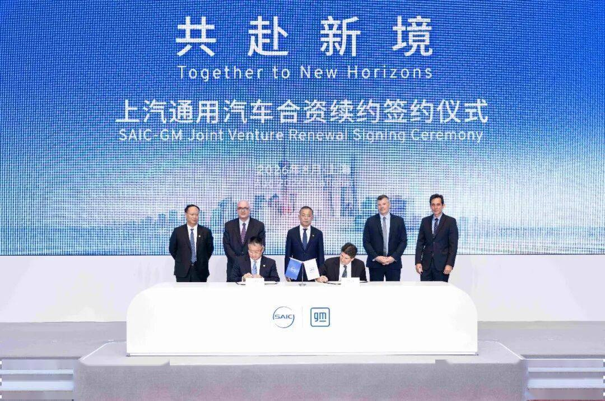

# 上汽通用续约20年：合资模式2.0时代正式开启，读懂智电时代合资企业的全球化新时代

- 公開日時: 2026-08-05 17:09（北京時間）
- 出典: [搜狐号・崔东树](https://www.sohu.com/a/1059150822_115312)
- テーマ（自動判定）: 世界市場
- 画像: 1枚

---

2026年8月5日，上汽集团与通用汽车签署战略续约协议，上汽通用合资期限延长20年至2047年。在全球汽车产业剧烈变革的当下，这次续约并非简单顺延合作时间，而是具备行业风向标意义的重大事件。结合产业环境，我从几个维度做一下分析。

1、本次20年超长续约，是投向中国汽车市场的一张长期信心票

当前全球汽车产业深度重构，部分跨国车企对中国市场采取观望、收缩策略。中国拥有全球最完整的汽车产业链、庞大消费体量，也是电动化智能化最大的应用试验场。上汽通用此次续约20年，是目前国内合资车企当中最长的合作周期，体现两大股东放弃短期博弈，坚持长期经营的战略定力。这充分说明，中国依旧是全球汽车创新、规模落地、产业竞争的核心市场，外资头部企业没有放弃中国赛道。

2、当下选择续约，存在三重现实产业逻辑

①市场层面：中国新能源市场规模与技术迭代速度全球领先，离开中国市场，就很难参与全球智电汽车的主流竞争，通用汽车需要依托中国市场完成新能源转型。

②企业能力层面：经过近30年积累，依托泛亚汽车技术中心，上汽通用已经构建起完整本土研发体系，产品定义、技术路线、整车验证、量产落地能力已经成熟，不再是过去单纯引进海外技术的生产制造基地，转型成果得到股东认可。

③模式倒逼层面：传统“海外输出技术、国内负责制造销售”的旧合资模式已经难以为继。通用汽车具有全球超强的营销渠道与品牌影响力。国内自主品牌强势崛起，市场迭代速度极快，长链条海外决策无法适配国内竞争节奏，倒逼合资双方重构合作机制，实现全球化新突破。

3、20年长期合作的核心信心，来源于跑通的“至境模式”，合资正式进入2.0阶段

①合作逻辑发生本质转变，从过去技术引进、规模制造，升级为“本土决策、能力共建、创新共创、价值共享”。本土团队在产品、技术上拥有更大话语权，解决传统合资决策链条长、对国内用户反应慢的痛点。

②泛亚技术中心为核心载体的“至境模式”是信心根基。坚持以中国用户需求为原点，同时守住全球品质标准，平衡中国市场快速迭代效率与全球整车质量要求。逍遥超级融合架构、别克至境产品已经实现技术向产品的转化，证明这套转型路径具备可行性，也是股东愿意持续投入的关键。

4、续约之后，上汽通用两大核心发展路径清晰落地

①本土原生自研成为产品核心驱动力，别克至境L7纯电是续约后的标志性车型。签约当晚该车型开启预售，依托至境模式，搭载全系标配的800V+702km+6C控温超快充技术，行业首创悬浮减压座舱与高阶智能，践行“最好的别克轿车在中国”。这款车也拉开上汽通用未来30款新能源产品投放的序幕，企业新能源转型进入集中释放阶段。

②发展方向从“全球本土化”迈向“中国全球化”。过往是海外车型引入国内做本土化改造；未来充分发挥中国在用户洞察、研发、制造、供应链效率的优势，推动中国定义、中国研发、中国制造的产品走向全球。中国从全球技术承接端，升级为汽车创新策源地与全球供给端，实现中外资源双向赋能。

5、理性看待续约，合约只是制度保障，市场竞争依旧严峻

20年合资合约给企业提供稳定的发展环境，但不等于发展一路畅通。国内新能源市场竞争高度内卷，自主品牌持续强势，市场淘汰赛还在持续。上汽通用最终还是要依靠产品力、实际市场表现来验证转型成效。我们要摒弃“合资反攻”“重回巅峰”这类情绪化表述，本次续约是对外开放合作的产业实践，不是对抗式竞争。

6、行业启示：智电时代合资企业的生存逻辑已经彻底改写

上汽通用此次续约，回答了整个行业的关键命题：新环境下合资企业如何生存发展。单纯搬运海外技术的时代已经结束，合资企业想要站稳脚跟，必须走向能力共建、本土创新，兼顾中国市场迭代速度与全球化新时代。上汽通用探索的合资2.0、至境模式、中国全球化路径，也将给国内其他合资车企提供重要参考样本。
