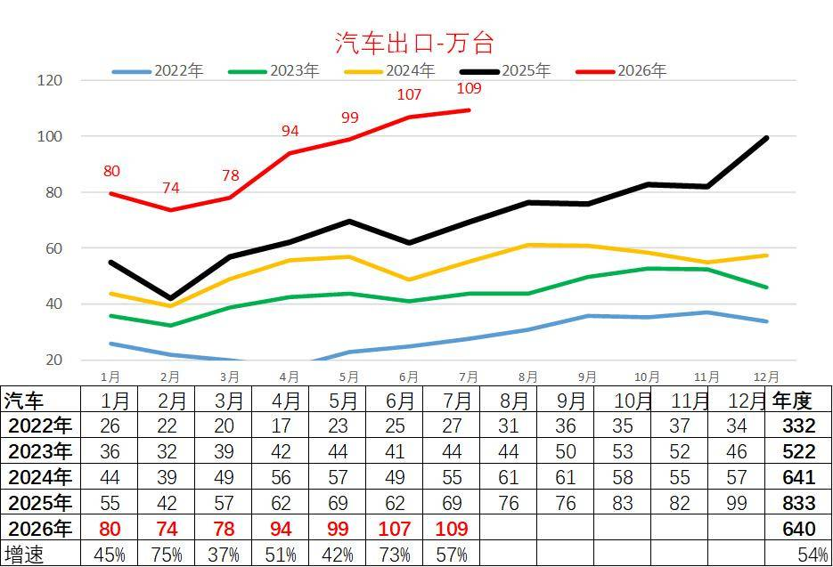
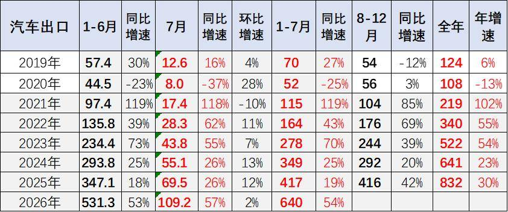
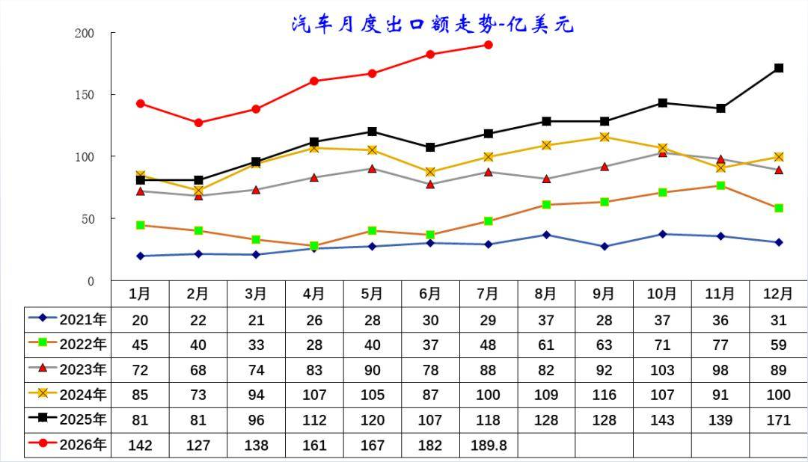
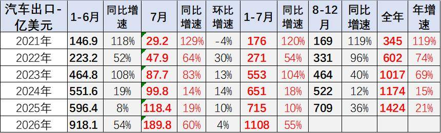
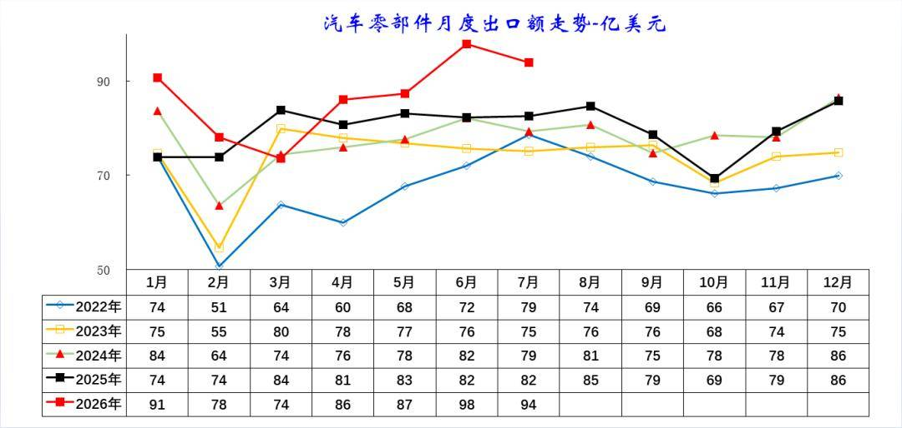
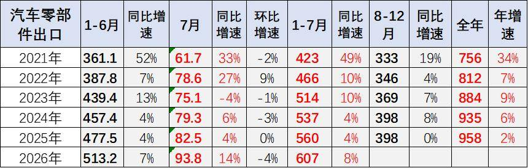

# 7月中国汽车出口109万，同比增57%，环比增2%

- 公開日時: 2026-08-07 17:56（北京時間）
- 出典: [搜狐号・崔东树](https://www.sohu.com/a/1060114909_115312)
- テーマ（自動判定）: 輸出
- 画像: 6枚

---

注：本分析文章仅代表崔东树个人观点，如有异议，请留言。

2026年1-7月汽车出口640万台，同比大增54%，大幅甩开往年同期水平。其中7月出口109.2万台，同比增速57%，环比小幅上升2%，增长爆发力突出。2026年1-7月汽车出口总额1108亿美元，同比大幅增长55%，增长力度重回高位。7月汽车整车出口190亿美元，同比增60%，环比正增长4%，打破2023-2025年7月稍低于5月的规律。

2026 年1-7月零部件出口总额607亿美元，同比增长8%，增速较2025 年上半年小幅回升。7月汽车零部件单月出口93.8 亿美元，同比增14%，环比降4%，6月高增长后的7月走势平稳。

今年汽车零部件出口同步稳步增长，重点服务欧美成熟市场，依托完善的供应链体系，为全球车企提供稳定配套，形成“零部件深耕欧美、整车辐射全球”的交叉互补格局，产业链协同效应凸显，共同支撑中国汽车产业的全球竞争力持续提升。

1、中国汽车出口爆发增长

2026年1-7月汽车出口持续走高，月度数值从1月80万台升至7月109万台，仅2月小幅回调，整体增长动能强劲。

对比往年同期，2026年各月出口量全面大幅超越2022-2025年同期，单月增速均超54%，7月同比增速达57%，1-7月累计出口640万台，同比增幅54%。

海外市场需求持续释放，国产汽车出海竞争力稳步提升，4月以来的汽车出口规模、增速均创历年同期新高。

2026年我国汽车出口迎来爆发式增长。2026年1-7月汽车出口640万台，同比大增54%，大幅甩开往年同期水平。其中7月出口109.2万台，同比增速57%，环比小幅上升2%，增长爆发力突出。

复盘2019-2025年走势：2021年迎来出海爆发，后续增速逐年放缓；2026年7月实现环比正增长，国内与海外需求互补性显著增强。

2、中国汽车出口额持续提升

2026年1-7月汽车出口额持续强势走高，单月金额从1月142亿美元升至7月190亿美元，仅2月环比小幅回落，各月数值大幅领先2022-2025年同期。

对比历年，2022年出口额基数最低、全年波动平缓；2023-2025年稳步抬升，但单月峰值均低于2026年上半年水平。

出口额增速显著高于出口量增速，反映单车出口均价持续上行，新能源、高端车型占比提升，汽车出海从规模扩张转向价值提升。

2026年1-7月汽车出口总额1108亿美元，同比大幅增长55%，增长力度重回高位。7月汽车整车出口190亿美元，同比增60%，环比正增长4%，打破2023-2025年7月稍低于5月的规律。

3、汽车零部件出口走势

2026年零部件出口额走势强劲，1月91亿美元、6月冲高至98亿美元，仅3月小幅回调，1-7月各月数值全面高于2022-2025年同期。

往年规律为2月出口额全年低谷，2026年2月78亿美元，显著高于往年同期底部。2022-2025年月度规模常年维持50-80亿美元区间，2026年6-7月突破区间上限。

整车出口带动配套零部件外需提升，新能源配套零部件海外需求放量，支撑零部件出口持续走高。

2026年1-7月零部件出口总额607亿美元，同比增长8%，增速较2025年同期小幅回升。7月汽车零部件单月出口93.8亿美元，同比增14%，环比降4%，6月高增长后的7月走势平稳。

2022-2025年零部件出口增速持续低位徘徊，2025年6-7月同比微增长，景气度偏弱。2026年随整车出口大幅放量，配套零部件外需同步回暖，6-7月产销配套订单集中释放，月度出口规模创近年同期新高。

作为整车出口的重要支撑，零部件出口的稳定增长，为我国汽车产业全球化布局筑牢了供应链基础，也为后续整车出海提供了持续的配套保障。

附：近日信息合集
