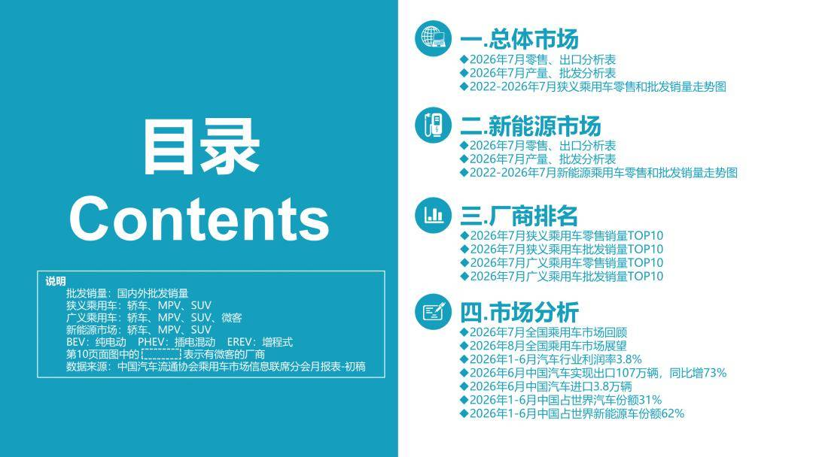
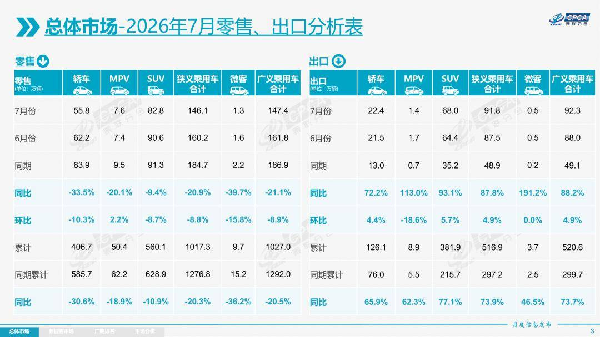
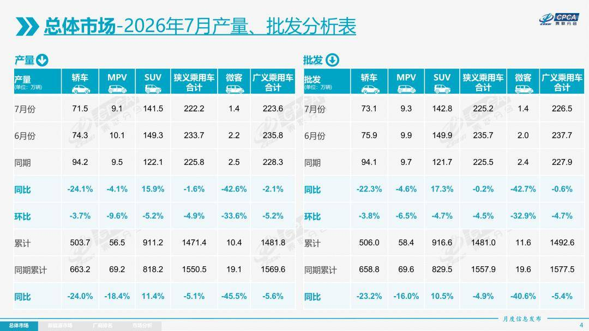
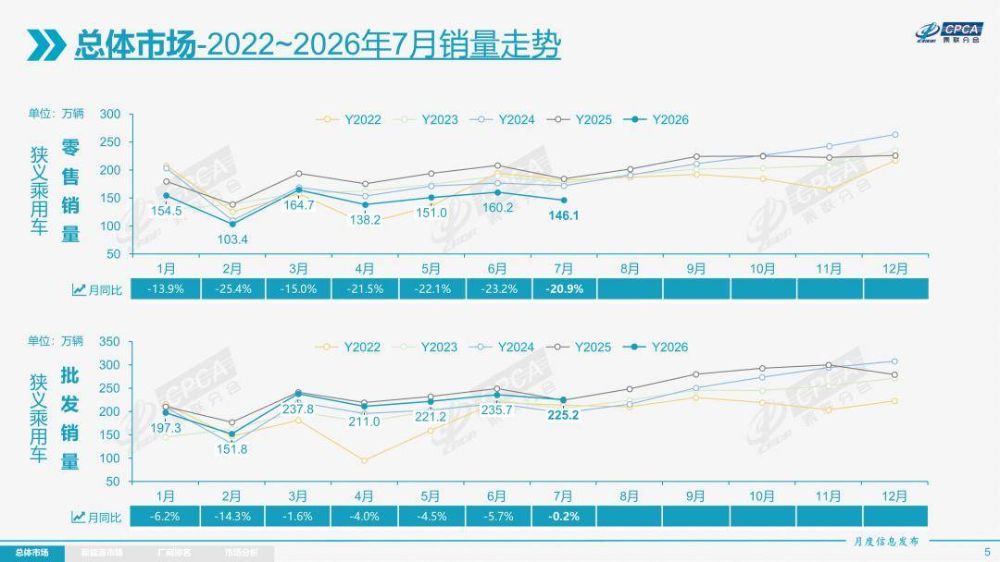
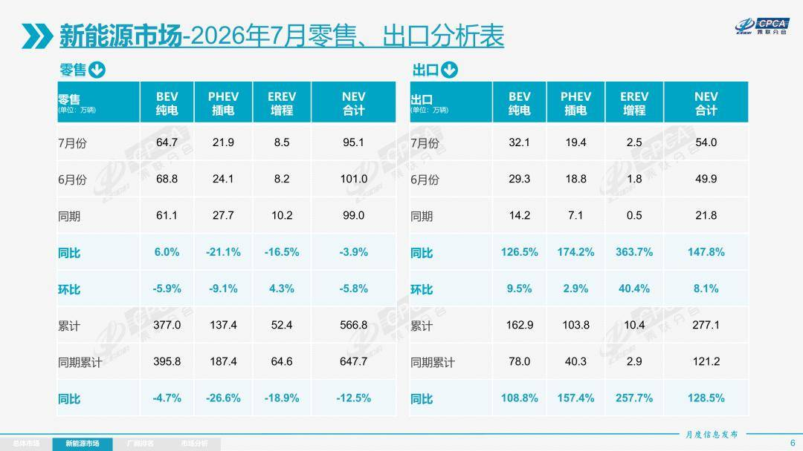
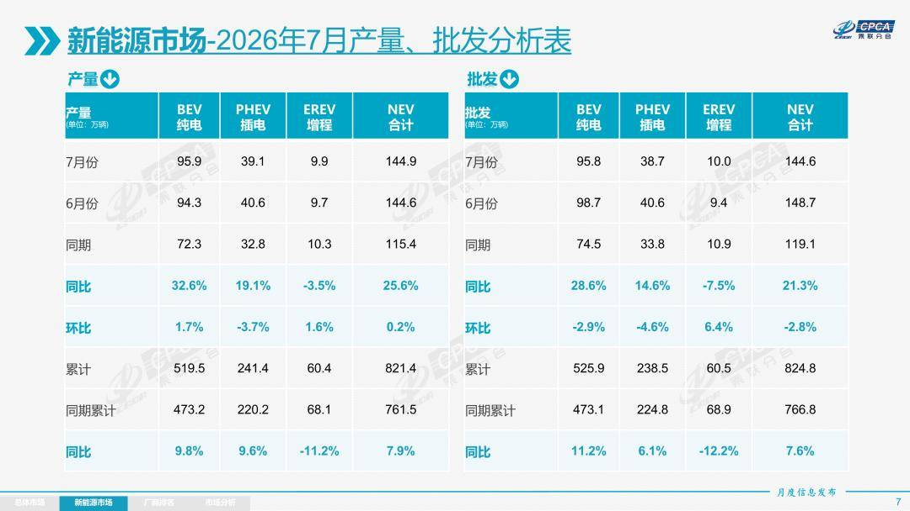
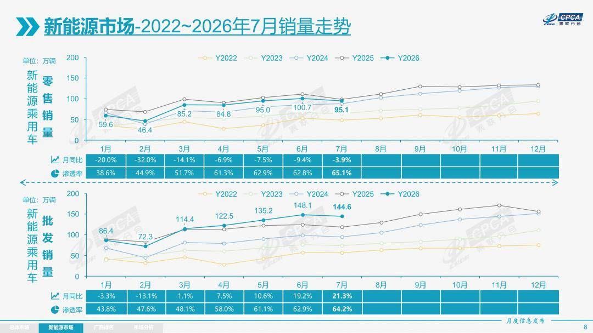
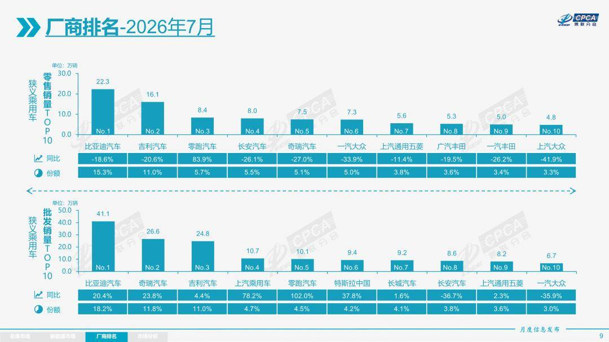
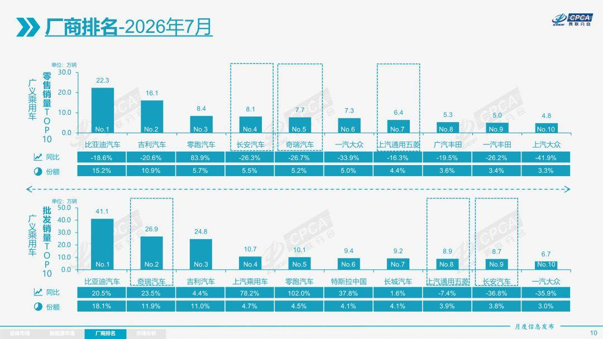

# 【月度分析】2026年7月份全国乘用车市场分析

- 公開日時: 2026-08-11 17:22（北京時間）
- 出典: [搜狐号・崔东树](https://www.sohu.com/a/1061527403_115312)
- テーマ（自動判定）: 乗用車市場
- 画像: 9枚

---

本文全文共9051字，阅读全文约需30分钟

1.2026年7月全国乘用车市场回顾

零售：2026年7月全国乘用车市场零售146.1万辆，同比下降20.9%，环比下降8.8%；今年以来累计零售1,017.3万辆，同比下降20.3%。2026年7月国内乘用车市场呈现“总量持续承压、环比走弱、结构极致分化”的运行态势，淡季下行特征凸显，行业结构性调整进一步深化。

2026年7月车市走弱，是油价反弹、宏观走弱、季节性淡季、前期需求透支及政策切换等多重因素共振所致。地缘冲突引发霍尔木兹海峡通航扰动，推动国际油价震荡上行，2026年国内汽油价格累计上调1,575元/吨，大幅抬高用车成本，燃油乘用车消费需求剧烈萎缩，但对商用车的影响很小。同时7月CPI、PPI环比回落、PMI景气下行，居民收入与消费预期偏谨慎，大额耐用品消费意愿低迷，住行消费持续走弱，拖累车市终端需求。叠加7月高温淡季压制线下到店客流、6月半年冲量提前透支市场需求，终端订单与客流同步回落。此外，新能源安全新国标正式落地，行业技术门槛抬升，低端车型短期出清扰动市场。而7月政治局会议明确财政加力、加码扩内需促消费政策，为车市提供底部支撑，本轮市场下行属于阶段性结构性波动，并非行业趋势性恶化。

综合来看，2026年7月乘用车市场呈现五大鲜明特征：一、总量持续承压，结构性分化极致放大，“燃油深度降温、新能源强势领跑”成为市场核心主线，油价波动主导了“油电替代”节奏；二、燃油车全线收缩，其中纯燃油车型近乎失速，混动车型相对抗跌，导致燃油车内部结构持续优化；三、新能源渗透率持续突破新高，供给端新国标合规产品集中迭代上市，行业从价格内卷全面转向价值竞争；四、出口持续发挥托底作用，有效稳住车企批发与产能，缓解国内零售疲软压力；五、行业库存持续良性去化，厂商、渠道库存降幅同步扩大，整体库存风险充分释放，行业经营压力稳步缓解、整体韧性有所修复。

7月燃油车零售同比下降41%，其中纯燃油车下降44%，普通混合动力下降4%。燃油车中自主下降46%，主流合资下降40%，豪华下降28%，均无差别地受到高油价剧烈冲击。

7月新能源车零售同比下降3.9%，其中自主下降4%，主流合资增长36%，豪华下降23%，自主经济型电动车国内零售受到补贴暴跌的影响较大。由于新能源商用车补贴力度强，MPV中低端与小型商用车的功能有相通之处，因此MPV中低端下滑较大。

7月自主品牌零售104万辆，同比下降14%，环比下降6%。当月自主品牌国内零售份额为71.0%，同比增长5.4个百分点。自主品牌在新能源市场和出口市场总体较平稳。

7月主流合资品牌零售29万辆，同比下降35%，环比下降12%。7月德系品牌零售份额12.4%，同比下降2.0个百分点，日系品牌零售份额10.9%，同比下降1.9个百分点。美系品牌市场零售份额4.2%，同比下降1.0个百分点。低销量合资车企逐步恢复活力。

7月豪华车零售13万辆，同比下降27%，环比下降23%。随着豪华车指导价的合理回归，7月豪华品牌零售份额8.7%，同比下降0.7个百分点。

出口：根据乘联数据，7月乘用车出口（含整车与CKD）91.8万辆，同比增长87.8%，环比增长4.9%，占乘用车厂商销量41%（上月37%，2025年同期21%）。7月新能源车占出口总量的58.8%，较同期增加14个百分点。7月自主品牌出口达到77.5万辆，同比增长87%；合资与豪华品牌出口14.3万辆，同比增长108%。

生产：7月乘用车生产222.2万辆，同比下降1.6%，环比下降4.9%。7月豪华品牌生产同比下降21%，环比下降12%；合资品牌生产同比下降35%，环比下降24%；自主品牌生产同比增长12%，环比增长0.1%。

批发：7月全国乘用车厂商批发225.2万辆，同比下降0.2%，环比下降4.5%；受出口暴增的促进激励，7月乘用车批发同比增速较零售增速高出20.7个百分点。7月自主车企批发173.3万辆，同比增长9%，环比下降3%。主流合资车企批发31.5万辆，同比下降30%，环比下降14%。豪华车批发20.4万辆，同比下降5%，环比下降3%。

7月乘用车主力厂商总体批发格局持续变化，比亚迪汽车、奇瑞汽车、上汽乘用车、零跑汽车、特斯拉中国、蔚来汽车、极狐汽车、江苏悦达起亚等车企实现同比20%以上高增长。7月车市集中度推升，10万辆以上批发销量的乘用车厂商5家（上月5家，去年同期5家），占整体市场份额50.3%（上月47%，同期46%）。5-10万辆批发量的乘用车厂商份额占比18.7%（上月26%，同期27%），1-5万辆批发量的乘用车厂商份额占比27.0%（上月24%，同期24%）。

库存：由于7月厂商生产安排极其谨慎，7月厂商批发高于生产3.0万辆，而厂商月度国内批发低于国内零售12.7万辆。今年去库存特征突出，1-7月总体乘用车行业库存下降64万辆（2025年同期下降25万辆、2024年同期下降60万辆、2023年同期下降18万辆）。

新能源：7月新能源乘用车生产达到144.9万辆，同比增长25.6%，环比增长0.2%。1-7月累计新能源乘用车生产达到821.4万辆，同比增长7.9%。

7月新能源乘用车批发销量达到144.6万辆，同比增长21.3%，环比下降2.8%；1-7月新能源乘用车批发销量达到824.8万辆，同比增长7.6%。7月常规燃油乘用车批发销量达到81万辆，同比下降24%，环比下降8%。

7月新能源乘用车市场零售95.1万辆，同比下降3.9%，环比下降5.8%；1-7月新能源乘用车市场零售566.8万辆，同比下降12.5%。7月常规燃油乘用车零售51万辆，同比下降41%，环比下降14.2%；其中普通混合动力车型同比仅下降4%，环比下降5%。

7月新能源乘用车厂商出口54.0万辆，同比增长147.8%，环比增长8.1%；1-7月新能源乘用车厂商出口277.1万辆，同比增长128.5%，7月常规燃油乘用车出口37.9万辆，同比增长42%，环比增长1%。

1)批发：7月新能源车厂商批发渗透率64.2%，较2025年7月提升11个百分点。7月自主品牌新能源车渗透率73.6%；豪华车中的新能源车渗透率57.1%；主流合资品牌新能源车渗透率上升到17.1%。

7月纯电动批发销量95.8万辆，同比增长28.6%，环比下降2.9%；7月狭义插混销量38.7万辆，同比增长14.6%，环比下降4.6%；7月增程式批发10.0万辆，同比下降7.5%，环比增长6.4%。7月新能源批发结构中：纯电动66.2%(同比+3.7%，环比-0.1%)、狭义插混26.8%(同比-1.6%，环比-0.5%)、增程式6.9%(同比-2.2%，环比+0.6%)。

7月B级电动车批发29.9万辆，同比增长35%，环比增长1%，占纯电动份额31%，较去年同期增长1.3个百分点。纯电动市场的A00+A0级经济型电动车市场压力较大，其中A00级批发销量6.5万辆，同比下降50%，环比下降15%，占纯电动的7%份额，较去年同期下降10.7个百分点；A0级批发销量31.1万辆，占纯电动的32%份额，同比增长8.9%.；A级电动车23.1万，占纯电动份额24%，同比下降2.1个百分点；从长期普及趋势看，经济型电动车增长是最有潜力的，只有入门级电动车普及才能真正拉动车市可持续增量。

7月乘用车批发销量超两万辆的车型有18个（上月21个），比亚迪元UP（63,258辆）、比亚迪宋（61,012辆）、Model Y（59,836辆）、吉利星愿（55,105辆）、瑞虎7（34,936辆）、Model 3（33,743辆）、缤越（31,137辆）、零跑A10（28,593辆）、比亚迪海鸥（27,971辆）、方程豹钛 7（27,320辆）、奇瑞JAECOO J5（24,639辆）、启源 Q05（24,512辆）、比亚迪海豚（22,910辆）、瑞虎 8（22,309辆）、五菱缤果（21,378辆）、小米SU7（21,044辆）、MG ZS（21,032辆）、比亚迪元PLUS（20,180辆）。其中新能源车型占绝对主力地位。

2）零售：7月新能源车在国内总体乘用车的零售渗透率65.1%，较去年同期增长11.6个百分点，环比增长2.1个百分点。7月国内零售，自主品牌中的新能源车渗透率83.8%；豪华车中的新能源车渗透率30.9%；而主流合资品牌中的新能源车渗透率仅上升到13.7%。从月度新能源车国内零售份额看，7月自主品牌新能源车零售份额64.6%，同比下降5.3个百分点；主流合资品牌新能源车份额4.5%，同比增长0.9个百分点；新势力份额26.8%，零跑汽车、蔚来汽车等品牌拉动新势力份额同比增长5.4个百分点。

3）出口：7月新能源乘用车出口54.0万辆，同比增长147.8%，环比增长8.1%。占乘用车出口58.8%，较去年同期增长14个百分点；其中纯电动占新能源出口的59.5%（去年同期65.1%），作为核心焦点的A00+A0级纯电动车占纯电动出口的42.2%（去年同期36.6%）。伴随着中国新能源车的规模优势显现和市场扩张需求，中国制造的新能源品牌产品越来越多地走出国门，在海外的认可度持续提升。其中狭义插混占新能源出口的35.9%（去年同期32.4%）增程占新能源出口的4.6%（去年同期2.5%）。虽然近期受到外部国家的一些干扰，但自主狭义插混出口发展中国家增长迅猛，前景光明。7月新能源出口方面优秀的企业是：比亚迪汽车（173,721辆）、奇瑞汽车（82,768辆）、特斯拉中国（66,330辆）、吉利汽车（60,584辆）、长安汽车（26,200辆）、上汽乘用车（24,778辆）、零跑汽车（17,569辆）、上汽通用五菱（13,199辆）、长城汽车（10,162辆）。其他车企新能源出口也有一定规模。

从海外体系建设上看，部分自主品牌的CKD出口占比较高，国际化表现优秀。其中长城汽车CKD出口占比44.7%，上汽通用五菱CKD出口占比37.2%，领途汽车CKD出口占比40.0%，上汽乘用车CKD出口占比11.4%。

4）车企：7月新能源乘用车企业总体走势较强，比亚迪汽车纯电动与插混双驱动夯实自主品牌新能源领先地位；以比亚迪汽车、吉利汽车、奇瑞汽车等为代表的狭义插混表现持续较强。在产品投放方面，随着自主车企在新能源路线上“多线并举”策略的实施，市场基盘持续扩大，新能源月度批发销量突破万辆的厂商达到20家（同比多1家，环比持平），占新能源乘用车总量93.6%（上月93.5%，去年同期91.7%）。其中，比亚迪汽车（410,612辆）、吉利汽车（156,568辆）、奇瑞汽车（122,097辆）、零跑汽车（101,267辆）、特斯拉中国（93,579辆）、上汽通用五菱（61,526辆）、长安汽车（57,092辆）、上汽乘用车（56,063辆）、小鹏汽车（38,027辆）、蔚来汽车（35,934辆）、长城汽车（34,645辆）、小米汽车（31,267辆）、理想汽车（30,468辆）、东风汽车（24,664辆）、极狐汽车（23,517辆）、广汽埃安（21,007辆）、赛力斯汽车（20,588辆）、上汽通用（12,662辆）、广汽丰田（12,002辆）、大众安徽（10,079辆）。

国内新能源乘用车零售突破2万辆的企业品牌是：比亚迪汽车（223,461辆）、吉利汽车（105,526辆）、零跑汽车（83,698辆）、长安汽车（59,907辆）、上汽通用五菱（48,967辆）、鸿蒙智行（45,422辆）、奇瑞汽车（39,079辆）、蔚来汽车（35,842辆）、上汽乘用车（31,471辆）、小米汽车（31,267辆）、理想汽车（30,468辆）、小鹏汽车（28,327辆）、特斯拉中国（27,249辆）、长城汽车（24,483辆）、广汽埃安（24,103辆）、极狐汽车（23,517辆）、东风汽车（21,396辆）。

5）新势力：7月新势力零售份额26.8%，同比增加5.4个百分点。新势力车型中的纯电动销量占比77.6%，较同期的63.7%占比大幅提升；新势力纯电动中的10-15万级别销量占比大幅增长。自主传统车企的独立新能源品牌作为创二代的表现较强，份额17.7%，同比增长5.4个百分点。极氪、奕派科技、深蓝汽车、极狐、岚图等自主大集团的自创新能源品牌表现优秀。

6）普混：7月普通混合动力乘用车批发9.7万辆，同比增长31%，环比下降13%。其中一汽丰田（34,883辆）、广汽丰田（24,495辆）、上汽乘用车（20,572辆）、吉利汽车（5,657辆）、长城汽车（3,284辆）、东风本田（3,170辆）、长安福特（3,058辆）、广汽本田（1,058辆）。混合动力的市场相对较强，上汽乘用车、吉利汽车等自主混动的海外市场异军突起。

2.2026年8月份全国乘用车市场展望

2026年8月乘用车市场整体呈现“总量弱修复、结构强分化”的运行态势，21个产销工作日叠加高温淡季，终端市场回暖节奏平缓，多重宏观与行业因素交织塑造了市场格局。受霍尔木兹海峡通航受阻影响，7月国际油价震荡上行，国内成品油价格两轮累计上调近985元/吨，大幅抬升燃油车用车、养车成本，持续压制用户燃油车购买意愿，传统燃油车需求持续走弱，也成为新能源车逆势走强的核心外部利好，持续拓宽新能源车型的国内和海外市场增长空间。

最新宏观数据显示国内消费与制造业景气偏弱，直接约束车市复苏力度。7月CPI同比上涨0.5%、环比微降0.1%，反映终端内需动力不足；PPI同比上涨3.5%、环比下降0.7%，上游成本边际缓解但传导滞后；PMI回落至49.2%，制造业景气度下行，叠加居民消费信心谨慎，汽车大额消费观望情绪浓厚，导致车市整体增长乏力。政策端形成强力对冲支撑，7月中央政治局会议明确：充分发挥各项存量政策效能，及时谋划出台务实管用的增量政策，加大逆周期调节力度，加力扩大内需、优化供给。随着消费品以旧换新配套政策持续优化加力，汽车消费扶持预期持续升温，将有效推动三季度车市从底部逐步复苏。

供给侧门槛持续提升，新能源车大型化趋势明显。2026年1-7月的新能源车新车中，5米以上新车达到49款，占新能源新车总数量的56%（2024年38%、2025年36%），而4米以下车型仅有1款占比1%，而去年同期5款占比6%。经济型车供给剧烈减少。

整体来看，8月车市处于底部蓄力修复阶段，随着各项稳消费政策逐步落地，叠加基数逐步改善，乘用车市场降幅将稳步收窄，行业正式进入“价值驱动、结构优化”的成熟发展阶段，为传统“金九银十”行情铺路蓄力。

3.2026年1-6月汽车行业利润率3.8%

今年上半年，面对国际环境复杂演变和国内转型压力不减等多重挑战，国民经济仍开局良好、质效提升，装备制造业和高技术制造业利润快速增长，原材料制造业利润两位数增长。近期随着车市生产规模扩大，PPI上行，上游有色和石油等矿业利润暴涨，钛酸锂价格近20万，2026年1-6月锂电池出口每吨单价10.48万元下降12%（2024年下降26%、2025年下降21%），而国内电池价格仍然坚挺，且锂电上市公司应付账期200天而应收账期要求60天。

2026年1-6月汽车生产1,510万辆，同比下降4%。2026年1-6月的汽车行业收入51,893亿元，同比增长1.8%；成本46,100亿元，增长2.8%；利润1,954亿元，同比下降20%。历年6月汽车业一般利润率都是较高的，今年6月达5.2%，已经好于3-4月3.7%的月度表现，但2026年1-6月汽车行业销售利润率仍只有3.8%，相对于上下游工业企业利润率6.5%的平均水平，汽车行业仍属偏低的。

2026年各地大力度推动“两新”政策落地实施，逐步有效释放内需活力。但汽车行业效益的改善明显落后于其它消费品。汽车行业利润受上游挤压，采购成本维持高位，叠加油价暴涨，有色金属、半导体利润暴增，终端用户购车观望心态严重价格内卷，导致车企运行压力持续加大，高质量发展受到来自上下游行业的巨大冲击。

4.2026年6月中国汽车实现出口107万辆，同比增73%

2026年1-6月中国汽车实现出口531万辆，同比增速53%，6月中国汽车实现出口107万辆，同比增长73%，环比增长8%，同比走势总体较强, 环比走势超预期正增长。今年增长的主要动力仍是高油价和中国产品竞争力提升以及全球南方国家市场的持续增长。

2026年6月中国汽车出口总量的前10国家：俄罗斯84,451辆、英国62,487辆、澳大利亚60,510辆、比利时59,606辆、菲律宾462,43辆、墨西哥45,528辆、阿尔及利亚33,358辆、泰国29,923辆、马来西亚26,767辆和巴西25,856辆，其中本期较同期增量增长的前五是：俄罗斯58,053辆、澳大利亚41,065辆、比利时35,070辆、英国33,913辆和菲律宾21,358辆。俄罗斯市场中国车企防风险意识提升，2025年出口去库存力度很大。2026年1-6月我们对俄罗斯的出口恢复较大。

2026年1-6月累计整车出口总量的前10国家：俄罗斯448,157辆、巴西410,825辆、英国255,260辆、澳大利亚237,823辆、比利时219,730辆、墨西哥210,155辆、意大利154,870辆、菲律宾148,727辆、阿联酋146,274辆和阿尔及利亚143,012辆，其中本期较同期增量增长的前五是：俄罗斯267,411辆、巴西249,571辆、英国118,848辆、阿尔及利亚100,382辆和澳大利亚94,368辆。

2026年6月中国新能源汽车出口46.3万辆，同比增长59%，1-6月累计出口242万辆，增长70%的表现很好，6月新能源车出口环比表现较强。2026年6月中国汽车出口中纯电动占比30%（同比0%），插混占比19%（同比+8%），混动占比7%（同比+1%），纯燃油车占比35%（同比-8%）。

2026年6月中国新能源汽车出口总量的前10国家：比利时57,217辆、英国50,157辆、澳大利亚46,434辆、菲律宾43,466辆、泰国28,978辆、德国17,900辆、西班牙14,974辆、韩国13,764辆、马来西亚12,399辆和巴西11,089辆，其中本期较同期增量增长的前五是：澳大利亚34,736辆、比利时33,277辆、英国31,305辆、菲律宾24,927辆和泰国20,980辆。

2026年1-6月中国新能源汽车出口总量的前10国家：巴西299,803辆、比利时209,217辆、英国181,260辆、澳大利亚167,126辆、泰国126,646辆、菲律宾126,062辆、德国84,190辆、意大利79,503辆、韩国75,430辆和西班牙72,723辆，其中本期较同期增量增长的前五是：巴西183,399辆、澳大利亚98,744辆、英国89,216辆、泰国66,297辆和比利时63,953辆。

中国新能源车2026年1-6月出口表现好于预期，主要是插混和混动替代纯电动成为出口增长的新增长点，尤其是纯电动货车出口表现较强，成为商用车新能源车出口亮点。运力恢复促进6月出口暴增。中国新能源车出口主要是出口西欧和中南美市场。中东市场受阻。

5.2026年6月中国汽车进口3.8万辆

2026年6月进口车进口3.8万辆，同比下滑11%，但由于2025年6月基数低，虽然美国与伊朗战争导致运输受阻，进口车总体下降较小。2026年1-6月进口汽车20万辆，同比下降11%。2026年1-6月仍是近期少见的较好表现，主要原因是因为2025年的低基数。由于2025年初低基数的促进，今年1-6月进口车零售19万辆，下滑29%的表现不算太差，6月下降到3万辆，下降了39%，下半年压力仍大。

进口车以传统燃油车为主格局。2026年6月进口量最高的前10国家是：日本18,486辆、德国9,272辆、斯洛伐克4,122辆、美国3,359辆、英国1,426辆、墨西哥654辆、奥地利555辆、韩国128辆、南非71辆和波兰70辆。其中本期较同期增量增长的前五是：日本5,131辆、德国928辆、奥地利303辆、墨西哥290辆和南非65辆。

2026年1-6月进口量最高的前10国家是：日本103,493辆、德国44,311辆、美国17,732辆、斯洛伐克13,520辆、英国10,855辆、墨西哥2,981辆、奥地利2,521辆、泰国1,733辆、瑞典604辆和韩国486辆。其中本期较同期增量增长的前五是：日本20,095辆、泰国1,515辆、奥地利960辆、墨西哥735辆和南非319辆。

在进口车近几年持续下滑的背景下，今年的豪华市场走势分化，雷克萨斯销量相对较稳，保持进口豪华车的第一位置。部分超豪华品牌波动异常，出现崩盘迹象，行业运行压力较大。

国产与进口豪华车市场的需求总体偏弱，其中上海、北京、苏州、杭州、成都、无锡等地区的豪华车市场压力较大。今年的喀什、伊犁、大庆、阿克苏等中西部地区需求较强。

6.2026年1-6月中国占世界汽车份额31%

根据世界汽车组织统计数据，全球汽车生产不断增长，2025年达到9,638万辆，较2024年的9,272万辆增长4%，中国占世界生产份额36%。根据我们统计2025年全球汽车销量9,689万辆，同比增长6%。2026年6月的世界汽车销量达到860万辆，同比增长6%。2026年1-6月世界汽车销量达到4,786万辆，同比增长3%。

随着美国、中国车市的年初相对负增长，2026年1-6月世界车市销量增长不强。2025年中国达到世界汽车35.4%的份额；2026年初中国份额31.4%，2026年初中国汽车销量下滑较大，由于今年政策补贴促进中国商用车走强落地，6月份额回升到32.2%。年初较低是入门级销量萎缩因素的异常体现，乘用车弱、商用车强，出口暴增。期待能有改善低端收入和减少抑制低端消费的政策出台。随着政策刺激效果逐步恢复显现，预计未来中国车市逐步走强。

2026年1-6月的全球汽车销量增长3%，其中中国汽车销量下降4%，美国销量下降3%，印度汽车市场销量增长19%，泰国汽车市场增长18%，俄罗斯市场销量增长10%，越南增长31%。新兴市场拉动市场表现较好。

东升西降，电动化发展的趋势也导致部分国际车企逐步走弱，除了丰田、现代起亚、铃木和塔塔等，其它国际品牌份额2026年出现较大幅度的下滑。吉利、比亚迪、奇瑞、上汽、长安等自主表现较强，中国自主品牌将全面提升世界份额。

7.2026年1-6月中国占世界新能源车份额62%

2026年1-6月世界新能源乘用车达到1,122万辆，同比增长13%，其中6月新能源车销量238万辆增长25%，增速回到历史正常水平。2026年1-6月的新能源车占世界汽车份额达到25.5%，其中纯电动车的占比达到16.3%，插电混动达到7.1%的汽车比例，混合动力达到8%，表现优秀。

中国之外市场的新能源走势总体增长迥异。由于欧洲新能源走势大幅回暖，因此海外新能源车1-6月销量427万辆、增速达到28%，接近于前两年平均水平。

初步统计欧洲新能源乘用车6月47万辆，同比增长23%，2026年1-6月累计234万辆，同比增长31%。由于高关税和新能源补贴取消的涨价因素的影响，美国新能源车2026年6月销量10.8万辆，同比下降20%，1-6月美国新能源车销量61万，下降27%。

世界新能源车渗透率总体呈现快速提升趋势，2022年已经达到13.1%水平，2023年达到15.9%，2024年达到19.5%，2025年渗透率达到23.6%。2026年累计新能源渗透率23.4%，其中，德国达到32%，挪威达到81%，英国35%，而美国仅有7%，日本仅有3%，因此世界新能源发展的不均衡性极为明显。

2025年中国新能源乘用车世界份额68.3%；2026年1-6月中国新能源乘用车世界份额达到62%的水平。2026年中国在世界纯电动车市场份额58%，2026年中国在世界插电混动份额达到71%的高水平，中国在世界插电混动市场呈现超强的表现。

2025年自主新能源乘用车海外市场销量份额达到15.8%，提升较大。2026年自主新能源乘用车海外市场销量份额大幅提升，6月达到26%，进一步大幅跃升。
