# 2026年7月全国乘用车市场运行特征分析

- 公開日時: 2026-08-12 21:22（北京時間）
- 出典: [搜狐号・崔东树](https://www.sohu.com/a/1062036636_115312)
- テーマ（自動判定）: 乗用車市場
- 画像: 22枚

---

注：本分析文章仅代表崔东树个人观点，如有异议，请留言。

2026年7月车市走弱，是油价反弹、宏观走弱、季节性淡季、前期需求透支及政策切换等多重因素共振所致。地缘冲突引发霍尔木兹海峡通航扰动，推动国际油价震荡上行，2026年国内汽油价格累计上调1,575元/吨，大幅抬高用车成本，燃油乘用车消费需求剧烈萎缩，但对商用车的影响很小。同时7月CPI、PPI环比回落、PMI景气下行，居民收入与消费预期偏谨慎，大额耐用品消费意愿低迷，住行消费持续走弱，拖累车市终端需求。叠加7月高温淡季压制线下到店客流、6月半年冲量提前透支市场需求，终端订单与客流同步回落。此外，新能源安全新国标正式落地，行业技术门槛抬升，低端车型短期出清扰动市场。而7月政治局会议明确财政加力、加码扩内需促消费政策，为车市提供底部支撑，本轮市场下行属于阶段性结构性波动，并非行业趋势性恶化。

1.近年狭义乘用车零售走势

7月全国乘用车市场零售146万辆，同比增长表现较弱，脱离正常增长线路。7月持续负增长原因是多元的，首先是高油价的影响，其次是以旧换新的新政策规范性较强和乘用车补贴缩水，加之上游涨价的剧烈冲击，深层原因是消费能力和意愿偏低。

2026年7月全国乘用车市场零售146万辆，同比下降21%，环比下降9%；今年以来累计零售1,016.1万辆，同比下降20%。2026年7月国内乘用车市场呈现总量持续承压、环比走弱、结构极致分化的运行态势，淡季下行特征凸显，行业结构性调整进一步深化。

2.近年狭义乘用车批发走势

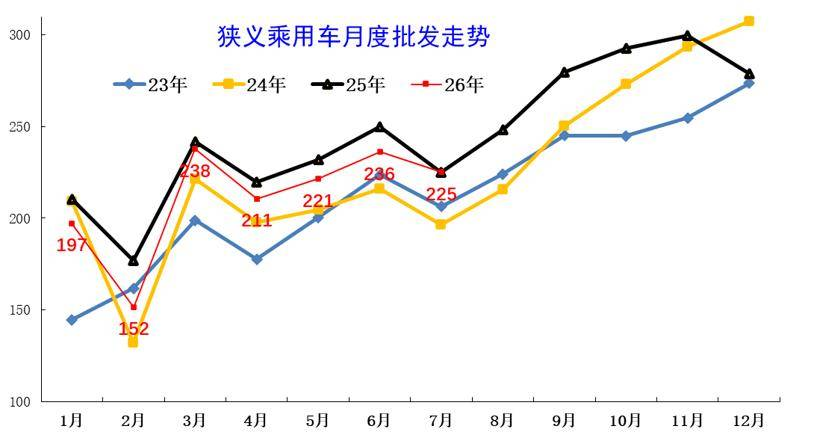

7月全国乘用车厂商批发225万辆，较同期持平，半年后首次实现月度增速基本持平表现。历年7月的走势相对平稳，今年国内低迷但出口高增长，因此总体回归平稳。由于出口超强，国内批发少，去库存效果好，渠道压力明显改善。

7月全国乘用车厂商批发225.2万辆，同比基本持平，环比下降4.7%；受出口暴增的促进激励，7月乘用车批发同比增速较零售增速高出20.7个百分点。

3.近年狭义乘用车生产走势

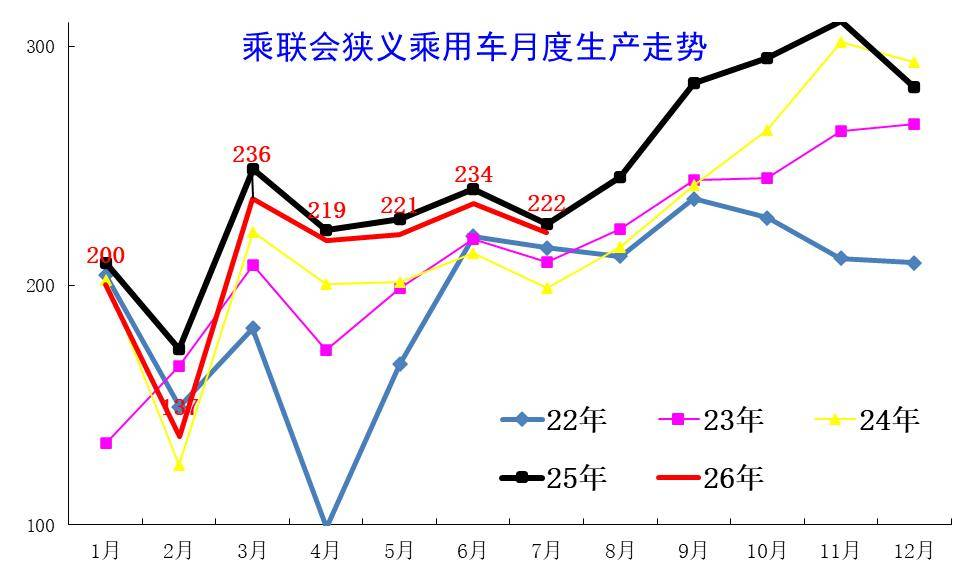

上半年乘用车生产减产力度较大。7月新国标启动，前期市场需求持续较弱，导致7月生产相对较好，同比走势改善。

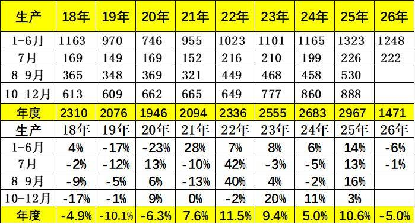

7月乘用车生产222.2万辆，同比下降1.6%，环比下降4.9%。7月豪华品牌生产同比下降21%，环比下降12%；合资品牌生产同比下降35%，环比下降24%；自主品牌生产同比增长12%，环比增长0.1%。

4.近年狭义乘用车出口走势

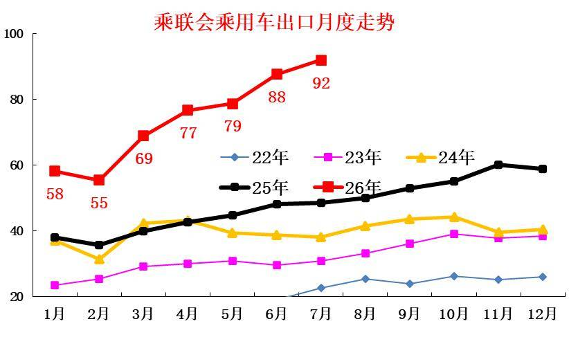

7月乘用车出口（含整车与CKD）92万辆，少有的连续2个月爆发式增长，突破90万规模，与2025年7月平稳走势反差较大。

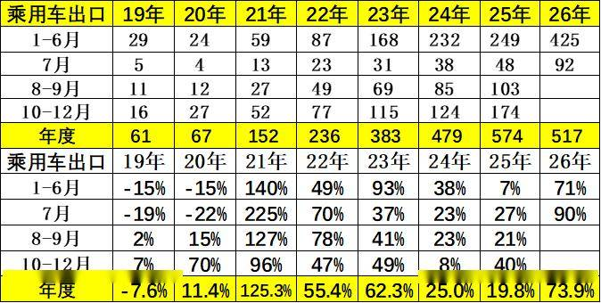

7月乘用车出口（含整车与CKD）91.8万辆，同比增长90%，环比增长4.9%，占乘用车厂商销量41%（上月37%，2025年同期21%）。7月新能源车占出口总量的58.8%，较同期增加14个百分点。7月自主品牌出口达到77.5万辆，同比增长87%；合资与豪华品牌出口14.3万辆，同比增长108%。

5.产销库存月度变化特征

由于7月厂商生产安排极其谨慎，7月厂商批发高于生产3.0万辆，而厂商月度国内批发低于国内零售12.7万辆。今年去库存特征突出，1-7月总体乘用车行业库存下降64万辆（2025年同期下降25万辆、2024年同期下降60万辆、2023年同期下降18万辆）。

6.狭义乘用车促销走势

A、新能源车促销力度小幅增长

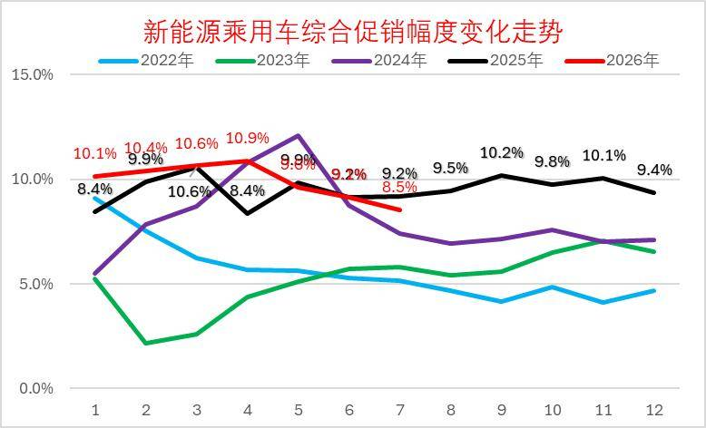

2026年7月的新能源车的促销下降到8.5%的中低位，较同期促销下降0.7个百分点，较上月降0.7个百分点。近几个月的促销收缩较大，随着低价新车的增多，新车切换的促销急剧下降，7月促销体系暂时回收，目前基本保持正常促销水平的中低位。

B、燃油车促销走势逐步下降

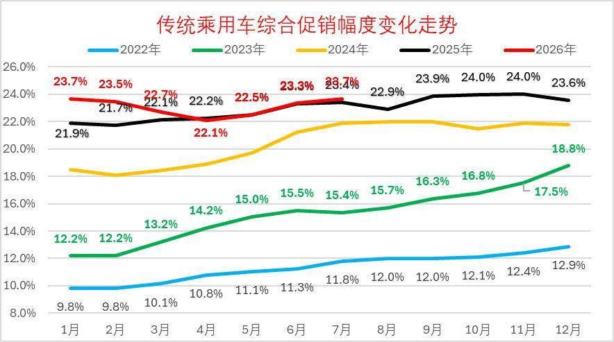

2026年7月传统燃油车的促销回升到23.7%的水平，较上月微增0.4个百分点，较同期微增，燃油车促销连续1年多维持在23%左右。

传统燃油车的促销2025年9月开始小幅加大，幅度较温和，2026年因降价力度大，实现促销逐步回落。

C、豪华车促销走势大幅下降

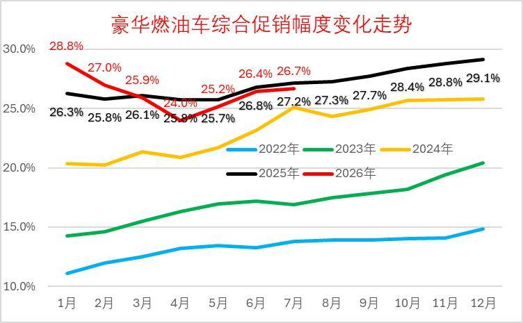

2026年7月豪华车的促销逐步达到26.7%的中高位，较上月回升0.3个点，较同期下降0.5个百分点。虽然消费升级推动高端需求较强，但2025年7月以来豪华车促销力度加大,2026年年初以来的新车指导价降价力度较大，促销因此下降，实际成交价格变化不大。

D、主流合资车促销走势平稳

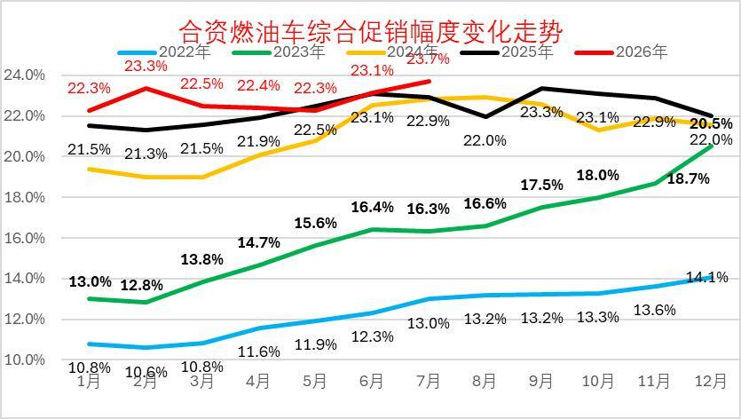

2026年7月合资燃油车的促销逐步达到23.7%的低位，较上月增加0.6个点，较同期增0.8个百分点。合资促销近期稍有增大。

合资燃油车的促销从2023年的13%的低位，2025年9月回升到23.7%峰值，随着新车强力降价，近三个月小幅波动。由于新车价格特别低，因此总体促销力度2-5月明显下降，6-7月相对平稳微增。

E、自主燃油车促销走势保持平稳

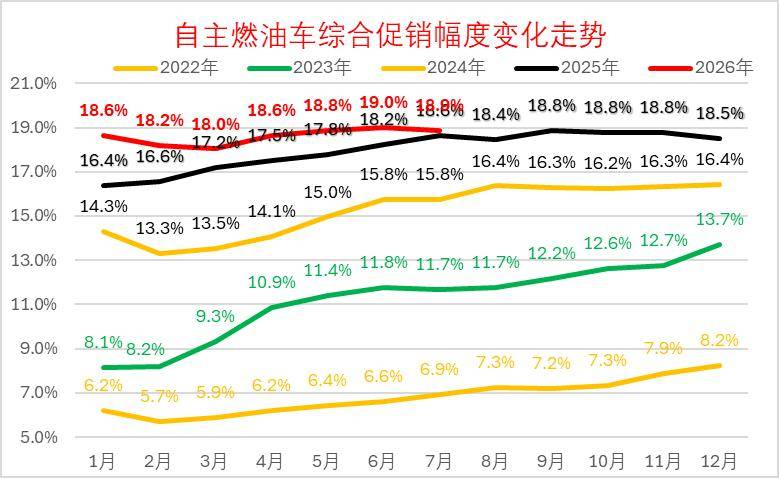

由于自主的新能源较强，加之燃油车出口较好，自主燃油车促销总体平稳。

2026年7月自主燃油车的促销逐步达到18.9%的高位，较同期增加0.8点。自主车企在2024-2025年上半年的促销上升较快，随后2025年下半年以来的促销总体稳定。

F、分动力促销力度跟踪相对温和

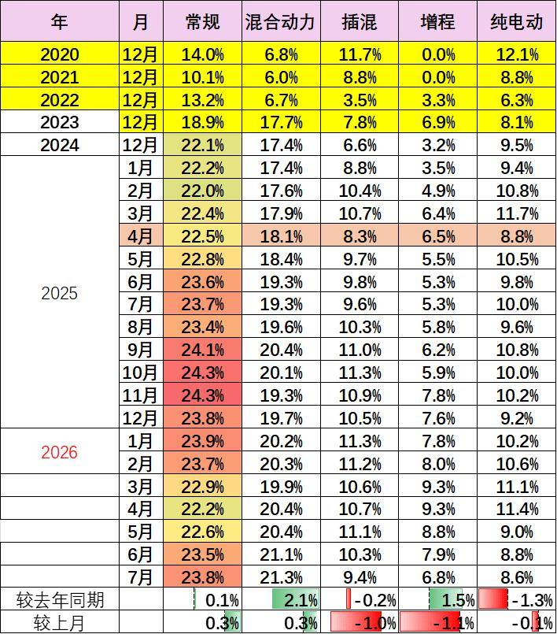

由于部分品牌降价带来的指导价回归，降低了促销幅度。2026年的常规燃油车和混合动力的降价力度大、高油价下销量差，促销力度也持续增大。

新能源车促销明显改善，插混和增程的促销明显改善，新品的促销降低改善市场表现。纯电动车型因为主力车型切换，促销较2025年7月下降1.3个点左右的促销，较上月下降0.1%左右促销。

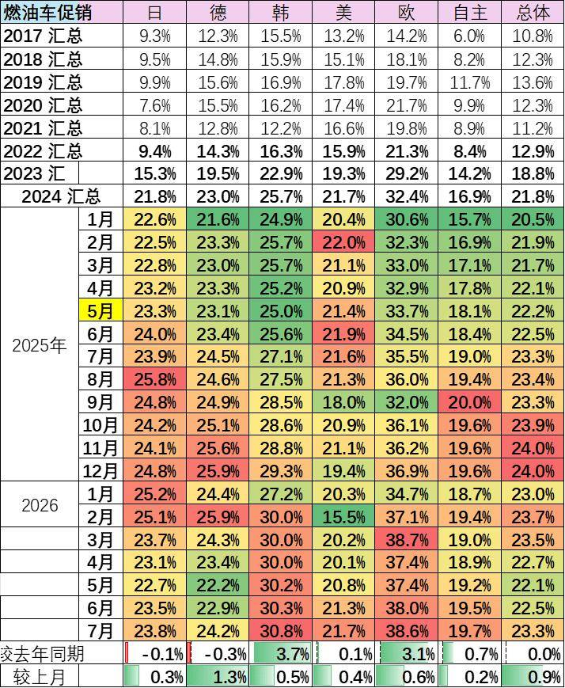

7月的车市促销相对平稳，经销商也是稳促销保利润。目前的欧系和韩系促销大，其它合资车企促销基本22%左右，差异不大。自主车企仍是促销最小的。

7.狭义乘用车各级别增长特征

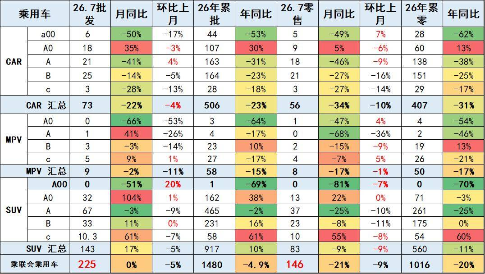

2026年7月乘用车零售降21%，批发下降5%，零售大幅弱于的批发增速,形成内冷外热格局。由于高油价冲击和补贴暂停带来零售回落，7月A级轿车零售与A00级轿车零售均较低，A0级轿车和高端车型成为7月零售主力，SUV的高端表现较强，轿车中主要是A0级轿车销量回升。

8.狭义乘用车国别增长特征

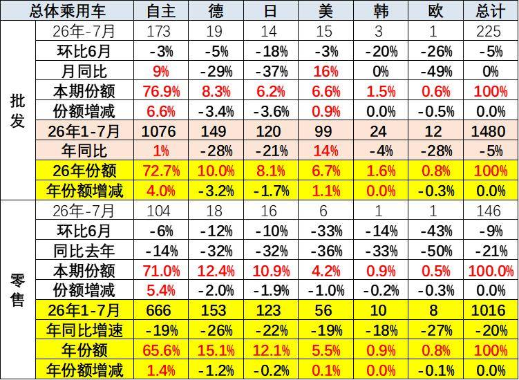

7月自主品牌零售104万辆，同比下降14%，环比下降6%。当月自主品牌国内零售份额为71.0%，同比增长5.4个百分点。自主品牌在新能源市场和出口市场总体较平稳。

7月主流合资品牌零售29万辆，同比下降35%，环比下降12%。7月德系品牌零售份额12.4%，同比下降2.0个百分点；日系品牌零售份额10.9%，同比下降1.9个百分点；美系品牌市场零售份额4.2%，同比下降1.0个百分点。低销量合资车企逐步恢复活力。

7月豪华车零售13万辆，同比下降27%，环比下降23%。随着豪华车指导价的合理回归，7月豪华品牌零售份额8.7%，同比下降0.7个百分点。

9.2026年品牌产销特征

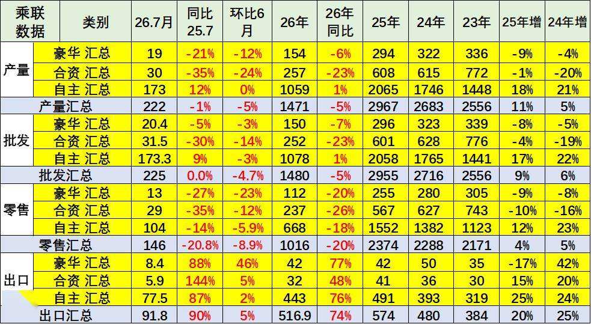

原有的品牌价值体系变化，豪华品牌近期持续压力加大，合资车企的产销走势压力持续较大，自主品牌产业链优势明显。

7月需求分化压力较大，燃油车市场环比走势较差，导致合资品牌走势恶化。自主靠新能源和出口相对表现较好。

10.全国新能源渗透率-批发

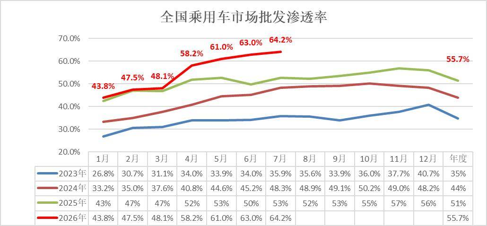

7月新能源车厂商批发渗透率64.2%，近几个月连续创造渗透率历史峰值，较2025年7月提升11个百分点。

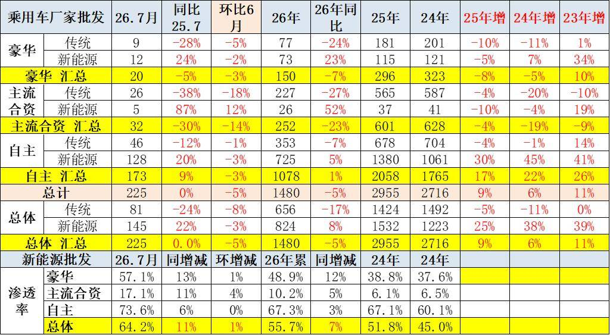

7月自主品牌新能源车渗透率73.6%；豪华车中的新能源车渗透率57.1%；主流合资品牌新能源车渗透率上升到17.1%。

7月传统车厂家批发同比降24%，而新能源车同比增22%，增速差距近50个百分点，燃油车的市场持续低迷，新能源出口的贡献度大。

11.全国新能源渗透率-零售

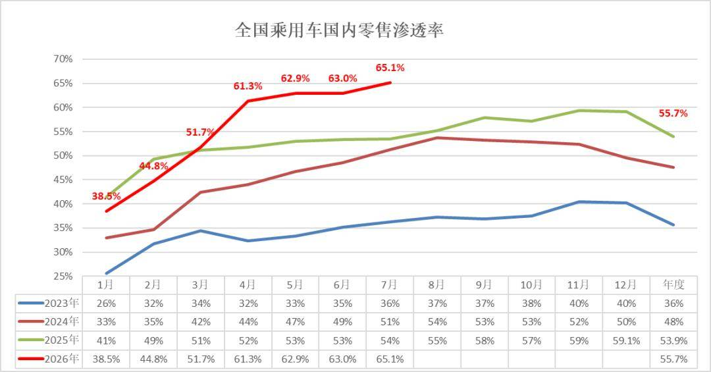

7月新能源车在国内总体乘用车的零售渗透率65.1%，近几个月连续创造渗透率历史峰值，较去年同期增长11.1个百分点，环比增长2.1个百分点。

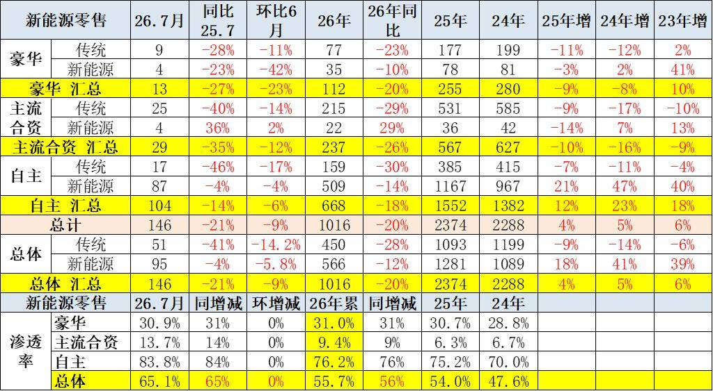

7月国内零售，自主品牌中的新能源车渗透率83.8%；豪华车中的新能源车渗透率30.9%；而主流合资品牌中的新能源车渗透率仅上升到13.7%。

7月燃油车零售同比下降41%，新能源车下降4%，差距仍是30多个百分点左右。但7月燃油车的环比走势弱于新能源车，形成油价上涨后的需求下滑的特征。

附：近日信息合集
