# 国补预售权益价16.99万元起，别克至境L7纯电开启预售

- 公開日時: 2026-08-10 18:18（北京時間）
- 出典: [搜狐号・崔东树](https://www.sohu.com/a/1062594665_115312)
- テーマ（自動判定）: その他
- 画像: 13枚

---

别克至境L7纯电 | 官方预售价 | 预售权益价 | 国补预售权益价
702奢享版 | 19.49万元 | 18.49万元 | 16.99万元
702奢享智行版 | 21.19万元 | 20.19万元 | 18.69万元
702艾维亚版 | 23.19万元 | 22.19万元 | 20.69万元
车身颜色 ：玄岩黑、金沙米、晶钻紫、星砂绿（选配）、落樱粉（选配）
内饰颜色 ： 琥珀暖棕、极夜追星、松霜雾蓝、霞紫月白、远山含翠（选配）、丹霞夜巡（选配）
预售权益：
1. 现金膨胀礼：享1,000元定金抵扣6,000元购车尾款
2. 置换补贴：享5,000元品牌置换补贴
3. 早鸟限量联名礼：限时下定享价值5,000元别克至境L7 X 拉夫劳伦香氛联名限量礼盒【极度舒适高定礼】
4. 外观选装礼：价值5,000元 全新车色（星砂绿、落樱粉）免费选装升级
5. 内饰选装礼：价值5,000元 全新内饰（远山含翠、丹霞夜巡）免费选装升级
6. 智行礼：价值30,000元 逍遥智行辅助驾驶终身使用权
7. 安心礼：首任非营运车主三电终身质保
8. 金石之约：3年内单次车损大于等于购车价30%，免费换新车（新车购买90天内，非营运车主可享特惠1,999元购买此权益）

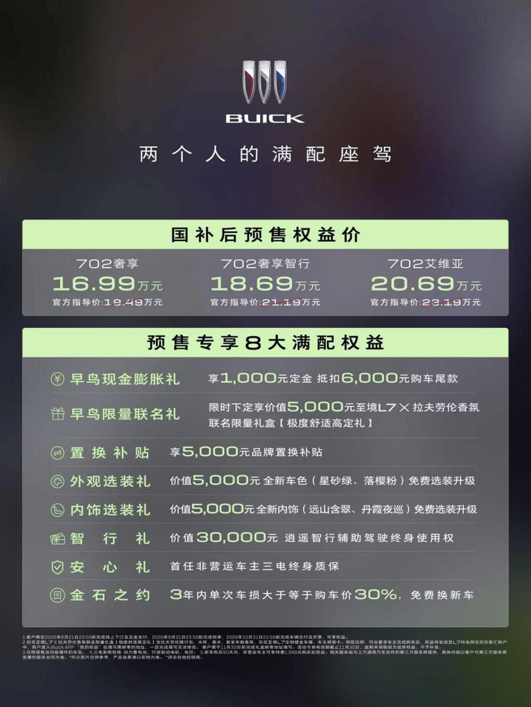

别克至境L7纯电预售权益

作为专为情侣、新婚夫妻打造的“两个人的满配座驾”，别克至境L7纯电不仅给足用车层面的满配诚意，更把仪式感延伸到用户的幸福人生节点。预售发布会现场，别克面向广大车主与经销商发起“幸福护航联盟”集结招募，旨在携手更多车主组建专属婚车车队，以车轮承载祝福，为每一段幸福旅程保驾护航。

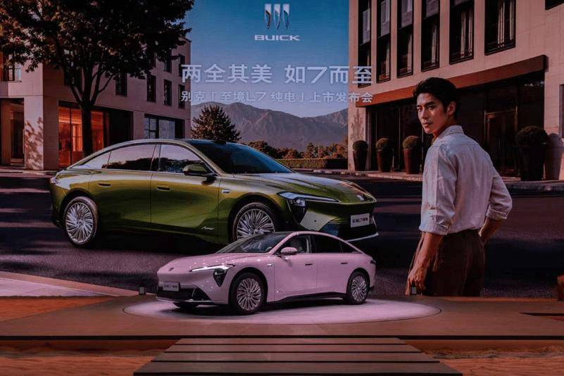

两全其美 如7而至 别克至境L7纯电预售

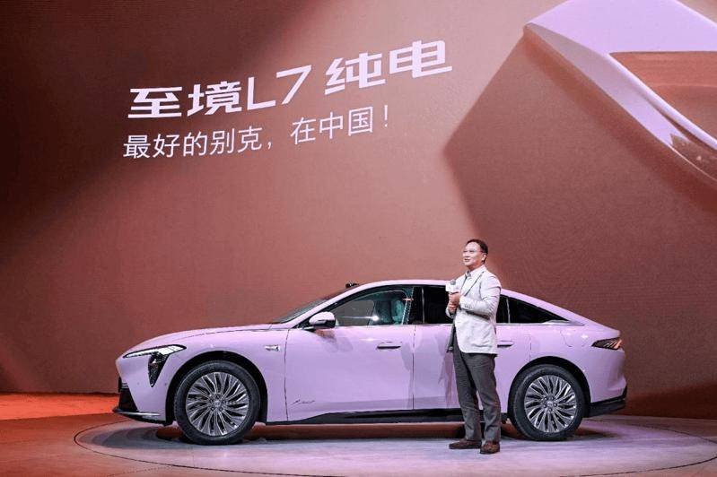

上汽通用汽车总经理徐平致辞

专属全新车色 颜值质感“极度养眼”

挑车和挑伴侣的逻辑不谋而合——既要第一眼动心，也要经得住长久相处。别克至境L7纯电带来“星砂绿”与“落樱粉”两款全新车色：星砂绿底色深邃温润，漆面融入暖色金属颗粒，自然光下泛出细腻金调，搭配8层抗刮耐晒涂装，久用依旧莹润；落樱粉经过29轮调色校准，低饱和粉紫色调呈现纯净雾感质地，精准还原春日樱花飘落的浪漫氛围，日常出行与婚礼场合都能成为视觉焦点。

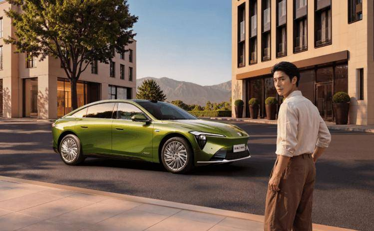

全新车色“星砂绿”

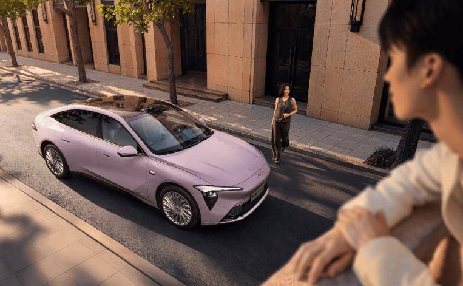

全新车色“落樱粉”

外在出彩，座舱质感同样拉满。别克至境L7纯电同步推出“远山含翠”“丹霞夜巡”两款内饰主题：远山含翠温润治愈，与星砂绿车身相得益彰；丹霞夜巡冷峻高级，沉稳不失简约。两人不管偏好哪种风格，触手可及都是考究质感。

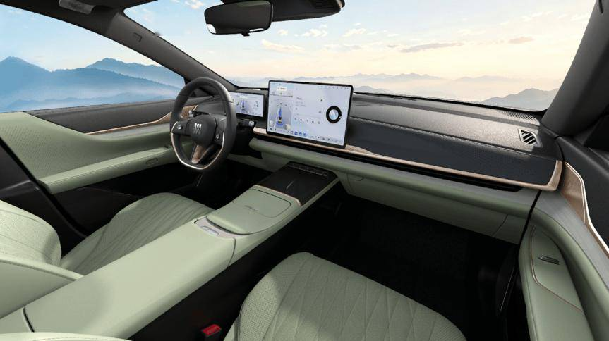

全新内饰“远山含翠”

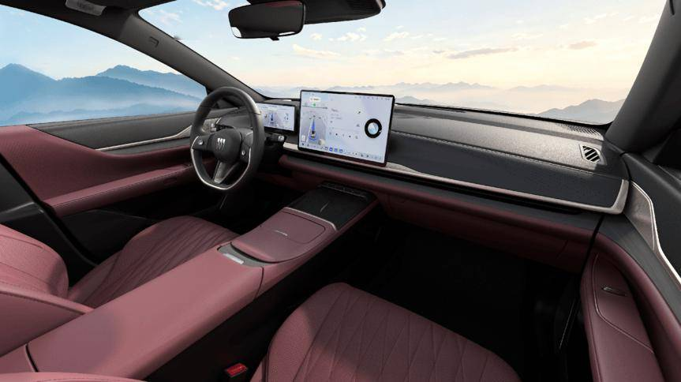

全新内饰“丹霞夜巡”

全系标配“876”和55℃控温超快充智电体验“极度靠谱”

周末约会，怕续航见底扫了兴致；下班接人，又怕充电耽误了约定时间。两人的甜蜜出行，不该被用车焦虑打乱节奏。别克至境L7纯电用满配三电实力，守护两人的出行时光。

新车全系标配800V全域高压架构、702kmCLTC真续航、6C控温超快充，以及同级唯一的80.6度奥特能2.0电池，并全系采用宁德时代电芯。入门即享的满配三电，满足日常通勤一周一充，下班不用绕路充电耽误时间，周末跨城见长辈、长途出油也不用频繁找充电桩；10分钟即可补能450km续航，去服务区买杯咖啡的功夫就充够了，不用排大队等充电等到烦躁。同时，车辆配备有6kW V2L外放电功能，可同时驱动电烤箱、咖啡机、投影仪等多台户外电器，近郊露营时接电烤串、放露天电影，约会的仪式感随手就能安排。

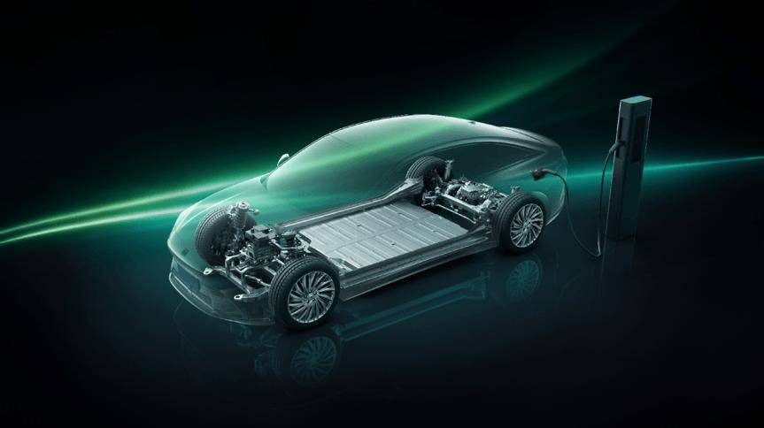

全系标配“876”，入门即享满配三电体验

动力表现也全程在线，不因电量高低妥协。新车搭载282kW驱动电机，峰值扭矩382N・m，配合Boost动力超频模式，零百加速仅需5.6秒，动力响应随叫随到；即便电量低至10%，高速超车、爬山路都干脆利落，自己开着过瘾，动力输出平顺不窜。

高效补能的背后，是奥特能平台的安全技术支撑。别克至境L7纯电搭载首创55℃控温超快充技术，通过四重热管理机制，将快充全程电芯峰值温度控制在55℃以内，低于国标65℃上限，做到80万公里低衰减，频繁快充也不用担心电池早衰，不用忧虑后期换电池额外花钱；奥特能平台实现56亿公里行驶零自燃、事故零起火，实打实的安全数据兜底，自己开着放心，家人坐着也踏实。

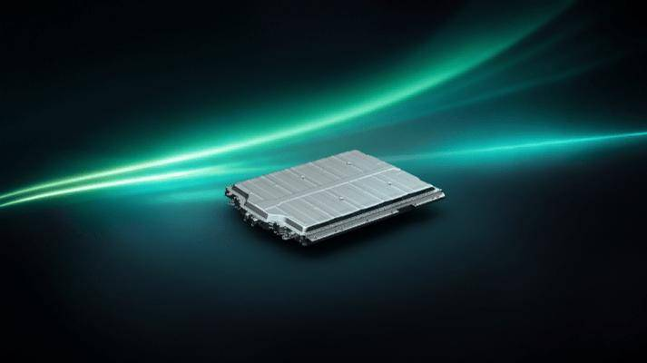

全系标配55℃控温超快充技术，打造更安全的800V平台

行业首创悬浮减压座舱 豪华舒适“极度宠爱”

专属于两个人的“移动小窝”，从来不需要谁迁就谁，主驾开得顺手，副驾被宠到位，才是满配座驾该有的样子。别克至境L7纯电打造行业首创悬浮减压座舱，从环境、座椅到底盘全维度优化，将舒适从静态乘坐延伸至动态行驶全程，给乘员独一无二的宠爱礼遇。

同级唯一五恒大健康座舱，以“恒静、恒洁、恒氧、恒温、恒湿”把车内变成只属于你们的移动疗愈空间，有效降低皮质醇、舒缓日常压力。6mm双层夹胶玻璃，带来静谧舒适的座舱环境；PM2.5自动整车净化搭配生化级滤芯，还有CO₂智能调节，关上门就是清新的森林氧吧，哪怕换季敏感、梅雨季闷湿天也能坐得舒服；多区空调搭配自动除湿系统，采用散流式送风设计，冷风不直吹脸避免皮肤拔干，暖风从脚起不怕穿短裙冻腿，全程动态调节车厢湿度，体感始终像春日般温润舒适。

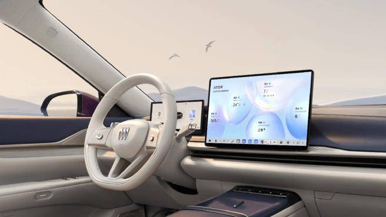

五恒大健康空间，身心皆放松，压力全清零

全车全系标配悬浮减压座椅，配齐电动腰托、通风、加热与按摩功能，还经过十大黄金人体工程优化，受力均匀分散，哪怕开长途出行，坐久了也不会腰酸背痛。专属于她的副驾更是拉满仪式感：标配双120°零重力座椅，一键躺平就能最大程度释放脊椎压力，逛了一天街坐上去瞬间就能放松；搭配同级最大PDLC瞬控调光天幕，0.02秒就能调成遮光模式，阻隔99.9%紫外线，夏天坐也不怕晒黑晒红；27扬声器音响搭配独立头枕音响，提前下载好喜欢的歌单，上车即沉浸在心动旋律里；还有车载智能香氛，3种调香自定义，通勤解乏、约会升温，让每段行程都拥有恰到好处的氛围感。

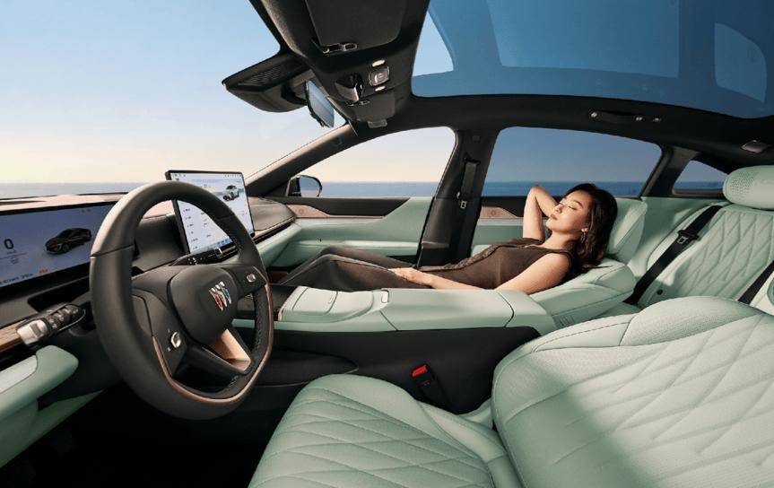

全系标配副驾双120°零重力座椅，入座即回血，减压更轻松

动态行驶的宠爱更是藏在看不见的地方：全系标配RTD连续阻尼可变悬挂，智驾版搭载预瞄悬浮魔毯底盘，能够提前扫描前方20米路面，每秒500次调节阻尼，过井盖、减速带、坑洼路面都能把颠簸过滤得干干净净，起步不仰头、刹车不点头，你开得顺手，她坐在副驾喝咖啡不会洒，补妆也不怕手抖，偶尔后排载着双方长辈出行也稳得不会晕车；搭配后排劳斯莱斯同款悬浮层，零压坐感体验，腰部、臀部、腿部压力均匀分散，全程保持自然松弛的坐姿；电动可调靠背角度+腰托支撑，贴合人体脊椎曲线，长辈久坐也不会出现腰部僵硬、背部酸痛的不适。

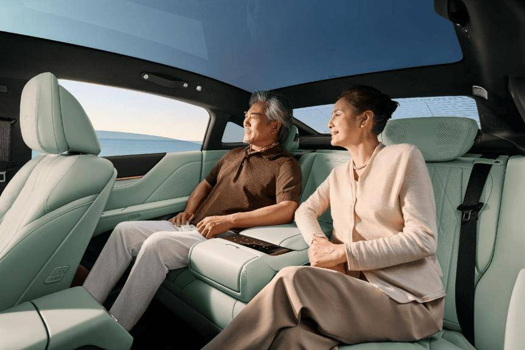

预瞄悬浮魔毯底盘，扫平路面颠簸，长辈乘坐不晕车

安全超国标168倍 爸妈严选“极度安全”

两个人的幸福选择，也是两家人的安心托付。别克至境L7纯电以远超国标的验证标准，让安全成为不可退让的底线，也成为双方长辈认可的“严选座驾”。

电池安全依托奥特能技术全面加码：电池包采用“七纵五横”高强度壳体+底盘五层缓冲防刮设计，从物理层面降低电芯受损风险；别克坚持“国标不做的我们做，国标做的我们翻倍做”，电池验证项目比新国标多60%，其中热扩散测试严苛程度最高达新国标的168倍，远超国标要求的安全阈值。

车身采用笼式安全乘员舱设计，高强钢与铝材占比达83.4%；侧气帘从前排延伸至C柱后方，覆盖前后排安全守护；整车累计完成77项安全碰撞测试，比国标+C-NCAP测试项目总和多51项，覆盖正面柱碰、偏置碰撞、卡车钻底等极端工况，以远超标准的验证强度，把风险消解在研发阶段。

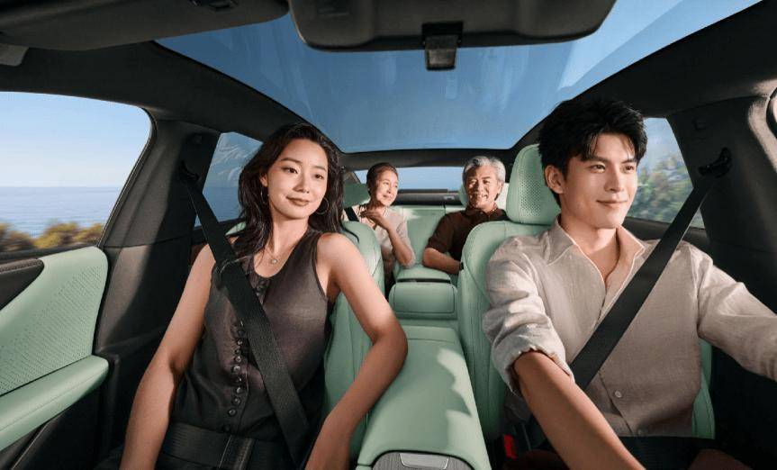

两个人的满配座驾，两家人的安全严选

从第一次约会兜风的心动，到组建小家庭后的日常陪伴，别克至境L7纯电始终懂你们想要的满配——是主驾的驾控乐趣与靠谱安心，是副驾的专属宠爱与舒适松弛，更是两家人都认可的安全感。现在这款“两个人的满配座驾”已正式开启预售，不妨拉上你的另一半，去别克全国展厅亲身感受，让它成为你们幸福旅程的专属同行者，陪你们走过每一段甜蜜时光。
