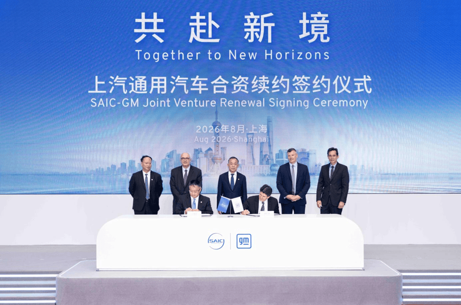
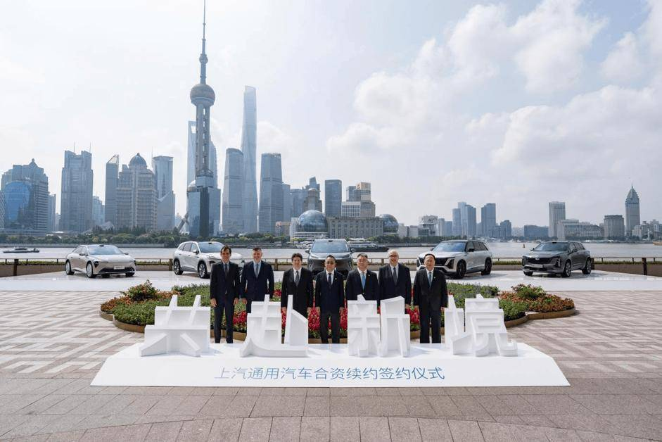
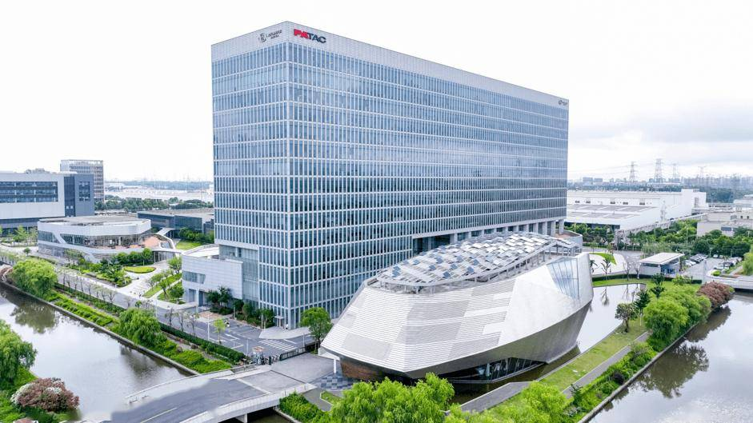
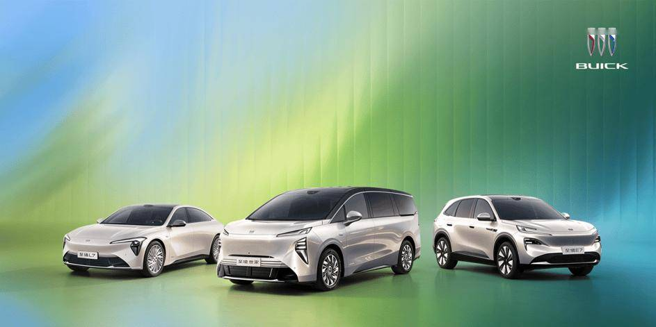
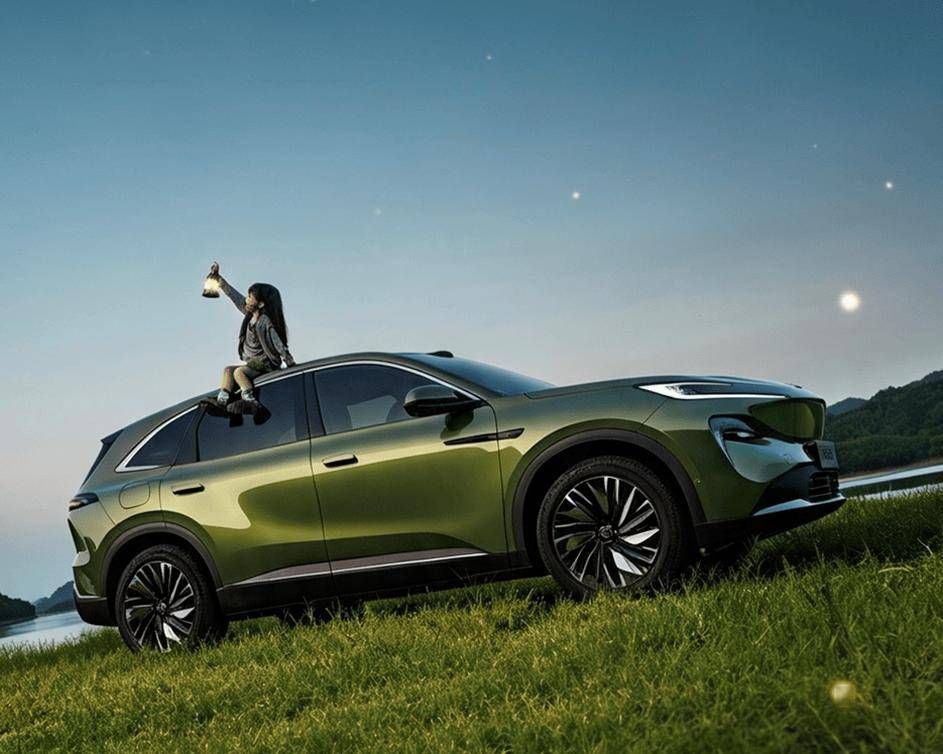

# 上汽通用汽车开启智电转型与全球化发展新境

- 公開日時: 2026-08-10 18:18（北京時間）
- 出典: [搜狐号・崔东树](https://www.sohu.com/a/1062594915_115312)
- テーマ（自動判定）: 世界市場
- 画像: 5枚

---

2026年8月5日今天，“共赴新境——上汽通用汽车合资续约签约仪式”在上海世界会客厅举行。上汽集团与通用汽车正式签署合资续约协议，将上汽通用汽车合资期限延长20年至2047年。双方表示，此次合作续约是基于近30年成功合作的基础，在全球汽车产业深刻变革背景下，上汽集团和通用汽车对中国汽车市场长期价值以及对上汽通用汽车转型能力和发展前景投下的一张信心票。双方股东将进一步协同技术研发、供应链与全球市场资源，为上汽通用汽车的智电转型、本土创新、全球化布局与长期健康发展提供持续支持。

合作新境：近30年携手，树立汽车产业开放合作的标杆

作为1997年上海市政府的“一号工程”和中美之间最大的合资项目之一，上汽通用汽车成为了中国改革开放与汽车产业现代化进程中极具代表性的实践样本。近30年来，其价值早已超越一家整车企业本身——既是上海连接全球汽车产业资源的重要平台，也是推动中国本土产业链、研发体系和汽车消费升级的重要力量，更见证并参与了中国汽车工业从技术引进到自主创新、走向全球的发展历程。这段历程留下的，不只是销量和规模，更是一系列具有行业标志意义的突破。

成立之初，它以23个月建厂、投产当年即盈利的“上海速度”，刷新全球整车工厂建设与投产效率纪录，树立起产业效率标杆；此后，又率先在国内合资车企中建立全球标准的制造、质量和供应链一体化运营体系，并在长期本土化发展中不断拓展合资企业的能力边界，如今已成为业内首家完整掌握产品定义、技术路线、验证标准和量产落地等核心决策权的合资车企。

在研发领域，上汽通用汽车依托泛亚汽车技术中心，开创合资车企本土研发的先河，逐步成长为国内首家同时具备整车与新能源三电系统正向开发、验证和量产能力的合资车企，为行业输送了大批本土研发人才，更主导或参与制定近300项行业标准。

从燃油车时代到新能源时代，上汽通用汽车持续将创新的技术和产品引入中国市场，不仅推出过多项行业首发技术，并开创多个具有代表性的细分车型品类，在满足消费者多元化出行需求的同时，也不断参与定义中国乘用车市场的竞争格局。近年来，上汽通用汽车更以长期主义精神为指引，始终坚持稳健可持续经营思路，统一执行全球高标准整车品质管控，拒绝粗放低价内卷，不以产品品质换取短期市场增量，倡导行业摒弃无序价格战，树立理性、健康、重产品力的行业发展新风向。近30年的发展实践表明，上汽通用汽车不仅是一家合资企业成长壮大的成功案例，更是中国汽车产业由开放合作走向本土创新、由服务国内市场迈向参与全球竞争的代表性样本。

信心新境：智电转型成效初显，股东双方再续20年加码未来

当前，全球汽车产业加速向电动化、智能化转型，面对新的市场环境，上汽通用汽车主动拥抱变革，加快推动产品、技术和运营体系重塑，并依托近30年积累的本土体系优势，探索出一条兼顾全球品质标准、中国用户需求与本土高效创新的转型路径——“至境模式”。

这一模式的本质，是全球技术积淀与本土极致创新的深度融合。 一方面，依托泛亚沉淀的本土研发体系与成熟的国内供应链，以及上汽集团近年来领先的智电技术能力的赋能，上汽通用汽车实现了对中国市场需求的敏捷响应与技术的快速迭代；同时，承袭通用汽车百年技术底蕴与全球严苛标准，上汽通用汽车的新能源产品也为消费者提供了卓越的产品安全性与可靠性。这种全球技术与中国创新的相互赋能，多方优势互补，共同构筑起上汽通用汽车面向智电时代的独特竞争力。

2025年，“至境模式”便交出了技术与产品的双重答卷。在技术端，推出合资车企首个由中国团队主导研发的全域融合新能源架构——“逍遥超级融合架构”，完成纯电、插电混动和增程等全类新能源技术的布局，实现本土原生研发体系的全面跃升；在产品端，同步推出别克高端新能源子品牌——别克至境，一年间便快速构建起覆盖轿车、SUV和MPV的全品类产品阵容，产品落地效率位居合资之首，旗下别克至境E7更创下合资新能源产品最快交付破万的销量纪录，别克至境世家成为2026年上半年中国40万以上豪华新能源MPV销量冠军，至境L7在增程轿车细分市场名列前茅。“至境模式”证明了合资企业同样能够具备中国洞察、中国速度和中国创新，实现高效产品迭代与高品质标准的有机统一。

面向未来，双方股东将为上汽通用汽车持续加强资源投入，支持本土团队主导全新车型和新能源、智能化技术研发。根据规划，从现在起到2030年，上汽通用汽车将推出至少30款新能源车型，不断完善别克和凯迪拉克新能源产品矩阵，在巩固企业新能源渗透率合资领先的同时，加快跻身中国新能源主流品牌的阵营。在智能化领域，上汽通用汽车也将进一步整合本土研发能力，积极拥抱中国科技产业链，加快包括智能座舱和高阶自动驾驶的技术研发和产品应用，为中国消费者提供更智能、更安全、更高品质的智能出行体验。

全球新境：从“全球本土化”迈向“中国全球化”

此次续约不仅着眼于中国市场的长期发展，也将进一步打开上汽通用汽车全球化发展的新空间。过去，合资合作更多是将全球技术引入中国，并根据中国市场需求进行本土化应用；未来，上汽通用汽车将更加充分地发挥中国在用户洞察、技术创新、智能制造和产业链效率等方面的优势，推动更多由中国定义、中国研发、中国制造的产品和技术服务全球市场，实现从“全球本土化”向“中国全球化”的范式转变。

以“至境模式”为原点，上汽通用汽车将加大对新能源出海业务的投入。早在 2025 年 4 月别克至境品牌发布时，就已定下 “本土创新、全球共享” 的目标。依托逍遥超级融合架构，别克至境全系车型从研发阶段就同步对标多国法规与全球品质标准，从技术到产品都为出海埋下战略伏笔。

如今这一全球出海战略即将迈出实质性步伐。按照规划，别克至境E7将于今年10月正式出口海外市场，成为别克品牌及上汽通用汽车首款走向海外的高端新能源车型，标志着企业转型和全球化战略掀开新篇章。别克至境不仅将成为本土开发、反向出口海外的合资标杆，更为跨国车企提供了“本土创新、全球共享”合资出海新模式。在股东双方的支持下，未来上汽通用汽车还将持续开拓中东、非洲、南美、墨西哥和亚太地区的国际市场，进一步提升中国本土创新成果在全球市场的影响力。

伴随着企业近30年的发展，上汽通用汽车的发展轨迹早已与上海这座汽车产业重镇紧密交织。从1997年首次签署合资协议，到今天再度开启未来20年的合资合作，时代和产业环境不断变化，但上汽集团和通用汽车长期合作的信任始终如一，面向未来的决心坚若磐石。

这份信心和承诺，也为上汽通用汽车未来健康发展奠定了坚实基础。上汽通用汽车将持续深化产业链生态建设，与供应链伙伴共享增长机遇，给经销商网络注入转型动能，为中国消费者带来性能更优、体验更优、品质更优和安全更优的产品，以稳健的经营态势护航企业的长远发展，实现高质量、可持续的盈利增长。

此次续约，签下的是上汽集团和通用汽车的合作关系，传递的是股东双方对于中国市场长期发展的信心，开启的是上汽通用汽车未来高质量转型的发展新境。站在新的起点上，上汽通用汽车将继续扎根上海、深耕中国、走向全球，为上海建设世界级汽车产业中心和中国汽车产业高水平开放、高质量发展贡献新的力量。
