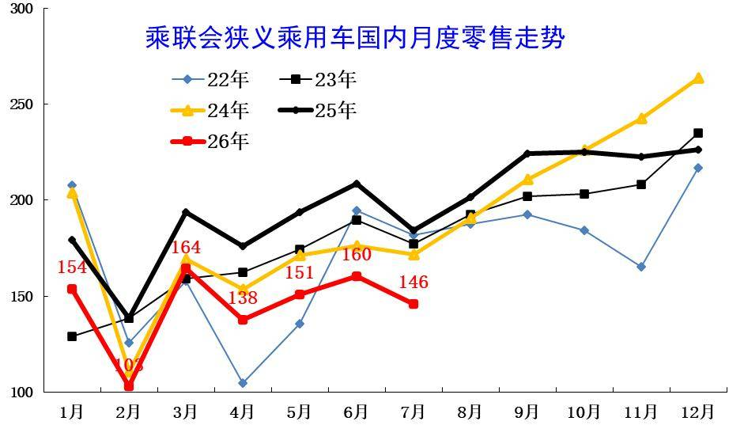
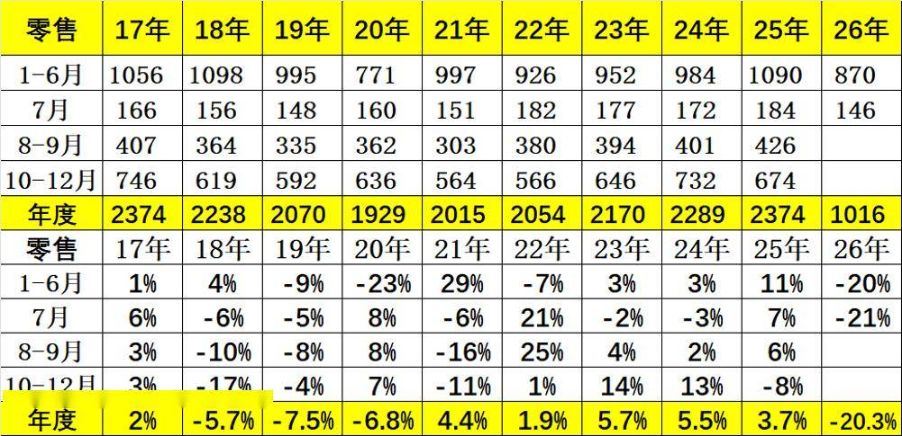
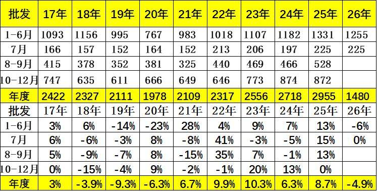
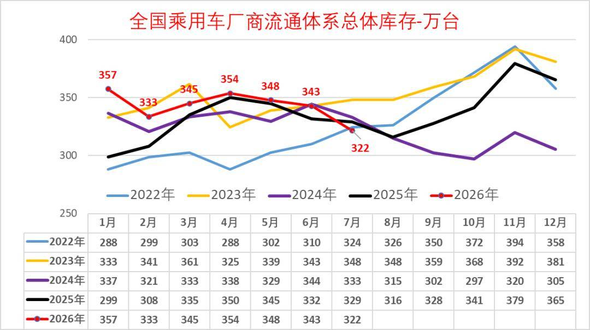
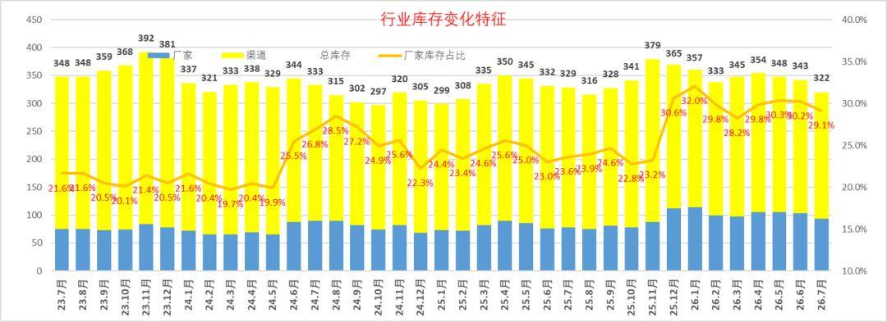
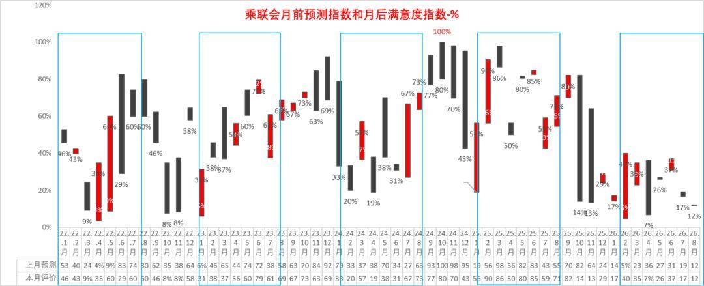
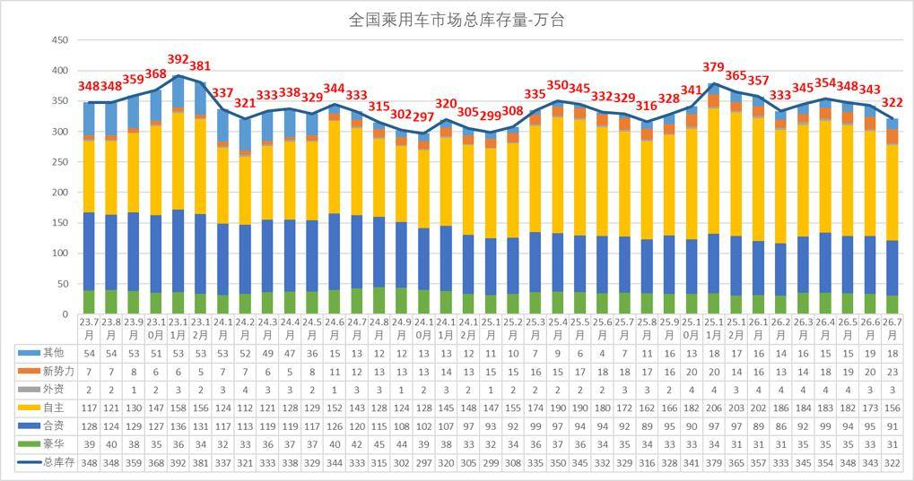
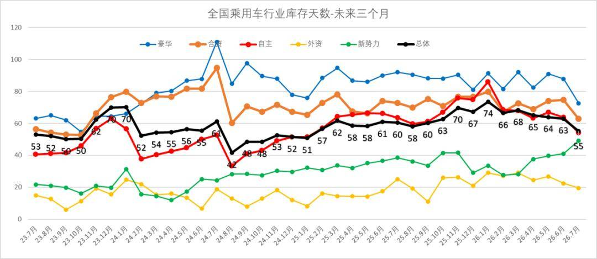
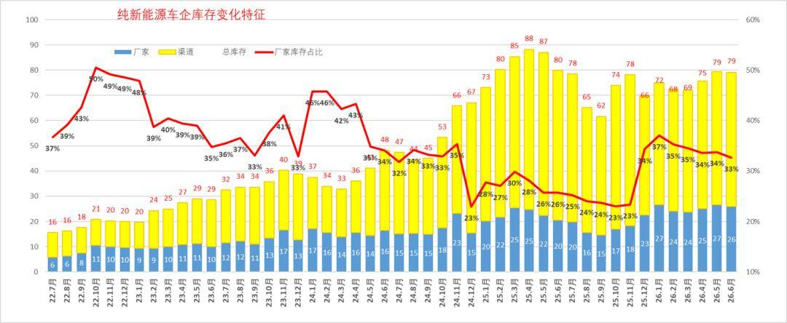

# 全国乘用车行业2026年7月末库存322万辆、库存55天、满意度17%

- 公開日時: 2026-08-18 15:17（北京時間）
- 出典: [搜狐号・崔东树](https://www.sohu.com/a/1064389968_115312)
- テーマ（自動判定）: 在庫
- 画像: 15枚

---

注：本分析文章仅代表崔东树个人观点，如有异议，请留言。

2026年7月末全国乘用车行业库存322万辆，较上月下降21万辆，较2025年7月下降7万辆，形成库存持续下降的趋势。其中厂家库存占比29.1%，相对回落。

乘联分会预测团队2026年7月乐观度19%，8月初的7月月后满意度为17%，预期低但满意度也差，主要是高油价的冲击太大。团队对8月市场的乐观度降到12%，这是近期市场乐观度判断的历史偏低预测指数。

我们根据未来N+3的月度零售预测测算库存支撑未来天数，未来零售是滚动变化的，因此不是固定的当月数据，库存天数也会随预测调整而变化。我们根据2026年7月底的库存与未来3个月国内零售量综合预估的现有库存支撑未来销售天数在55天，相对于2023年7月的53天、2024年7月的61天，2025年7月的60天，今年7月的总体库存天数相对较好。

2026年7月仅生产新能源车的企业的总库存保持在79万辆，环比上月持平，较2025年11月峰值库存增1万辆，但较2025年7月的78万台增1万辆。近期新能源经销商的厂家和渠道库存面临市场零售低于预期，行业库存总体压力较大。

1.近年狭义乘用车零售走势

7月全国乘用车市场零售146万辆，同比增长表现较弱，脱离正常增长线路。7月持续负增长原因是多元的，首先是高油价的影响，其次是以旧换新的新政策规范性较强和乘用车补贴缩水，加之上游涨价的剧烈冲击，深层原因是消费能力和意愿偏低。

2026年7月全国乘用车市场零售146万辆，同比下降21%，环比下降9%；今年以来累计零售1,016.1万辆，同比下降20%。2026年7月国内乘用车市场呈现总量持续承压、环比走弱、结构极致分化的运行态势，淡季下行特征凸显，行业结构性调整进一步深化。

2.近年狭义乘用车批发走势

7月全国乘用车厂商批发225万辆，较同期持平，半年后首次实现月度增速基本持平表现。历年7月的走势相对平稳，今年国内低迷但出口高增长，因此总体回归平稳。由于出口超强，国内批发少，去库存效果好，渠道压力明显改善。

7月全国乘用车厂商批发225.2万辆，同比基本持平，环比下降4.7%；受出口暴增的促进激励，7月乘用车批发同比增速较零售增速高出20.7个百分点。

3.近年狭义乘用车生产走势

上半年乘用车生产减产力度较大。7月新国标启动，前期市场需求持续较弱，导致7月生产相对较好，同比走势改善。

7月乘用车生产222.2万辆，同比下降1.6%，环比下降4.9%。7月豪华品牌生产同比下降21%，环比下降12%；合资品牌生产同比下降35%，环比下降24%；自主品牌生产同比增长12%，环比增长0.1%。

4.近年狭义乘用车出口走势.

7月乘用车出口（含整车与CKD）92万辆，少有的连续2个月爆发式增长，突破90万辆规模，与2025年7月平稳走势反差较大。

7月乘用车出口（含整车与CKD）91.8万辆，同比增长90%，环比增长4.9%，占乘用车厂商销量41%（上月37%，2025年同期21%）。7月新能源车占出口总量的58.8%，较同期增加14个百分点。7月自主品牌出口达到77.5万辆，同比增长87%；合资与豪华品牌出口14.3万辆，同比增长108%。

5.全国乘用车行业库存跟踪

2026年7月末全国乘用车行业库存322万辆，较上月下降21万辆，较2025年7月下降7万辆，形成库存持续下降的趋势。2025年的以旧换新政策启动带来厂商的总体乐观，以旧换新推动的销量较高，厂家生产相对谨慎，形成5-8月持续去库存。由于去年10月以来市场严重低于预期，11月库存创近两年新高，随后生产下调力度大，但市场零售下滑也超预期，因此上半年库存处于高位，7月减产力度大，库存较同期库存的降幅明显。

6.全国乘用车厂商库存跟踪

2023年以来乘用车行业整体库存保持相对平稳状态，2024年10月回落在297万辆左右,2025年11月回升到379万辆，随后回落，2026年7月的库存下降到322万辆，其中厂家库存占比29.1%。

由于前期市场预期较好，厂商生产热情较高，总体行业库存压力相对不可控。目前厂家库存占比逐步下降，市场严重低迷，厂家减产，未来几个月销量转旺的消化库存压力较小。

7.全国乘用车市场预测指数与满意度指数

我们按照PMI指数的设定方式和评价结果评价月度市场表现。根据厂家内部人员的预测汇总测算，乘联分会预测团队2025年初以来对市场预测很乐观，逐步悲观，预测团队2025年1-9月对市场预测很乐观，10月开始满意度持续暴跌到低位。2026年7月乐观度19%，8月初的7月月后满意度为17%，预期低但满意度也差，主要是高油价的冲击太大。

团队对8月市场的乐观度降到12%，这是近期市场乐观度判断的历史偏低预测指数。从目前的322万辆的库存水平和预期的到未来几个月的市场增长的判断，行业库存消化压力仍较大。鉴于目前销量持续低于预期的现状，车企需及时跟踪政策环境与市场变化，谨慎设定产销节奏，根据经销商库存结构，谨慎增加库存，及时清理历史库存。

8.全国乘用车市场总体库存特征

随着新能源车的占比提升，燃油车销量下降，对应的库存占压也逐步减少。从库存周期看，从2023年4月的325万辆，随后回升到2023年11月392万辆，随后下行到2024年10月的297万辆的库存低位。

2025年-2026年初仍属加库存周期，行业压力持续加大。近期车市下滑较大，由于新能源车萎缩较严重，库存的压力也并未有效缓解。

9.美国乘用车行业库存对比

美国的库存目前是在40-50天，总体的库存压力不大，这也是中国车市参考的对象。

10.全国乘用车市场库存天数小幅回落

随着2025年市场回暖的如期到来，生产走势较强，前期的去库存的特征改变，反内卷带来行业库存控制，库存增长相对温和。2025年4季度，虽然有免税政策的到期促进，但走势实际低于预期，行业库存天数峰值回升到2026年1月的74天，随后生产减产力度大。因此根据2026年7月底的库存与未来3个月国内零售量综合预估的现有库存支撑未来销售天数在55天，相对于2023年7月的53天、2024年7月的61天，2025年7月的60天，今年7月的总体库存天数相对较好。

11.全国新能源乘用车库存持续上升

从仅生产新能源车的企业的库存变化特征分析看，2023年年初库存20万辆，随后进入库存快速增长期， 2025年4月仅生产新能源车的企业的库存达到88万辆，这是近期的峰值。随着反内卷的推动，行业库存2025年9月降到62万辆，2026年7月仅生产新能源车的企业的总库存保持在79万辆，环比上月持平，较2025年11月峰值库存增1万辆，但较2025年7月的78万台增1万辆。近期新能源经销商的厂家和渠道库存面临市场零售低于预期，行业库存总体压力较大。

附：近日信息合集
