# 车市扫描-2026年31期（8月10日-8月16日）

- 公開日時: 2026-08-19 17:25（北京時間）
- 出典: [搜狐号・崔东树](https://www.sohu.com/a/1064979176_115312)
- テーマ（自動判定）: 車市スキャン（週次）
- 画像: 17枚

---

主要信息源自乘联分会每日新闻等

中国汽车流通协会

乘用车市场信息联席分会（乘联分会）

网站：http://www.cpcaauto.com

一、本周车市概述1.2026年8月全国乘用车市场零售相对平稳

【2026年8月1-16日乘联分会市场分析要闻】

8月1-16日全国乘用车厂家批发58.3万辆，同比去年同期下降25%，较上月同期下降1%；今年以来累计批发1539.3万辆，同比去年同期下降6%。8月1-16日市场零售62.8万辆，同比去年同期下降22%，较上月同期增长0%；今年以来累计零售1080.1万辆，同比去年同期下降20%。

8月1-16日全国乘用车厂家新能源批发42.5万辆，同比去年同期下降3%，较上月同期增长6%；今年以来累计批发867.3万辆，同比去年同期增长7%。8月1-16日新能源车市场零售39.9万辆，同比去年同期下降15%，较上月同期增长1%；今年以来累计零售606.7万辆，同比去年同期下降13%。

2026年8月1-16日全国新能源市场零售渗透率63.6%；新能源厂家批发渗透率72.9%。

8月第1周全国纯燃料轻型车生产13.7万辆，同比去年同期下降60%，较上月同期下降42%。8月第1周混合动力与插混总体生产7.3万辆，同比去年同期下降33%，较上月同期下降35%。

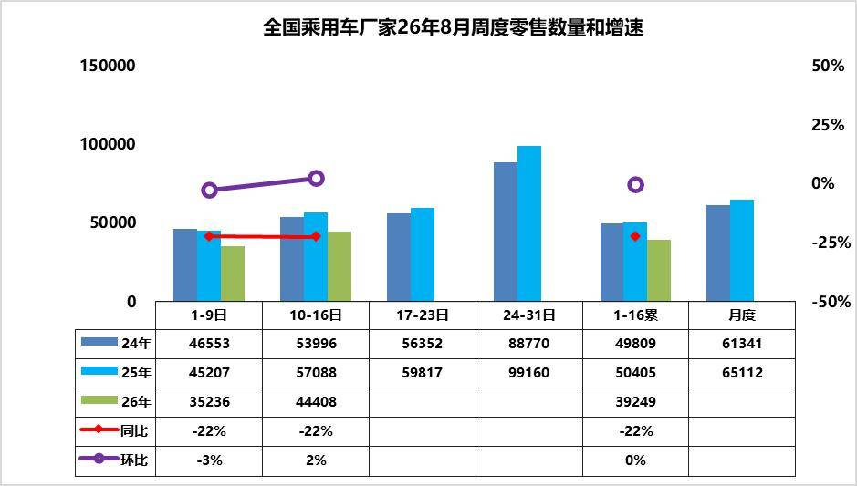

8月第1周乘用车市场日均零售3.5万辆，同比去年同期下降22%，较上月同期降3%。

8月第2周乘用车市场日均零售4.4万辆，同比去年同期下降22%，较上月同期增2%。

8月1-16日市场零售62.8万辆，同比去年同期下降22%，较上月同期增长0%；今年以来累计零售1080.1万辆，同比去年同期下降20%。

近期终端市场回暖节奏平缓，多重宏观与行业因素交织塑造了市场低位平稳格局。受霍尔木兹海峡通航受阻影响，7月国际油价震荡上行，国内成品油价格两轮累计上调近985元/吨，大幅抬升燃油车用车、养车成本，持续压制用户燃油车购买意愿，传统燃油车需求持续走弱。近期新能源车价格平稳，消费观望心态浓重。但随着8月中下旬开学季的到来，购车消费会有明显改善，小型电动车虽然新品少，但市场需求旺，加之以旧换新补贴的资金充沛，目标压力逐步加大，各地政策逐步宽松，预计会拉动车市改善加快。

8月车市处于底部蓄力修复阶段，随着各项稳消费政策逐步落地，叠加基数逐步改善，乘用车市场降幅将稳步收窄，行业正式进入价值驱动、结构优化的成熟发展阶段，为传统“金九银十”行情铺垫蓄力。

2.2026年8全国乘用车厂家销量平稳

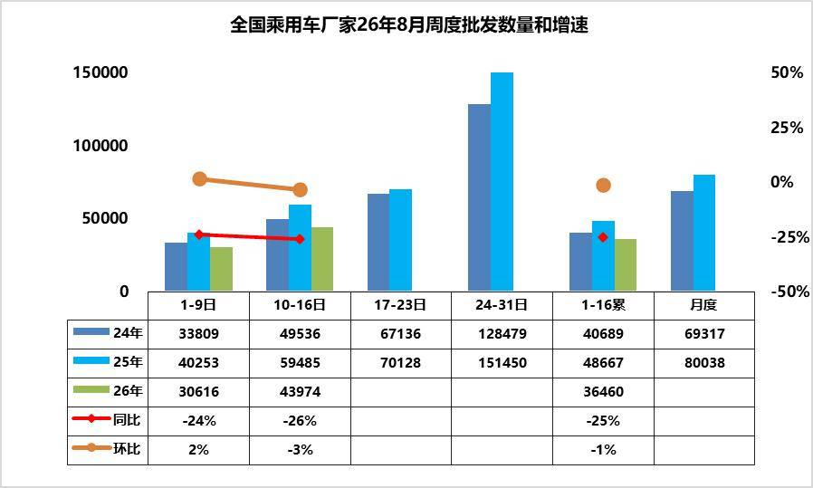

8第1周批发日均3.1台，同比去年8月同期下降24%，环比上月同期增2%。

8第2周批发日均4.4台，同比去年8月同期下降26%，环比上月同期降3%。

8月1-16日全国乘用车厂家批发58.3万辆，同比去年同期下降25%，较上月同期增下降1%；今年以来累计批发1539.3万辆，同比去年同期下降6%。

最新宏观数据显示国内消费与制造业景气偏弱，直接约束车市复苏力度。7月CPI同比上涨0.5%、环比微降0.1%，同比涨幅较上月显著回落0.5个百分点，反映终端内需动力不足；PPI同比上涨3.5%、环比下降0.7%，上游成本边际缓解但传导滞后；PMI回落至49.2%，制造业景气度下行，叠加居民消费信心谨慎，汽车大额消费观望情绪浓厚，导致车市整体增长乏力。

由于近期市场压力较大，主力厂家8月初高温假放假较多，燃油车市场去年火爆，今年受高油价冲击大，月初的厂家燃油车出货速度慢，因此年初暂时较低。今年部分区域局部洪涝灾害带来终端客流与销量的损失，月底成都车展大量新车密集上市，车市热度可能有所回升。

3.全国乘用车行业2026年7月末库存322万辆、库存55天、满意度17%

2026年7月末全国乘用车行业库存322万辆，较上月下降21万辆，较2025年7月下降7万辆，形成库存持续下降的趋势。其中厂家库存占比29.1%，相对回落。

乘联分会预测团队2026年7月乐观度19%，8月初的7月月后满意度为17%，预期低但满意度也差，主要是高油价的冲击太大。团队对8月市场的乐观度降到12%，这是近期市场乐观度判断的历史偏低预测指数。

我们根据未来N+3的月度零售预测测算库存支撑未来天数，未来零售是滚动变化的，因此不是固定的当月数据，库存天数也会随预测调整而变化。我们根据2026年7月底的库存与未来3个月国内零售量综合预估的现有库存支撑未来销售天数在55天，相对于2023年7月的53天、2024年7月的61天，2025年7月的60天，今年7月的总体库存天数相对较好。

2026年7月仅生产新能源车的企业的总库存保持在79万辆，环比上月持平，较2025年11月峰值库存增1万辆，但较2025年7月的78万台增1万辆。近期新能源经销商的厂家和渠道库存面临市场零售低于预期，行业库存总体压力较大。

4.2026年7月汽车增加值8.7%、生产-0.1%，汽车消费-17%，新能源汽车渗透率61%

今年以来，扩内需、促消费政策措施持续落地见效，我国消费市场发展质量不断提升，虽然入门级消费低迷，但消费新业态新模式活力迸发。

2026年1-7月，社会消费品零售总额287744亿元，同比增长1.2%。其中，汽车消费额22602亿元、同比降13%；除汽车以外的消费品零售额265142亿元，增长2.7%。7月份，社会消费品零售总额39022亿元，同比增长0.6%。其中，汽车消费额3130亿元、同比降17%；除汽车以外的消费品零售额35892亿元，增长2.5%。

7月份，规模以上工业增加值同比实际增长4.5%，其中7月汽车工业增加值增8.7%，汽车工业生产表现很强。1—7月份，规模以上工业增加值同比增长5.3%，汽车增长7.2%。

2026年1-7月汽车生产1761万台，同比降3%；新能源汽车生产895万台，同比增10%，渗透率51%；燃油车生产867万台，同比降14%。2026年7月汽车生产253万台，同比持平；新能源汽车生产155万台，同比增30%，渗透率61%；燃油车生产98万台，同比降27%。

2026年1—7月份，汽车行业固定资产投资同比下降5.3%，仍高于-6.7%的各行业平均水平。近期投资压力大的是第三产业，尤其是公共基础设施、教育、文化、卫生投资下降剧烈。

当前，虽然我们极力稳定国际油价，但高油价冲击产业链供应链稳定和消费需求仍较明显，高物价，衣食支出暴增，有效需求不足、市场缺乏活力等问题挑战仍然存在，行业稳增长任务依然艰巨。

由于2026年以旧换新的乘用车补贴力度远低于商用车，因此商用车补贴推动新能源零售增长特别好，新能源乘用车暴跌。目前乘用车消费压力很大，期待未来能有长效的强力接续政策，减免购车人员个税、推动新能源车下乡、设立经济型电动车标准，优化C7经济型电动车驾照申领、给200公里以下续航的合规纯电动车车购税更大优惠、鼓励结婚和生育购车等更多的改善措施，拉动购车消费促进经济增长。

5.7月份皮卡市场销售5.7万辆，同比增38%，环比下降9%

皮卡产销：2026年7月份皮卡市场销售5.7万辆，同比增38%，环比下降9%，处于近5年的当月高位水平。1-7月销量40万台，同比增15%。

国内市场和出口市场格局差异化明显。长城汽车持续保持强势皮卡领军地位，国内外表现均较平稳。受出口持续同比增长促进，上汽大通、江淮汽车、郑州日产、长安汽车表现较强。在国内皮卡零售市场，长城皮卡、江铃汽车、郑州日产、雷达汽车、江西五十铃等表现较好，国内“皮卡一超多强”格局继续保持。

皮卡出口：皮卡的海外市场远大国内市场需求，不要指望国内市场的不切实际的预期，出海是皮卡企业高增长的唯一选择。2026年7月全国皮卡出口4万辆，同比增长74%，环比增5%；2026年1-7月全国皮22.8万辆，同比增长40%，行业出口占比继续保持高位。2024年皮卡出口占比皮卡总销量的45%，2025年皮卡出口达到50%，2026年累计皮卡出口达到55%，2026年7月皮卡出口达到71%，中国自主皮卡出口提升较好。

新能源皮卡：2024年全国新能源皮卡销量2.12万辆，同比增长170%；2025年新能源皮卡7.3万辆，增长243%，2026年7月新能源皮卡0.9万辆，同比增115%，环比降2%；2026年1-7月新能源皮卡5.4万辆，同比增18%；形成新能源皮卡稍弱于燃油皮卡总体增速的走势。

随着电动化和乘用化的发展，皮卡市场的空间仍将逐步改善。7月新能源皮卡销量中：比亚迪皮卡海外销量5660台、吉利雷达电动皮卡2088台、郑州日产471台、长安增程皮卡555台，其它皮卡企业的新能源车也有一定规模。伴随着国内新能源皮卡市场启动，逐步培育市场，预计中国皮卡未来将会更快的发展来满足国内外需求。

二、本周上市新车1.零跑A05上市

8月11日，零跑A05上市，新车共推5款，售价区间为6.39万-9.09万元。新车采用圆形的车灯元素、半隐藏式门把手、笑脸尾灯。内饰采用8.88英寸液晶仪表、14.6英寸2.5K中控屏、IP BAR。新车配备高通8295座舱芯片、激光雷达、256色氛围灯、无麦K歌等。新车CLTC续航里程405km，510km。

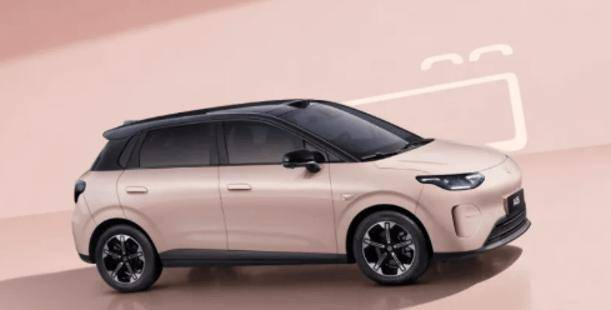

2.新款艾瑞泽8 PRO上市

8月10日，新款艾瑞泽8 PRO上市，新车共推5款，售价区间为11.39万-14.59万元，限时指导价10.49万-13.69万元，超值置换价8.99万-11.69万元。新车采用更大尺寸的格栅，尾灯融入智驾小蓝灯。配备猎鹰500驾驶辅助、8255车机芯片等。搭载1.6T和2.0T发动机，配备7DCT变速箱。

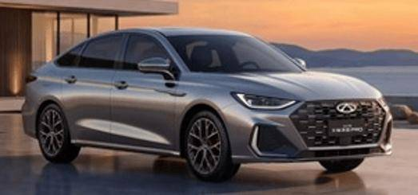

3.新款海豹06上市

8月11日，新款海豹06上市，新车共推12款，售价区间为9.99万-15.59万元。新车取消现款的大嘴格栅，纯电版本增加65L前备箱。内饰采用15.6 英寸中控大屏，更换电子怀挡。新车配备激光雷达、满血版DeepSeek大模型、云辇-C等。新车1.5L插混动力CLTC纯电续航230km，320km，纯电版CLTC纯电续航分别为530km，630km。

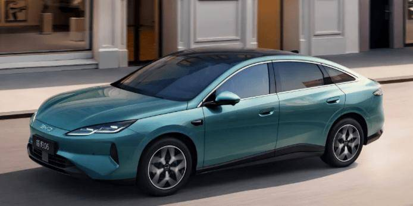

4.新款别克GL8陆尚上市

8月13日，新款别克GL8陆尚上市，新车共推2款，售价区间为24.99万-26.99万元，限时上市价22.99万-24.99万元。新车延续现款车型的设计，电动侧滑门优化了上下出入。内饰搭载双12.3英寸联屏，座椅、车门升级菱格纹设计。新车座椅舒适度进一步升级，优化动态体验舒适反馈。搭载1.5T插混系统，CLTC纯电续航142km。

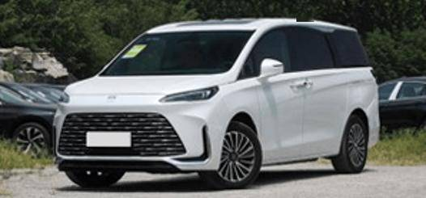

5.方程豹钛3 510KM后驱闪充版上市

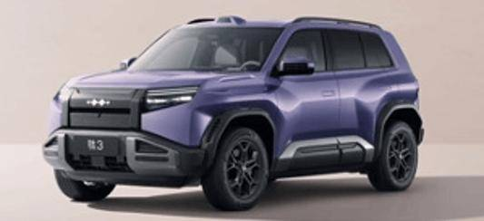

6.比亚迪秦MAX上市

8月13日，比亚迪秦MAX上市，新车共推9款，售价区间为9.99万-14.39万元。新车采用中央贯穿饰条、半隐藏式门把手、115L前备厢。内饰采用15.6英寸悬浮式中控屏、8.8英寸液晶仪表、10.8英寸HUD。配备闪充技术、天神之眼B、云辇C、前排座椅电调/加热/通风/按摩等。新车1.5L插混版本CLTC纯电续航为230km，320km，纯电版本CLTC续航里程为530km，630km。

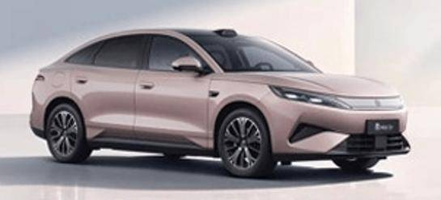

7.魏牌V8X上市

8月14日，魏牌V8X上市，新车共推5款，售价区间为23.98万-31.58万元，权益价22.68万-30.28万元。新车延续了魏牌V9X的设计思路。内饰采用双17.3英寸中控+副驾联屏、12.3英寸仪表、29英寸HUD、17.3英寸后排屏。新车配备双VLA大模型、车位到车位、语音控车、双向20°后轮转向等。新车1.5T和2.0T Hi4混动系统，CLTC纯电续航为258km，261km，324km，402km。

8.岚图追光S上市

8月16日，岚图追光S上市，新车共推3款，售价区间为22.99万-27.99万元，限时权益价22.39万-27.39万元。新车采用10组贯穿式风道、19个真风口、车顶扰流板、双承重挂钩。内饰采用双15.6英寸2.5K悬浮中控屏+29英寸AR-HUD+8.8英寸2K仪表屏。配备四激光雷达、鸿蒙座舱5.2、主副驾零重力座椅、27个扬声器、空气悬架+CDC电磁减振等。新车提供后驱版本和四驱版本，CLTC续航分别对应630km、740km、700km。

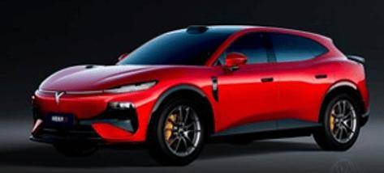

三、宏观经济与政策1.两部门：推广车辆主被动安全装置等

工业和信息化部、应急管理部印发《安全应急装备产业发展“十五五”规划》。其中提出，推广交通基础设施安全状态及工程建设安全监测预警设备、交通安全防护系统及装置、车辆主被动安全装置、桥梁防撞预警装置、道路和隧道无人巡检和智能救援装备等。

2.两部门：在有条件的矿区合理布局建设充换电站、加氢站

8月10日，国家发展改革委、国家能源局发布关于印发《煤炭工业发展“十五五”规划》的通知。在有条件的矿区合理布局建设充换电站、加氢站，建设矿区绿色交通服务基础设施升级试点。鼓励煤制油气和煤化工项目开展规模化绿电、绿氢利用替代和碳捕集利用与封存应用。

3.国家发展改革委:严格实施新能源车“带电池报废”

8月16日，在2026年全国生态日主场活动上，国家发展改革委环资司司长王善成表示，到2030年建立健全“新三样”固废回收利用全链条闭环管理体系，严格实施新能源车“带电池报废”，严厉打击违法违规回收拆解行为。加快废旧机电设备、汽车、电器电子等重点再生资源拆解能力改造升级。

4.油价迎年内第五次下调

据国家发改委消息，自8月14日24时起，国内汽、柴油(标准品)价格每吨分别下调230元、220元。本轮是成品油价格迎来的年内第五次下调。

5.长春两区推出总额一百万元的消费补贴

8月15日至31日，长春净月高新区与南关区发放百万购车补贴：若在活动期间的汽车销售企业购买2万元及以上的小型/微型乘用车（新能源、混合动力也算新车），或5万元以上的二手车，但不含营运车辆，就可以申领补贴。补贴按发票金额分档，新车四档，最高可领4000元；二手车三档，单台最高3000元；叠加银联刷卡再享千元优惠，不限户籍先到先得。

6.佛山顺德全域向无人车开放路权

8月11日，佛山市顺德区智能网联汽车产业园在乐从镇揭牌，佛山市智能网联汽车产业共同体同步成立，由广东车世界汽车产业园、中国移动佛山分公司、萝卜快跑（佛山）等12家产学研单位共同发起。智能网联产业发展行动计划发布并确立“五年三步走”路径：建设全域智能网联汽车应用示范镇，拓展“水陆空”一体化智能网联示范区，最终塑造全域智能网联生态标杆。

7.上海：支持新能源汽车产品与服务协同出海

8月10日，上海市商务委等七部门印发《上海市国家服务贸易创新发展示范区建设方案》。其中提出，支持新能源汽车产品与服务协同出海。支持新能源汽车企业自建海外营销售后服务网点和维修备件中心，运用数字技术开展远程诊断、技术支持等服务。在新能源汽车、新型储能、光伏产品等领域，开展一次检测、多国认可的“一测多证”试点。

8.浙江省省长刘捷在杭州专题调研新能源汽车企业发展情况

8月12日，浙江省委副书记、省长刘捷在杭州专题调研新能源汽车企业发展情况。要引导更多零部件企业加快进入整车配套体系，不断壮大新能源汽车产业集群规模。

四、新品信息跟踪1.上汽大众ID.ERA 5S预售

8月11日，上汽大众旗下ID. ERA 5S正式预售。ID. ERA 5S是上汽大众ID. ERA序列的第二款车型，也是该系列首款轿车，定位中型插电混动智能家轿，标配“行云智行”高阶辅助驾驶以及“云栖智舱”智能座舱，支持高速NOA与城市NOA功能，是大众品牌全球首款支持城市NOA的轿车。ID. ERA 5S搭载1.5L发动机+电机插混系统，发动机最大功率80kW，电机峰值功率130kW。车辆WLTC纯电续航120km，综合续航超2000km，亏电油耗2.82L/100km。

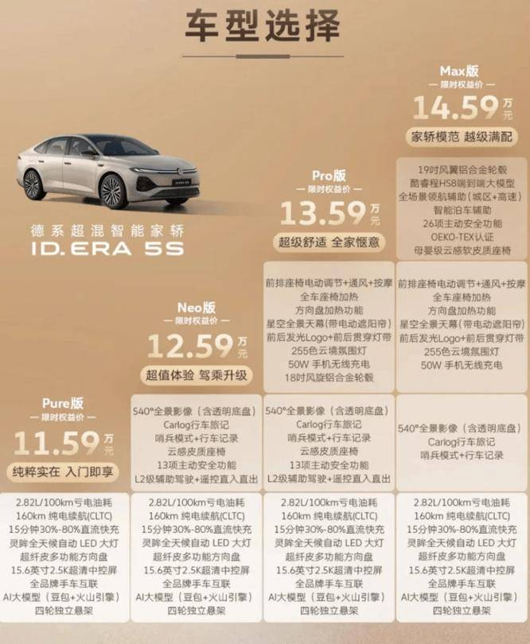

2.小鹏G9L开启预售

8月11日，小鹏G9L正式亮相并同步开启预售。相比现款G9，新车车身增加229mm，轴距增加102mm，车宽增加62mm。搭载小鹏第二代VLA的首次重大升级版本。

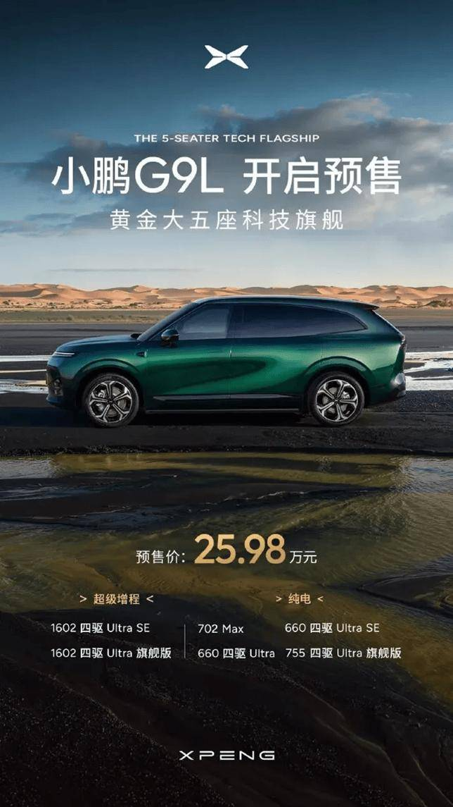

3.奇瑞风云T7开启预售

8月12日，奇瑞风云T7开始预售，预售价10.99-12.99万元。搭载猎鹰500端到端行泊一体智能驾驶辅助系统，支持高速NOA、城市记忆领航、记忆泊车功能，配备65.05kWh新国标犀牛磷酸铁锂电池，全系提供三电终身质保政策，CLTC纯电续航里程600km，百公里综合电耗12.9度，30%-80%快充时长20分钟，支持6.6kW对外放电功能。

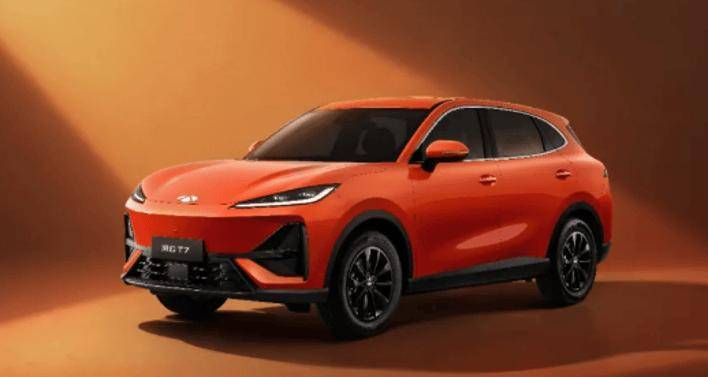

4.荣威家越07正式发布开启盲订

8月13日，上汽荣威在上海举办新品发布会，全新大五座新能源SUV家越07全球首发并同步开启盲订，新车锁定15万级家用市场，是上汽与字节火山引擎联合打造的首款AI原生车型，全车深度内置豆包汽车版大模型。插混版综合续航1300km，纯电版CLTC续航650km，全系标配800V快充，20分钟补能350km。

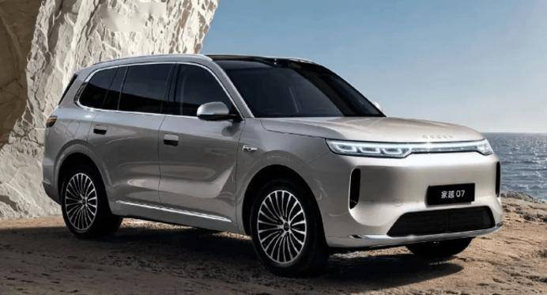

5.吉利银河TT预售

8月13日，吉利银河TT正式开启预售。全系标配宁德时代电池，提供52.4kWh、63.8kWh及75.2kWh三种电池组，对应纯电续航里程为540km、640km及650km和725km。

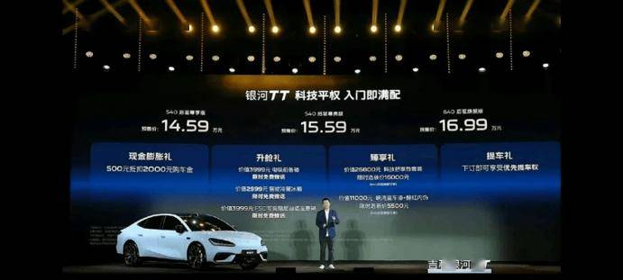

6.奇瑞捷豹路虎神行者8开启预售

8月14日，奇瑞捷豹路虎旗下FREELANDER神行者8在江苏常熟完成全球首秀并正式开启预售，这款定位豪华科技全地形SUV的新车，是奇瑞与捷豹路虎“合资3.0”模式落地的首款量产车型，搭载华为乾崑智驾ADS 5的豪华全地形SUV，预售价33.99万起。

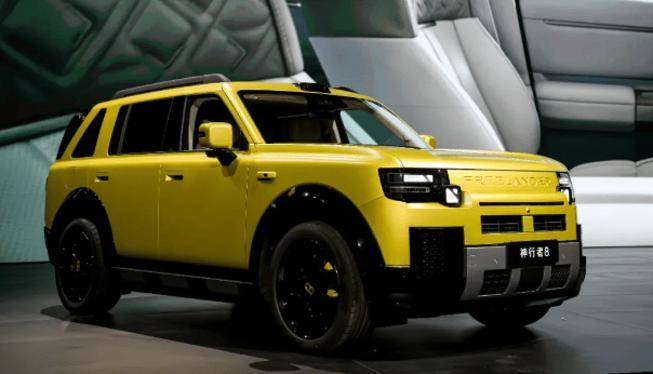

7.奕境X9搭载鸿蒙座舱HarmonySpace 6全球首秀

8月10日，奕境X9座舱正式公布内饰。搭载的鸿蒙座舱HarmonySpace 6迎来全球首秀，搭载了全新一代小艺智能体、AMS舱内融合感知、软硬生态双向打通三大行业领先能力。实现了沉浸式电竞房、移动K歌房、超级影音房三大移动空间体验。

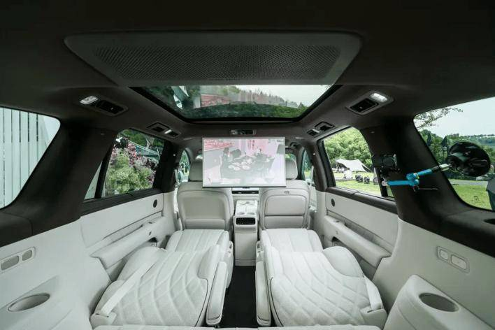

五、企业信息1.长安、华为深化战略合作

中国长安汽车集团有限公司与华为技术有限公司签署战略合作框架协议，双方合作不再局限于车型层面，重点攻坚AI底层技术。双方将共建汽车行业通用及垂直大模型，打造数字化底座、算力集群与软硬件一体化体系，覆盖车载交互、整车研发、柔性工厂制造等场景。

2.长安与荣耀共建联合创新实验室

8月13日，长安汽车与荣耀终端联合打造的“联合创新开放实验室”正式揭牌落地。此次双方携手打通了需求定义、产品开发、测试验证到认证准出的全链路协同体系，实现从浅层功能定制到深层技术生态共建的跨越。随着实验室落地，双方最新技术成果迎来量产落地，长安全新深蓝S05将首发搭载荣耀车联3.0系统。

3.大众汽车计划将中国产的车型引入欧洲

据德国《商报》报道，大众汽车正在研究将旗下大型SUV车型ID. Era 9X引入欧洲市场的可行性，相关评估报告已提及茨维考工厂作为潜在生产地点。

4.大众汽车在大连投资成立新电池公司

保沃科电池（大连）有限公司成立。经营范围包括电池零配件销售、电池制造、电子专用材料销售、汽车零部件研发等。该公司由大众汽车（中国）投资有限公司等共同持股。

5.大众中国推出自研全场景辅助驾驶系统HS8

大众中国通过智能驾驶能力中心酷睿程推出第一代自主研发的全场景驾驶辅助产品，这是一套车载一段式端到端解决方案。该方案预计2026年第三季度起搭载于三家合资企业的7款全新车型，2027年起进一步拓展至更多CEA车型，并加速推进L3与L4自动驾驶研发，首批L3能力最快于2027年下半年启动交付。

6.方程S系列首发搭载比亚迪智慧生态2.0

8月10日，比亚迪旗下方程豹汽车宣布，方程S系列首发搭载比亚迪智慧生态2.0，全车配备PIN口、磁吸及螺纹接口。

7.路虎卫士官方限时直降17万

8月10日捷豹路虎中国正式发布限时购车政策，旗下路虎卫士110 HSE官方指导价89.9万元，活动限时价降至72.8万元，单次现金优惠超17万元。旗下卫士110 SE、暗黑特别版同步下调定价，SE版本限时64.8万元。

8.奇瑞汽车调整星途事业部汇报线

奇瑞汽车调整星途事业部汇报关系。奇瑞汽车执行副总裁张贵兵开始分管星途事业部，向奇瑞汽车常务副总裁张国忠汇报，其他职务不变。

9.上汽西班牙建厂获批

近日，西班牙国防部一名发言人表示，西班牙将批准中国上汽集团在加利西亚地区建设汽车工厂的计划。此前有报道称，由于该项目距离西班牙海军基地较近，可能存在安全风险。

10.蔚来武汉换电站资产全面转由国资持有

8月12日，蔚来能源与光谷交通集团在武汉举行首批合作充换电站交付仪式，双方合作共建运营的首批36座充换电站正式完成交付。此次合作采用“国资合作方持有资产+蔚来专业运营”模式，即相关充换电站资产由光谷交通集团持有，蔚来能源负责运营。

11.奕派科技人事调整

8月11日，东风奕派汽车科技有限公司对内宣布核心人事调整：奕派科技总经理助理、东风风神营销事业部总经理邓留超升任奕派科技销售公司总经理，同时兼任奕派营销事业部总经理、风神营销事业部总经理，统管风神、奕派双品牌全部营销业务。

六、行业信息1.7月新能源乘用车渗透率65.1%

乘联分会8月11日发布的产销数据显示，7月全国乘用车市场零售146.1万辆，同比下降20.9%；前7月累计零售1017.3万辆，同比下滑20.3%。7月新能源汽车渗透率达65.1%，较去年同期增长11.6个百分点，环比增长2.1个百分点。

2.奥托立夫芜湖安全气囊工厂开建

8月10日，奥托立夫芜湖安全系统有限公司在安徽省芜湖市鸠江区举行奠基仪式。新工厂将聚焦汽车安全气囊产品，建设现代化生产车间及自动化装配产线，计划2027年正式投产。

3.采埃孚8挡混动变速器在中国正式量产

8月12日，采埃孚8挡混动变速器在上海采埃孚变速器有限公司正式量产，目前该变速器已获多家客户定点。

4.均胜电子：子公司安徽均胜安全引入15亿元战略投资

8月13日，均胜电子公告称，公司控股子公司安徽均胜汽车安全系统控股有限公司拟引入战略投资者兴银金融资产投资有限公司和中邮金融资产投资有限公司，分别增资5亿元和10亿元。增资款项主要用于偿还公司向其提供的股东借款。

5.宁德时代宁家服务提速后市场规模化布局

8月10日，宁德时代旗下独立后市场品牌宁家服务举办品牌日活动，并同步开业全球十大站点，涵盖海口、杭州、淄博、沈阳、广州、遂宁、宁波、香港、挪威、土耳其。

6.文远知行2026上半年营收3.5亿元

8月12日，自动驾驶科技公司文远知行WeRide发布2026年第二季度及上半年财报。上半年公司总营收达3.5亿元，同比增长73%；其中第二季度营收2.3亿元，同比增长82%、环比增长103%，毛利率升至37.5%，较2025年第二季度提高9.4个百分点。

7.小马智行全球自动驾驶里程突破1亿公里

8月10日，小马智行宣布其全球自动驾驶测试与运营总里程正式突破1亿公里。

8.小马智行与优步将联合在欧洲部署2000多辆出租车

小马智行周五宣布，计划在与优步（Uber）扩大合作框架下，在欧洲部署超过2000辆自动驾驶出租车。声明称，此次合作扩展计划还包括中东地区。

9.中创新航上半年净利润预计超过15亿元

8月14日，中创新航发布2026年中期业绩盈利预喜公告，预计上半年净利润介于15.06亿元至15.81亿元之间，同比增长约100%至110%。

七、跨国集团与国际市场1.7月全球电动汽车销量约185万辆

Benchmark Mineral Intelligence数据显示，7月全球电动汽车销量约185万辆，同比增长9%；前7个月累计销量1150万辆，同比增长4%。其中，7月，欧洲电动汽车销量达45万辆，同比增长33%，环比下降17%；而美国市场受到联邦电动汽车税收抵免政策取消的影响，电动汽车销量同比下降27%。

2.全球电动汽车价格跌破混合动力汽车

3.保时捷联手小鹏汽车组建开放排放池

8月12日，据Schmidt Automotive Research报道，保时捷已退出大众集团碳排放池，与中国小鹏汽车组建开放排放池，共同核算2026至2027年的车队碳排放。此举是欧盟排放池机制的一部分，允许多家车企合并计算新车平均碳排放，电动车销量高的企业可以将富余额度转让或出售给高排放的盟友。

4.戴姆勒卡车CEO：若欧盟维持排放规定，公司或面临10亿欧元罚款

戴姆勒卡车首席执行官Karin Rådström表示，如果欧盟坚持现行排放规定，公司每低于2030年排放目标1个百分点，就可能面临约1.2亿欧元的罚款。按照目前的减排进度，戴姆勒卡车可能无法完成目标，差距约为10%至15%，这意味着罚款金额可能达到约10亿欧元。

5.丰田等日本企业在美遭消费者起诉要求返还特朗普退税费用

据日本共同社8月13日报道，丰田汽车等日本企业的在美子公司近日接连遭到美国消费者起诉。消费者认为，自己购买的商品因关税而涨价，但关税被裁定违法后应退还的税款并未返还给消费者，此举不合理，因此要求退还部分购买价款。

6.福特计划将部分林肯车型生产从中国转移至美国

近日，福特汽车首席执行官吉姆·法利（Jim Farley）表示，福特计划从2030年起将部分林肯车型的生产从中国转移至美国。这一决定主要受到美国关税成本不断上升以及针对中国制造汽车的监管限制影响。

7.法拉第未来第二季营收创历史新高

8月14日，法拉第未来对外发布业绩报告。今年第二季度，FF营业收入为83.6万美元，较同期的5.4万美元大幅增长超1400%；营业成本为1154万美元，较同期的2691万美元同比下滑57%；净亏损为3896万美元，较同期的1.247亿美元同比收窄69%。

8.韩国7月汽车出口超62亿美元

韩国产业通商部8月13日发布资料显示，7月韩国汽车出口额同比增加7%，为62.4亿美元，创下历年同期新高。新能源汽车出口额同比增加25.5%，为25.9亿美元，占整体出口额的41.5%。燃油汽车出口额则同比减少3.1%，为36.5亿美元。

9.捷豹路虎2026/27财年第一季度营收60亿英镑

捷豹路虎发布2026/27财年第一季度（2026年4月至6月）业绩表现：公司本财季营收达60亿英镑，税前利润为1.09亿英镑，调整后息税前利润率为2.8%。本财季，捷豹路虎在中国市场的零售销量环比增长28.5%。

10.美国7月份零售额创一年多来最大跌幅消费者减少购车及网购

美国商务部当地时间14日公布数据显示，美国7月零售销售额环比下降0.6%，创一年来最大环比跌幅，低于市场普遍预期。剔除汽车及零部件、加油站销售额，7月零售销售额环比下降0.2%。从环比数据来看，汽车和零部件销售额下降1.8%。

11.美国二季度汽车贷款规模创历史新高

美国纽约联邦储备银行日前发布最新家庭债务与信贷报告称，美国消费者第二季度新增汽车贷款规模创下纪录，总额达2,110亿美元。

12.日产新车研发周期大幅缩短

日产汽车在日本横滨总部举行的活动上透露，通过借鉴中国车企的研发模式，日产将全新车型研发周期从50个月缩短至37个月，改款车型从50个月压缩至30个月，提速40%。

13.三星SDI将完全接管与通用汽车在美合资企业

8月11日，三星SDI宣布与通用汽车达成协议，共同开发下一代电动汽车电池。根据该协议开发的棱柱形电池产品预计将应用于通用汽车下一代电动车型。三星SDI还同意收购通用汽车在美国印第安纳州合资企业Synergy Cells中所持全部股份，并接管该公司。

14.沃尔沃推“安全教练”应用

沃尔沃于8月15日宣布推出名为“安全教练”的新应用，该应用可通过车机或手机运行，结合真实事故数据和沃尔沃的安全研究成果，在驾驶过程中分析用户的刹车、加速和过弯方式，并据此生成评分及改进建议。该应用将首先在瑞典和挪威上线。

15.现代汽车2026年H1营收95万亿韩元

8月14日，现代汽车发布2026年上半年业绩报告。营收95.15万亿韩元，同比增长2.65%；毛利率17.61%，同比下降1.91个百分点；归母净利润4.86万亿韩元，同比下降21.11%。

16.优步将在东京试点部署Robotaxi

8月13日，优步（Uber）宣布，优步日本已与日之丸交通签署运营合作协议，将负责东京自动驾驶出租车试点项目的日常车队运营，项目预计于2026年底启动。该项目将采用日产聆风（LEAF）电动车，搭载英国自动驾驶技术公司Wayve的人工智能驾驶技术。

17.英国拟放宽电动汽车销售比例强制令

英国政府发布公告，宣布重新审视此前的电动汽车销售比例强制令。根据英国政府2024年出台的规定，各大汽车厂商今年销售的车辆中，纯电汽车的比例需要达到33%；并在2030年逐步提高至80%。英国政府考虑下调这一目标，最低可能降至50%。

附：近日信息合集
