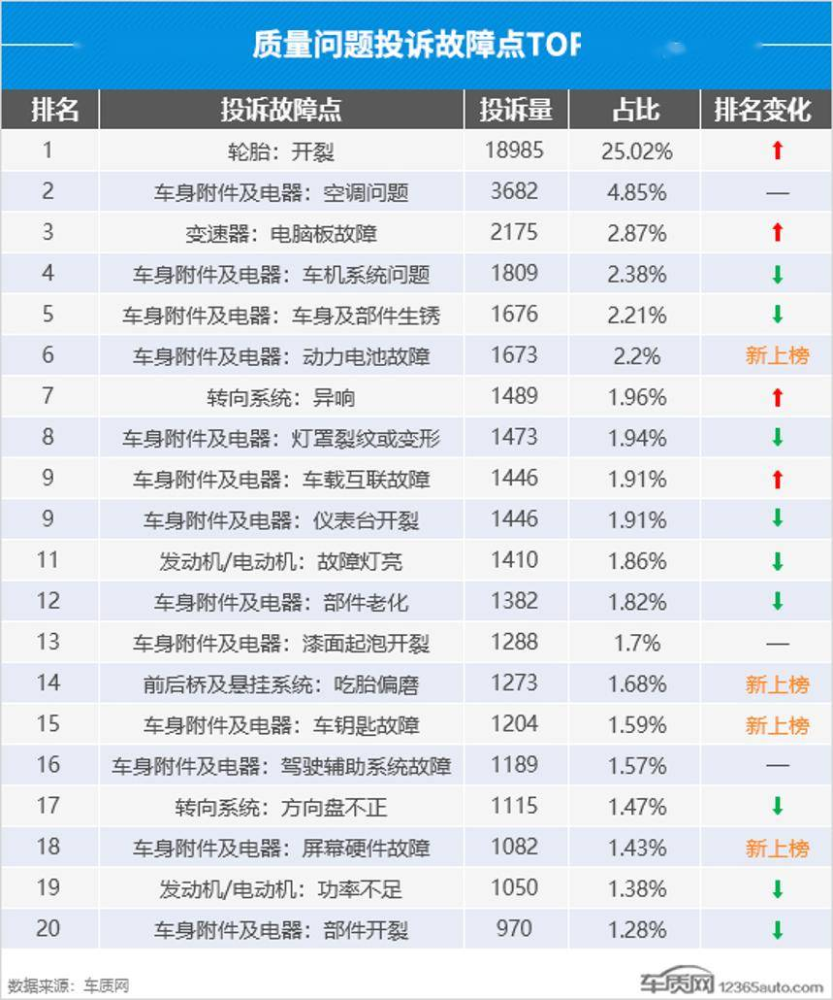
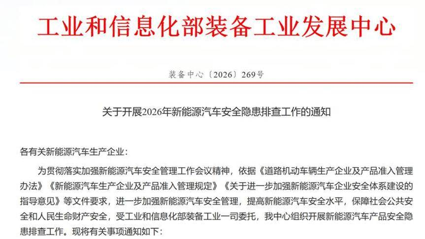
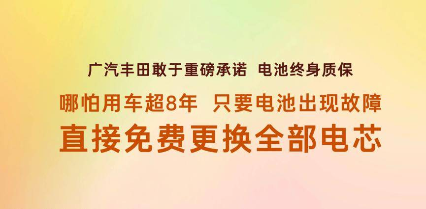
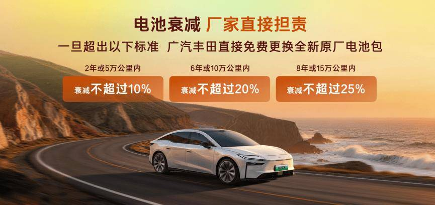
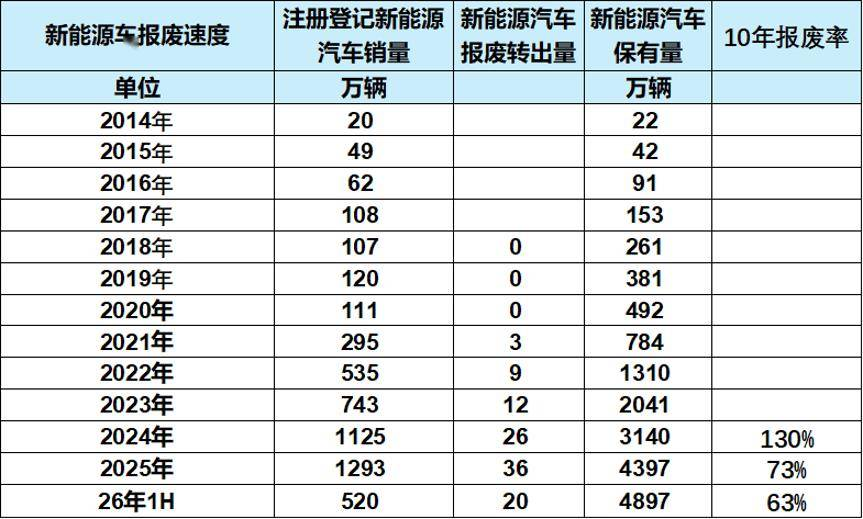

# 260 万辆新能源车面临电池脱保，长效电池质保是新能源下半场关键命题

- 公開日時: 2026-08-20 09:30（北京時間）
- 出典: [搜狐号・崔东树](https://www.sohu.com/a/1065191126_115312)
- テーマ（自動判定）: 論評・その他
- 画像: 6枚

---

截至2026年6月底，全国新能源汽车保有量达4897万辆，占汽车总量的13.19%，较去年同期提高2.92个百分点。其中，纯电动汽车保有量3367.5万辆，占新能源汽车总量的68.77%。2026年，中国新能源汽车产业正在穿越一个关键节点。根据公安部及乘联分会数据推算，到今年年底，全国车龄超过8年的新能源汽车保有量将达到260万辆，这意味着最早一批进入私人消费市场的新能源车将陆续脱离国家规定的“8年或12万公里”动力电池最低质保期。海量存量车辆进入质保空窗期，电池故障维修、续航衰减、安全兜底等问题快速凸显，成为当前新能源售后市场的核心痛点。在行业变革与用户需求升级的双重驱动下，市场开始涌现长效及全场景电池保障方案，以广汽丰田铂智7为代表的车型，率先升级电池长效保障体系，不仅有三电终身质保，还保证用车8年后电池有故障全电芯免费更换、明确电池衰减赔付标准等差异化权益，更是首次承诺电池事故起火兜底，补齐行业“高龄电池维保”和“非品质问题起火赔付”的短板，为新能源汽车全生命周期质保体系升级提供了典型参考样本。8年只是政策划定的最低合规底线，绝非动力电池的使用寿命上限，面对大规模脱保潮，车企长效质保与底层技术保障能力的差距，正在成为存量车市最核心的产品价值分水岭。

一、大规模脱保潮来袭，行业售后模式暴露核心短板

2015年出台的国家标准对动力电池最低质保要求是8年或12万公里，这一标准在当年新能源渗透率不足2%的背景下制定，更多是从产业培育角度出发的基础性保障。但十年过去，全国新能源汽车保有量已突破4900 万辆，大量车辆仍在持续使用，电池故障率和衰减程度正进入加速暴露期。

依据国内新能源汽车推广周期推算，2015至2018年批量上市的初代家用新能源车，在2025年集中走完法定质保周期。2025年前后首批车型开始集中"脱保"，当年出保规模已超150万辆，今年约260万辆，未来几年累计脱保车辆将突破千万台，这也是国内新能源市场发展以来，首次迎来大规模、大批量的电池质保过期浪潮，对整个售后体系都是一次压力测试。

从当前暴露的问题看，矛盾主要集中在三个层面：

第一，脱保后维修成本畸高，"修车比车贵" 现象普遍。有数据显示，纯电车型动力电池单件零整比均值达49.59%，即换一块电池的费用平均占到整车售价的近一半。主流车型整包更换费用普遍在6 万元以上，部分高端车型甚至超过15 万元。而不少车龄8 年以上的老旧电车，整车残值已降至4-5 万元，出现"换电池不如换车" 的尴尬局面。

第二，电池衰减标准模糊，用户维权缺乏依据。车质网数据显示，截至2026 年7 月，动力电池相关投诉已累计达4.59 万条，其中续航缩水、衰减过快占比最高。新国标落地前，行业缺乏统一的衰减判定与显示精度标准，车载电池健康度显示误差较大，车主面临续航大幅缩水却达不到车企自费更换标准的困境。2026年二季度，动力电池故障投诉量环比翻倍增长，首次跻身行业投诉热门问题前列。

第三，行业通用维修方案存在技术短板。目前绝大多数车企处理电池故障，采用的是"单颗故障电芯单独更换"模式，看似降低短期维修成本，却忽略了动力电池天然存在的"电芯木桶效应"。动力电池由数百颗电芯串并联组成，整包容量、续航与安全上限，完全由性能最弱的电芯决定。新旧电芯在内阻、容量、自放电特性上存在天然差值，单独更换单颗电芯后，电芯一致性会持续失衡，长期充放电会加剧内部环流、温度不均，不仅导致续航再次快速衰减，还会提升热失控风险。这也是很多车主反复维修电池却治标不治本的核心原因。

很多消费者受行业8年质保思维固化，默认电池质保到期即接近报废。但从长期路试与国标数据来看，高品质动力电池的实际使用寿命远超8年。真正的差距，不在于电芯基础材质，而在于车企前期的研发耐久标准、极限验证体系，以及后期的长效售后兜底能力。

二、行业质保普遍内卷化，长效兜底能力成真实壁垒

工信部近期发布的《关于开展2026 年新能源汽车安全隐患排查工作的通知》中，特别要求对"长周期、长里程使用车辆及电池衰减率较高的车辆，应采取技术手段加强车辆运行监控"。这意味着监管层已经意识到存量新能源车的安全风险正在累积。当政策要求企业加强监控时，部分车企选择主动升级质保承诺，本质上是在"兜底线"和"拉高线"两条路径上同时推进。

当下新能源市场终身质保政策并不少见，但条款差异巨大，多数存在严苛限制。在梳理市场主流质保政策时发现，约七成品牌的终身质保仅针对首任车主，车辆过户即失效，严重影响二手车保值率；约六成品牌仅兜底原厂品质问题，底盘剐蹭、交通事故导致的电池故障、起火均不在保障范围内。用户实际获得的权益，往往与宣传存在较大落差。

真正能解决脱保时代用户痛点的质保体系，需要贯穿研发、品控、售后全链条，这也是多数车企难以突破的壁垒。从行业实践看，只有少数具备深厚整车制造功底的品牌，目前在重构电池质保规则。

监管层面已经关注高龄电池风险，部分车企开始探索长效电池保障方案，市场出现多元化创新实践，广汽丰田就是其中代表之一。以广汽丰田旗下纯电轿车铂智7 为例，其电池保障体系有几个值得关注的特点：一是在电芯设计阶段植入多项长效安全标准，核心耐久性能设计目标达到20 年以上，从源头提升电池长期稳定性；二是摒弃低成本的单电芯维修模式，推出“用车超8 年后电池故障，可免费更换全部电芯”的政策，规避新旧电芯混用的一致性问题；三是明确量化电池衰减赔付标准，衰减超标即免费更换全新原厂电池包；四是升级全场景电池起火兜底保障，覆盖品质问题、底盘剐蹭、交通事故等场景，且新老车主一视同仁。

客观而言，这类无套路、全周期的质保政策，很难成为行业标配。终身质保、全电芯更换、全场景兜底，意味着车企需要承担长期、高额的售后成本，没有成熟的电池联合开发体系、超国标极限验证、严苛的品控体系支撑，根本无法持续落地。多数车企可快速采购硬件堆砌配置，但数十年积淀的整车制造功底、全生命周期质保体系，是短期无法复制的核心壁垒。

三、新能源车存量竞争时代：质保能力决定新能源下半场竞争力

260万辆电车脱保潮，是新能源产业从高速扩张转向高质量发展的重要分水岭。乘联分会数据显示，2026年7月国内新能源乘用车零售渗透率已达65.7%，连续四个月站稳60% 以上高位。新能源汽车正式从增量市场进入存量置换市场，竞争逻辑正在发生根本性变化。

上半场比拼渗透率、配置速度、价格优势，下半场核心比拼长期可靠性、全周期服务、用户权益确定性。随着动力电池耐久性新国标正式实施，行业标准化程度持续提升，消费者对电池寿命、衰减、安全的认知愈发清晰，仅满足8年最低质保标准的车型，将逐步丧失市场竞争力。

我判断，未来行业将呈现两大清晰趋势：一是前端研发标准持续升级，车企将普遍抬高电池耐久设计目标，参照铂智7电池20年耐久性能设计，通过超规测试、严苛品控，从源头降低高龄电池故障概率。电池的竞争，将从单纯比能量密度、比充电速度，转向比全生命周期可靠性。二是后端质保体系加速分化，如广汽丰田等头部具备体系实力的品牌，将以长效、无套路的兜底政策构建差异化优势，而多数车企将维持基础合规质保，市场差距持续拉大。

面对千万级脱保存量市场，谁能打破8 年质保的行业局限，解决用户长期用车的核心焦虑，谁就能站稳新能源下半场的价值竞争赛道。这不仅是企业竞争力的体现，更是推动整个产业高质量发展的重要力量。
