# 全国商用车国内保险特征—7月重卡新能源渗透率48%

- 公開日時: 2026-08-20 09:30（北京時間）
- 出典: [搜狐号・崔东树](https://www.sohu.com/a/1065227523_115312)
- テーマ（自動判定）: 商用車
- 画像: 13枚

---

注：本分析文章仅代表崔东树个人观点，如有异议，请留言。

根据国家金融局交强险数据，国内商用车交强险数据的2025年商用车强势增长。由于新能源车强势增长和报废更新政策促进车辆更新，2026年新能源商用车整体呈现快速拉升的良好局面。2026年1-3月商用车月均销量平稳，下降7%较弱；4-6月商用车市场逆势走强增10%；7月商用车23万台的销量实现-7%的同比下降。从累计数据来看，1-7月累计销量178万台，同比增1%，走出近5年来较强，远强于消费类乘用车走势。

2026年7月新能源商用车暴增到10万台，同比增43%，环比6月降16%；2026年1-7月新能源商用车交强险62万台，累计增速45%。

2026年7月商用车新能源渗透率44.1%， 较同期增长15个点，强于乘用车的增长。2026年仍是纯电动增长较强，插混与增程的表现改善较大，氢燃料车的产品技术停滞，补贴仍拉不动增长。高油耗高税收的物流车型新能源渗透率提升较大，而中卡和皮卡稍低。

1、全国商用车市场交强险数据分析

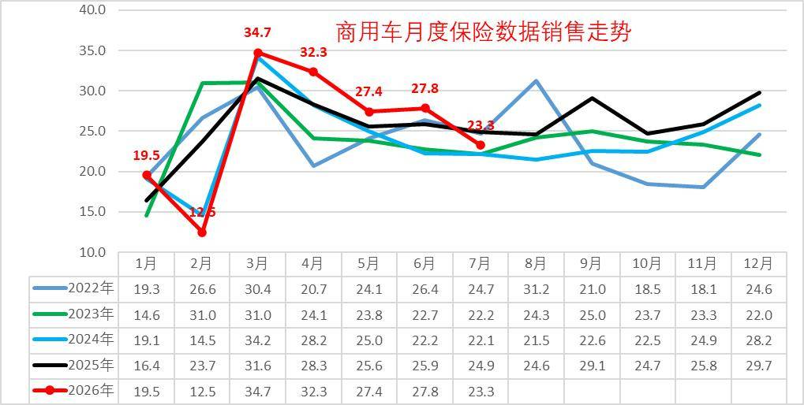

2026年商用车市场呈现明显的阶段性波动特征，走势明显强于乘用车。受春节错峰因素影响，1月销量创下近四年新高，透支部分市场需求，导致2月销量大幅回落，1-2月行业整体销量同比下滑明显。3月市场快速回暖，3-6月销量保持高位， 7月走势显著低于历年同期季节性水平，走出独立下行行情。

2026年1-3月商用车月均销量平稳，下降7%较弱。4-6月商用车市场逆势走强增10%，7月商用车23万台的销量实现-7%的同比下降，4-6月增10%的强势特征凸显，与乘用车市场近期走弱形成鲜明反差。从累计数据来看，1-7月累计销量178万台，同比增1%，走出近5年来较强，远强于消费类乘用车走势。

2、全国新能源商用车市场销量分析

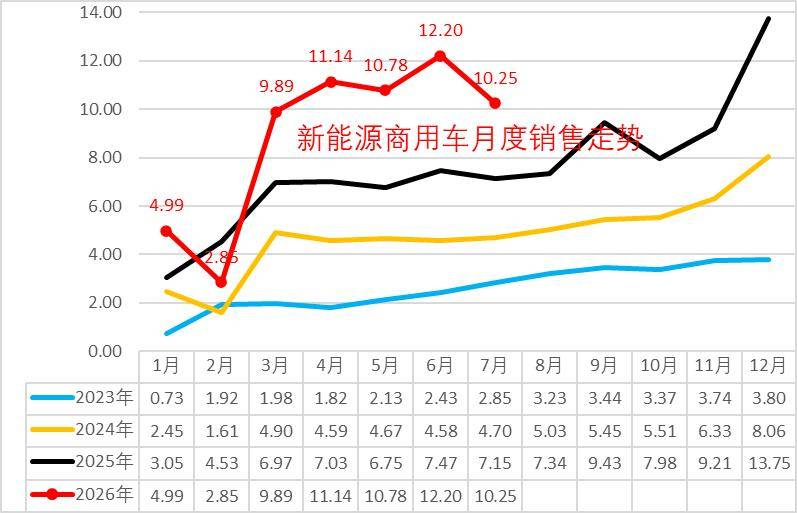

2026年，新能源商用车延续波动上行走势，1月凭借年初采购热潮销量冲高至5万台，创下阶段性高位；2月受春节假期、终端停工等季节性因素影响销量明显回落；3-7月市场迎来爆发式增长，单月销量保持10万台，形成异常超强走势。在整体商用车市场小幅下滑的背景下，新能源赛道逆势高增，成为行业唯一增长板块。

新能源商用车从2024年开始爆发增长，2024年新能源商用车销量57.9万台，同比增长84%；2025年新能源商用车累计达到91万台，同比增长57%。

2026年7月新能源商用车暴增到10万台，同比增43%，环比6月降16%；2026年1-7月新能源商用车交强险62万台，累计增速45%。

3、新能源商用车渗透率

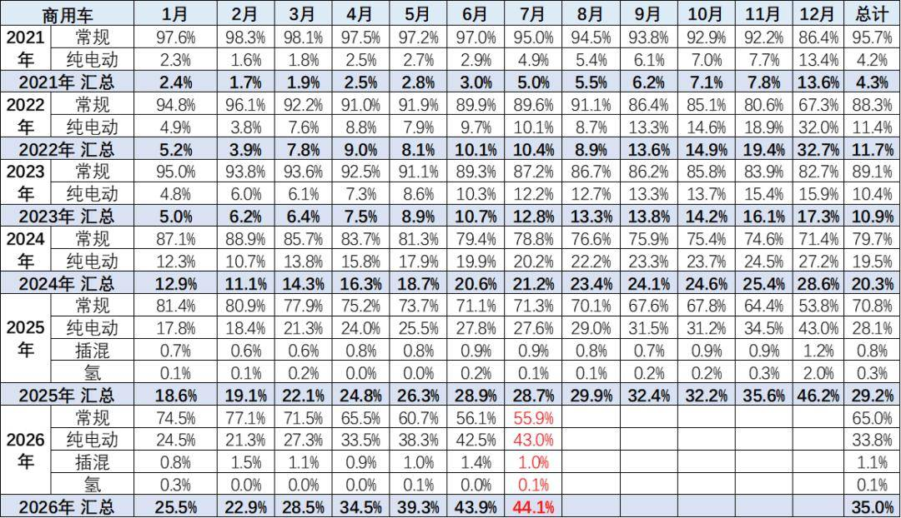

2025年新能源商用车渗透率达到29%的水平，相对于2024年实现了较好提升。2026年1-7月份新能源渗透率达到35%，相对于去年1-7月的24%，提升11个百分点，表现相对较好。

2026年7月商用车新能源渗透率44.1%，较同期增长15个点，强于乘用车的增长。2026年仍是纯电动增长较强，插混与增程的表现改善较大，氢燃料车的产品技术停滞，补贴仍拉不动增长。

4、商用车市场变化分析

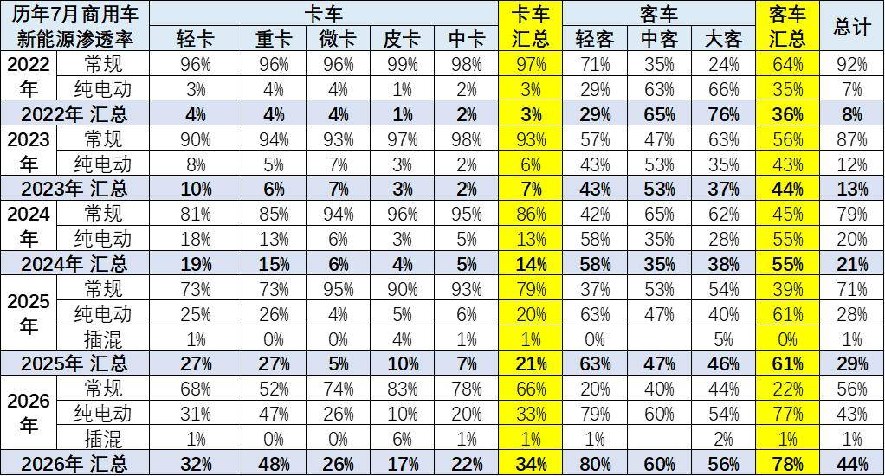

商用车的卡车和客车结构相对稳定。卡车中的重卡和轻卡表现较好，油改电降成本和报废更新政策的拉动效果强力体现，中重卡在补贴拉动下的近两年走势改善，2026年7月走势表现较强。

2026年7月商用车新能源渗透率44%，较同期增加15个点渗透率，新能源提升较快。其中客车新能源渗透率78%，大客从新能源领跑到最差，7月的大客新能源渗透率回升到56%，中客回升到60%，轻客上升到80%，客车新能源反差巨大。2026年7月的卡车新能源渗透率34%，卡车较同期提升13个百分点；其中重卡达到48%（较同期增21个百分点）、轻卡达到32%（较同期增5个百分点），高油耗高税收的物流车型新能源渗透率提升较大，而中卡和皮卡稍低。

客车中的轻客走势较强，电动化带来轻客替代微客成为市场主力。大中型客车2026年初表现较弱，燃油大中型客车走势较稳，新能源大中型客车表现一般。

5、商用车竞争结构变化分析

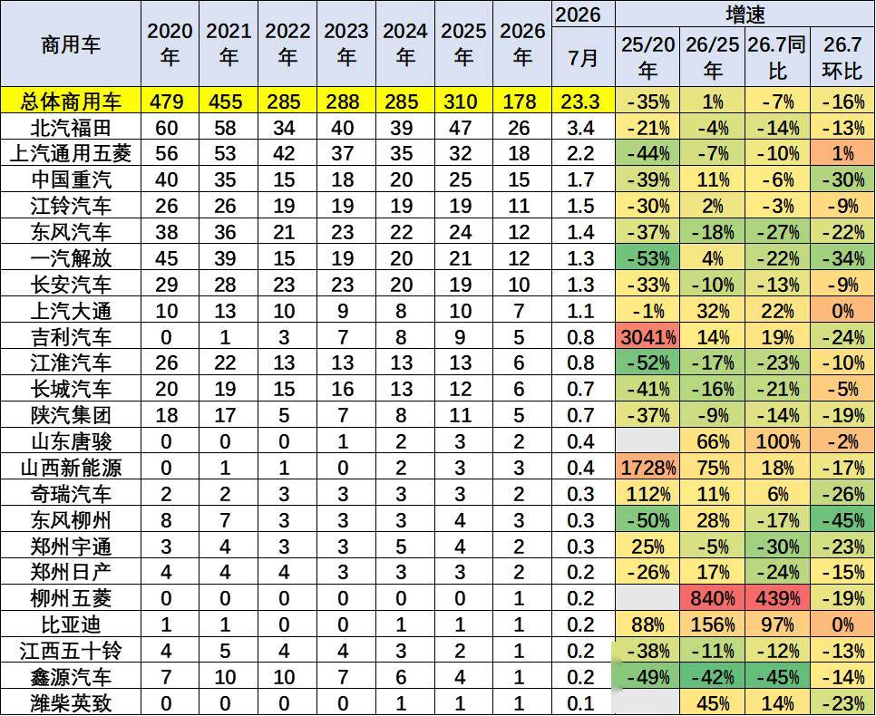

当前国内商用车市场销量核心由轻卡、重卡两大细分赛道支撑，行业头部企业格局稳固，同时新晋品牌快速突围，市场竞争呈现“头部稳固、新锐崛起”的特征。传统主力企业中，福田汽车深耕轻卡市场、五菱依托小微卡及轻卡产品抢占大众市场、中国重汽领跑重卡赛道，三大企业稳居行业第一梯队，在各自核心细分领域销量优势显著。

2026年市场竞争格局出现新变化，部分二线品牌发力明显，长安跨越、上汽大通等企业凭借精准的产品定位、优质的新能源产品布局，市场表现亮眼，销量增速优于行业平均水平，逐步抢占细分市场份额。整体来看，传统老牌车企凭借渠道、口碑、供应链优势稳固基本盘，新兴及二线车企依托新能源产品差异化突围，行业竞争从传统燃油车的规模竞争，逐步转向新能源产品、技术、服务的综合竞争。

6、中重型卡车区域市场结构

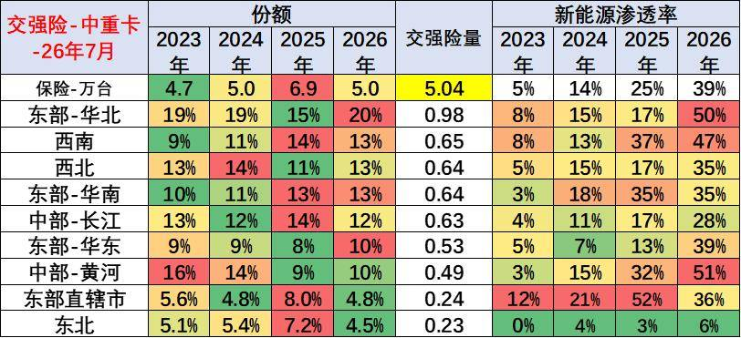

从区域分布来看，国内中重型卡车传统核心市场集中在华北、西南地区，该类区域工业、基建、资源运输需求旺盛，为重卡市场提供稳定支撑。近两年随着南方区域基建扩容、物流产业升级，华南、西南地区重卡市场需求持续释放，市场份额稳步提升，区域格局从“北强南弱”逐步向南北均衡发展。

新能源重卡区域分化特征更为明显，2026年中部黄河、西南地区新能源重卡渗透率位居全国前列，其中西南地区依托完善的新能源产业链、密集的物流运输场景、宽松的地方扶持政策，渗透率提升速度全国最快；北方区域新能源重卡仍处于稳步替代阶段，东北等的增速相对平缓。

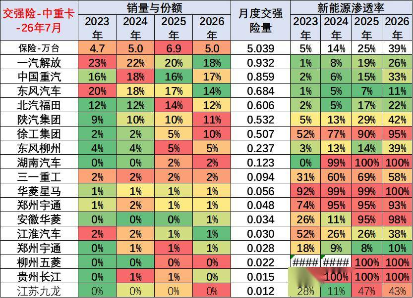

企业竞争层面，中重卡市场头部集中度较高，一汽解放、中国重汽、福田汽车、东风汽车四大传统巨头稳居行业第一梯队，凭借成熟的产品体系、完善的售后网络，主导国内中重卡市场。在政策补贴强力拉动下，传统重卡企业电动化转型提速，新能源重卡渗透率持续攀升。同时，徐工、三一重工等二线工程机械系重卡企业，依托场景化产品优势，新能源车型渗透率快速提升，弯道超车趋势明显。出口与内销结构方面，2025年国内重卡企业以出口增量为主，海外市场表现强势；2026年企业重心转向国内新能源市场布局，国内燃油重卡销量占比相对回落，新能源替代成为内需市场核心主线。

7、轻型卡车区域市场结构

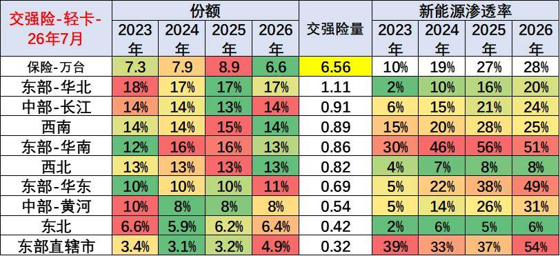

国内轻卡市场需求与区域物流活跃度高度绑定，传统优势区域集中在华北、华南、西南地区，上述区域城乡物流、短途运输、商超配送需求旺盛，支撑轻卡稳定销量。2026年区域格局出现新变化，东北地区物流产业逐步复苏，短途货运、城乡配送需求回暖，轻卡市场销量稳步增长，区域市场份额持续提升。

新能源轻卡市场呈现明显的经济区域集聚特征，东部沿海的华南、华东地区是核心主力市场，区域内电商物流、同城配送、冷链运输场景密集，叠加地方路权、补贴政策加持，新能源轻卡渗透率和保有量遥遥领先。而京津沪等一线城市，受市场饱和、政策管控严格等因素影响，2026年新能源轻卡市场增长节奏放缓，增速低于全国平均水平。

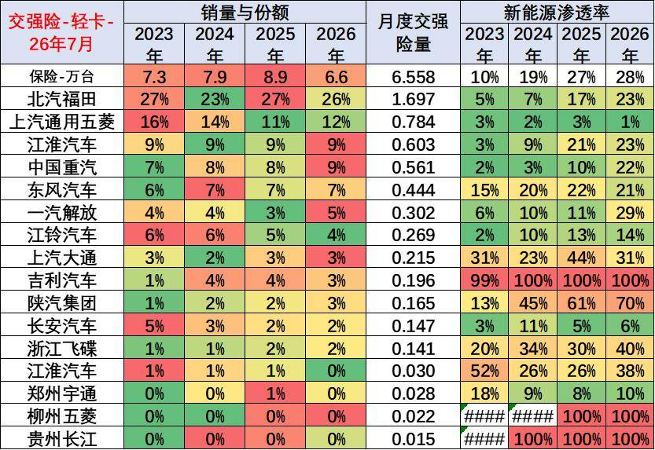

企业格局方面，传统燃油轻卡市场由北汽福田、上汽通用五菱、中国重汽、江淮汽车、东风汽车等老牌企业主导，市场份额稳固。其中上汽通用五菱依托小微卡产品优势，持续向上渗透小轻卡细分市场，产品适配性强、终端口碑优异，市场表现突出。新能源轻卡赛道中，吉利汽车、上汽大通、江淮汽车布局前瞻，近两年持续深耕新能源轻卡技术研发与场景化产品迭代，产品续航、载重、能耗优势明显，成为新能源轻卡市场的核心主力企业。

8、轻型客车区域市场结构

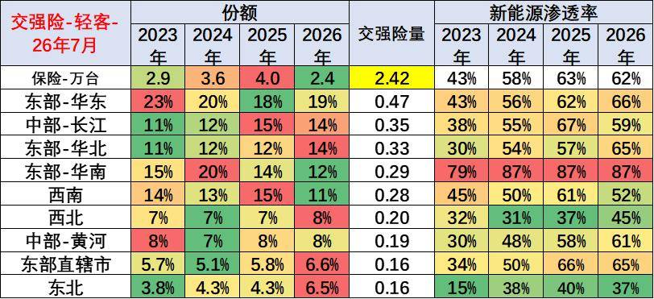

轻型客车主要适配城市通勤、同城配送、商旅出行等场景，需求高度集中于经济发达区域。国内轻客传统核心销售区域为华东、华南地区，2026年西北地区依托城市发展、轻客市场需求快速增长，区域市场份额大幅提升。

新能源轻客需求同样集中于经济发达地区，华南地区凭借活跃的民营经济、密集的城市配送场景、完善的新能源配套，新能源轻客市场规模和渗透率全国领先。同时，京津沪等一线城市实施严格的燃油车路权管控、限行政策，直接导致燃油轻客使用场景收缩、销量持续萎缩，倒逼市场向新能源轻客转型，政策驱动替代效果显著。

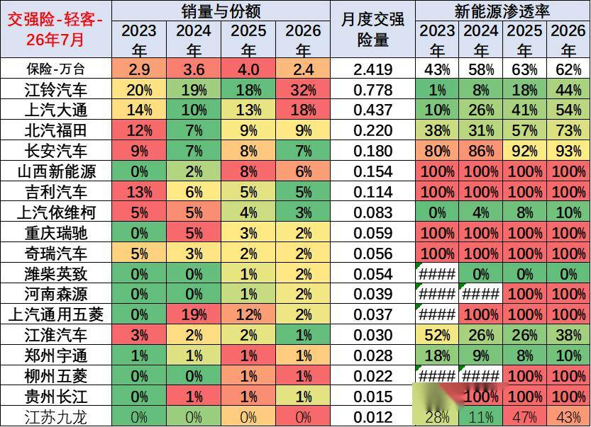

企业竞争维度，国内轻客市场主力企业包括江铃汽车、上汽大通、长安汽车、吉利商用车、上汽通用五菱等。传统车企深耕燃油轻客市场，保有量优势明显。

新兴势力中，吉利商用车聚焦新能源轻卡、轻客赛道，新能源产品竞争力突出，市场份额持续提升。2026年长安汽车推出多款高性价比电动轻客产品，适配多场景城市使用需求，产品竞争力大幅提升，成为新能源轻客市场的新锐力量。

9、大中型客车区域市场结构

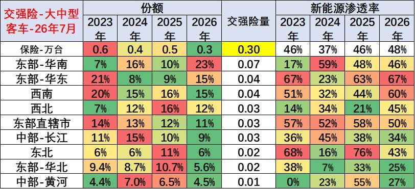

2026年大中型客车行业整体表现疲软，市场需求波动较大，区域分化、动力类型分化特征十分显著。行业呈现“政策驱动新能源、市场支撑燃油车”的差异化发展格局：新能源大中型客车主要依靠地方公交更新、政府采购政策拉动，市场化需求偏弱；燃油大中型客车依托长途客运、团体通勤、旅游出行等市场化刚需，销量走势相对稳健。

区域分布上，新能源大中型客车渗透率南方地区整体高于北方地区，南方城市公交更新迭代速度更快、绿色出行政策落地更彻底，支撑新能源大中客需求。北方及部分中部地区需求高度依赖地方专项补贴政策，政策落地节奏直接影响区域销量。2026年华南地区加大公交电动化改造力度，区域新能源公交客车采购量大幅提升，带动大中客新能源市场份额显著回升。

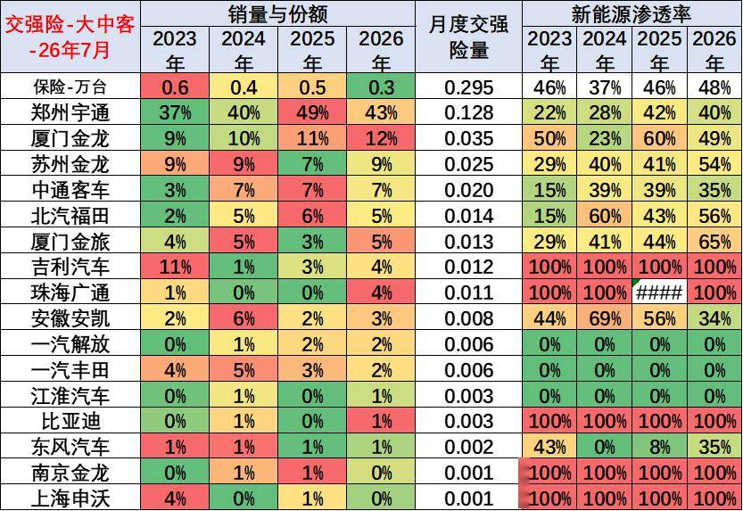

企业格局方面，宇通客车、中通客车、苏州金龙等传统龙头企业持续主导大中型客车市场，品牌力、产品力、售后体系优势显著。其中宇通客车传统燃油大中型客车市场根基稳固，终端销量表现强劲；2026年7月中通股份大中型客车产品销量逆势走高，市场表现亮眼。新能源转型层面，行业分化明显，二线客车企业聚焦新能源赛道，资源集中投入，新能源大中客渗透率相对更高；而宇通等主力龙头企业坚持燃油、新能源双线并行，燃油车基本盘稳固，新能源业务稳步拓展，整体发展更为均衡。

附：近日信息合集
