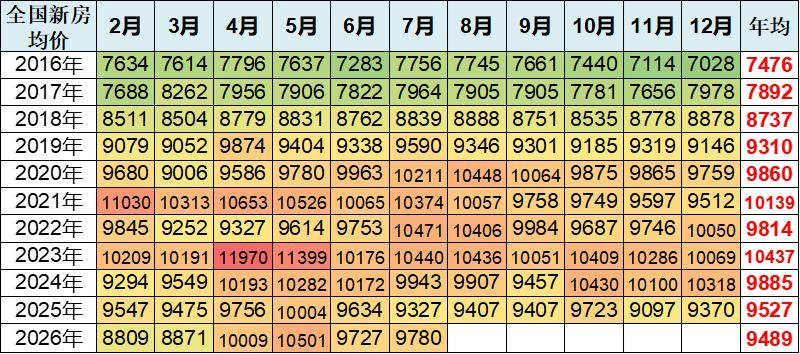
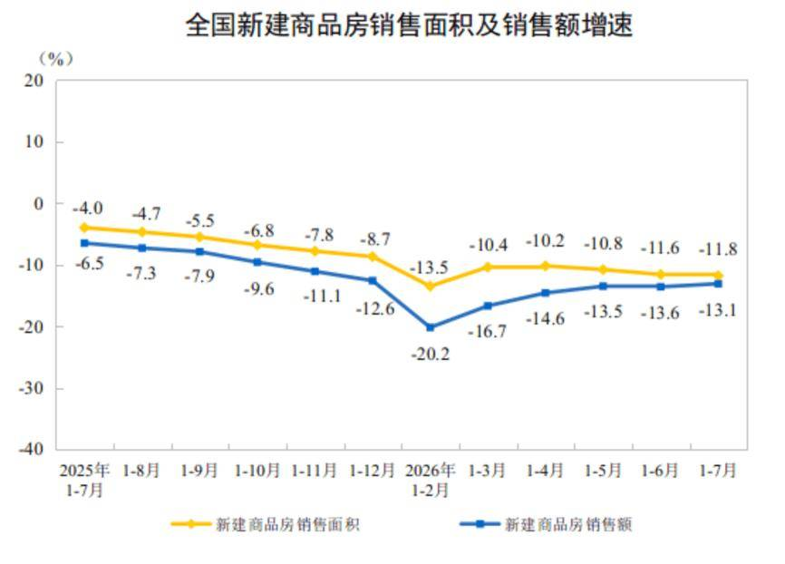
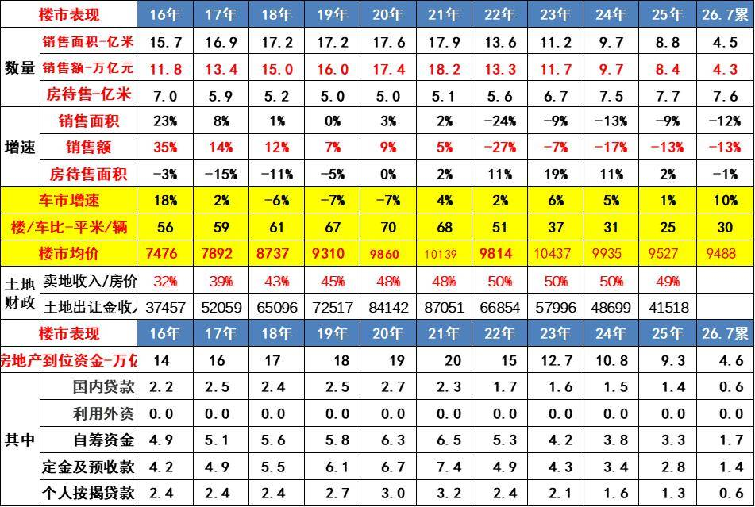
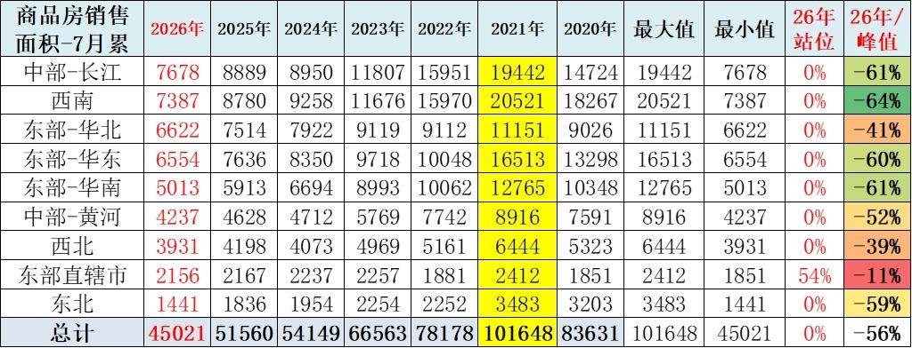
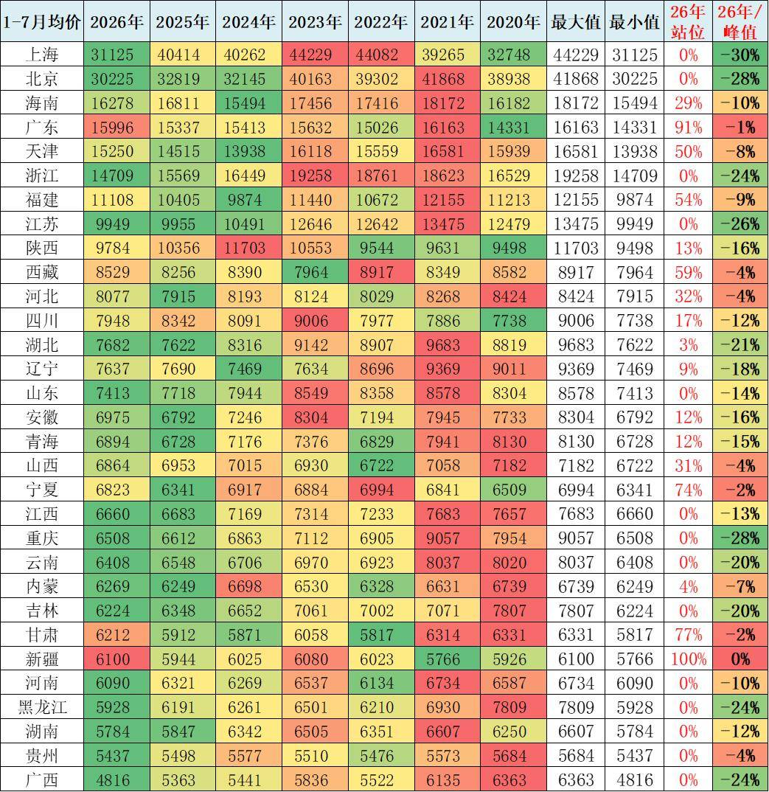
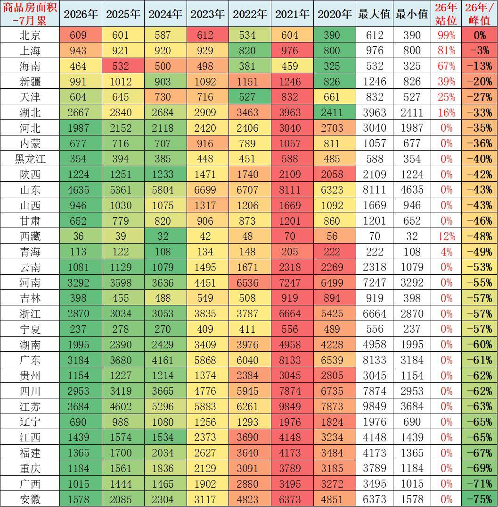

# 2026年房地产市场量价分析

- 公開日時: 2026-08-21 13:11（北京時間）
- 出典: [搜狐号・崔东树](https://www.sohu.com/a/1065851405_115312)
- テーマ（自動判定）: 論評・その他
- 画像: 6枚

---

注：本分析文章仅代表崔东树个人观点，如有异议，请留言。

2026 年1—7 月全国商品房市场仍处于深度调整周期，销售面积与销售额同比双位数下滑，但降幅自3月起连续收窄，价格端出现逐月企稳迹象。核心矛盾已从"价格下跌" 转向"量能收缩"，区域与城市分化极端化 —— 一线城市及核心都市圈量价韧性较强，中西部人口流出省份量能跌幅普遍超过60%。政策托底效应已在边际显现，但行业全面复苏仍需等待库存去化、居民收入预期与人口基本面的实质性改善。

1、全国新房价格走势

全国新房均价呈现"先升后降、高位回落" 的长周期特征。2016—2021年为持续上行期，年均从7476 元升至10139 元，累计涨幅35.6%，2021 年为价格顶峰。2022年起进入下行通道，2023 年短暂反弹至年均10437 元后再度走弱，2024—2026 年年均分别为9885、9527、9489元。从历年1—7 月累计均价看，2021 年峰值约10653 元，2026 年回落至9488 元，累计跌幅约10.9%。2026 年内呈现"前低后高" 的逐月修复态势，2 月8871 元→7 月9780 元，环比连续回升，显示政策托底下价格端出现边际企稳信号，但绝对水平仍显著低于历史峰值。

2、商品房的走势

1—7月份，新建商品房销售面积45021万平方米，同比下降11.8%；其中住宅销售面积下降12.7%。新建商品房销售额42718亿元，下降13.1%；其中住宅销售额下降13.2%。

2025 年以来商品房市场"量额双降、降幅先扩后收" 的运行轨迹。销售面积累计增速从2025 年1—7 月的下降4.0%持续下滑，至2026 年1—2 月探底至下降13.5%，随后逐月收窄至1—7 月的下降11.8%；销售额增速走势更为陡峭，从下降6.5%深跌至2026 年1—2 月的下降20.2%，后修复至下降13.1%。两条线始终呈"剪刀差"—— 销售额降幅持续大于销售面积降幅，反映均价下行对销售额的额外拖累。2026年3 月以来降幅连续收窄，说明以旧换新、降首付等政策组合拳已产生边际托底效应，但1—7 月仍维持双位数负增长，市场尚未走出调整区间，量能修复仍需时日。

3、历年的商品房销量走势分析

房地产行业十年周期的结构性转折。销售面积从2021 年峰值17.9 亿平米降至2025 年8.8 亿平米，2026 年1—7 月仅4.5 亿平米，较峰值腰斩；销售额从18.2 万亿降至8.4 万亿，2026年1—7 月4.3 万亿。房待售面积逆势从2020 年5.0 亿平米攀升至2026 年7.6 亿平米，去化压力持续累积。

2021年土地出让金收入87051亿元，占房地产销售额48%；2023年土地出让金收入57996亿元，占房地产销售额50%；2024年土地出让金收入48699亿元，占卖房收入50%，房地产对地方财政贡献巨大。2025年卖地收入数据仍占房价49%。

目前，2026年1-7月汽车销量与房地产销量关系是30平米房/1辆车，销量的对比不合理现象有所改善。虽然房车比最高时的2020年70平米房/1辆车有所改善，但前期的债务压力和目前万元均价的楼市挤压消费压力仍大，导致车市需求因债务压力低迷。

楼市的财富效应对高端车需求有一定的促进效果，近期居民的楼市债务压力下降和购房需求减弱，对改善车市消费也带来一定潜在利好。

4、商品房销量变化分析

区域分化是本轮调整的核心特征。全国商品房销售面积1—7 月累计从2021 年峰值10.16 亿平米降至2026 年4.50 亿平米，整体降幅56%。分区域看，东部直辖市表现最抗跌，2026 年较峰值仅降11%，2026 年站位达54%，核心城市刚需与改善需求韧性较强；西北（-39%）、东部- 华北（-41%）次之。跌幅最深的为西南（-64%）、中部- 长江（-61%）、东部- 华南（-61%）和东部- 华东（-60%），这些区域此前依赖高周转、高杠杆的开发模式，调整中去化压力集中释放。东北（-59%）、中部- 黄河（-52%）亦深度调整。整体看，人口流入的核心都市圈与产业支撑较强的区域相对抗跌，而中西部人口流出、库存高企的区域跌幅居前，区域分化格局将长期化。

5、2026年房地产均价变化相对较小

省级均价呈现"高位深调、低位企稳、少数坚挺" 的分化格局。一线城市中，上海2026 年1—7 月均价31125 元，较2023 年峰值44229 元下跌30%；北京30225 元，较2021 年峰值41868 元下跌28%，一线城市价格调整幅度超预期。东部沿海省份中，浙江（-24%）、江苏（-26%）、重庆（-28%）跌幅较深；广东表现最为坚挺，2026 年均价15996 元，较峰值仅跌1%，站位91%，得益于珠三角产业与人口支撑。海南（-10%）、天津（-8%）、福建（-9%）相对抗跌。中西部省份中，新疆2026 年均价6100 元创历史新高（站位100%），甘肃（-2%）、宁夏（-2%）接近峰值，低基数区域价格韧性较强；而四川、云南、河南、黑龙江、贵州、广西等多数省份2026 年均价处于2020 年以来最低位（站位0%），价格下行压力仍大。

6、2026年房地产销售面积剧烈分化

省级销售面积的分化程度远超均价，呈现"核心城市抗跌、中西部省份深跌" 的极端格局。北京2026 年1—7 月销售609 万平米，较2023 年峰值612 万平米几乎持平（站位99%），为全国最抗跌省份；上海943 万平米，较峰值仅跌3%（站位81%）；海南464 万平米，跌13%（站位67%）。这三个地区得益于严格的供给管控和强劲的刚需支撑，市场韧性突出。天津（-27%）、湖北（-33%）、河北（-35%）跌幅相对可控。而绝大多数中西部和东北省份2026 年销售面积处于2020 年以来最低位（站位0%），安徽跌幅最深，从2021 年峰值6373 万平米降至1578 万平米，暴跌75%；广西（-71%）、重庆（-69%）、福建（-67%）、江西（-65%）、辽宁（-65%）紧随其后。这表明本轮调整已从"价格调整" 演变为"量能崩塌"，三四线及以下城市需求端收缩是核心矛盾，市场修复将高度依赖人口与产业的基本面支撑。

附：近日信息合集
