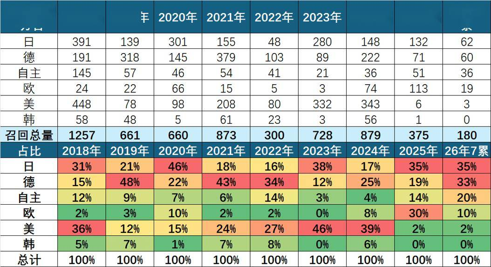
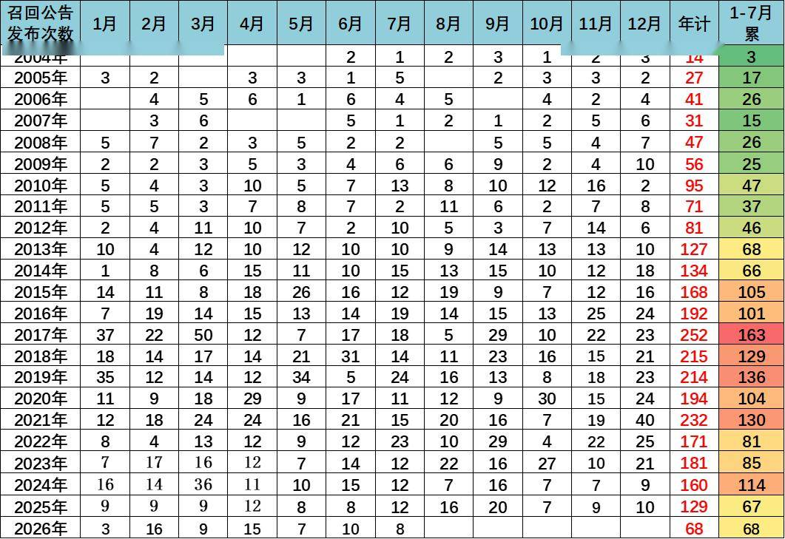
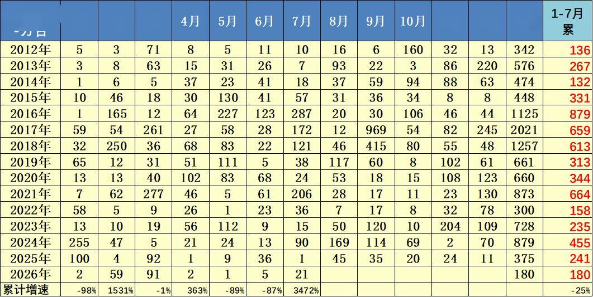
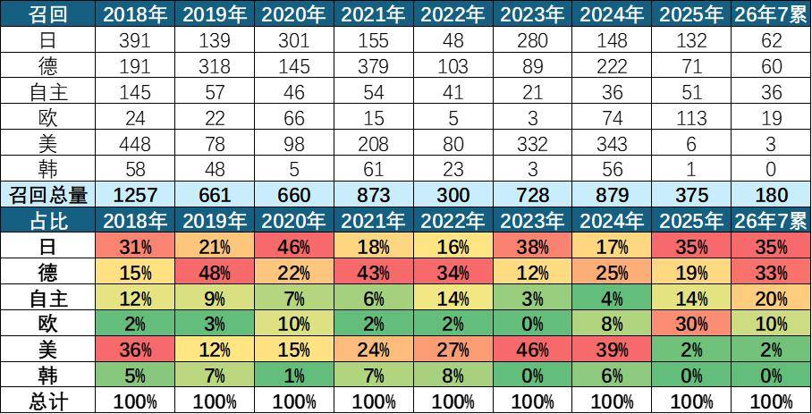

# 427万辆车企集中召回：新能源汽车颜值迭代下的安全底线重塑

- 公開日時: 2026-08-23 19:08（北京時間）
- 出典: [搜狐号・崔东树](https://www.sohu.com/a/1066574010_115312)
- テーマ（自動判定）: 論評・その他
- 画像: 4枚

---

注：本分析文章仅代表崔东树个人观点，如有异议，请留言。

2026年8月，国家市场监管总局集中公示九大主流车企的召回备案，累计涉及车辆超427万辆，创下国内汽车行业单一共性问题召回规模之最。此次大规模整改并非个别车企质量失控，而是新能源汽车“颜值优先”设计风潮与即将落地的安全新国标碰撞之下，行业主动进行的系统性风险纠偏。隐患集中于隐藏式门把手应急机械拉手在极端工况下辨识度不足，整改以OTA软件升级和标识补强为主，轻量高效。事件折射出中国新能源汽车产业正从“重体验、轻兜底”的粗放创新，迈向“颜值、体验、安全三位一体”的高质量发展新阶段，也标志着汽车安全监管从“事后处置”向“事前风控”的关键转型。

一、事件概况：九大车企集中整改，创下行业共性召回纪录

1、这次427万召回规模巨大

2026年8月21日，国家市场监督管理总局召回中心集中公示九家主流车企车辆召回备案计划，涵盖特斯拉、小米汽车、小鹏、零跑、极氪、东风、奇瑞、北汽蓝谷、中国一汽等国内外头部品牌，累计召回车辆超427万辆，创下国内汽车行业单一共性问题召回规模的历史纪录。本次大规模集中召回并非个别车企品控失当，而是新能源汽车设计潮流迭代、安全标准升级与监管体系趋严叠加下的行业共性整改事件，对国内新能源汽车产业高质量发展具有重要的警示与规范意义。

2、2026年召回的次数较少

今年汽车召回数量总体相对稳定，1-7月累计68批次，是2015年以来的召回最低的年份，并不多。

3、2026年召回数量总体较低

2012年至2026年（1-7月）各月及年度汽车召回总量。2017年召回达2021万辆峰值，2024年回升至879万辆。2026年前7个月累计180万辆，虽7月单月高达21万辆，但总体较正常。

4、国际车企召回很频繁，自主召回逐步跟进

二、此次召回的特征分析

1、隐患本质：非批量故障，系极端工况下的设计细节短板

2、整改模式：轻量化数字化整改，构建软硬双重安全冗余

3、溯源分析：颜值优先的设计风潮催生行业共性漏洞

本次九大车企集体入局、超427万辆车辆集中整改，根源在于新能源汽车内饰设计的行业共性趋势。近年来，新能源汽车全面摒弃传统燃油车的模块化内饰设计，以极简美学、一体化座舱、隐藏式结构为核心设计潮流，隐藏式电释放门把手、一体化内饰配色成为主流配置。这种设计革新有效提升了整车科技感、风阻系数与内饰精致度，是新能源车型差异化升级的重要亮点。但行业普遍存在“重体验颜值、轻极端工况”的设计短板，多数车企在产品研发阶段，重点验证常规用车场景的功能稳定性，对低压断电、重度碰撞等小概率、高风险极端失效场景的安全兜底设计考量不足，最终形成全行业普遍性设计隐患。

4、市场认知：召回不等于质量翻车，是行业责任的体现

市场层面无需对本次大规模召回过度恐慌，更不应将其解读为“新能源汽车质量崩塌”。行业需要树立一个核心认知：主动备案召回的车辆反而更安全、更值得消费者信任，持续主动召回整改，本质是车企持续消除车辆潜在安全隐患、敬畏安全底线的体现。汽车产品结构复杂、工况场景多样，任何车型都难以完全规避极低概率的设计隐患，因此车企是否主动排查、主动召回、主动整改，才是衡量车辆安全可靠性与企业责任的关键，而非是否存在召回记录。现实中，大量未发起召回的车型，并不代表不存在同类或其他隐性安全隐患，只是未被排查梳理、未启动合规整改。客观来看，召回规模大小与车辆质量优劣无直接关联，本次427万辆的庞大召回体量，核心源于国内新能源汽车庞大的市场存量，以及监管趋严下车企主动履行安全主体责任的行业进步。成熟汽车市场的核心特征，并非零召回，而是隐患早发现、风险早处置、整改全覆盖。九大主流车企主动备案召回、全面整改共性隐患，恰恰体现了国内头部车企日趋完善的质量管控体系与安全责任意识。

5、消费指引：理性看待召回，聚焦极端工况安全冗余

对于消费者而言，本次事件也提供了理性购车、用车的重要参考。现有车主无需过度焦虑，可主动查询车辆召回状态，按时完成OTA升级与标识补强整改，整改后车辆安全性能将得到全面提升；潜在购车消费者在选购隐藏式门把手车型时，可重点关注车辆应急逃生机构的辨识度、操作便捷性，将极端工况安全冗余作为重要购车参考指标。

三、此次召回的积极意义

1、监管逻辑：国标落地倒逼整改，行业监管迈入前置风控时代

2、技术反思：OTA赋能安全迭代，软件无法替代硬件兜底

同时，本次事件充分凸显了汽车OTA技术的行业价值与规范必要性。相较于传统燃油车硬件召回耗时耗力、成本高昂的弊端，新能源汽车依托智能化、网联化优势，可通过远程软件迭代快速优化车辆控制逻辑，高效化解隐性安全隐患，大幅提升车辆安全迭代效率。但此次整改也暴露行业短板：软件智能防护不能替代硬件机械兜底。新能源汽车安全设计中，部分车企过度依赖电控、智能系统，忽视了极端工况下电子系统失效后的物理安全冗余，片面以智能化替代基础安全设计，这也是本次全行业集体踩坑的核心症结。

3、产业启示：重构研发标准，筑牢软硬件协同安全体系

立足产业长远发展，本次集中召回为新能源行业敲响了安全警钟，释放出明确的行业升级信号。其一，汽车设计必须坚守“安全优先”的底层逻辑，颜值创新、体验升级、技术迭代必须无条件服从安全底线，极简设计、隐藏式结构、一体化座舱等创新方案，需同步完善极端工况安全冗余设计，杜绝美学设计凌驾生命安全。其二，车企研发体系需重构安全验证标准，打破“常规工况验证为主”的传统模式，将低压失效、重度碰撞、系统宕机等极端失效场景纳入核心测试体系，从产品源头规避共性安全隐患。其三，行业需建立软硬件协同安全体系，明确智能电控为辅助防护、机械结构为终极兜底的安全层级，杜绝过度依赖智能化、弱化基础硬件安全的行业乱象。

4、行业总结：大规模召回助力产业走向成熟规范化

总体而言，427万辆集中召回不是行业质量危机，而是中国新能源汽车产业走向成熟的必经淬炼。在新能源汽车高速迭代、智能化持续升级的背景下，行业正在告别“重创新、轻兜底”的粗放发展模式，逐步构建“颜值、体验、安全三位一体”的高质量发展体系。随着国内汽车安全国标持续完善、监管体系日趋精细化、车企安全研发能力不断升级，中国汽车产业的安全标准、产品品质将持续迭代优化，为行业长期健康发展筑牢核心根基。

附：近日信息合集
