# 车市扫描-2026年32期（8月17日-8月23日）

- 公開日時: 2026-08-26 17:54（北京時間）
- 出典: [搜狐号・崔东树](https://www.sohu.com/a/1067920875_115312)
- テーマ（自動判定）: 車市スキャン（週次）
- 画像: 19枚

---

主要信息源自乘联分会每日新闻等

中国汽车流通协会

乘用车市场信息联席分会（乘联分会）

网站：http://www.cpcaauto.com

一、本周车市概述1.2026年8月全国乘用车市场零售相对平稳

【2026年8月1-23日乘联会市场分析要闻】

8月1-23日全国乘用车厂家批发101.2万辆，同比去年同期下降20%，较上月同期增长2%；今年以来累计批发1582.2万辆，同比去年同期下降6%。8月1-23日乘用车市场零售95.6万辆，同比去年同期下降22%，较上月同期下降2%；今年以来乘用车累计零售1112.9万辆，同比去年同期下降20%。

8月1-23日全国乘用车厂家新能源批发71.4万辆，同比去年同期增长5%，较上月同期增长4%；今年以来累计批发896.2万辆，同比去年同期增长7%。8月1-23日新能源车市场零售61.4万辆，同比去年同期下降12%，较上月同期下降2%；今年以来累计零售628.3万辆，同比去年同期下降12%。

2026年8月1-23日全国新能源市场零售渗透率64.3%；新能源厂家批发渗透率70.5%。

8月第1-3周全国纯燃料轻型车生产27万辆，同比去年同期下降59%，较上月同期下降15%。8月第1-3周混合动力与插混总体生产25.9万辆，同比去年同期下降20%，较上月同期下降5%。

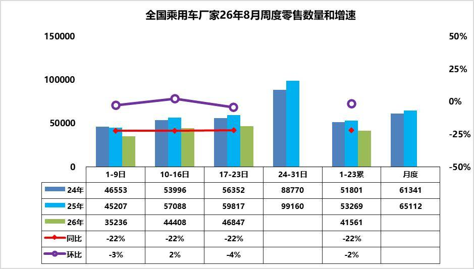

8月第1周乘用车市场日均零售3.5万辆，同比去年同期下降22%，较上月同期降3%。

8月第2周乘用车市场日均零售4.4万辆，同比去年同期下降22%，较上月同期增2%。

8月第3周乘用车市场日均零售4.7万辆，同比去年同期下降22%，较上月同期降4%。

8月1-23日乘用车市场零售95.6万辆，同比去年同期下降22%，较上月同期下降2%；今年以来累计零售1112.9万辆，同比去年同期下降20%。

近期终端市场回暖节奏平缓，多重宏观与行业因素交织塑造了市场低位平稳格局。受霍尔木兹海峡通航受阻影响，7月国际油价震荡上行，国内成品油价格两轮累计上调近985元/吨，大幅抬升燃油车用车、养车成本，持续压制用户燃油车购买意愿，传统燃油车需求持续走弱。近期新能源车价格平稳，消费观望心态浓重。随着8月中下旬开学季的到来，购车消费预计会有明显改善，小型电动车虽然新品少，但市场需求旺，加之以旧换新补贴的资金充沛，目标压力逐步加大，各地政策逐步宽松，预计会拉动车市改善加快。

8月车市处于底部蓄力修复阶段，随着各项稳消费政策逐步落地，叠加基数逐步改善，乘用车市场降幅将稳步收窄，行业正式进入价值驱动、结构优化的成熟发展阶段，为传统“金九银十”行情铺垫蓄力。

2.2026年8全国乘用车厂家销量平稳

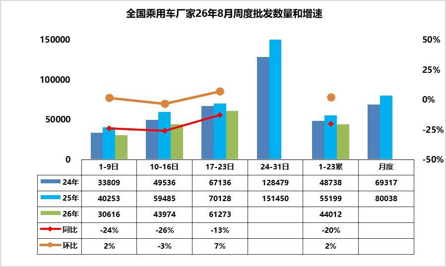

8第1周批发日均3.1台，同比去年8月同期下降24%，环比上月同期增2%。

8第2周批发日均4.4台，同比去年8月同期下降26%，环比上月同期降3%。

8第3周批发日均6.1台，同比去年8月同期下降13%，环比上月同期增7%。

8月1-23日全国乘用车厂家批发101.2万辆，同比去年同期下降20%，较上月同期增长2%；今年以来累计批发1582.2万辆，同比去年同期下降6%。

最新宏观数据显示国内消费与制造业景气偏弱，直接约束车市复苏力度。7月CPI同比上涨0.5%、环比微降0.1%，同比涨幅较上月显著回落0.5个百分点，反映终端内需动力不足；PPI同比上涨3.5%、环比下降0.7%，上游成本边际缓解但传导滞后；PMI回落至49.2%，制造业景气度下行，叠加居民消费信心谨慎，汽车大额消费观望情绪浓厚，导致车市整体增长乏力。

由于近期市场压力较大，主力厂家8月初高温假放假较多，燃油车市场去年火爆，今年受高油价冲击大，月初的厂家燃油车出货速度慢，因此年初暂时较低。今年部分区域局部洪涝灾害带来终端客流与销量的损失，月底成都车展大量新车密集上市，车市热度可能有所回升。

3.全国商用车国内保险特征——7月重卡新能源渗透率48%

根据国家金融局交强险数据，国内商用车交强险数据的2025年商用车强势增长。由于新能源车强势增长和报废更新政策促进车辆更新，2026年新能源商用车整体呈现快速拉升的良好局面。2026年1-3月商用车月均销量平稳，下降7%较弱。4-6月商用车市场逆势走强增10%，7月商用车23万台的销量实现-7%的同比下降。从累计数据来看，1-7月累计销量178万台，同比增1%，走出近5年来较强，远强于消费类乘用车走势。。

2026年7月新能源商用车暴增到10万台，同比增43%，环比6月降16%；2026年1-7月新能源商用车交强险62万台，累计增速45%。

2026年7月商用车新能源渗透率44.1%， 较同期增长15个点，强于乘用车的增长。2026年仍是纯电动增长较强，插混与增程的表现改善较大，氢燃料车的产品技术停滞，补贴仍拉不动增长。高油耗高税收的物流车型新能源渗透率提升较大，而中卡和皮卡稍低。

4.2026年中国汽车引领中国出口高质量增长

近日海关总署发布2026年1-7月份进出口数据。中国商品贸易出口在2026年总体表现相对强势增长，2026年1-7月出口25237亿美元，同比增长18%。尤其在7月份增247%达到3979亿美元的历年7月最高水平，中国出口贸易增长表现很强。从中国对美贸易顺差看，近几年一直保持较强的年度超3000亿美元的良好走势，今年1-7月份的顺差1706亿美元较好，且也要考虑转口增长良好走势，2026年的综合顺差依旧保持良好态势。

今年2月有81种商品占53%的商品处于近两年最低位，随着人民币升值，今年7月的出口商品价格处于高位的大幅增长，0分位的仅有11种商品占7%，50%-80%的高位的32%，价格位置在50%以下的有38%的商品品类，较2月改善巨大。

新三样分化严重，太阳能电池出口剧烈萎缩。2026年1-7月锂电池出口达到580亿美元，增41%。7月锂电池出口维持在94亿美元，同比增长33%。2026年1-7月太阳能电池出口达到372亿美元，增20%。7月太阳能电池出口暴增到43亿美元，同比降4%。

汽车出口2026年1-7月达到1108亿美元，增55%，7月汽车出口190亿美元，增60%，中国汽车活力很强。汽车零部件出口2026年1-7月达到607亿美元，增8%，7月汽车零部件出口94亿美元，增14%，中国汽车零部件出口压力巨大。要跟着自主整车企业发展，要改变依托欧美的售后体系的特征。

摩托车出口2026年1-7月达到134亿美元，增26%，7月摩托车出口21亿美元，同比增25%，燃油摩托车出口因高油价放缓，电动摩托暴增。要跟着自主整车企业发展，要改变依托欧美的售后体系的特征。

5.《道路交通安全法》修订草案设自动驾驶专章：从“人开车”到“车担责”，自动驾驶不是让车变少，而是让更多人拥有车

自动驾驶会让更多人买车，而不是更少。因为现在中国千人汽车保有量才260辆，发达国家是500到800辆。我始终觉得，中国汽车普及还有很大的空间。还有很多人买不起车，或者不敢开车、不会开车。自动驾驶降低了驾驶门槛，降低购车门槛，让老年人、手脚不便的人、害怕开车的人，都有了拥有自己一辆车的可能。推动这一空间释放的关键力量，正是智能网联汽车对中老年消费者的吸引力。未来自动驾驶让设计极简，成本降低，让那些原本“不会开车、不敢开车、不能开车”的老年人群有了购车和用车的可能。这不是“存量替代”，而是“增量释放”。

二、本周上市新车1.方程豹钛7 DM长续航版上市售价19.58万-22.58万元

8月18日，方程豹钛7 DM长续航版上市，新车共推2款，售价19.58万-22.58万元。外观与现款车型基本保持一致。新车配备20扬声器帝瓦雷音响、主动香氛系统、天神之眼B等。搭载1.5T插混系统，升级搭载50kWh大电池包，CLTC纯电续航达到315km和300km。

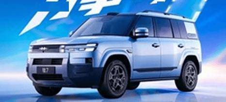

2.新款丰田凯美瑞上市-权益价为13.18万-16.98万元

8月19日，新款丰田凯美瑞上市，新车共推6款，售价17.18万-20.98万元，权益价为13.18万-16.98万元。外观与老款车型基本保持一致。内饰采用全新设计，搭载8.8英寸全液晶仪表+15.6英寸中控大屏。新车配备座椅按摩、14扬JBL音响、骁龙8155芯片、50W无线充电面板等。提供2.0L燃油以及2.0L或2.5L双擎混动系统，匹配CVT，E-CVT变速箱。

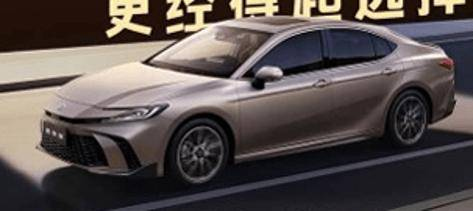

3.别克至境L7纯电版上市-权益价16.99万-19.99万元

8月19日，别克至境L7纯电版上市，新车共推3款，售价17.99万-20.99万元，上市权益价16.99万-19.99万元。外观与增程版基本保持一致。配备高通SA8775P芯片、27扬声器、Momenta R6大模型、预瞄魔毯底盘等。新车基于800V纯电架构打造，CLTC纯电续航702km。

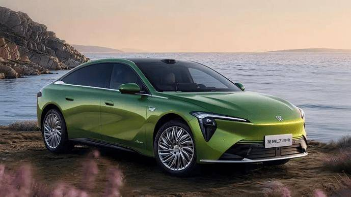

4.全新捷途山海L7 PLUS上市-超级置换价10.99万-15.99万元

8月19日，全新捷途山海L7 PLUS上市，新车共推6款，售价区间为11.99万-16.99万元，超级置换价10.99万-15.99万元。新车延续品牌经典家族设计语言。内饰采用10.25英寸全液晶仪表+15.6英寸向日葵中控屏。配备猎鹰700高阶智驾、高通SA8255芯片、12扬声器、6.4L冷暖冰箱等。提供1.5T和1.5L插混系统，CLTC工况纯电续航220km。

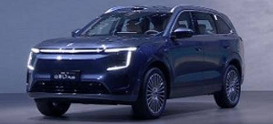

5.问界M6增程版新车型上市-售价区间为23.98万-25.98万元

8月20日，问界M6增程版新车型上市，新车共推2款，售价区间为23.98万-25.98万元。新车新增全新车漆配色冰晶粉。内饰新增全新内饰颜色松露棕。提供全新车载配件，包含副驾拓展套装、副驾随心支架。采用1.5T增程动力，CLTC纯电续航为235km，355km。

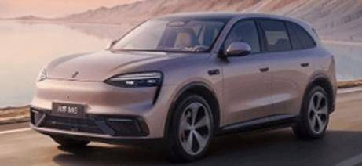

6.享界G9上市-售价区间为42.98万-54.98万元

8月20日，享界G9上市，新车共推10款，售价区间为42.98万-54.98万元。新车采用纵向灯组、电动踏板、侧翼迎宾光毯、侧开尾门。内饰采用12.3英寸全液晶仪表、17.2英寸中控屏、17.2英寸副驾屏、17英寸后排屏。配备2000kg准牵引资质、后排隐私光幕、车载对讲机、车载制氧系统等。纯电版CLTC续航为701km、728km；1.5T增程版CLTC纯电续航310km，400km，405km。

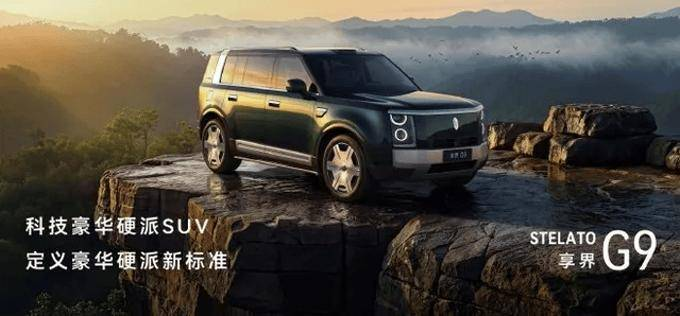

7.长安CS55PLUS蓝鲸超擎混动上市-限时权益价7.99万-10.39万元

8月20日，长安CS55PLUS蓝鲸超擎混动上市，新车共推4款，售价区间为9.89万-11.79万元，限时权益价7.99万-10.39万元。新车采用全新江韵叠浪无边界前脸格栅。内饰采用10.25英寸+14.6英寸星环智联双联屏。配备AI语音大模型、50W无线快充、前排座椅通风加热、副驾座椅按摩等。新车1.5T油电混动系统，匹配1DHT变速箱。

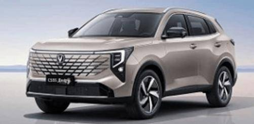

8.上汽大众ID.ERA 5S上市权益后售9.79万-12.79万元

8月21日，上汽大众ID.ERA 5S上市，新车共推5款，售价区间为11.99万-14.99万元，权益后售9.79万-12.79万元。新车采用家族式设计语言、贯穿式尾灯、自发光LOGO。内饰采用8.8英寸悬浮式仪表屏、15.6英寸2.5K中控屏。配备255色氛围灯、科大讯飞AI语音、地平线HSD高阶智驾等。采用1.5L插混系统，CLTC纯电续航160km。

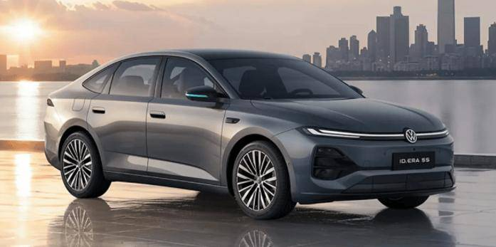

9.MG 07上市-限时补贴价区间为10.59-15.69万元

8月21日，名爵品牌旗下全新车型——MG 07正式上市，新车共推出7款车型，官方指导价区间为10.89-15.99万元，限时补贴价区间为10.59-15.69万元。MG 07是MG旗下全新轿跑，基于上汽全新一代新能源平台打造，定位中型新能源轿跑，搭载Momenta R7强化世界模型以及X7自研大模型专用芯片，动力上提供插混和纯电两种驱动形式。

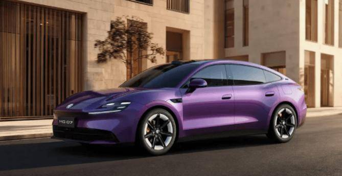

10.新款红旗HS5上市-权益后售13.48万-20.08万元

8月21日，新款红旗HS5上市，新车共推5款，售价区间为17.68万-23.98万元，权益后售13.48万-20.08万元。新车采用全新一体式车灯样式，调整尾灯以及后包围。新车调整功能区域布局，新增怀挡式换挡结构。配备方向盘加热、前排座椅加热通风、丹拿音响、灵犀座舱、司南驾驶辅助等。搭载2.0T发动机，匹配8TIP变速箱。

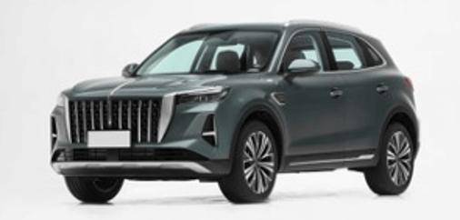

11.东风风神L8Y上市-限时权益后9.19万-11.09万元

8月21日，东风风神L8Y上市，新车共推3款，售价区间为10.09万-11.99万元，限时权益后9.19万-11.09万元。新车采用发光LOGO、传统车门把手、双段式扰流板、贯穿式灯组。内饰采用15.6英寸中控屏+10.25英寸液晶仪表+AR-HUD。配备高通骁龙8155、主副驾座椅按摩/通风/加热/记忆迎宾。搭载单电机纯电动力，CLTC纯电续航里程535km。

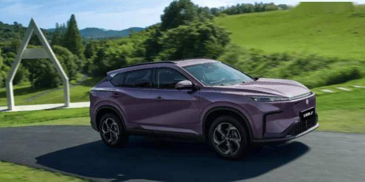

12.smart精灵#3型动竞速版上市-限时权益价19.49万元

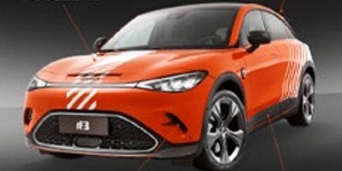

13.smart精灵#5 BRABUS超能版焕新上市-限时权益价32.99万元

8月21日，smart精灵#5 BRABUS超能版焕新上市，限时权益价32.99万元。新车新增全新哑光黑车色。超能版配备了翻毛皮+皮质材质包裹的三辐式多功能方向盘。CLTC工况下纯电续航660km。

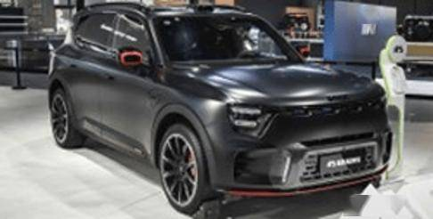

14.别克新GL8陆上公务舱尊享版上市-限时上市价为24.49万元

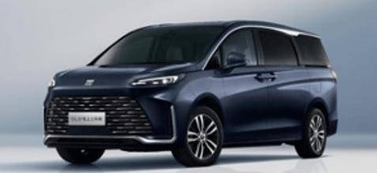

15.新款深蓝G318上市-限时优惠价19.68万-23.68万元

8月21日，新款深蓝G318上市，新车共推3款，售价区间为19.98万-23.98万元，限时优惠价19.68万-23.68万元。新车隐藏式门把手更换为机械门把手。中控区域细节进行优化。配备HarmonySpace 5、乾崑ADS 5Pro。搭载1.5T增程动力，CLTC纯电续航200km。

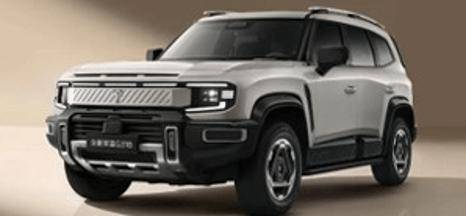

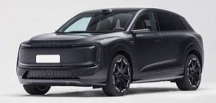

17.埃安UT 530宁德版上市-限时一口价8.58万元

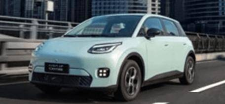

三、宏观经济与政策1.国家能源局：1-7月充换电服务业用电量974亿千瓦时

8月21日，国家能源局发布7月全社会用电量数据。7月，全社会用电量10400亿千瓦时，同比增长1.7%。其中，充换电服务业、互联网数据服务用电量分别为164亿、99亿千瓦时，增速分别达到50.3%、40.1%。1-7月，全社会用电量累计61399亿千瓦时，同比增长4.7%。其中，充换电服务业、互联网数据服务用电量分别为974亿、593亿千瓦时，增速分别达到55.8%、43.3%。

2.福建省推进汽车流通消费改革试点建设扩大新车消费

8月21日，福建省印发《福建省“十五五”商务发展规划》，规划提出，推动消费升级。推进汽车流通消费改革试点建设，扩大新车消费，便利二手车流通交易。

3.杭州老旧柴油货车淘汰最高每车补助19万元

杭州开展市区老旧柴油货车淘汰更新补助，其中包含了国五、国四排放标准的非营运货车和国五营运货车。补助分淘汰更新补助和首年奖励两部分，累计最高可达19万元。

4.陕西发布电动汽车大功率充电设施建设财政补贴方案

陕西省发展改革委、省财政厅研究制定了《陕西省电动汽车大功率充电设施建设财政补贴方案》。其中提出，对单枪最大输出功率1000千瓦及以上的兆瓦级充电设施给予重点支持，按照核算功率补贴80元/千瓦；对单枪最大输出功率大于250千瓦且低于1000千瓦的，按核算功率补贴50元/千瓦。对县域范围内的，在上述补贴标准基础上额外增加10元/千瓦。

5.上海市黄浦区：到2030年，建设5个以上市级电动汽车共享充电小区

8月19日，黄浦区人民政府发布了关于印发《美丽黄浦建设“十五五”规划》的通知。积极拓展充（换）电设施覆盖面，推进既有充电桩直流快充升级、电动汽车共享充电小区建设。到2030年，新建1000个电动汽车充电桩，建设5个以上市级电动汽车共享充电小区。

6.因门把手安全隐患，9家车企宣布召回

7.商务部等9部门发文提出多举措激发下沉市场活力

8月18日，商务部等9部门发布《关于进一步激发下沉市场活力 活跃县域消费的意见》。大力支持新能源汽车、绿色智能产品、绿色建材等下乡，扩大农村充电设施覆盖范围等。

8.阿根廷对中国产汽车传动轴启动反倾销日落合并情势变迁复审调查

8月19日，阿根廷经济部发布2026年第1291号公告，对原产于中国的汽车传动轴产品即十字万向节和球笼三叉启动反倾销第三次日落复审调查，同时启动情势变迁复审调查。案件调查期间，暂停对涉案产品征收反倾销税。公告自发布之日起生效。

四、企业信息1.聂春飞出任东风日产副总经理

日前，东风有限内部官宣人事变动，东风有限副总裁、原东风日产总经理助理聂春飞正式出任东风日产副总经理，东风公司党委常委、副总经理周锋不再兼任东风日产副总经理职务，转向集团层面履职。

2.广汽昊铂埃安上线官方二手车

8月22日，广汽昊铂埃安上线官方二手车品牌“悦享二手车”，覆盖二手车检测、交易、金融和售后。悦享二手车将车源限定为车龄4年以内、里程不超10万公里的非事故、非水泡车辆，每车通过128项检测，并进行22项原厂翻新。购车用户可延续原有质保及权益，享三电系统终身质保、1年或3万公里官方延保和全国联保。

3.吉利汽车2026年上半年收入超1700亿元

8月17日，吉利汽车控股有限公司发布2026年中期业绩，上半年公司总营收达1736亿元，同比增长15%，创历史新高。核心归母净利润达96.8亿元，同比劲增46%；核心归母净利率5.6%，同比增长27%。毛利率提升至17.9%，单车收入同比提升16%至11.2万元。

8月17日，吉利汽车将2026年全年出口目标由64万辆上调至92万辆，挑战百万级海外销售规模。同时宣布对管理层进行调整，自2026年8月18日起，李书福辞任吉利汽车控股有限公司董事会主席及执行董事职务，获任为公司终身荣誉主席，继续担任浙江吉利控股集团董事长。安聪慧获任吉利汽车控股有限公司董事会主席。

4.江淮汽车：上半年归母净利润亏损7.49亿元

江淮汽车8月19日披露半年报，公司上半年实现营业收入221.3亿元，同比增长14.31%；归属于上市公司股东的净利润亏损7.49亿元，上年同期亏损7.73亿元，同比减亏；基本每股收益-0.34元/股。

5.吉利宣布停止研发传统燃油车

8月17日，吉利汽车CEO淦家阅宣布，吉利未来将不再研发传统燃油车，所有燃油车产品将转向i-HEV智擎混动技术。吉利中国星系列也将全面完成混动化转型。

6.零跑汽车宣布正式进入阿根廷市场

零跑汽车宣布正式进入阿根廷市场，推出零跑B10和零跑C10两款全球车型的增程版本。零跑汽车与Stellantis集团共享其在阿根廷多年的经销商网络、服务体系及本地化运营经验。

7.奇瑞汽车上半年净利润率6.3%

8月20日，奇瑞汽车股份有限公司发布截至2026年6月30日止六个月之未经审核中期业绩。实现收入人民币1432.80亿元，同比增长1.2%；毛利人民币230.44亿元，同比增长25.1%；毛利率由去年同期的13.0%提升至16.1%。期内利润人民币90.16亿元，净利润率6.3%。

8.神龙汽车新公司成立

神龙汽车科技（武汉）有限公司完成工商注册，法定代表人为黄勇，注册资本约为82亿元。新公司由东风汽车集团、长江产业投资集团、武汉金融控股集团、武汉经开产业投资集团、Stellantis集团、神龙汽车有限公司六方共同投资设立。经营范围涵盖汽车零部件研发、新能源汽车整车销售等。8月20日上午在武汉经开区挂牌成立。

9.赛力斯半年报出炉

日前，赛力斯汽车正式对外披露半年报告，上半年赛力斯营业收入574.93亿元，同比下滑7.87%；归母净利润-17.17亿元，由盈转亏，同期盈利29.41亿元；扣非归母净利润-23.79亿元，同期盈利24.74亿元，同比下滑196.12%；赛力斯半年期综合毛利率为21.80%，较同期下滑4.7个百分点。

10.特斯拉中国车机正式上线豆包大模型

11.特斯拉官网：中国不在FSD可使用地区

特斯拉北美官网近日更新了FSD全球可使用地区清单。最新名单里，全球仅开放12个地区，中国不在此次公示的可用地区范围内。

12.武汉蔚来能源增资至74.84亿

武汉蔚来能源有限公司发生工商变更，注册资本由17.84亿人民币增至74.84亿人民币，增幅约320%。该公司由蔚来能源投资（湖北）有限公司全资持股。

13.智己发布“NEXT·2028”战略

智己汽车正式发布全新产品战略“NEXT·2028”。该战略以上汽最新NEO三电架构、全线控底盘及IM Claw智能体三大技术为核心支撑，旨在实现整车全域体验升级，后续全系车型将标配相关旗舰技术。

14.欧委会批准奔驰、宝马与赛力斯共同控股超充合资公司逸安启

欧盟委员会宣布根据欧盟并购法规，正式批准梅赛德斯-奔驰中国集团、华晨宝马和赛力斯集团共同控股北京逸安启新能源科技有限公司（逸安启）。

五、行业信息1.乘联分会：1-7月我国汽车出口同比增长55%

海关总署数据，2026年1-7月中国商品贸易出口额为25237亿美元，同比增长18%。7月我国汽车出口190亿美元，同比增长60%；1-7月汽车出口达到1108亿美元，同比增长55%。

2.乘联分会：预计8月狭义乘用车销量环比增长8.1%

8月21日，乘联分会初步推算本月狭义乘用车总市场约为158万辆，其中新能源车零售约为104万辆左右，渗透率预计可达65.8%。占市场总销量七成以上的头部厂商，本月零售目标环比上月增长约8%，推算8月狭义乘用车零售环比增长8.1%，同比降幅仍大于20%。

3.禾赛科技公布2026上半年财报

8月18日，禾赛科技发布2026财年半年报，营业总收入15.41亿元，同比增长25.1%；毛利润6.11亿元，同比增长17.62%；毛利率39.7%，同比下降2.5个百分点；归母净利润8886.5万元，同比增长234.9%；基本每股收益：0.07元，同比增长133.33%。

4.宁德时代商城正式上线

8月22日，“宁德时代商城”小程序正式上线。作为专为中小集成商打造的官方储能产品直销平台，宁德时代商城的企业注册客户已突破1800家。目前，宁德时代商城已上架三类储能产品，储能电芯3箱起订。

5.途虎养车上半年营业收入87.8亿元

8月21日，途虎养车发布2026年中期业绩报告。期内，途虎养车门店网络加速扩张至8825家。上半年，途虎实现总收入87.8亿元，同比增长11.4%，期内录得经调整净利润2.4亿元。

6.亿纬锂能：上半年净利润同比增长105.66%

亿纬锂能宣布全球化产能布局双线并进。国内方面，亿纬锂能规划投建新增约260GWh大铁锂产能，已在广东、湖北、江苏、福建、浙江等多地完成选址工作。海外方面，亿纬锂能马来西亚生产基地加速建设，定位为覆盖亚洲、辐射全球的多场景锂电池制造基地。

亿纬锂能8月19日披露半年报，2026年上半年，公司实现营业收入为456.91亿元，同比增长62.2%；归母净利润33.01亿元，同比增长105.66%；基本每股收益1.57元。公司拟每10股派发现金红利2.3元（含税）。出货量方面，报告期内动力电池出货35.76GWh，同比增长66.47%；储能电池出货44.46GWh，同比增长54.88%。

六、跨国集团与国际市场1.本田取消三款北美电动汽车项目

近日，本田正式宣布，取消三款北美电动汽车项目，分别是本田0系列轿车、0系列SUV以及讴歌RSX电动跨界车，这三款车型原定在俄亥俄州工厂生产。本田表示，此次战略调整将计提约2.5万亿日元的费用和损失。

2.保时捷回应“2030年前停产Taycan”

保时捷德国总部回应称：公司正在精简Taycan的衍生车型数量以降低产品复杂度，而非砍掉整个车系。短期内，没有停产Taycan的计划。

3.大众集团将从约150款车型降至75款

当地时间8月21日，大众集团首席执行官表示，目前集团旗下各品牌总共提供约150款车型，未来通过削减车型变体与重叠产品后，车型总数将降至约75款。

4.美对加拿大汽车等部分商品加征50%关税

一名美国政府高级官员证实，对加拿大汽车等部分商品加征50%关税的措施，将于美东时间8月22日凌晨00:01正式生效。加拿大方面表示，将以同等幅度实施反制。

5.Stellantis集团考虑出售加拿大工厂

加拿大汽车工人工会表示，已收到Stellantis集团通知，受美国贸易关税影响，该公司正考虑关闭并出售其位于安大略省布兰普顿的整车工厂。

6.特斯拉准备面向公众推出CyberCab

据报道，特斯拉已告知员工，正为面向公众推出Cybercab做准备。这是特斯拉首款没有方向盘和刹车踏板的车型。计划首先在得克萨斯州奥斯汀向公众推出，最快可能8月内启动。

7.Waymo为自动驾驶出租车自研芯片

当地时间8月20日消息，谷歌旗下Waymo自研一款芯片，旨在提升其无人自动驾驶出租车的性能，并将芯片供应来源从英伟达等第三方公司拓展至自研渠道。这款专用芯片已在Waymo最新一代无人驾驶出租车中投入量产，将提升车辆的反应速度和导航能力。该芯片算力超过1000 TOPS，采用台积电5纳米工艺制造。

8.优步、特斯拉、Waymo获准在拉斯维加斯最多投放8000辆无人出租车

美国内华达州交通管理局于近日全票通过三项许可，允许优步、特斯拉以及Waymo在拉斯维加斯所在的克拉克县开展商业化机器人出租车服务。这几份许可合计允许未来12个月内在该县投放最多8000辆机器人出租车。

附：近日信息合集
