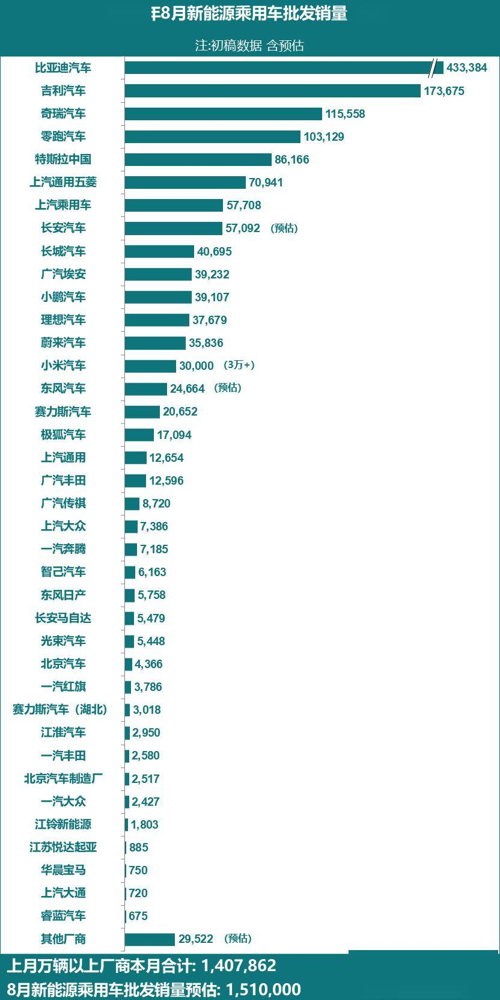

# 【新能源】2026年8月新能源乘用车厂商批发销量快讯

- 公開日時: 2026-09-02 18:40（北京時間）
- 出典: [搜狐号・崔东树](https://www.sohu.com/a/1071066035_115312)
- テーマ（自動判定）: 乗用車市場
- 画像: 1枚

---

本文全文共864字，阅读全文约需3分钟

8月新能源乘用车市场预判

2026年8月，全国新能源乘用车厂商批发销量预估达到151.0万辆，同比增长16%，环比增长4%，实现双位数双增长，标志着新能源板块在经历前期调整后已进入强势筑底的复苏通道。这一增速显著高于同期整体车市大盘，新能源车成为稳定乘用车市场平稳发展的核心引擎。

2026年8月新能源乘用车市场呈现 “渗透率创新高但总量承压、批售繁荣但零售疲软”的复杂局面。高油价延续和产品供给优化仍是支撑新能源的核心因素，但季节性淡季、宏观消费偏弱、高基数效应以及渠道库存压力构成了显著制约。由于8月下旬的开学季市场本应是购车换购旺季，但今年8月下旬走势明显没有正常的热度回升特征。市场已从8月的“复苏通道”进入“底部蓄力”阶段，真正的旺季行情有待“金九银十”验证。

受益于头部车企加速电动化转型与消费环境驱动，8月多家主流车企新能源批发销量刷新同期历史纪录，印证国内车企电动化转型成效凸显。比亚迪汽车、吉利汽车、奇瑞汽车、零跑汽车、上汽通用五菱、上汽乘用车、长城汽车、小鹏汽车、蔚来汽车、极狐汽车、上汽通用、广汽丰田、广汽传祺、长安马自达等车企，本月新能源批售量悉数创下历年 8月最佳成绩。这些车企覆盖自主、合资及新势力品牌，说明电动化转型已从“少数先行”演变为“全行业共识”，技术迭代与新品投放节奏加快，市场表现持续提升。

全国乘用车市场2026年7月，新能源批发销量万辆以上厂商的销量之和，占总体新能源乘用车当月销量的93%。根据目前初步汇总数据，7月新能源销量万辆以上厂商企业的8月销量为141万辆。目前大部分厂商销量基本都已经锁定大数，因此按照7月结构占比结合8月数据，测算8月的全国新能源乘用车批发销量为151万辆。

综上，根据月度初步乘联数据综合：2026年8月全国乘用车厂商新能源批发预估151万辆，同比增长16%，环比增长4%。

注：由于乘联快报数据可能与厂商终稿数据有差异，因此对此版的具体厂商数据不要与历史终稿数据直接对比，以防误导。

8月乘用车主力厂商新能源批发销量快报

