# 车市扫描-2026年33期（8月24日-8月31日）

- 公開日時: 2026-09-03 17:22（北京時間）
- 出典: [搜狐号・崔东树](https://www.sohu.com/a/1071474601_115312)
- テーマ（自動判定）: 車市スキャン（週次）
- 画像: 11枚

---

主要信息源自乘联分会每日新闻等

中国汽车流通协会

乘用车市场信息联席分会（乘联分会）

网站：http://www.cpcaauto.com

一、本周车市概述1.2026年8月全国乘用车市场零售相对平稳

【2026年8月1-31日乘联会市场分析要闻】

8月1-31日全国乘用车厂家批发236.9万辆，同比去年同期下降5%，较上月同期增长5%；今年以来乘用车累计批发1717.9万辆，同比去年同期下降5%。8月1-31日市场零售162.6万辆，同比去年同期下降19%，较上月同期增长11%；今年以来乘用车累计零售1179.9万辆，同比去年同期下降20%。

8月1-31日全国乘用车厂家新能源批发150.6万辆，同比去年同期增长16%，较上月同期增长4%；今年以来乘用车累计批发975.4万辆，同比去年同期增长9%。8月1-31日新能源车市场零售106.9万辆，同比去年同期下降4%，较上月同期增长12%；今年以来乘用车累计零售673.7万辆，同比去年同期下降11%。

2026年8月1-31日全国新能源市场零售渗透率65.7%；新能源厂家批发渗透率63.6%。

8月第1-4周全国纯燃料轻型车生产40.6万辆，同比去年同期下降56%，较上月同期下降4%。8月第1-4周混合动力与插混总体生产38.6万辆，同比去年同期下降17%，较上月同期增长4%。

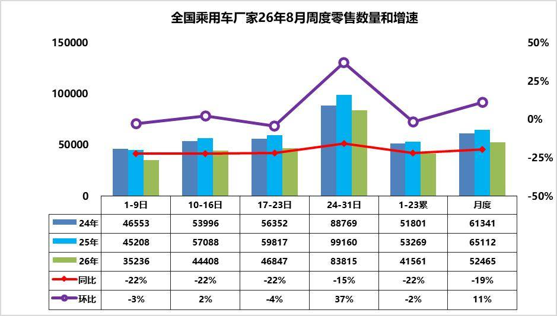

8月第1周乘用车市场日均零售3.5万辆，同比去年同期下降22%，较上月同期下降3%。

8月第2周乘用车市场日均零售4.4万辆，同比去年同期下降22%，较上月同期增长2%。

8月第3周乘用车市场日均零售4.7万辆，同比去年同期下降22%，较上月同期下降4%。

8月第4周乘用车市场日均零售8.4万辆，同比去年同期下降15%，较上月同期增长37%。

8月1-31日市场零售162.6万辆，同比去年同期下19%，较上月同期增长11%；今年以来乘用车累计零售1179.9万辆，同比去年同期下降20%。

近期终端市场回暖节奏平缓，多重宏观与行业因素交织塑造了市场低位平稳格局。受霍尔木兹海峡通航受阻影响，7月国际油价震荡上行，国内成品油价格两轮累计上调近985元/吨，大幅抬升燃油车用车、养车成本，持续压制用户燃油车购买意愿，传统燃油车需求持续走弱。近期新能源车价格平稳，消费观望心态浓重。随着8月中下旬开学季的到来，购车消费有明显改善，小型电动车虽然新品少，但市场需求旺，加之以旧换新补贴的资金充沛，目标压力逐步加大，各地政策逐步宽松，逐步拉动车市改善加快。

8月车市处于底部蓄力修复阶段，随着各项稳消费政策逐步落地，叠加基数逐步改善，乘用车市场降幅将稳步收窄，行业正式进入价值驱动、结构优化的成熟发展阶段，为传统“金九银十”行情铺垫蓄力。

2.2026年8全国乘用车厂家销量平稳

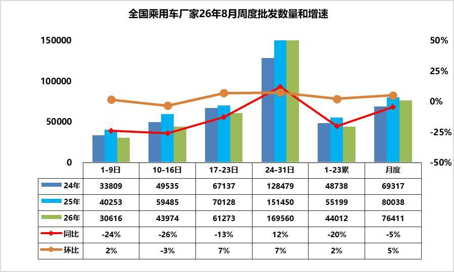

8第1周批发日均3.1台，同比去年8月同期下降24%，环比上月同期增长2%。

8第2周批发日均4.4台，同比去年8月同期下降26%，环比上月同期下降3%。

8第3周批发日均6.1台，同比去年8月同期下降13%，环比上月同期增长7%。

8第4周批发日均17.0台，同比去年8月同期增长12%，环比上月同期增长7%。

8月1-31日全国乘用车厂家批发236.9万辆，同比去年同期下降5%，较上月同期增长5%；今年以来乘用车累计批发1717.9万辆，同比去年同期下降5%。

最新宏观数据显示国内消费与制造业景气偏弱，直接约束车市复苏力度。7月CPI同比上涨0.5%、环比微降0.1%，同比涨幅较上月显著回落0.5个百分点，反映终端内需动力不足；PPI同比上涨3.5%、环比下降0.7%，上游成本边际缓解但传导滞后；PMI回落至49.2%，制造业景气度下行，叠加居民消费信心谨慎，汽车大额消费观望情绪浓厚，导致车市整体增长乏力。

由于近期市场压力较大，主力厂家8月初高温假放假较多，燃油车市场去年火爆，今年受高油价冲击大，月初的厂家燃油车出货速度慢，但后期出口数据汇入的增长较好。今年部分区域局部洪涝灾害带来终端客流与销量的损失，月底成都车展大量新车密集上市，车市热度稍有回升。

3.2026年1-7月中国占世界汽车份额31%

根据世界汽车组织统计数据，全球汽车生产不断增长，2025年达到9689万台，较2024年的9177万台增6%，中国占世界生产份额35.4%。根据我们统计2025年全球汽车销量9689万台，同比增长6%。2026年7月的世界汽车销量达到824万台，同比增5%。2026年1-7月世界汽车销量达到5611万台，同比增3%。

随着美国、中国车市的年初相对负增长，2026年1-7月世界车市销量增长不强。2025年中国达到世界汽车的35.4%的份额；2026年初的中国份额31.4%。2026年初，中国汽车销量下滑较大，随着政策补贴促进中国商用车走强，7月份额回升到32.1%。年初较低是入门级销量萎缩因素的异常体现，乘用车弱、商用车强，出口暴增。期待能有改善低端收入和减少抑制低端消费政策，随着政策刺激效果逐步恢复显现，预计未来中国车市逐步走强。

2026年1-7月的全球汽车销量增3%，其中中国汽车销量下降4%，美国销量下降3%，印度汽车市场销量增19%，泰国汽车市场增14%，俄罗斯市场销量增8%，越南增29%。新兴市场拉动市场表现较好。

东升西降，除了丰田、现代起亚、铃木和塔塔等，其它国际品牌份额2026年出现较大幅下滑。相对于2019年的中国自主品牌全面提升世界份额。吉利、比亚迪、奇瑞、上汽、长安等自主表现较强。电动化发展也导致部分国际车企逐步走向衰落。除了铃木等印度市场较好的因素促进，其它国际品牌份额出现全面较大的下滑。

4.2026年1-7月汽车行业利润率3.6%、收入增2.7%、成本增3.8%、利润降20%

2026年1-7月，面对国际环境复杂演变和国内转型压力等多重挑战，国民经济开局良好、质效提升，装备制造业和高技术制造业利润快速增长，原材料制造业利润两位数增长，为全年经济平稳运行奠定坚实基础。2026年7月汽车生产253万台，同比持平；新能源汽车生产155万台，同比增30%，渗透率61%；燃油车生产98万台，同比降27%。2026年7月的汽车行业收入8887亿元，同比增8.3%；成本7957亿元，增10%；利润209亿元，同比降28%；汽车行业利润率2.4%。2026年1-7月汽车生产1761万台，同比降3%；新能源汽车生产895万台，同比增10%，渗透率51%；燃油车生产867万台，同比降14%。2026年1-7月的汽车行业收入60780亿元，同比增2.7%；成本54058亿元，增3.8%；利润2162亿元，同比降20%；汽车行业利润率3.6%，相对于下游工业企业利润率6.5%的平均水平，汽车行业仍偏低。

2026年各地大力度推动“两新”政策落地实施，逐步有效释放内需活力，但汽车行业效益改善明显落后其它消费品。随着国家反内卷工作持续推进，汽车行业受上游挤压严重，价格问题严重，油价暴涨，有色金属、半导体利润暴增，终端用户购车观望心态严重，车企运行压力持续加大，高质量发展受到上游的巨大冲击。

5.2026年1-7月中国占世界新能源车62%

2026年1-7月世界汽车销量达到5611万台，新能源汽车达到1352万台。2026年1-7月的新能源车份额达到24.1%，其中纯电动车的占比达到16.8%，插电混动达到7.3%的汽车比例。混合动力达到8.1%的表现优秀。

由于欧洲新能源走势大幅回暖，因此海外其他国家新能源车7月销售78万台增29%;海外新能源车1-7月销量511万台、增速达到30%，接近于前两年平均水平。其中美国新能源车2026年7月销量10.4万台同比降37%，1-7月美国新能源车销量71万，降低29%。欧洲新能源乘用车2025年销量386万台，较去年同期增量96万台，增33%。初步统计欧洲新能源乘用车7月41万台同比增38%，2026年1-7月279万台同比增34%。

世界新能源车渗透率总体呈现快速提升趋势，2022年已经达到13.1%水平，2023年达到15.9%，2024年达到19.5%，2025年渗透率达到23.6%。2026年世界新能源车渗透率24.1%，其中，德国达到32.6%，挪威达到81%，英国35%，而美国仅有7%，日本仅有4%，因此世界新能源发展的不均衡性极为明显。

2025年中国新能源乘用车世界份额68.3%；2026年1-7月中国新能源乘用车世界份额达到62%，2026年7月达到65.3%的较好水平。2026年中国在世界纯电动车市场份额58%份额，年初因素的中国纯电动车表现暂时较差，7月达到62%。2025年中国在世界插电混动份额达到76.4%的超高水平，2026年中国在世界插电混动份额达到71%的高水平，7月达到74%中国在世界插电混动市场呈现超强的表现。

2025年自主新能源乘用车海外市场销量份额达到15.8%，提升较大。2026年自主新能源乘用车海外市场销量份额大幅提升，7月达到28%，进一步大幅跃升。

二、本周上市新车1.长城H9力魂版上市限时焕新价21.49万-23.29万元

8月24日，长城H9力魂版上市，新车共推2款，售价区间为23.99万-25.79万元，限时焕新价21.49万-23.29万元。新车提供两款专属配色，换装全新前杠，抬高边角位置，前唇预留拖钩及绞盘安装点位。配备2.5吨牵引资质、拖车取电口、三把锁、坦克掉头、全地形反馈系统等。提供2.0T汽油发动机+8TIP变速箱，以及2.4T柴油发动机+9TIP变速箱。

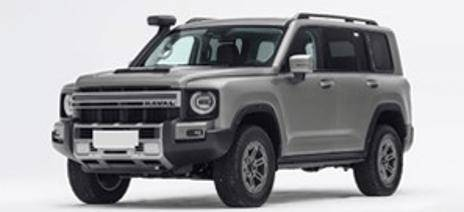

2.北京越野泰钽700上市焕新价为24.98万-34.98万元

8月25日，北京越野泰钽700上市，新车共推3款，售价区间为27.98万-37.98万元，焕新价为24.98万-34.98万元。新车采用五孔发光格栅、竖向尾灯、外挂式备胎。内饰采用10.25英寸全液晶仪表、双15.6英寸中控副驾联屏、21.4英寸吸顶屏。配备乾崑ADS 5 Max、ANC主动降噪、后排隐私声盾、制氧机、卫星通信等。采用非承载式车身，搭载1.5T增程系统，CLTC纯电续航220km。

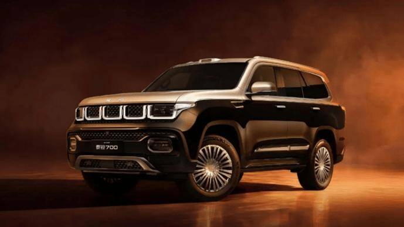

3.全新起亚赛图斯上市一口价7.99万-11.99万元

8月26日，全新起亚赛图斯上市，新车共推6款，售价区间为10.99万-14.99万元，上市一口价7.99万-11.99万元。新车提供普通套装与X‑Line运动套件可选。内饰采用10英寸低位交互仪表+27英寸超薄一体式宽屏。配备高通骁龙8295P芯片、文心一言AI大模型、L2级智能驾驶辅助等。新车1.5L发动机匹配CVT变速箱，1.5T发动机匹配8TIP变速箱。

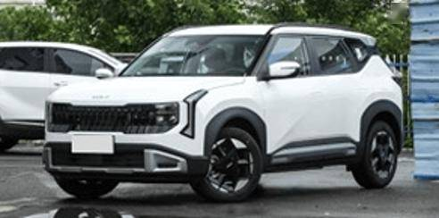

4.奇瑞风云T7上市抢先置换价9.49万-11.59万元

8月26日，奇瑞风云T7上市，新车共推3款，售价区间为9.79万-11.89万元，抢先置换价9.49万-11.59万元。新车采用双LED风刃前大灯、贯穿式尾灯、后扰流板、电动后备厢。内饰采用8.8英寸全液晶仪表、15.6英寸2.5K悬浮式中控屏。配备猎鹰500辅助驾驶、舱驾一体8775芯片、豆包大模型、前排座椅加热/通风等。新车全系CLTC纯电续航600km。

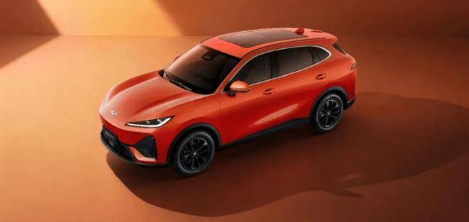

5.新款丰田bZ5上市限时权益价10.98万-17.98万元

8月26日，新款丰田bZ5上市，新车共推6款，售价区间为12.98万-19.98万元，限时权益价10.98万-17.98万元。外观与老款车型基本保持一致。新车搭载激光雷达，并升级为MomentaR6大模型。CLTC纯电续航里程为550km和630km。

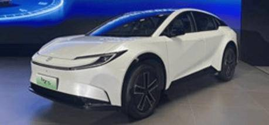

6.长城欧拉5GT上市限时换新价8.98万-13.38万元

8月28日，长城欧拉5GT上市，新车共推6款，售价区间为9.98万-14.38万元，限时换新价8.98万-13.38万元。新车采用下压式前脸与俯冲车身设计，搭载空气动力学GT套件。内饰采用一体式运动座椅、头枕专属刺绣、定制运动缝线。新车配备Coffee OS 3、Coffee GPT、Coffee Pilot 3、激光雷达等。1.5T燃油版本搭配7DCT变速器，1.5THEV版本搭配2DHT变速器，纯电版本CLTC续航550km。

8月28日，长城欧拉5运动款上市，新车共推7款，售价区间为8.18万-13.58万元，限时换新价7.18万-12.58万元。新车采用运动前铲、尾部扩散器与后扰流板组件。内饰采用星夜灰+闪电黄撞色、晨曦白+闪电黄撞色两种选择。新车配备Coffee OS 3、Coffee Pilot 3、座椅通风/加热/记忆等。1.5T燃油版本搭配7DCT变速器，1.5THEV版本搭配2DHT变速器，纯电版本CLTC续航580km。

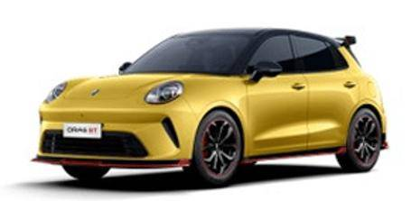

7.全新一代智己L6上市19.99万元起

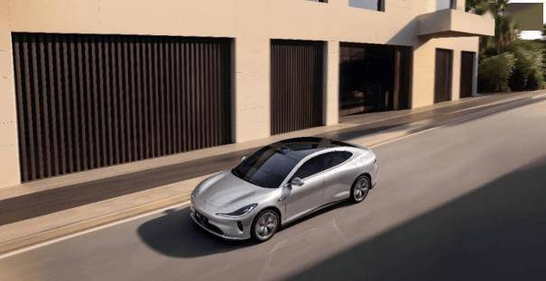

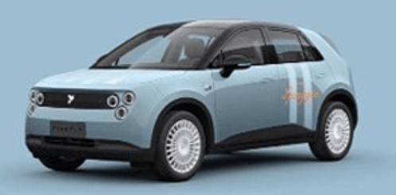

9.新款途观L Pro上市置换惊爆价14.99万-26.68万元

8月29日，新款途观L Pro上市，新车共推4款，售价21.38万-26.68万元，限时置换惊爆价14.99万-26.68万元。外观与老款车型基本保持一致。配备高通骁龙8155芯片、文心一言+DeepSeek大模型、行云智能辅助驾驶。搭载1.5T，2.0T发动机，匹配7DCT变速箱。

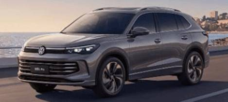

三、宏观经济与政策1.道交法修订草案新增自动驾驶汽车专章规定

8月25日，提请十四届全国人大常委会会议初次审议的道路交通安全法修订草案，设置了“自动驾驶汽车的特别规定”专章，明确了自动驾驶汽车和辅助驾驶功能的概念，并明确自动驾驶汽车在自动驾驶功能激活状态下发生道路交通安全违法行为的，由自动驾驶汽车生产企业、进口企业接受处理。未激活自动驾驶功能的自动驾驶汽车和驾驶仅具备辅助驾驶功能的汽车上道路行驶，按照非自动驾驶汽车的规定管理。

2.两部门：规范无人驾驶货车、无人快递车等装备试点应用

国家发展改革委、交通运输部联合印发《物流网建设实施方案》。规范无人驾驶货车、无人快递车等装备试点应用，在封闭园区、港站等率先投放运行。

3.工信部：严禁未经充分测试验证的新能源汽车产品进入市场

8月26日，国新办举行的新闻发布会现场，工信部对近期出现的个别引发社会关注的汽车产品质量、自动驾驶安全等事件作出回应。支持重点企业加大技术攻关力度，持续提升动力电池低温适应性、耐久性，提高自动驾驶安全性、可靠性。将加强产品创新设计准入审查和测试验证管理，严禁未经充分测试验证的产品进入市场。

4.工信部等四部门组织开展道路机动车辆产品生产一致性和质量提升专项行动

8月27日，工信部、公安部、生态环境部、市场监管总局联合印发《关于开展道路机动车辆产品生产一致性和质量提升专项行动的通知》，聚焦生产一致性、可靠性、耐久性、新技术测试验证四大领域突出问题，从严规范行业竞争秩序，筑牢车辆产品质量安全底线，推动汽车、摩托车产业健康可持续发展。一同发布的《道路机动车辆生产企业产品安全保障能力和生产一致性监督检查工作方案》显示，此次主要检查内容包括智能网联汽车安全保障能力、企业设计开发及生产能力、产品生产一致性情况等。

5.新版强制国标发布，将提升车用压缩天然气产品质量

市场监管总局（国家标准委）近日批准发布《车用压缩天然气》强制性国家标准，将自2027年8月1日起实施。一是技术指标持续健全；二是试验方法全面升级；三是取样与判定规则不断完善。该标准的发布实施将有效规范我国压缩天然气产品质量管控。

6.统计局：2026年1-7月份全国规模以上工业企业利润增长17.6%

8月27日，统计局发布数据显示，1-7月份，全国规模以上工业企业实现利润总额45,820.6亿元，同比增长17.6%。1-7月份，规模以上工业企业实现营业收入80.92万亿元，同比增长6.5%。7月份，规模以上工业企业利润同比增长11.2%。

7.上海将全市网格化划分为“发展区”“保持区”和“调控区”

8月28日，上海市交通委员会印发《上海市公共充电网络建设“发展区”“保持区”和“调控区”划分方案（2026年）》。根据区域内有明确补能需求的新能源运营车辆数与优质公共充电枪数的比值，划分发展区、保持区、调控区，方案适用时间为2026年8月30日至2027年8月29日。

四、企业信息1.大众汽车发布新一代Amarok皮卡

大众汽车在2026年巴西巴雷图斯牛仔节开幕式上正式展示了新一代Amarok皮卡。这款中型皮卡计划于2027年上市，将在阿根廷生产。大众汽车确认新一代Amarok将成为该车型历史上动力最强的版本，并支持电气化技术。

2.丰田汽车下一代电动车将率先在中国生产

据日经中文网报道，丰田将于2027年秋季在中国生产下一代纯电动汽车（EV），作为旗下高端品牌“雷克萨斯”的SUV进行销售，并将在公司位于上海的新工厂生产。首年月产量约为1000辆，到2028年将扩大至每年数万辆。

3.比亚迪与荣耀达成深度手车互联合作

8月25日，比亚迪官方宣布，与荣耀达成深度手车互联合作，地址流转一拖即达、音乐无缝流转、微信扫一扫一句话唤起（需要DiLink100及以上智能座舱平台）。

4.比亚迪上半年营收3448.2亿元

8月28日，比亚迪披露2026年中期业绩报告，比亚迪上半年营收3448.2亿元人民币，同比下降7.13%；比亚迪上半年净利润123.3亿元人民币，同比下降20.5%。比亚迪上半年研发投入约人民币289亿元，累计研发投入超人民币2700亿元。

5.比亚迪第10000座闪充站落成

8月28日，比亚迪“闪充中国”战略迎来关键节点，其第10000座闪充站暨深圳龙华闪充旗舰站正式落成。截至当前，比亚迪全国闪充站总用户量突破183万。

6.北汽蓝谷2026年H1营收116亿元

8月28日，北汽蓝谷发布2026年上半年业绩报告。营收115.97亿元，同比增长21.86%；销售毛利率4.21%，同比提升9.68个百分点；归母净利润-19.38亿元，同比收窄16.02%。

7.长安2026年H1营收656亿元

8月28日，长安发布2026年上半年业绩报告。营收656.34亿元，同比下降9.71%；归母净利润8.17亿元，同比下降64.32%。集团总交付119.56万辆，同比下降11.76%。

8.长城汽车半年财报发布

8月25日，长城汽车发布2026年半年度报告。2026年上半年长城汽车实现营业收入为1021.01亿元，同比增长10.58%，为其首次实现上半年营收超千亿元；归母净利润为24.65亿元，同比下滑61.11%；扣非净利润净利润为16.10亿元，同比下滑55.04%。

9.福田汽车半年盈利改善

8月28日，福田汽车发布2026年半年报。2026年上半年，福田汽车实现营业收入336.68亿元，同比增长10.86%；利润总额9.04亿元，同比提升20.44%；归属于上市公司股东的净利润为9.05亿元，同比增长16.54%；扣除非经常性损益净利润为7.77亿元，同比大幅增长41.04%，盈利质量实现较大提升。

10.广汽集团冯兴亚拜访华为任正非

8月25日，广汽集团董事长冯兴亚发文称，他与团队8月24日赴深圳再次拜访华为任正非先生，围绕启境下一阶段发展以及广汽与华为双方合作进行深入交流。

11.广汽集团2026上半年合并营收同比增9.13%至465亿元

广汽集团8月28日披露2026年半年度报告。录得合并营业总收入逾465亿元、同比增长9.13%，全集团汽车销量77.31万辆、同比增长2.35%。其中自主品牌出口量大增132%，出口规模已接近2025年全年总量，全集团海外市场收入同比增长109.27%至140.13亿元。

12.吉利汽车集团发布AI新能源越野技术体系

近日，吉利汽车集团正式发布AI新能源越野技术，汇集GTA原生新能源越野架构、全驱AI电混雷神EM-T、AI全地形数字底盘三大全球首创科技，实现车身结构、动力系统、智能底盘、全域安全的全方位创新突破，并率先搭载于银河战舰700。同时，吉利“全球品质验证体系”也同步发布。

13.吉利埃及工厂投产

近日，吉利控股集团在埃及10月6城（6 October City）启用一座新工厂，该工厂将与Auto Mobility（吉利埃及）合作运营，生产帝豪轿车和缤越运动型多用途车。这是吉利在埃及、非洲及中东地区的首个工业项目。该工厂设有两条生产线，年产能规划为4万辆，其中约1万辆用于埃及本土市场销售，其余约3万辆计划出口至中东及北非地区。

14.零跑汽车与中国一汽签署深化战略合作协议

8月24日，中国一汽与零跑汽车在长春举行深化战略合作协议签署仪式。根据协议，双方将围绕资本合作、新能源整车、智能驾驶、动力总成、动力电池、智能底盘、车身工艺装备、轻量化部件、具身智能机器人、金融等领域开展深度协同。

15.零跑汽车2026年H1营收381亿元

8月24日，零跑汽车发布2026年上半年业绩报告。营收381.07亿元，同比增长57.2%；毛利率11.7%，同比下降2.4个百分点；归母净利润2.08亿元，同比增长530.97%。

16.岚图汽车发布2026中期业绩

8月27日，岚图汽车发布2026年中期业绩，交付同比增长35.9%，营业收入181.6亿元，同比增长42.4%；毛利为32.2亿元，同比增加17.7%；毛利率为17.7%；净亏损为3.9亿元。上半年研发投入同比增长23.6%，智能化等重点领域投入增长27.2%，推进虎踞底盘、面向L3级的智能架构、座舱智能体和琥珀电池2.0等关键技术开发应用。

17.理想汽车2026财年第二财季归母净亏损17.04亿元

8月26日，理想汽车发布2026财年第二财季财报。当季营业总收入为256.67亿元，同比下降15.1%，环比增长11.7%；毛利润为28.36亿元，同比下降53.3%，环比增长56.9%；毛利率为11%。归属于普通股股东的净亏损为17.04亿元，同比由盈转亏，环比亏损收窄25.1%。

18.汽集团发布2026年半年报

8月28日，上汽集团发布2026年半年度报告，上半年公司实现合并营业总收入2986.5亿元，归属于上市公司股东的净利润51.5亿元，剔除汇兑及减值影响后的核心归母净利润达78.7亿元，同比增长72%；毛利率为12.6%，较去年同期提升3个百分点；经营活动产生的现金流量净额达543亿元，同比增长158%。

19.特斯拉：中国造Model Y成日本上半年进口车品牌单一车型新车销量第一

8月27日，特斯拉微博账号发文称，中国造Model Y成为日本上半年进口车品牌单一车型新车销量第一。

20.蔚来：全国建成9244座充换电站

8月25日，蔚来在社交平台发文称，截至今日，蔚来全国建成9244座充换电站，其中换电站4038座，充电站5206座、充电桩30002根，累计提供超1.2亿次换电。

21.小鹏汽车2026年H1营收328亿元

8月24日，小鹏汽车发布业绩报告。2026年上半年，营收327.8亿元，同比下降3.8%；汽车销售收入280.5亿元，同比下降10.3%；汽车毛利率12.1%，同比下降0.5个百分点。

22.小鹏机器人业务完成首轮超9亿美元融资

8月24日，小鹏集团宣布，机器人业务完成首轮超9亿美元融资，投后估值超63亿美元（约430亿元人民币）。小鹏集团将继续控股机器人业务。

23.小鹏第二代VLA大模型迎来首次重大升级

8月27日，小鹏第二代VLA大模型迎来首次重大升级，全新XOS6.3.0版本将于小鹏G9L全球首发。此次模型升级的核心，是让AI开始真正理解时间：从过去对物理世界的静态3D空间理解，进一步走向动态4D时空理解。即将发布的全新XOS6.3.0大版本，端侧模型参数量扩大了3.5倍，还引入了整车大脑MasterAgent，实现VLA+VLM的驾舱融合。

24.小鹏汽车成功注册“小鹏IRON”商标

广东小鹏汽车科技集团有限公司成功注册一枚“小鹏IRON”商标，国际分类为9类 科学仪器，已申请商品/服务包括：科学研究用具有人工智能的拟人机器人；科学研究用具有人工智能的人形机器人；实验室机器人等。

25.小米玄戒O100将应用于手机汽车机器人全生态品类

8月24日，小米集团在北京正式发布三款玄戒自研芯片，其中玄戒O100基于玄戒创新的高带宽矩阵总线，实现远超传统旗舰SoC的端侧AI性能，支持1.22TB/s超高带宽，端侧推理速度最高可达330TPS，未来将应用于手机、汽车、机械人等全生态品类。

26.众泰汽车财报发布

8月29日，众泰汽车对外发布半年度业绩报告。今年上半年众泰汽车营业总收入为1.90亿元，与去年同期相比下降32.08%；归母净利润8038.93万元，同比扭亏为盈。

27.中通客车：上半年净利润2.83亿元

中通客车8月27日披露半年报，2026年上半年，公司实现归属于上市公司股东的净利润2.83亿元，同比增长48.50%；基本每股收益0.484元。

28.中国特供AUDI逆向入德

据媒体报道，两款专为中国市场研发的奥迪AUDI纯电车型，正通过平行进口渠道反向流入德国本土市场。两款车型均是奥迪联合上汽集团专为中国市场定制开发的电动产品，此前从未在欧洲地区上市发售。此次出口到德国的并非主机厂，而是德国平行进口商Auto China。

五、行业信息1.今年前七个月全国二手车累计交易量1127.48万辆

8月30日，中国汽车流通协会发布的数据显示，今年前七个月，二手车累计交易量1127.48万辆，同比增长0.39%，与同期相比增加了4.38万辆。

2.国轩高科2026年上半年净利大增278%

8月25日，国轩高科披露2026年半年度报告。公司上半年实现营业总收入277.76亿元，同比增长43.22%；归属于上市公司股东的净利润13.86亿元，同比大幅增长278.05%。其中，动力电池实现收入225.97亿元，同比大涨61.01%。国轩高科上半年全球动力电池装机量达28GWh，同比增长43.3%，全球市占率4.6%，位列全球第五，较上年同期提升0.7个百分点。

3.赣锋锂业：2026年半年度净利润42.57亿元

8月28日，赣锋锂业公告称，公司发布2026年半年度报告，实现营业收入230.97亿元，同比增长175.75%；归属于上市公司股东的净利润42.57亿元，同比扭亏为盈。

4.华为鸿蒙座舱HarmonySpace暑期版本发布

华为乾崑智能汽车解决方案分享了鸿蒙座舱HarmonySpace暑期版本升级亮点。新增导航Agent地址主动记忆、语音发起导航同时选择路线偏好、多条件筛选充电站等功能。

5.均胜安全宿州生产基地封顶

8月25日，均胜汽车安全系统宣布其宿州生产基地顺利完成主体结构封顶。该基地是均胜安全在中国布局的第9座生产基地，宿州基地预计将于2027年全面建成。

6.宁德时代在雅安成立新材料科技公司

宁德时代（雅安）新材料科技有限公司成立，注册资本4亿元，经营范围包含：常用有色金属冶炼；有色金属合金制造；有色金属合金销售；矿物洗选加工；选矿等。该公司由宁德时代全资持股。

7.千里科技2026年H1营收51亿元

8月24日，千里科技发布2026年半年度报告。智能辅助驾驶业务H1收入12.35亿元，占主营业务收入的24.3%，用户激活率93%，相关功能已覆盖16款车型。此外，公司乘用车业务毛利率由上年同期的3.3%提升至12.7%。智能辅助驾驶研发投入8.37亿元。

六、跨国集团与国际市场1.保时捷与印度最大IT服务公司达成12.5亿欧元AI部署合作协议

印度最大的信息技术服务公司塔塔咨询服务（TCS）8月24日宣布，保时捷与TCS签署了一份为期五年的合作协议，协议金额达12.5亿欧元，用于人工智能领域的合作。TCS将建立一个专门的中心，负责监督保时捷公司的人工智能技术应用。作为协议的一部分，保时捷将其信息技术咨询业务转让给TCS，转让金额约为3.2亿欧元。

2.本田称若美墨加贸易协定不续签，或放弃在北美新建工厂

本田执行副总裁Noriya Kaihara表示，如果关键的《美墨加贸易协定》（USMCA）未能续签和延长，该公司可能不会在北美建设其第八座整车装配厂。

3.大众拟裁员5万

日前，大众集团首席执行官、管理董事会主席奥博穆公开预警，称当前大众的处境岌岌可危，集团提出至2030年在德国本土累计优化约5万个工作岗位，覆盖大众乘用车、奥迪、保时捷以及软件子公司CARIAD。全球产能将从1200万辆压缩至900万辆。

4.大众计划将未来五年投资额降至约1,560亿美元

8月29日，大众汽车公司计划在未来五年内将投资额限制在约1,350亿欧元（约合1,560亿美元）。该金额低于其去年制定的截至2030年1,600亿欧元的支出预算。

5.丰田将上调向汽车零部件制造商供应的钢板价格

据日媒报道，丰田汽车计划在下半财年将向零部件制造商供应的钢板价格上调约1.2万日元/吨，较上半财年有所提高。

6.丰田计划从2028年起推出接近全自动驾驶的汽车

丰田汽车表示，将于2028年在乘用车上引入自动驾驶技术，并计划自主开发一套Level 2++级自动驾驶系统，仅需驾驶员进行极少的操作。丰田计划从2030年起将这项技术扩展至更多车型，并推动其进一步普及。对于商用车，丰田计划到2030年实现Level 4级自动驾驶，使车辆能够在特定条件下完全自主行驶，并计划从2030年开始加快该技术在日本全国范围内的部署。

7.捷尼赛思宣布2027年推出首款增程式电动车

8月27日，在韩国首尔举行的CEO投资者日上，现代汽车集团旗下豪华汽车品牌捷尼赛思宣布将于2027年推出其首款增程式电动车（EREV），综合续航里程将超过1030公里。

8.莲花科技完成对Lotus UK 100%股权收购

莲花科技宣布，已完成对英国莲花业务Lotus UK的全面整合。此次整合将英国跑车工程与制造能力及莲花科技的智能汽车业务统一于单一公司架构之下，英国跑车业务与拥有中国资本支持的母公司长期独立运营局面正式结束。

9.现代汽车与工会达成初步薪资协议

8月25日，现代汽车与其工会达成一项初步薪资协议，其中包括基本月薪上调10万韩元。月薪400%的奖金外加1270万韩元、15股现代汽车股票、50万韩元福利积分，以及夏季休假补贴上调20万韩元。现代汽车同意在2027年至2028年间新招聘500名生产工人。

10.现代汽车计划推出100款全新及改款车型

8月26日，现代汽车宣布将推出超100款全新及改款车型，意在美国混动市场挑战丰田汽车，并在全球其他地区抵御竞品的冲击。现代汽车将进军18个全新细分赛道，涵盖中型皮卡、轻型商用车以及非承载式车身车型。全部全新及改款车型中，58款投向其最大市场美国，41款投放欧洲，26款投放印度，22款投放中国，部分车型会跨区域同步推出。

附：近日信息合集
