# 2026年上半年整车企业业绩分析

- 公開日時: 2026-09-04 14:21（北京時間）
- 出典: [搜狐号・崔东树](https://www.sohu.com/a/1072054032_115312)
- テーマ（自動判定）: その他
- 画像: 14枚

---

注：本分析文章仅代表崔东树个人观点，如有异议，请留言。

2026年上半年，中国汽车行业正处于深度转型与激烈的存量竞争中。伴随新能源渗透率不断提升，行业整体呈现“增收不增利”和“冰火两重天”的格局。国内车企收入虽然保持增长，但增速明显放缓，与国际巨头的规模差距依然存在；同时，产业链利润高度向上游电池龙头集中，而下游经销商则面临严重的生存危机。

受价格战及高库存影响，全行业的资金链和供应链占款问题日益凸显，系统性风险正在加大。以下从收入、毛利、费用、净利润、库存及现金流等多维度进行详细剖析。

随着国内消费市场压力加大，海外利润很高，大部分车企的海外销量增长快，且海外毛利明显高于国内，车企出海是最重要的破局之道。

1、销售收入规模：扩张放缓，结构剧烈分化

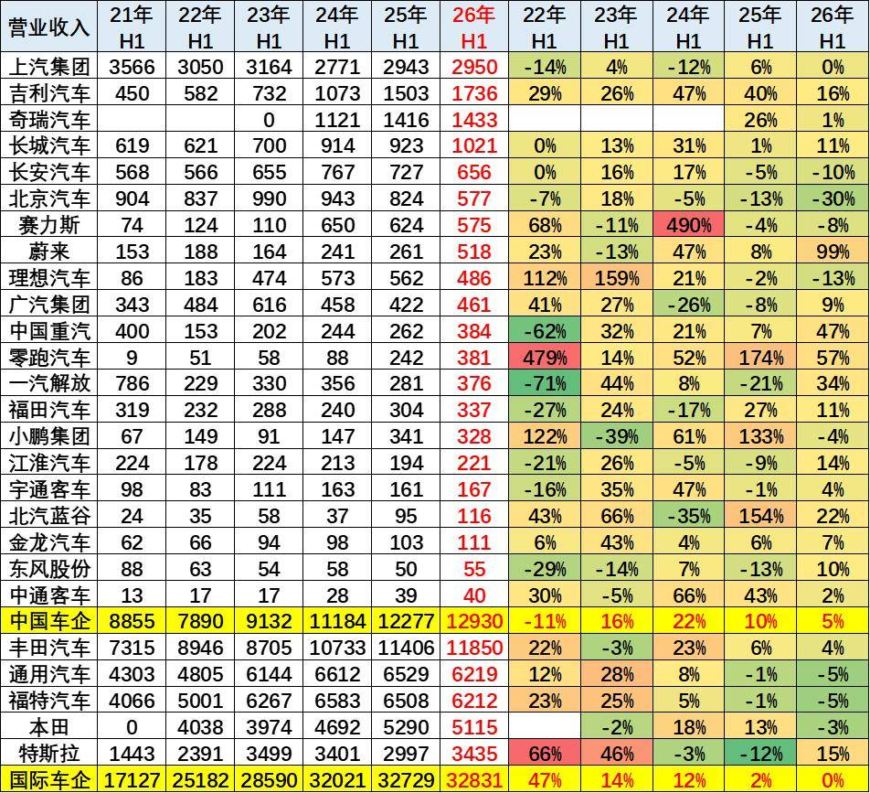

主流上市中国车企上半年营收由8855亿元增至12930亿元，累计增长46%，但2026年H1同比增速仅5%，进入低速存量竞争阶段；国际车企合计达32831亿元，同比持平。结构上，新能源车企领涨（吉利、零跑、赛力斯、蔚来翻倍），而传统大厂（上汽、北京汽车、一汽解放）则承压下滑。

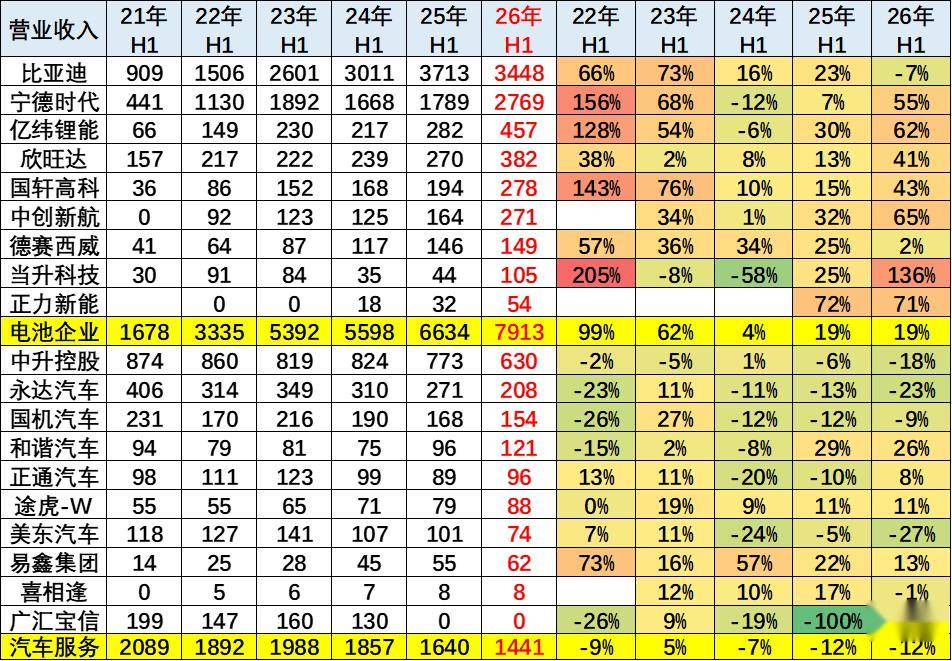

比亚迪被分到电池企业类别，因为只有电池才有如此的超高实际利润。

上游电池高景气与下游渠道疲软形成鲜明反差，行业利润进一步向上游集中。上游电池企业营收五年累计大增371%（26H1达7913亿元），宁德时代同比仍增55%；反观下游汽车服务商（经销商）营收五年累计萎缩31%（仅剩1441亿元），中升、永达、美东等普遍收缩。

2、毛利表现：以价换量，利润向上游集中

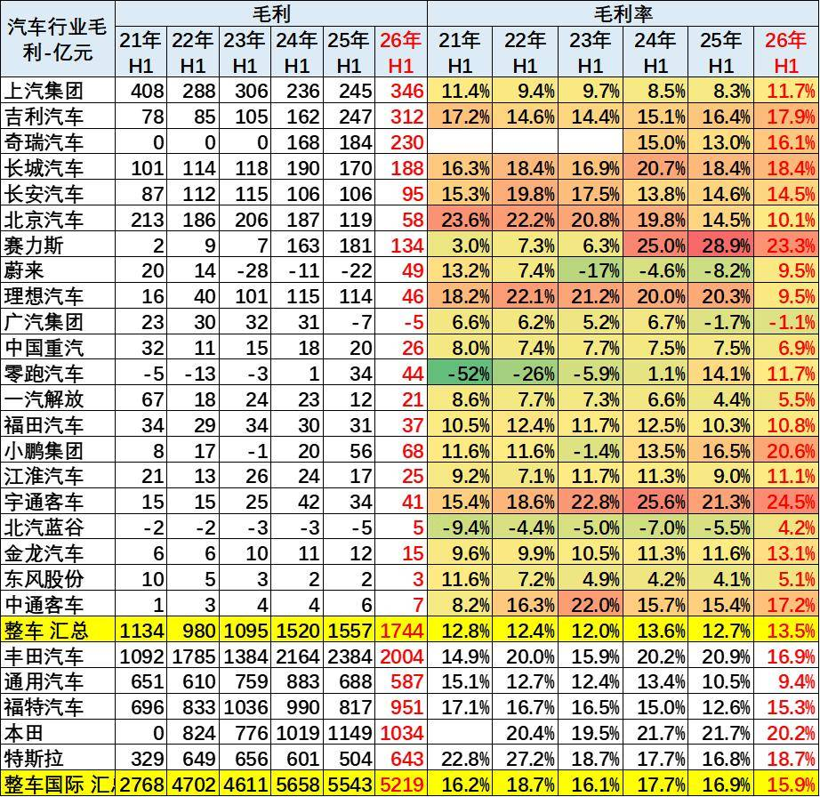

从数据看，汽车行业呈现“增收不增利”的以价换量格局。整车汇总收入从2021H1的1134亿元增至2026H1的1744亿元，但毛利率稳定在12%-13%，未随规模提升。

国际车企规模翻倍（2768亿元→5219亿元），毛利率却从16.2%大幅下滑至15.9%，盈利空间被严重挤压。国内整车汇总毛利率稳定在12%-13%，但国际车企从16.2%大幅下滑至15.9%，盈利空间均被严重挤压。

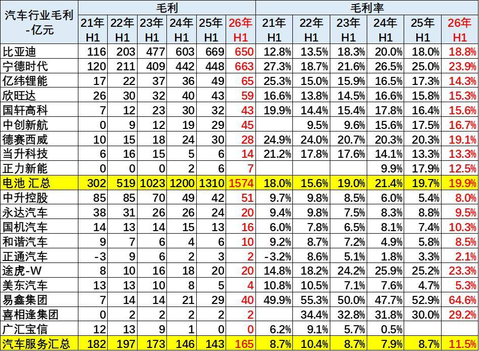

上游电池板块毛利从302亿元暴增至1574亿元，毛利率稳居20%左右；而下游服务板块毛利仅165亿元，毛利率仅8%-11%。这揭示出行业正经历深度洗牌，下游生存空间被无限压缩。

反观汽车服务板块，毛利仅165亿元，毛利率徘徊在8%-11%，中升、美东等经销商利润大幅缩水，广汇宝信更是退市，行业正经历深度洗牌，下游生存空间压力巨大。

3、各项费用表现-新势力高投入，巨头降本增效

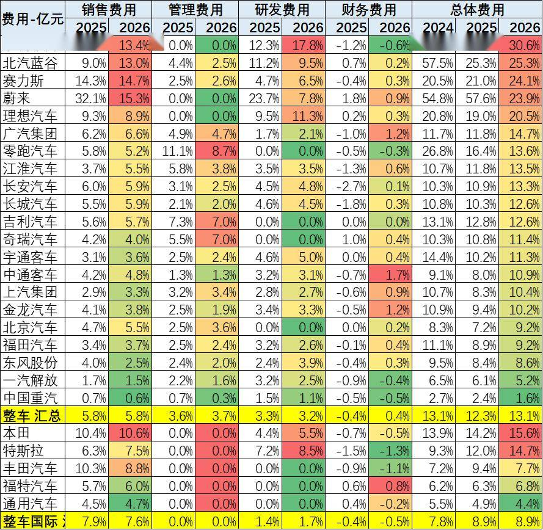

国内车企费用率两极分化，整体13.1%显著高于国际的8.9%。造车新势力仍处高投入期，小鹏2026年总体费用率预计飙升至30.6%（其中研发达17.8%）；蔚来从2024年54.8%大幅优化至23.9%，降本明显。相比之下，传统巨头和国际品牌规模效应突出，广汽、上汽费用率仅10%左右，丰田（7.7%）和通用（4.4%）极低。国内车企面临激烈的营销（销售）与研发双重成本挤压，新势力盈利压力依然严峻。

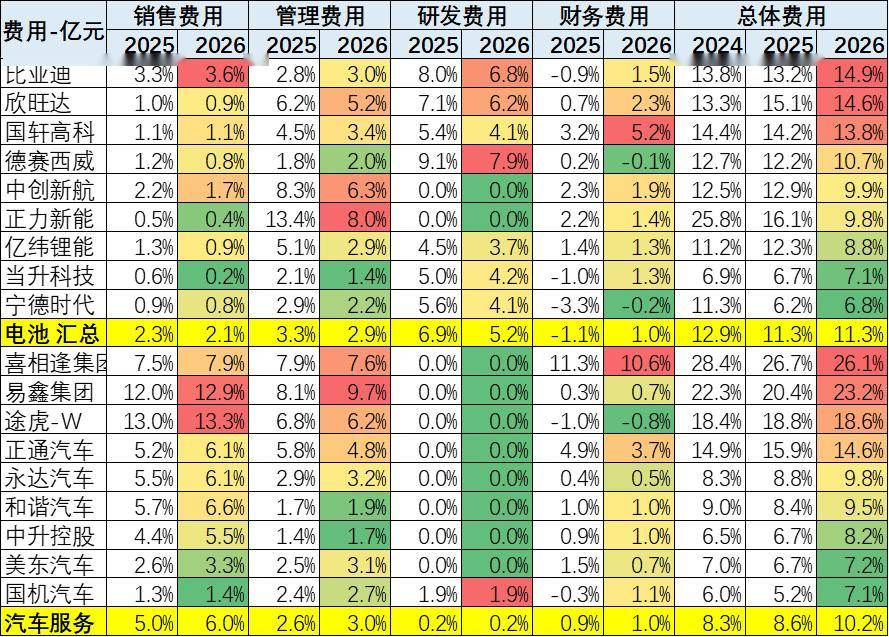

上游电池整体费用率稳定在11.3%，研发占比降至5.2%，降本增效明显；宁德时代总费用率仅6.8%极优，比亚迪因财务及销售费用增加升至14.9%。下游服务企业整体费用率由8.6%升至10.2%，主因销售费用激增，易鑫（12.9%）与途虎（13.3%）销售费用率极高，正通财务费用高企。整体呈上游降本增效、下游高营销成本挤压利润的两极分化格局。

4、净利润表现-冰火两重天，行业整体承压

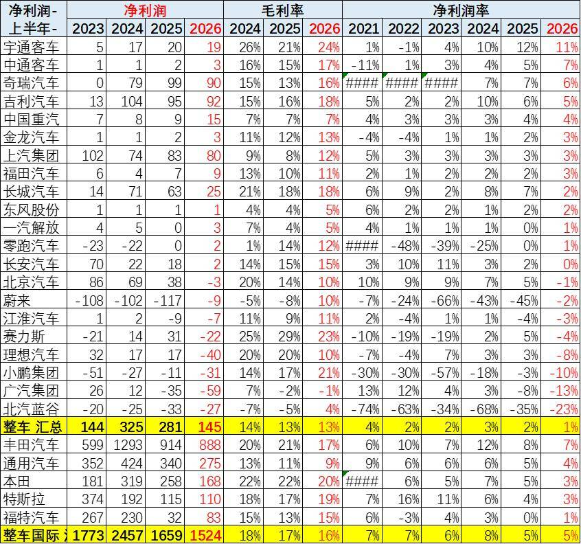

国内车企盈利严重承压：2026H1“整车汇总”净利润仅145亿元，净利率跌至1%，远低于国际车企的1524亿元和5%净利率。利润分化剧烈，奇瑞、吉利、上汽撑起利润大盘；而广汽毛利率暴跌至-1%（亏损59亿元），北汽蓝谷亏损率23%，理想、小鹏、蔚来等新势力继续深亏。结合上一张表的高额销售与研发费用，国内车企深陷价格战，毛利率被高昂费用吞噬，而丰田以888亿元净利、7%净利率稳居全球霸主。

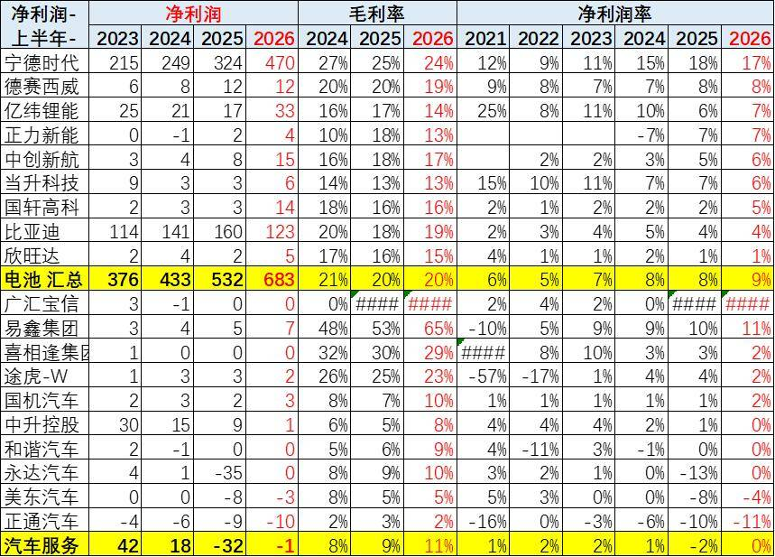

上下游利润急剧分化。上游“电池汇总”净利润从2023年376亿元飙升到2026年H1的683亿元，净利率升至9%；其中宁德时代独占470亿元（净利润率17%），比亚迪虽赚123亿元但净利润率降至4%，利润隐蔽较强。反观下游“汽车服务”由盈转亏，净利润从42亿元跌至-1亿元（净利润率0%），中升控股从30亿元跌至仅1亿元，正通汽车亏损扩大，反映出价格战正严重挤压经销商生存空间，产业链利润高度向上游龙头集中。

5、库存风险：产销脱节，库存周期拉长

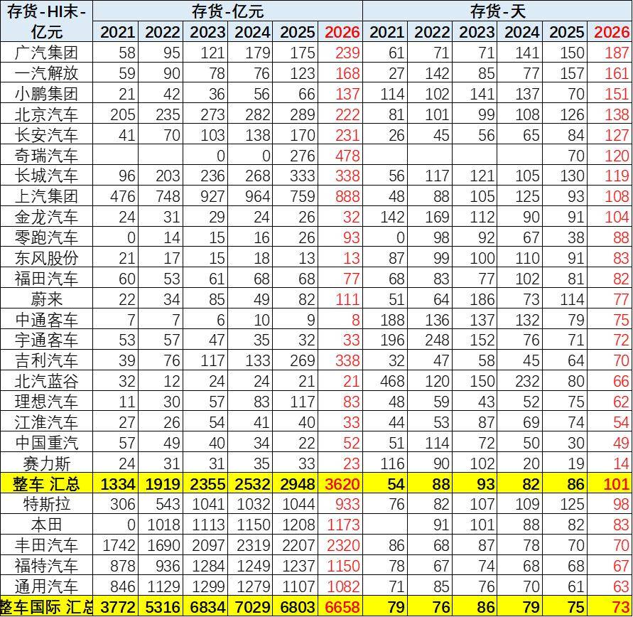

中国整车企业库存压力急剧恶化：库存总额从2021年1334亿元飙升至2026年预测的3620亿元，库存天数由54天恶化至101天；而国际车企（丰田、特斯拉等）库存天数稳定在73-79天，管理更优。国内车企中广汽（187天）、一汽解放（161天）、小鹏（151天）库存严重积压，长安、长城、上汽、奇瑞也均超100天，面临巨大去库存风险；仅赛力斯（14天）、理想（62天）等新势力去化极佳，凸显国内价格战下产销脱节的巨大压力。

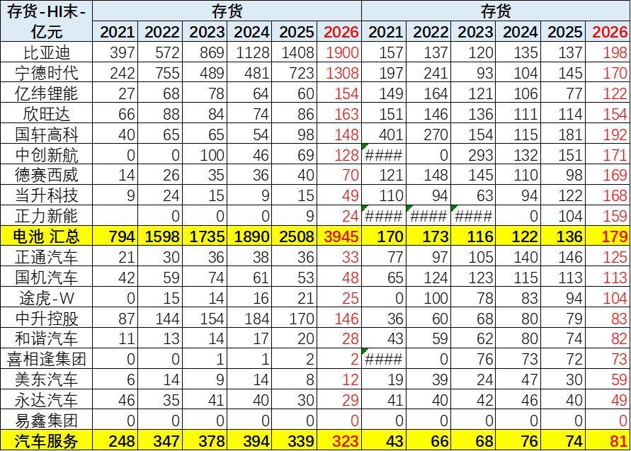

上游电池库存激增：总额从2021年上半年的794亿元飙升至3945亿元，周转天数升至179天；比亚迪（1900亿元/198天）、宁德时代（1308亿元/170天）带头加速累库，备货暗藏过剩隐忧。下游服务库存额相对平稳（323亿元），但周转天数由43天翻倍至81天，中升等经销商去库明显放缓。整体呈“上游高备货、下游慢周转”格局，终端销量承压正向上游传导。

6、资金与占款：挤压上游，隐患加剧

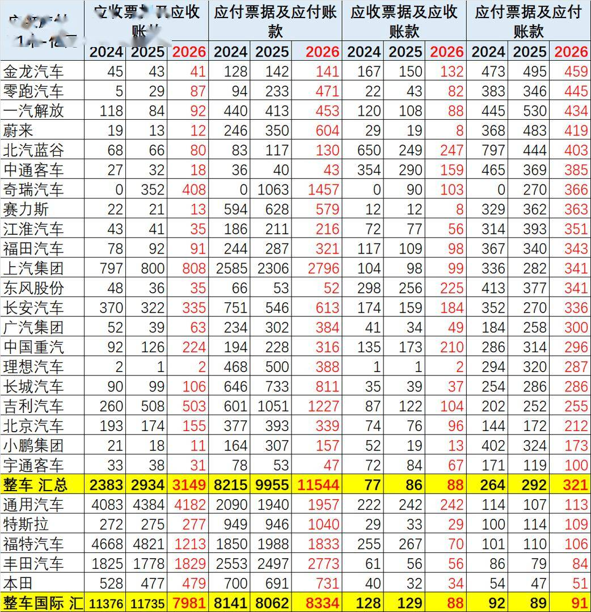

2026年H1国内整车应付账款总额已突破1.1万亿元（远超国际的8334亿元），周转天数高达321天，是国际车企（91天）的35倍，且从2024年的264天持续攀升。其中上汽（2796亿元）、奇瑞（1457亿元）、吉利（1227亿元）占用最重。这在价格战与高库存背景下，虽短期缓解了整车厂现金流压力，但实质是将资金压力强制转嫁给上游零部件供应商，产业链系统性风险剧增。

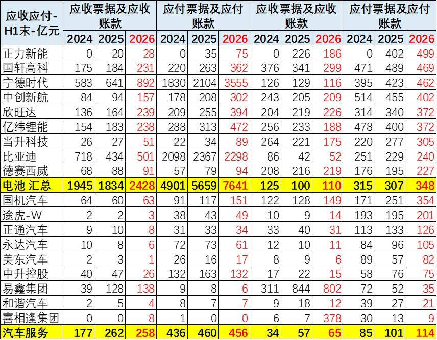

上游电池巨头占款能力惊人。2026年H1电池汇总应付账款由2024年4901亿元飙升至7641亿元，周转天数高达348天（宁德时代从2104亿元增至3555亿元）；而同期应收账款仅2428亿元，收付严重不对等，将资金压力极大转嫁给上游材料商。下游汽车服务板块资金压力也在加剧，应付账款周转天数从65天升至114天，应收账款升至65天。整体呈现整车及电池巨头凭借产业链强势地位极度延长账期，下游服务商资金链愈发紧绷的风险趋势。

7、现金流量：挤压上游，隐患加剧

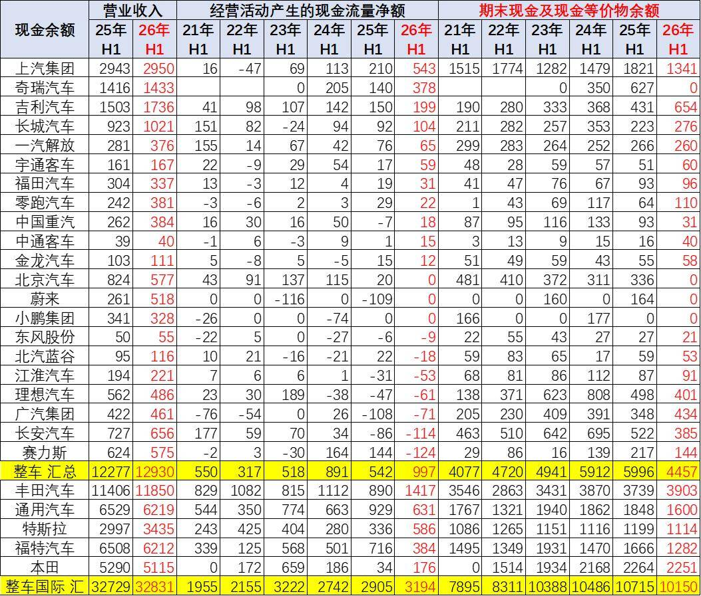

国内车企2026年H1经营性现金流回升至997亿元（2025年542亿元），期末现金增至4457亿元，但仅为国际车企（现金流3194亿元，现金10155亿元）的三分之一，造血能力仍偏弱。行业呈现严重两极分化：上汽（543亿元）、奇瑞（378亿元）、吉利（199亿元）依靠规模优势自我造血；而广汽、长安、理想、赛力斯等2026年H1经营现金流集体告负，陷入“失血”状态。结合前表超300天的应付账款周期，当前高企的现金流是建立在对上游严重占款基础上的，弱势车企的资金链正面临严峻考验。

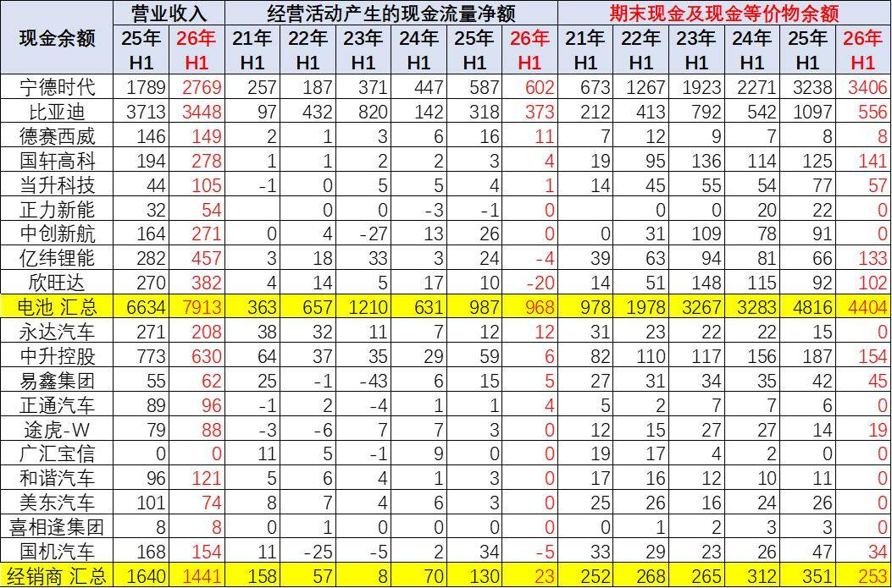

上游电池板块“造血”强劲，经营净现金流从2021年H1的363亿元增至2026年H1的987亿元，期末现金总额飙升至4404亿元；宁德时代单家贡献602亿元净现金流，现金储备达3406亿元；比亚迪现金也增至556亿元。反观下游经销商，2026年H1营收缩水至1441亿元，经营净现金流从2025年的130亿元骤降至2026年的23亿元，现金仅253亿元。资金正极度向上游巨头集中，下游面临严峻的失血与生存危机。

附：近日信息合集
