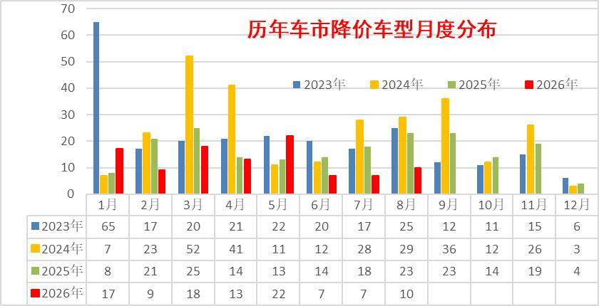
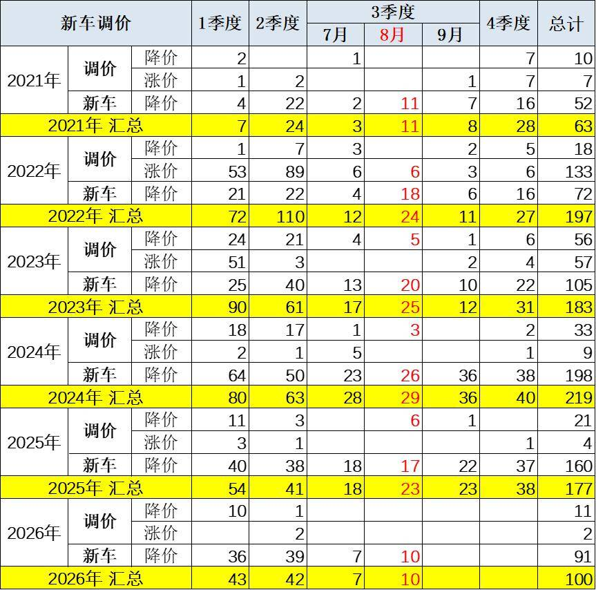
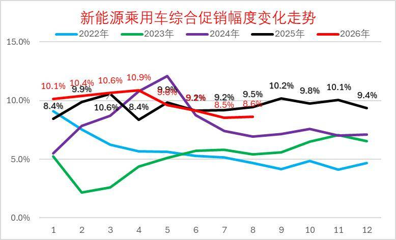
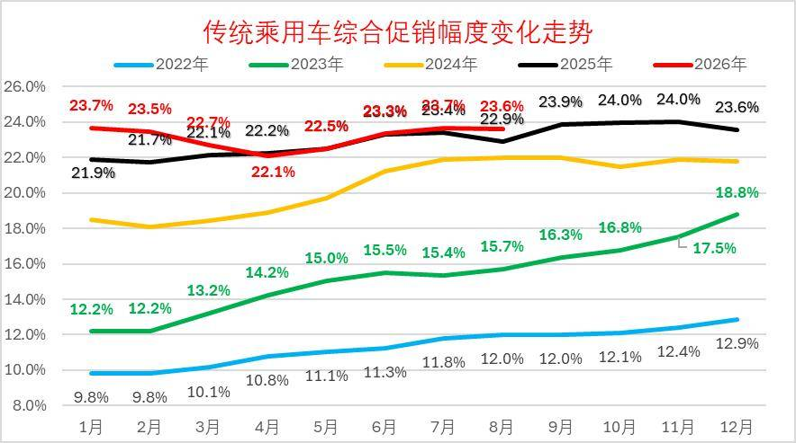
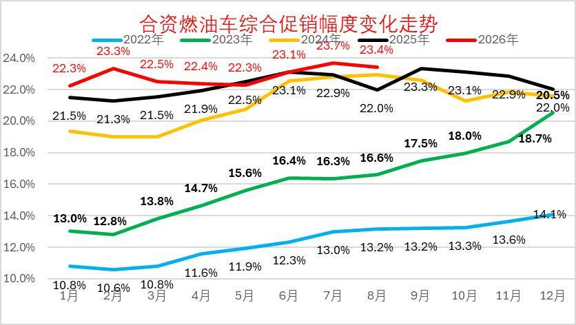
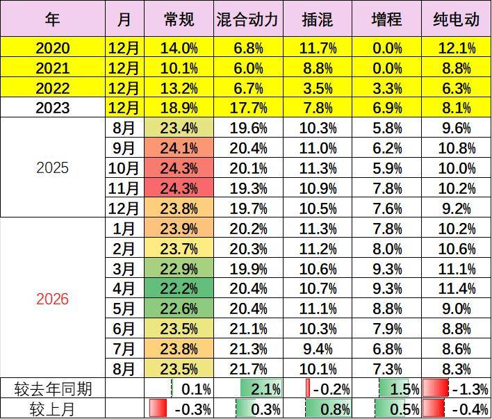
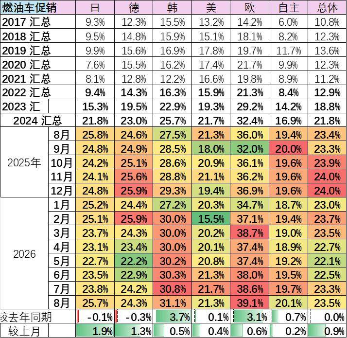

# 2026年8月乘用车市场降价促销分析

- 公開日時: 2026-09-07 19:14（北京時間）
- 出典: [搜狐号・崔东树](https://www.sohu.com/a/1072954545_115312)
- テーマ（自動判定）: 値引き・販促
- 画像: 10枚

---

注：本分析文章仅代表崔东树个人观点，如有异议，请留言。

2025年以来全国乘用车行业促销与降级均强力理性，市场秩序明显改善。由于成本上涨和需求不足，价格相对坚挺而消费低迷。

2026年8月降价规模10款，较同期少13款。其中纯燃油车型2款，较同期少3款；纯电动车型6款，较同期少8款。燃油车和增程的压力太大，价格调整可以理解。

2026年1-8月降价规模100款，较同期少36款，其中常规燃油车降价36款，较同期持平；混合动力燃油车降价5款，较同期增加1款；插混燃油车降价22款，较同期持平；增程式车型降价6款，较同期减少4款；纯电动车型降价31款，较同期减少33款。

2026年1~8月份，新能源车新车降价车型均价26.4万元的降价力度算术平均达到3万元，降价力度达到11.5%。2026年8月份，新能源车新车降价车型均价25.6万元的降价力度算术平均达到4.5万元，降价力度达到17.8%的较高水平。

2026年1~8月份，常规燃油车新车降价车型均价21.7万元的降价力度算术平均达到3万元，降价力度达到13.7%。2026年8月份，常规燃油车新车降价车型均价15万元的降价力度算术平均达到0.5万元，降价力度达到3.3%。

2026年1~8月份，总体乘用车市场新车降价车型均价24.5万元的降价力度算术平均达到3万元，降价力度达到12.3%。2026年8月份，总体乘用车市场新车降价车型均价23.7万元的降价力度算术平均达到3.8万元，降价幅度达到16.1%。

一、总体降价跟踪

1、月度降价状态跟踪

降价分析主要关注新车推出而突破前期价格下限的情况，也就是较隐蔽的降价行为，这里主要定义三年内的降价。而有些新车前几年开始上市很便宜，随后因2022年碳酸锂价格而宣布涨价，然后现在宣布降价，虽然没有突破上市时的底价，但为了体现降价的现象，因此此次分析中也算降价。

由于部分按动力细分的车型在年内有多次的价格调整行动，因此按照非重复计算的方式，车型数不是简单累加，而是合并了重复车型。

从降价节奏来看，2023年的降价总体较多， 2024年的降价在3-8月份达到了超强的程度，2025年的部分车企春季和秋季的阶段性组合促销，没有计入当年的降价车型范畴。2026年由于价格自律极其严格，因此车企降价的相对较少，车企利润剧烈分化，但市场缺乏活力，销量低迷。

面对价格体系的重塑，2026年8月份有10款车型降价，比去年少13款车型降价。今年较去年3-8月的大规模降价，今年3-8月市场保持相对克制，但销量总体较差。

2、车型最低价分析

2020-2021年的车企降价力度较小，2022-2024年力度较猛，2025年降到177款车型，2026年1月的新车降价的规模相对活跃,2月因春节因素大幅减少,3-5月回升到20款左右降价,8月降到10款。由于市场运行压力太大，目前的价格竞争主要是新车推出直接突破原有价格的下限，而不是增配不降价的模式。

面对新能源车车购税开始征收，2026年1-5月直接降价的车型较多，虚高的指导价回归，有利于消费者的交税成本合理化。

2026年截止到8月的降价车型总体较少，燃油车中主要是豪华车的价格重新梳理。

2026年1-8月降价规模100款，较同期少36款，其中常规燃油车降价36款，较同期持平；混合动力燃油车降价5款，较同期增加1款；插混燃油车降价22款，较同期持平；增程式车型降价6款，较同期减少4款；纯电动车型降价31款，较同期减少33款。

2026年8月降价规模10款，较同期少13款。其中纯燃油车型2款，较同期少3款；纯电动车型6款，较同期少8款。燃油车和增程的压力太大，价格调整可以理解。

3、综合降价幅度

2026年1~8月份，新能源车新车降价车型均价26.4万元的降价力度算术平均达到3万元，降价力度达到11.5%。2026年8月份，新能源车新车降价车型均价25.6万元的降价力度算术平均达到4.5万元，降价力度达到17.8%的较高水平。

2026年1~8月份，常规燃油车新车降价车型均价21.7万元的降价力度算术平均达到3万元，降价力度达到13.7%。2026年8月份，常规燃油车新车降价车型均价15万元的降价力度算术平均达到0.5万元，降价力度达到3.3%。

2026年1~8月份，总体乘用车市场新车降价车型均价24.5万元的降价力度算术平均达到3万元，降价力度达到12.3%。2026年8月份，总体乘用车市场新车降价车型均价23.7万元的降价力度算术平均达到3.8万元，降价幅度达到16.1%。

4、进口车价格变化

由于高端市场竞争格局巨变，市场环境剧烈恶化，降价车型逐步出现，为了经销商利益和消费者权益，宝马等品牌开始调整指导价格，实际成交价格基本稳定，这样的空降还是很有意义的。

二、车市促销跟踪

1、新能源车促销力度小幅增长

2026年8月的新能源车的促销下降到8.6%的中低位，较同期促销下降0.9%，较上月增0.1%。近几个月的促销收缩较大，随着低价新车的增多，新车切换的促销急剧下降，8月促销体系暂时回收，目前基本保持正常促销水平的中高位。

2、燃油车促销走势逐步下降

2026年8月传统燃油车的促销维持在23.6%的水平，较上月微降0.1个百分点，较同期增0.7个百分点，燃油车促销连续1年多维持在23%左右。

传统燃油车的促销2025年9月开始小幅加大，幅度较温和，2026年因降价力度大，实现促销逐步回落。

3、豪华车促销走势大幅下降

2026年8月豪华车的促销逐步达到26.9%的中高位，较上月回升0.2个点，较同期下降0.4个百分点。虽然消费升级推动高端需求较强，但2025年8月以来豪华车促销力度加大,2026年年初以来的新车指导价降价力度较大，促销因此下降，实际成交价格变化不大。

4、主流合资车促销走势平稳

2026年8月合资燃油车的促销逐步达到23.4%的中高位，较上月下降0.3个点，较同期增1.4个百分点。合资促销近期稍有增大。

合资燃油车的促销从2023年的13%的低位，2025年9月回升到23.3%峰值，随着新车强力降价，近三个月小幅波动。由于新车价格特别低，因此总体促销力度相对平稳微增。

5、自主燃油车促销走势保持平稳

由于自主的新能源较强，加之燃油车出口较好，2025年自主燃油车促销总体平稳。

2026年8月自主燃油车的促销逐步达到19%的高位，较同期增加0.6点。自主车企在2024-2025年上半年的促销上升较快，随后2025年下半年以来的促销总体稳定。

6、分动力促销力度跟踪相对温和

由于部分品牌降价带来的指导价回归，降低了促销幅度。2026年的常规燃油车和混合动力的降价力度大、高油价下销量差，促销力度也持续增大。

新能源车促销明显改善，插混和增程的促销明显改善，新品的促销降低改善市场表现。纯电动车型因为主力车型切换，促销较2025年8月下降1.3个点左右的促销，较上月下降0.4%左右促销。

8月的车市促销相对平稳，经销商也是稳促销保利润。目前的欧系和韩系促销大，其它合资车企促销基本22%左右，差异不大。自主车企成为促销最小的。

三、具体降价车型跟踪-8月

1、新能源车降价分析

2026年8月份纯电动车型新车降价的力度似乎较温和，个别低销量车型指导价下探的降价达到31%左右，但非主力车型的实际影响不大。根据新能源车促销10%的规模，正常车型价格下探的力度还是问题不大的。

2026年8月份插混和增程车型新车降价的力度相对复杂，因为其中部分是新品上市后随后加推很多车型，车价剧烈的下调。

问界总体表现较强，近期的价格逐步务实，价格底线降到23万左右，有利于销量探底回升。

2、燃油车降价分析

燃油车的国内压力较大，但不少车企仍是坚持燃油车产品布局，尤其是坚持中大型燃油车，这有利于海外市场的发展。

附：近日信息合集
