# 2026年8月全国乘用车市场运行特征分析

- 公開日時: 2026-09-09 19:32（北京時間）
- 出典: [搜狐号・崔东树](https://www.sohu.com/a/1073940327_115312)
- テーマ（自動判定）: 乗用車市場
- 画像: 23枚

---

注：本分析文章仅代表崔东树个人观点，如有异议，请留言。

2026年8月全国乘用车市场零售154.1万辆，同比下降23.6%，环比增长5.5%；今年以来累计零售1,171.6万辆，同比下降20.7%。8月国内乘用车市场呈现“总量弱修复、环比走强、结构极致分化”的运行态势，淡季尾部阶段正在“筑底蓄力”，行业结构性调整进一步深化。乘联预测团队对7月的预测指数是19%，8月中旬评估的7月满意度是17%，我们对8月的预测指数是12%，是处于历史底部的水平，预计9月中旬发布的满意度应该会有改善。

1.近年狭义乘用车零售走势

8月全国乘用车市场零售154万辆，同比增长表现较弱，脱离正常增长线路。8月持续负增长原因是多元的，首先是高油价的影响，其次是以旧换新的新政策规范性较强和乘用车补贴缩水，加之上游涨价的剧烈冲击，深层原因是消费能力和意愿偏低。

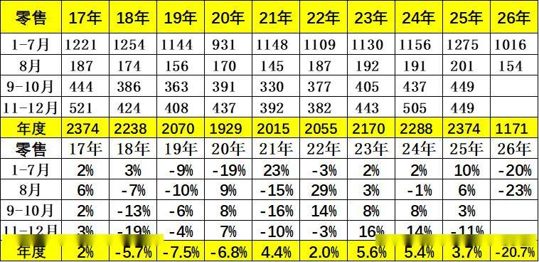

2026年8月全国乘用车市场零售154.1万辆，同比下降23.6%，环比增长5.5%；今年以来累计零售1,171.6万辆，同比下降20.7%。2026年8月国内乘用车市场呈现总量持续承压、环比走弱、结构极致分化的运行态势，淡季下行特征凸显，行业结构性调整进一步深化。

2.近年狭义乘用车批发走势

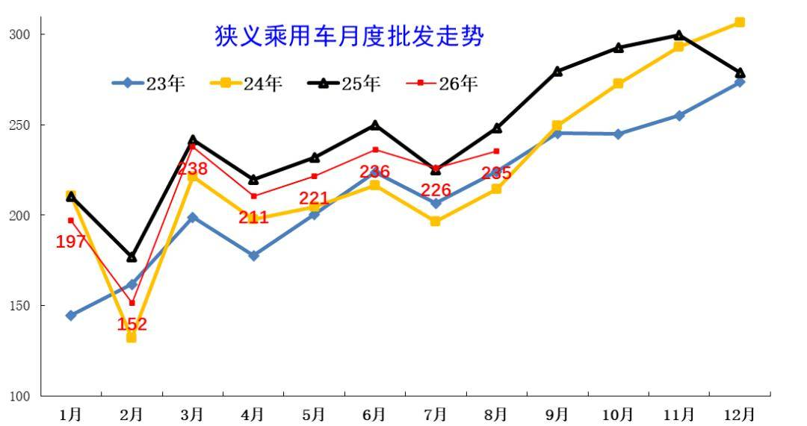

8月全国乘用车厂商批发235万辆，较同期下滑较大。历年8月的走势相对较强，今年国内低迷但出口高增长，因此总体回归平稳。由于出口超强，国内批发少，去库存效果好，渠道压力明显改善。

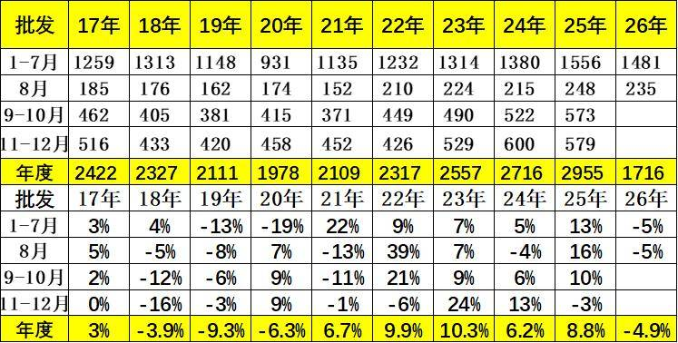

8月全国乘用车厂商批发235.3万辆，同比下降5.3%，环比增长4.5%；受出口暴增的促进激励，8月乘用车批发同比增速较零售增速高出18.3个百分点。

3.近年狭义乘用车生产走势

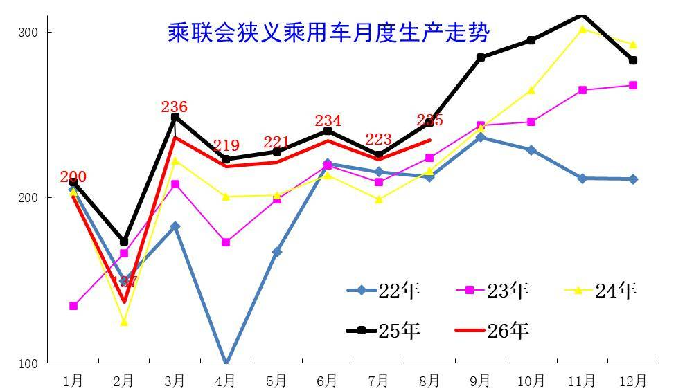

上半年乘用车生产减产力度较大。8月仍平淡，前期市场需求持续较弱，导致8月生产相对较低，同比走势下滑巨大。

8月乘用车生产235万辆，同比下降4%，环比增长5.4%，后面9月的下滑压力更大。

4.近年狭义乘用车出口走势

8月出口回落，高速环比上涨趋势改变，市场逐步进入平稳期。

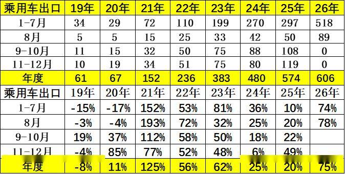

8月乘用车出口（含整车与CKD）88.8万辆，同比增长77.8%，环比下降4.2%，占乘用车厂商销量38%（上月41%，2025年同期20%）。8月新能源车占出口总量的58.4%，较同期大幅增加18个百分点。

5.产销库存月度变化特征

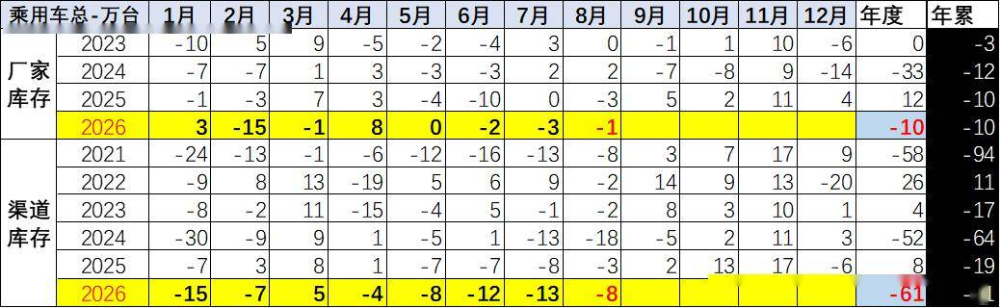

由于8月厂商生产安排极其谨慎，8月厂商批发高于生产0.5万辆，而厂商月度国内批发低于国内零售7.6万辆。今年去库存特征突出，1-8月总体乘用车行业库存下降71万辆（2025年同期下降30万辆、2024年同期下降76万辆、2023年同期下降20万辆）。

6.狭义乘用车促销走势

A、新能源车促销力度小幅增长

2026年8月的新能源车的促销下降到8.6%的中低位，较同期促销下降0.9%，较上月增0.1%。近几个月的促销收缩较大，随着低价新车的增多，新车切换的促销急剧下降，8月促销体系暂时回收，目前基本保持正常促销水平的中高位。

B、燃油车促销走势逐步下降

2026年8月传统燃油车的促销维持在23.6%的水平，较上月微降0.1个百分点，较同期增长0.7个百分点，燃油车促销连续1年多维持在23%左右。

传统燃油车的促销2025年9月开始小幅加大，幅度较温和，2026年因降价力度大，实现促销逐步回落。

C、豪华车促销走势大幅下降

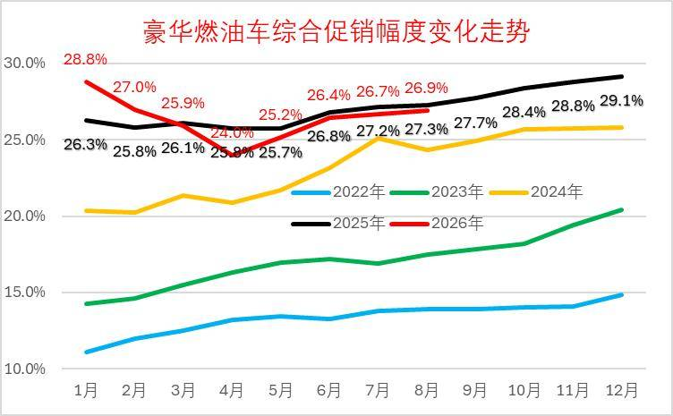

2026年8月豪华车的促销逐步达到26.9%的中高位，较上月回升0.2个点，较同期下降0.4个百分点。虽然消费升级推动高端需求较强，但2025年8月以来豪华车促销力度加大,2026年年初以来的新车指导价降价力度较大，促销因此下降，实际成交价格变化不大。

D、主流合资车促销走势平稳

2026年8月合资燃油车的促销逐步达到23.4%的中高位，较上月下降0.3个点，较同期增1.4个百分点。合资促销近期稍有增大。

合资燃油车的促销从2023年的13%的低位，2025年9月回升到23.3%峰值，随着新车强力降价，近三个月小幅波动。由于新车价格特别低，因此总体促销力度相对平稳微增。

E、自主燃油车促销走势保持平稳

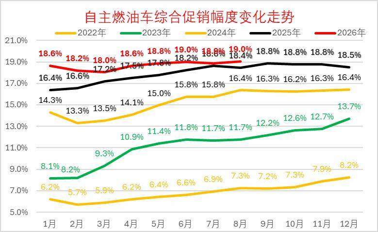

由于自主的新能源较强，加之燃油车出口较好，2025年自主燃油车促销总体平稳。

2026年8月自主燃油车的促销逐步达到19%的高位，较同期增加0.6点。自主车企在2024-2025年上半年的促销上升较快，随后2025年下半年以来的促销总体稳定。

F、分动力促销力度跟踪相对温和

由于部分品牌降价带来的指导价回归，降低了促销幅度。2026年的常规燃油车和混合动力的降价力度大、高油价下销量差，促销力度也持续增大。

新能源车促销明显改善，插混和增程的促销明显改善，新品的促销降低改善市场表现。纯电动车型因为主力车型切换，促销较2025年8月下降1.3个点左右的促销，较上月下降0.4%左右促销。

8月的车市促销相对平稳，经销商也是稳促销保利润。目前的欧系和韩系促销大，其它合资车企促销基本22%左右，差异不大。自主车企成为促销最小的。

7.狭义乘用车各级别增长特征

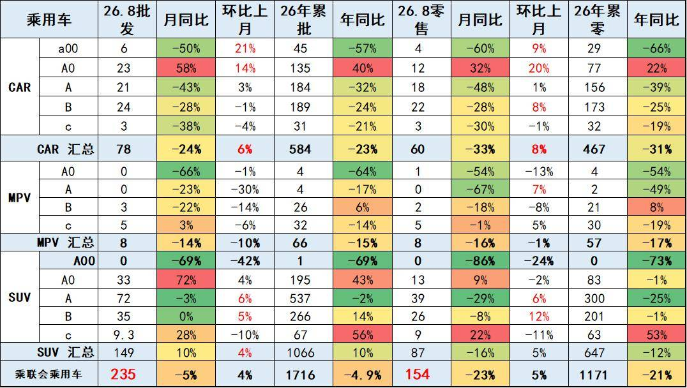

2026年8月乘用车零售降23%，批发下降5%，零售大幅弱于的批发增速,形成内冷外热格局。

入门级消费受冲击大。由于高油价冲击和补贴暂停带来零售回落，8月A级轿车零售与A00级轿车零售均较低，A0级轿车和高端车型成为8月零售主力，SUV的高端表现较强，轿车中主要是A0级轿车销量回升。

8.狭义乘用车国别增长特征

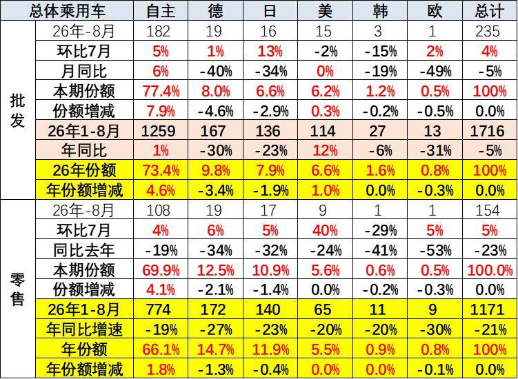

8月自主品牌零售108万辆，同比下降19%，环比增长4%。当月自主品牌国内零售份额为69.9%，同比增长4.1个百分点。总体上自主品牌在新能源市场和出口市场表现较平稳。

8月主流合资品牌零售31万辆，同比下降35%，环比增长5%。8月德系品牌零售份额12.5%，同比下降2.1个百分点；日系品牌零售份额10.9%，同比下降1.4个百分点；美系品牌市场零售份额5.6%，同比下降0.04个百分点。低销量合资车企逐步恢复活力。

9.2026年品牌产销特征

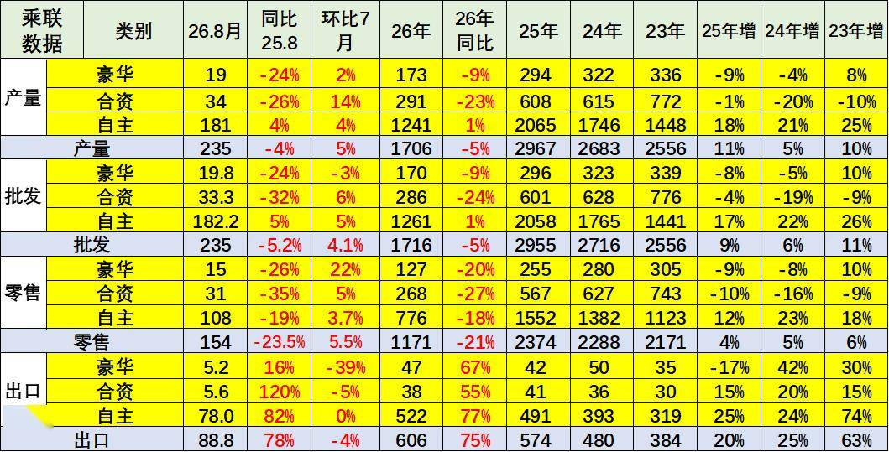

原有的品牌价值体系变化，豪华品牌近期持续压力加大，合资车企的产销走势压力持续较大，自主品牌产业链优势明显。

8月需求分化压力较大，燃油车市场环比走势较差，导致合资品牌走势恶化。自主靠新能源和出口相对表现较好。

10.全国新能源渗透率-批发

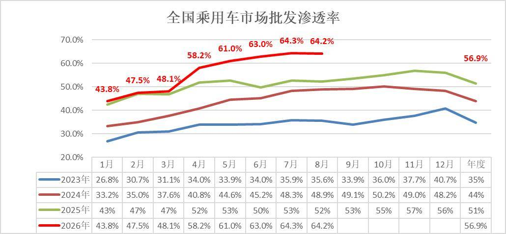

8月新能源车厂商批发渗透率64.2%，较2025年8月提升12个百分点。近几个月连续保持渗透率历史峰值。

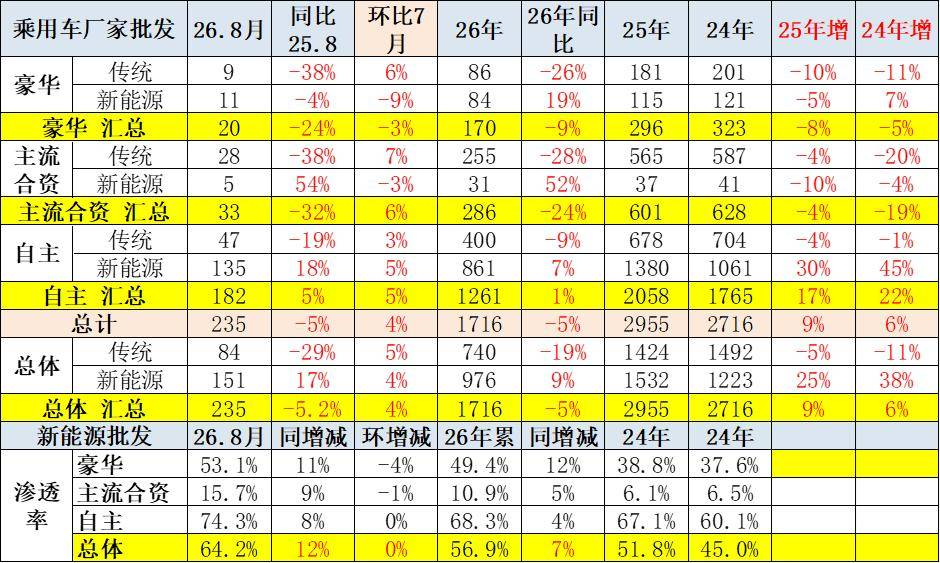

8月自主品牌新能源车渗透率74.3%；豪华车中的新能源车渗透率53.1%；主流合资品牌新能源车渗透率上升到15.7%。

8月传统车厂家批发同比降29%而新能源车同比增17%，增速差距近50个百分点，燃油车的市场持续低迷，新能源出口的贡献度大。

11.全国新能源渗透率-零售

8月新能源车在国内总体乘用车的零售渗透率65.2%，较去年同期增长9.9个百分点，环比增长0.1个百分点。

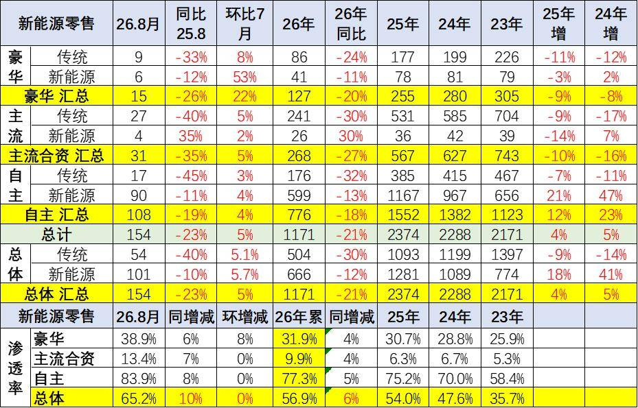

8月国内零售，自主品牌中的新能源车渗透率83.9%；豪华车中的新能源车渗透率38.9%；而主流合资品牌中的新能源车渗透率仅上升到13.4%。

附：近日信息合集
