# 2026年8月汽车细分市场走势和厂家竞争表现分析

- 公開日時: 2026-09-12 16:18（北京時間）
- 出典: [搜狐号・崔东树](https://www.sohu.com/a/1075225918_115312)
- テーマ（自動判定）: セグメント・車種
- 画像: 17枚

---

注：本分析文章仅代表崔东树个人观点，如有异议，请留言。

2026年8月车市零售环比回升5.5%，是油价高位压制、宏观景气偏弱、政策预期升温、成都车展带动等多重因素交织共振的结果。地缘冲突持续困扰霍尔木兹海峡的通航，推动国际油价维持高位震荡，2026年国内汽油价格累计上调已超1,720元/吨，尤其7月底以来上涨了180元，大幅抬高了燃油车用车成本，国内燃油乘用车消费需求持续剧烈萎缩。8月制造业PMI环比回升0.6%至49.8%，仍处于荣枯线之下，终端内需边际虽回暖但力度有限。8月上中旬高温假抑制终端到店客流、下旬成都车展带动市场热度回升、月末冲量拉动日均零售修复，终端订单与客流呈现前低后高走势。此外，新能源安全新国标落地后合规产品集中迭代上市，技术门槛抬升推动行业从“价格内卷”转向“价值竞争”。叠加7月政治局会议明确财政加力、加码扩内需促消费政策持续落地，为车市提供底部支撑，因此本轮市场下行属于阶段性结构性波动，行业趋势性恶化判断为时尚早。

1、2026年汽车市场总体平稳

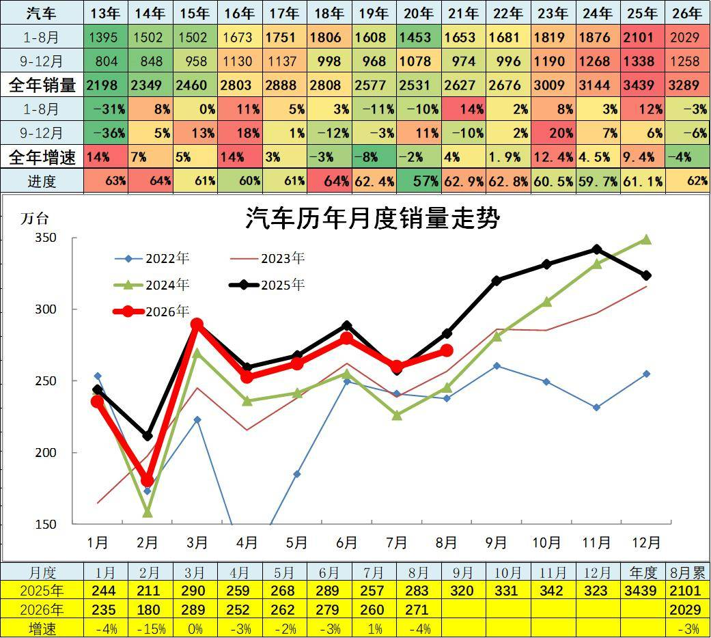

2026年8月汽车总计销量271万台，同比下降4%。2026年1-8月汽车总计销量2029万台，累计下降3%。2026年卡车和客车市场较强，乘用车市场表现稍弱，加之出口强、国内弱，最终总体厂家销量走势相对平稳。

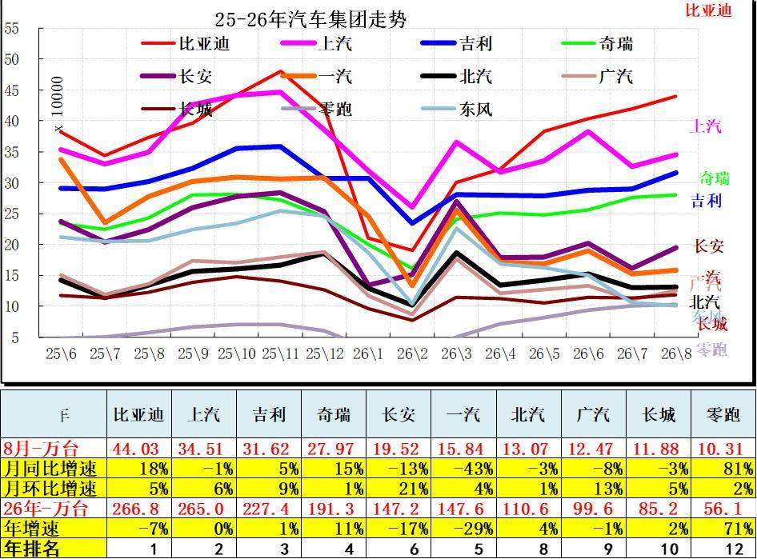

2026年汽车集团的表现剧烈分化，比亚迪等企业快速恢复，实现回升到第一。上汽压力巨大。吉利、奇瑞等企业总体仍保持较强走势。

2、出口占总销量的比重

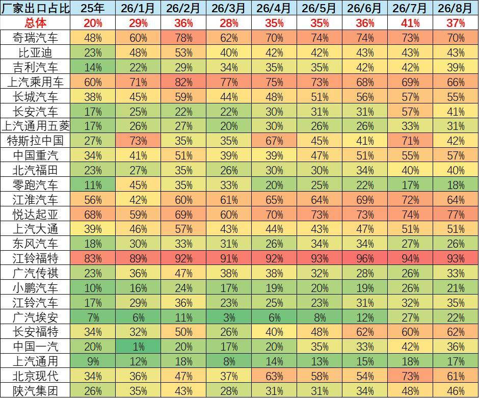

中国汽车出口近几年爆发增长，2026年8月达到出口占总量的37%的比例，较2025年的20%大幅提升，实现出口支撑中国汽车规模增长的重要组成。

3、主力车企集团的表现分化剧烈

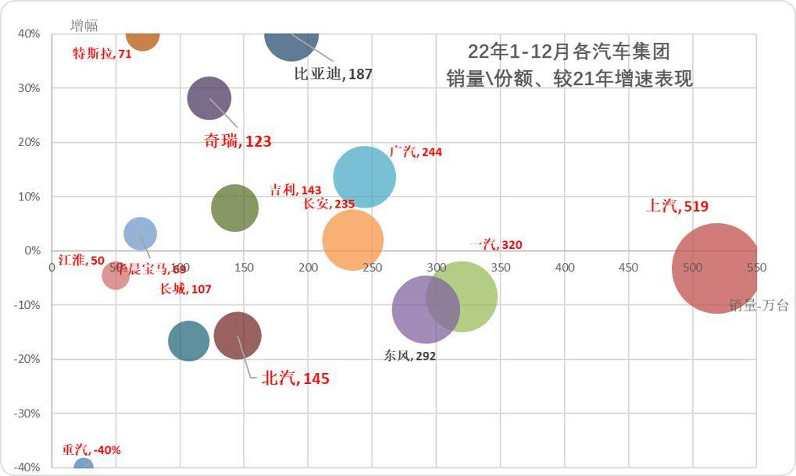

对比上面2021年图表，2022年的部分车企强势表现，行业增速分化严重。2022年年初的疫情导致传统车企压力较大，尤其新能源冲击叠加疫情影响，国有大集团表现分化，广汽和奇瑞表现优秀，其中奇瑞的商用车和乘用车版块表现均很好。北方的一汽、长城、北汽等各家表现都有压力。

2023年初新能源推动车市走势分化。央企三强总体分化，部分国企掉队。比亚迪等新能源企业的表现很好；奇瑞、特斯拉今年的表现相对较强。二线车企表现分化，因为新旧动能转换和新能源车持续亏损压力，自主品牌中小企业分化严重低迷。

2024年的汽车集团的阵容格局全面变化，比亚迪新品降价增量，由于乘用车销售需求火爆和海外贡献，因此奇瑞、吉利和东风表现的很好，上汽仍处于剧烈下滑中。新能源车的比亚迪和特斯拉增速分化。

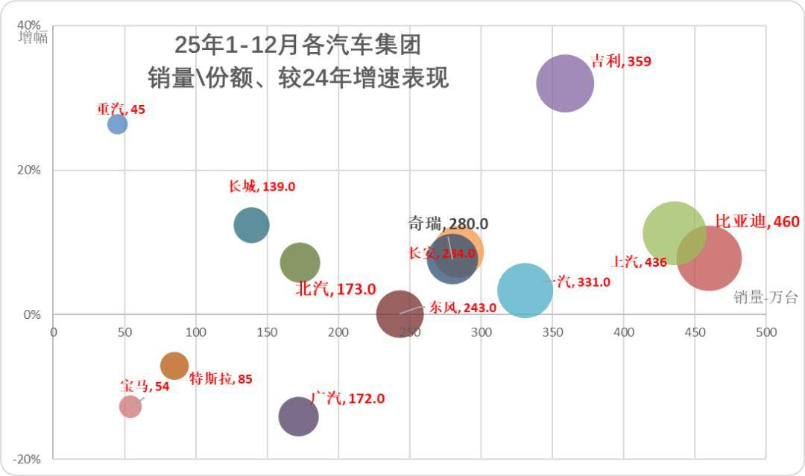

汽车市场的厂家格局巨变，行业呈现增速剧烈的分化，2025年开始的民营企业替代国企成为行业主力，吉利、比亚迪、奇瑞、长城增速保持较高水平。

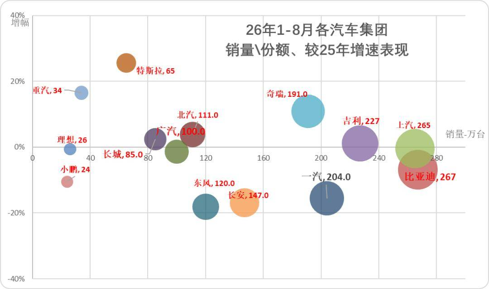

2026年销量领先是各国有企业的奋斗重点，虽然市场严峻低迷，但比亚迪回归第一。上汽和吉利、奇瑞、北汽等今年1-8月表现较强，增速改善。长城、特斯拉等总体表现优秀。

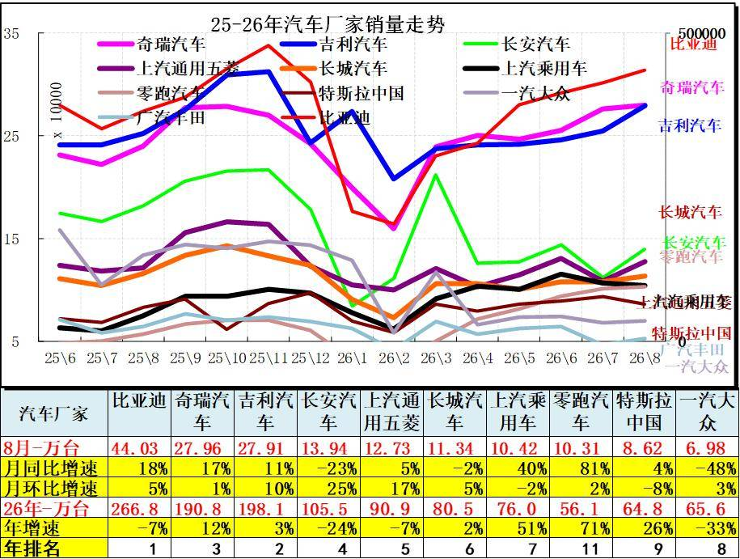

2026年汽车厂家格局相对稳定，自主地位大幅提升。8月厂家销量总体较好，但市场零售低迷拖累乘用车厂家表现。比亚迪等部分厂家环比7月走势很强，奇瑞等同比走强。自主的强势出口企业表现优秀，有合资的集团压力巨大。

4、狭义乘用车企业产销走势

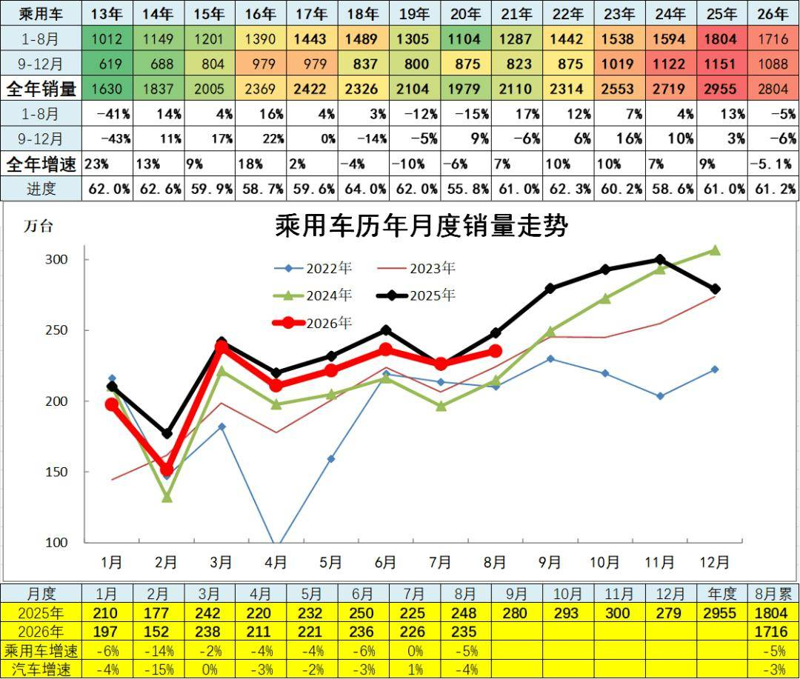

2026年8月狭义乘用车合计销量235万台，同比下降5%；2026年1-8月狭义乘用车合计销量1716万台，同比下降5%。近几年新能源车技术创新、新品竞争力不断增长，燃油车新品推出乏力。2026年年初的新能源车处于调整期， 经销商信心不足，高油价压低增速。

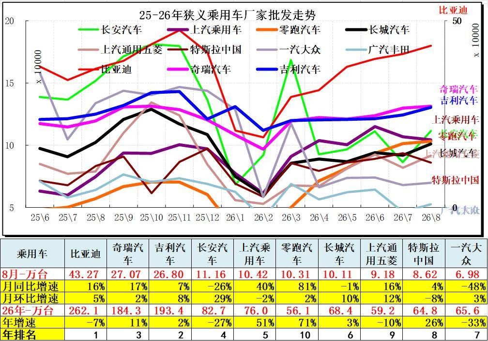

2026年乘用车自主车企全面领先。8月主力车企总体较弱，自主超强。由于高油价，合资车企8月走势较弱。比亚迪领军，奇瑞汽车第2名，吉利汽车8月保持前3，前三的规模日益接近。合资的一汽大众和上汽大众等表现较低迷。

乘用车主力厂家阵营迅速分化，出口为主的企业和新能源车为主的厂家表现较强，合资表现分化尤为明显，一汽大众较强。

5、新能源乘用车企业产销走势

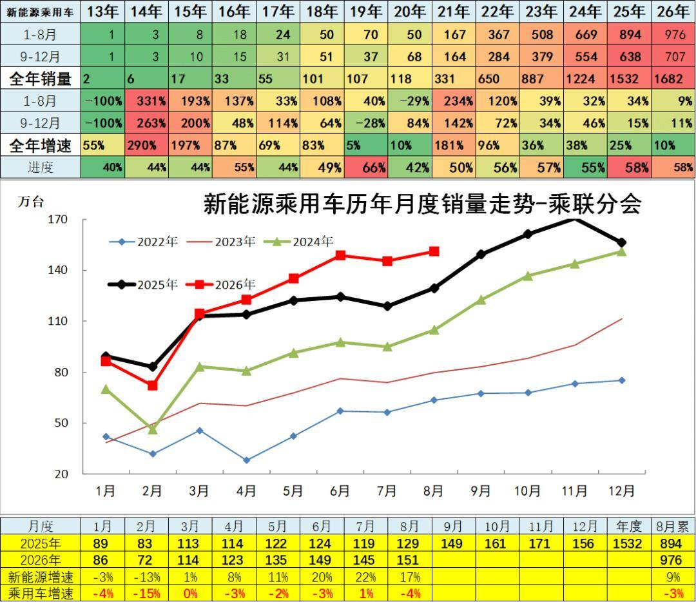

2026年8月新能源乘用车厂家销量合计151万台，同比增17%；2026年1-8月新能源乘用车厂家销量合计976万台，同比增9% 。2026年年初报废更新补贴压力大、油价暴涨、消费低迷、新能源车需求弱， 2026年的新能源国内走势面临需求低迷的压力较大。

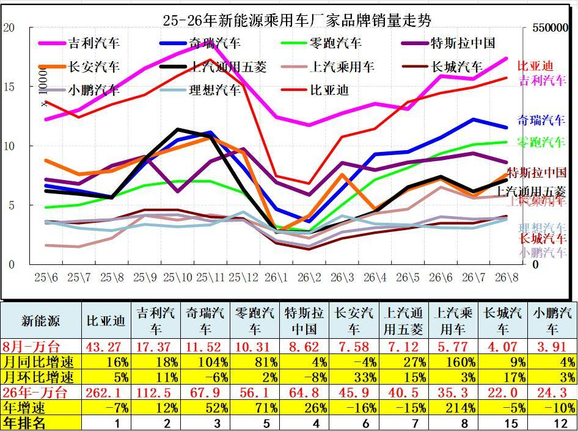

2026年比亚迪保持第一，但插混增长压力较大。奇瑞、零跑等新能源增长较强。

6、传统动力乘用车企业产销走势

2025年传统燃油狭义乘用车销量1422万台，同比下降5%，2026年1-8月740万台降18%。随着油价高企，2026年国内燃油车市场走势持续较弱。

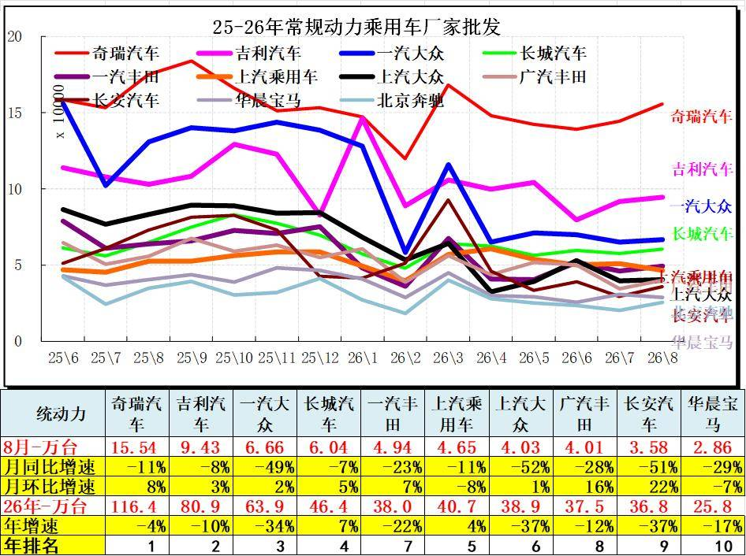

由于出口的支撑，2026年燃油车总体表现分化，自主表现超强，主力合资车企短期内迅速弱化。

7、客车企业产销分类走势

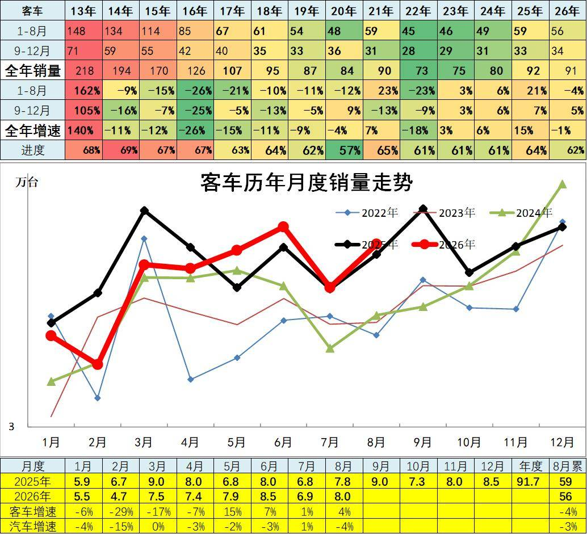

2025年全年累计客车合计销量92万台，累计增速15%；2026年1-8月客车合计销量56万台，同比降4%，出口和新能源物流车的拉动效果一般。

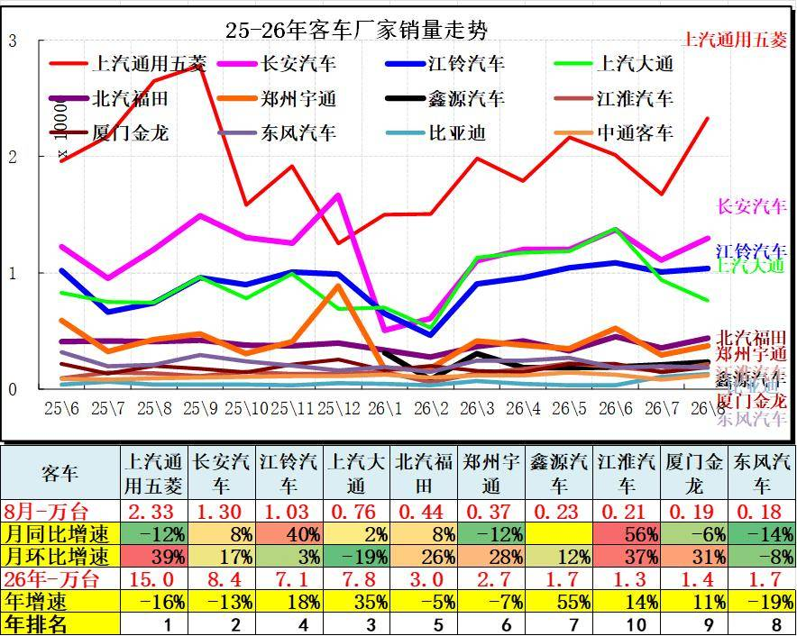

在2025年年底冲刺后，2026年客车走势逐步走强，上汽通用五菱表现很强，上汽大通等头部厂家近几个月销量总体较强，物流类轻客和微客的市场需求波动较大，出口贡献巨大。2026年江铃汽车、上汽大通的商用车走势较好，8月五菱、长安、江淮等物流车企业环比回升较大。

8、卡车企业产销分类走势

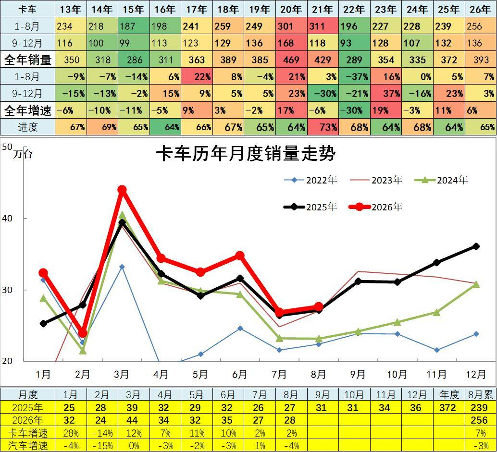

2025年卡车销量372万台，累计增速11%；2026年1-8月卡车销量256万台，同比增长7%，形成消费与生产分化，消费暴跌、生产超强增长态势。

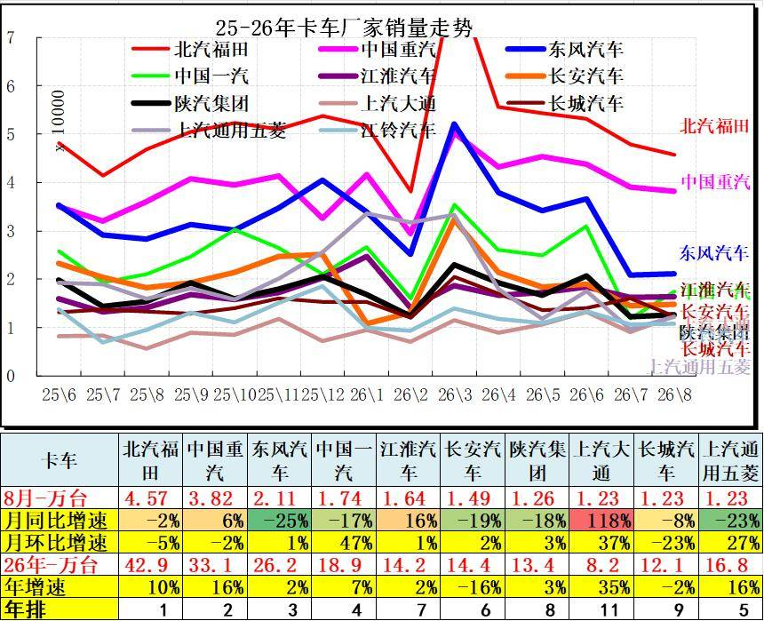

2026年的卡车主力厂家分化较明显，卡车头部厂家表现较强，江淮、大通、重汽等车企同比去年8月暴增。

商用车补贴效果突出，2026年的重卡暴增，纯电动重卡表现很强，重汽、一汽、陕汽和的增长较强，行业格局相对稳定。

附：近日信息合集
