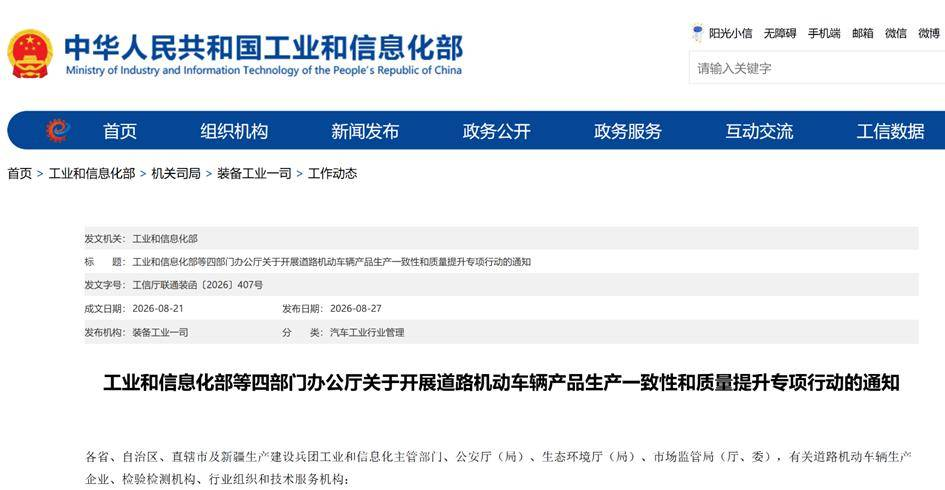
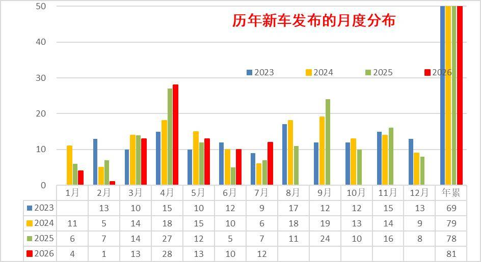
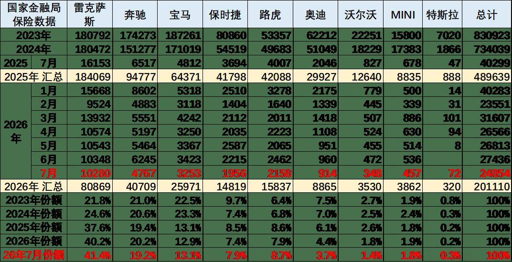

# 3万公里、生产一致性、质量提升“成人礼”背后：新能源竞争从“速度”转向“耐久”

- 公開日時: 2026-09-14 16:43（北京時間）
- 出典: [搜狐号・崔东树](https://www.sohu.com/a/1075914000_115312)
- テーマ（自動判定）: 産業統計
- 画像: 3枚

---

2026年8月，全国汽车标准化技术委员会就三项电动汽车定型试验规程公开征求意见，核心调整是将新能源汽车可靠性行驶总里程从1.5万公里统一提升至不低于3万公里，全面拉平燃油车标准。8月27日，工业和信息化部、公安部、生态环境部、市场监管总局（下称“四部门”）决定，即日起在全国范围内开展为期1年的道路机动车辆产品生产一致性和质量提升专项行动。检查对象包括道路机动车辆生产企业及产品、有关道路机动车辆检验检测机构。

一、从“减半”到“拉平”：一纸规程的十五年跨越

回溯2005年，GB/T 18388规定电动汽车可靠性试验里程为燃油车的50%——燃油车跑3万，电车仅需1.5万。这在产业培育期是为降低准入门槛、鼓励“试错”的特殊扶持。2026年1月，工信部将其升级为强制性标准；8月，规程修订草案不仅将里程翻倍至3万，更增设细化要求：纯电车直流充电累计里程占比不得低于90%，插混车型需额外完成1万公里纯电行驶，燃料电池车须全程在混动模式下完成测试。

从“减半”到“拉平”，政策逻辑已从“培土育苗”转向“优胜劣汰”。这意味着，依靠政策补贴和参数噱头就能获取市场份额的窗口期正在关闭，所有玩家都必须直面真实路况下的耐久考验。

二、“速成”的代价：新品周期压缩暴露可靠性隐忧

模块化平台与软件定义汽车大幅压缩了研发周期，新势力从立项到量产普遍压缩至20至24个月。2026年1-7月，国内新车发布累计达81款，较去年同期的78款小幅增加，且集中放量在4-7月。虽然整体数量并非网传的500多款（口径不同），但新品上新的速度确实维持高位。

研发“加速度”的另一面，是验证环节的妥协。2026年上半年，车机死机、电池故障、零部件供应短缺等问题集中爆发，多款新车上市不足百日即宣布召回，消费者戏称其为“抽签式造车”。8月26日，工信部副部长辛国斌在国新办发布会上明确指出：“激进式创新设计未经充分实验验证就装车应用”是‘十五五’必须加力解决的问题。此番3万公里新规，正是对这一问题精准的制度性纠偏。

三、“慢”策略的分化：传统验证体系迎来合规红利

在行业信奉“唯快不破”的背景下，部分传统车企坚持的36至48个月开发周期一度被解读为保守。然而，当新规落地，这种保守反而显露出成本优势。

以丰田旗下雷克萨斯为例，其九州工厂内部耐久验证门槛原本就高于此前的国标要求。因此，当全行业被迫将里程拉升至3万公里时，这类企业面临的产线调整与合规边际成本，远低于那些长期依赖OTA修复半成品的新势力。

但需要清醒看到，“慢”不等于万能。2026年上半年数据表明，传统架构在智能化交互体验上的投诉率呈上升趋势，尤其在车机互联、语音控制等领域，其迭代速度与中国本土新势力差距明显。慢工或能出细活，却不一定能出“新活”。在电气化与智能化的天平上，过于倾向物理可靠性的一方，正在面临用户“用脚投票”之外的“用数据投票”的压力。

四、进口车结构生变：豪华市场的“避险效应”与单腿风险

在进口车总量萎缩的背景下，结构分化正在加剧。非豪华进口车剧烈萎缩，而进口豪华车占比被动提升。这其中，雷克萨斯的表现值得关注——但需置于客观数据中审视。

目前进口车主要靠豪华车的需求支撑，非豪华进口车剧烈萎缩。进口车中的主力进口豪华车占比大幅增长。合资品牌进口车快速萎缩，欧系的进口车等部分品牌进口车萎缩剧烈。

2025年的雷克萨斯的进口保险零售数据18.4万辆，同比增长2%，份额达到进口豪华车的40.2%，并且雷克萨斯2025年销量高于2022年销量，在2022-2024年连续三年保持在18万辆水平基础上。ES系列单一车型上险量达11.87万辆，贡献超六成销量。逆势增长的密码很简单：消费者最终用脚投票，投给经得起时间推敲的品质，而非激进的参数。2026年1-7月雷克萨斯的进口豪车市场份额41.4%，高于25年的40.2%约1.2个百分点。宝马、保时捷、路虎的表现总体相对稍好。

这一现象的成因有两面性：

- 一面是避险需求。 经济周期波动下，消费者更倾向选择高保值率、低养护成本的车型，雷克萨斯的“低故障率”口碑恰好契合了这种避险心理，而非单纯的品牌魅力胜出。

- 另一面是结构脆弱性。 极度依赖ES单车型、新能源产品线严重缺位，使得其市场根基并不牢固。单车成交均价已较2023年出现明显下探，“以价换量”的隐忧已经浮现。若不能补齐电动化短板，一旦竞品在可靠性上迎头赶上，其份额护城河极易被反超。

五、2027国产化：不仅是产线迁移，更是品牌大考

2025年2月，丰田宣布在上海金山独资设立雷克萨斯纯电研发生产公司，总投资约146亿元，规划年产能10万辆，预计2027年投产。同年6月动工，8月进一步披露将在此生产下一代纯电SUV，应用一体化压铸技术。

从产业布局看，这打破了丰田“日本优先”惯例，体现出对中国供应链效率的重视。但从品牌角度看，国产化是一把双刃剑：

1.价格体系重构风险。 一旦放弃“进口车”身份，其长期赖以生存的“进口光环”和高溢价逻辑将受到挑战。参考英菲尼迪、讴歌的国产化历程，“日系高端国产即遇冷”的阴影并非空穴来风。

2.品控一致性风险。 九州工厂沉淀数十年的匠人培育体系与静态检查标准，能否在上海金山短时间内完整移植，不仅考验硬件投入，更考验文化磨合。国产后的第一批产品质量，将直接决定其品牌调性在中国市场的新定位。

六、结语：成人礼之后，淘汰赛才刚刚鸣枪

3万公里，是新能源车的“成人礼”。它标志着中国新能源汽车产业正式告别政策“襁褓”，从青春期走向成熟期，从“培育优先”转向“规范优先”。

新规落地后，将产生多重连锁反应：抬高研发硬成本、加速低端产能出清、倒逼BMS（电池管理系统）和热管理技术升级、缓解消费者长期存在的“里程焦虑之下的耐久焦虑”，同时也为整车出口增加了国际合规的通行证。

真正经得起时间检验的品牌，从来不需要靠政策门槛来证明自己——因为它们早已习惯用高于国标的内控标准要求自己。当“速度竞赛”的泡沫被3万公里的里程计刺破，中国新能源市场将迎来一场堂堂正正的“质量淘汰赛”。成人礼之后，不是终点，而是更漫长、更残酷征途的起点。
