# 2026年8月汽车增加值8.7%、汽车生产降3%，消费降19%，新能源汽车渗透率61%

- 公開日時: 2026-09-15 12:35（北京時間）
- 出典: [搜狐号・崔东树](https://www.sohu.com/a/1076256081_115312)
- テーマ（自動判定）: 産業統計
- 画像: 11枚

---

注：本分析文章仅代表崔东树个人观点，如有异议，请留言。

今年以来，扩内需、促消费政策措施持续落地见效，我国消费市场发展质量不断提升，消费新业态新模式活力迸发。由于低端车市不旺，消费不旺。

1—8月份，社会消费品零售总额327569亿元，同比增长1.1%。其中，汽车消费额25805亿元、同比降14%；除汽车以外的消费品零售额301764亿元，增长2.7%。8月份，社会消费品零售总额39824亿元，同比增长0.4%。其中，汽车消费额3279亿元、同比降19%；除汽车以外的消费品零售额36545亿元，增长2.5%。1—8月份，新建商品房销售面积49880万平方米，同比下降12.1%；其中住宅销售面积下降13.0%。

8月份，规模以上工业增加值同比实际增长5.2%，其中8月汽车工业增加值增8.7%，汽车工业生产表现很强。1—8月份，规模以上工业增加值同比增长5.3%，汽车增长7.4%。

2026年1-8月汽车生产2031万台，同比降3%；新能源汽车生产1059万台，同比增11%，渗透率52%；燃油车生产972万台，同比降15%。2026年8月汽车生产270万台，同比降3%；新能源汽车生产165万台，同比增22%，渗透率61%；燃油车生产105万台，同比降26%。

2026年1—8月份，汽车行业固定资产投资同比下降6%，仍高于-7.2%的各行业平均水平。近期投资压力大的是第三产业，尤其是公共基础设施、教育、文化、卫生投资下降剧烈。

当前，虽然我们极力稳定国际油价，但高油价冲击产业链供应链稳定和消费需求仍较明显，高物价，衣食支出暴增，有效需求不足、市场缺乏活力等问题挑战仍然存在，行业稳增长任务依然艰巨。

由于2026年以旧换新的乘用车补贴力度远低于商用车，因此商用车补贴推动新能源零售增长特别好，新能源乘用车暴跌。目前乘用车低端消费压力很大，期待未来能有长效的强力接续政策，减免购车人员个税、推动新能源车下乡、设立经济型电动车标准，优化C7经济型电动车驾照申领、给200公里以下续航的合规纯电动车车购税更大优惠、鼓励结婚和生育购车等更多的改善措施，拉动购车消费促进经济增长。

1.汽车消费相对平稳下行

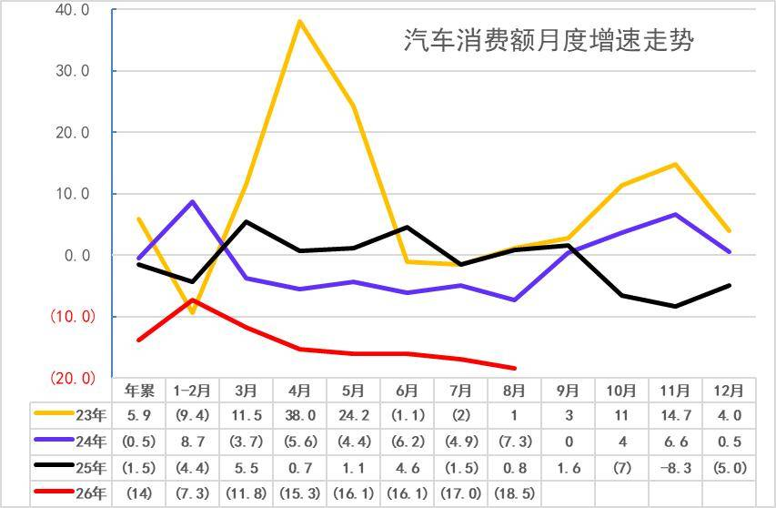

自从楼市2021年下跌以来，汽车消费从2020年的3.94万亿元上升到2024年的5.03万亿元，摆脱了2018-2020年连续3年徘徊在3.9万亿元的被动局面。由于房地产下跌利好消费，买房投资挤压消费问题改善，目前看消费不旺的问题稍有改善。

2026年1-8月份，汽车消费同比降14%,8月汽车消费同比降18.5%,基数连续拉高后，今年的回落较大，2025年的3月和6月高基数压力最大，8月的基数压力下未改变汽车零售的环比走稳，高油价的消费冲击有所改善。

2.2026年汽车产量走势偏弱

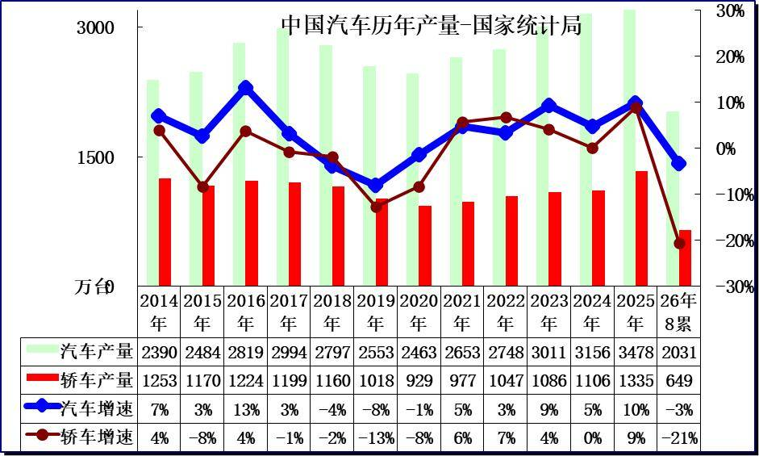

8月份，规模以上工业626种产品中有286种产品产量同比增长。其中，钢材11475万吨，同比下降5.5%；汽车269.7万辆，下降2.7%，其中新能源汽车164.7万辆，增长21.9%；发电量9438亿千瓦时，下降0.8%；原油加工量5907万吨，下降6.9%。

3.2026年汽车增加值表现较好

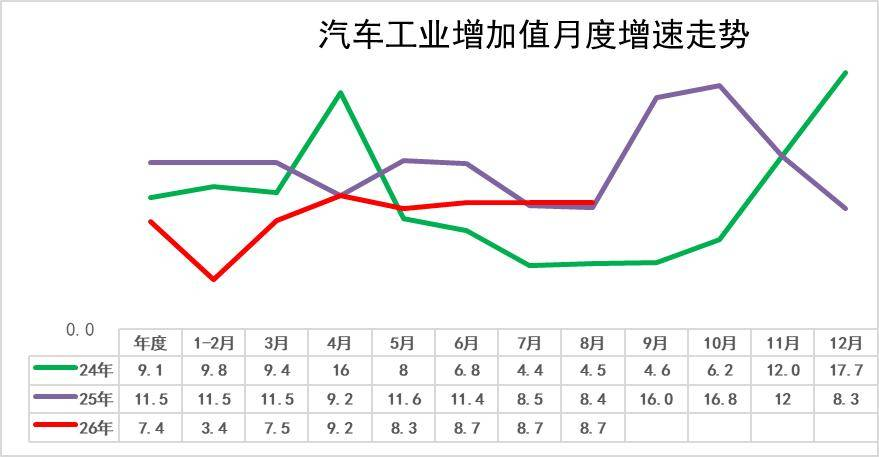

2020年汽车工业增加值增6.6%；2021年增速徘徊在5.5%的水平；2022年的汽车增加值6.3%，较强；2023年汽车业增加值增13%，实现超强增长；2024年的9.1%的汽车增加值相对提升较好；2025年的汽车工业增加值增11.5%。

8月份，规模以上工业增加值同比实际增长5.2%，其中8月汽车工业增加值增8.7%，汽车工业生产表现很强。1—8月份，规模以上工业增加值同比增长5.3%，汽车增长7.4%。

4.汽车产能利用率相对平稳

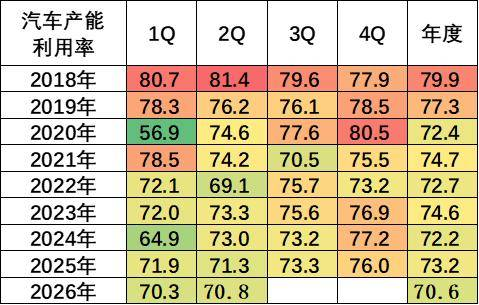

2020-2024年全国工业产能利用率保持在72.4—74.6的较小波动范围内。2024年四季度，全国规模以上工业产能利用率为76.2%，比上年同期上升0.3个百分点，比三季度上升1.1个百分点。2025年全国规模以上工业产能利用率为74.4%。分主要行业看，2025年汽车行业产能利用率73.2%，相对处于较低水平。

2026年1季度，汽车行业产能利用率为70.3%，同比去年下降1.6个百分点；2026年2季度，汽车行业产能利用率为70.8%，同比去年下降0.5个百分点。

5.汽车生产具体情况

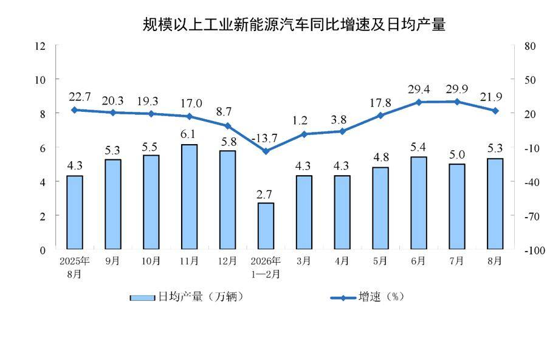

2026年8月份日均新能源汽车生产5.3万台，同比增21.9%。由于新能源轿车的去年基数较高，今年生产波动较大。2025年新能源车的生产较好是小微型电动车，需求也是中低端的需求较强，因此销售额增速稍低于销量增速。今年补贴锐减的小微型冲击较大，但商用车补贴高，市场暴涨。

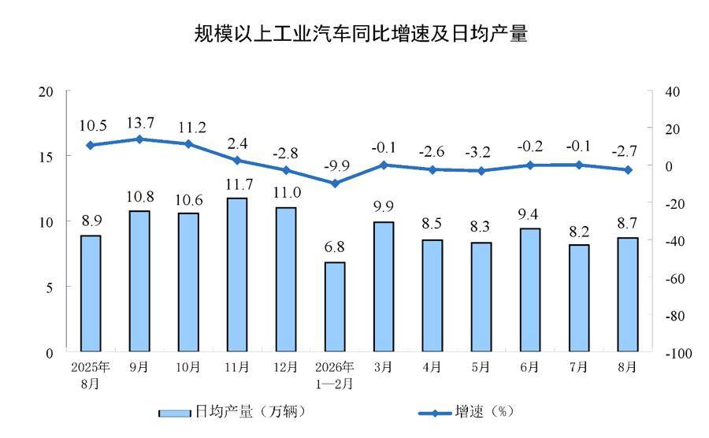

分产品看，2026年8月份，汽车日均8.7万辆，降2.7%，考虑到2025年1-8月基数抬高，2026年年政策性补贴收缩，今年1-8月增速的表现较弱。

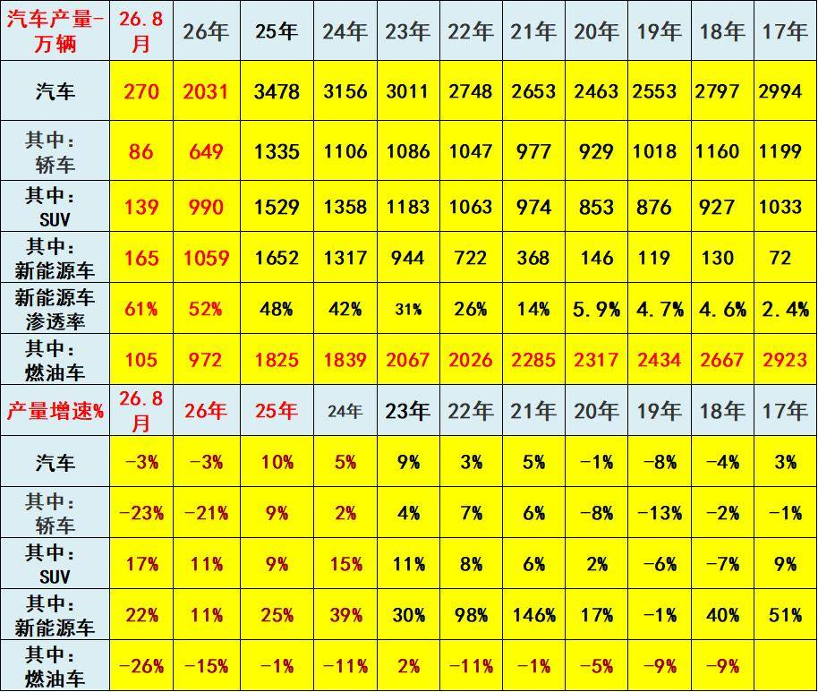

2022年汽车生产2748万台，同比增3%；新能源汽车生产722万，同比增98%，渗透率26%；燃油车生产2026万台，同比降11%。

2023年汽车生产3011万台，同比增9%；新能源汽车生产944万台，同比增30%，渗透率31%；燃油车生产2067万台，同比增2%。

2024年汽车生产3156万台，同比增5%；新能源汽车生产1317万台，同比增39%，渗透率42%；燃油车生产1839万台，同比降11%。

2025年汽车生产3478万台，同比增10%；新能源汽车生产1652万台，同比增25%，渗透率48%；燃油车生产1825万台，同比降1%。

2026年1-8月汽车生产2031万台，同比降3%；新能源汽车生产1059万台，同比增11%，渗透率52%；燃油车生产972万台，同比降15%。

2026年8月汽车生产270万台，同比降3%；新能源汽车生产165万台，同比增22%，渗透率61%；燃油车生产105万台，同比降26%。

6.2026年汽车投资持续回落

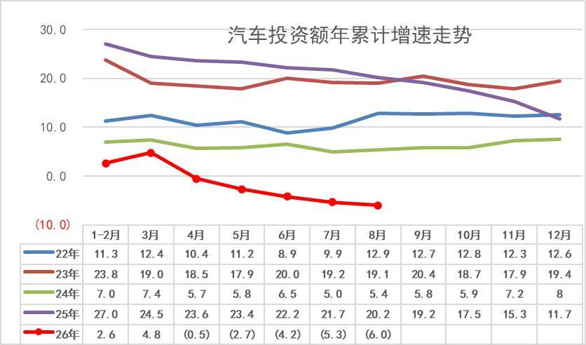

1—8月份，全国固定资产投资（不含农户）293092亿元，同比下降7.2%。分产业看，第一产业投资5832亿元，同比下降2.4%；第二产业投资113094亿元，下降2.9%；第三产业投资174166亿元，下降9.9%。投资压力大的是第三产业，公共基础设施、教育、文化、卫生投资下降剧烈。

2026年1—8月份，汽车行业固定资产投资同比下降6%，仍高于-7.2%的各行业平均水平。

7.房地产的消费挤压问题稍有改善

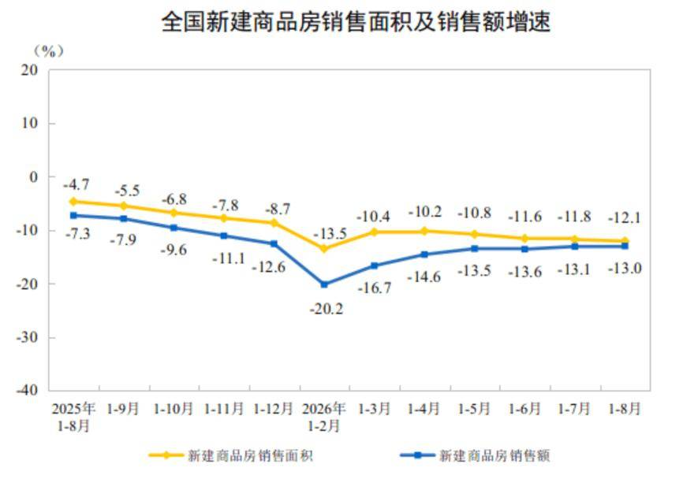

1—8月份，新建商品房销售面积49880万平方米，同比下降12.1%；其中住宅销售面积下降13.0%。新建商品房销售额47470亿元，下降13.0%；其中住宅销售额下降13.1%。

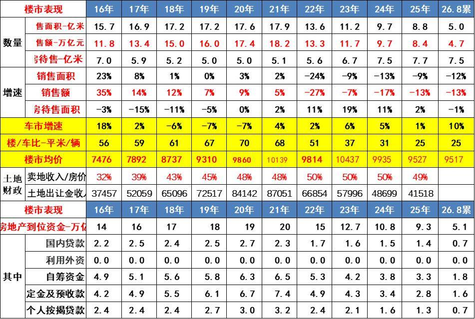

2021年土地出让金收入87051亿元，占房地产销售额48%；2023年土地出让金收入57996亿元，占房地产销售额50%；2024年土地出让金收入48699亿元，占卖房收入50%，房地产对地方财政贡献巨大。2025年卖地收入数据仍占房价49%。

目前，2026年1-8月汽车销量与房地产销量关系是25平米房/1辆车，销量的对比不合理现象有所改善。虽然房车比最高时的2020年70平米房/1辆车有所改善，但前期的债务压力和目前万元均价的楼市挤压消费压力仍大，导致车市需求因债务压力低迷。

楼市的财富效应对高端车需求有一定的促进效果，近期居民的楼市债务压力下降和购房需求减弱，对改善车市消费也带来一定潜在利好。

8.车市消费需要有持续政策支持

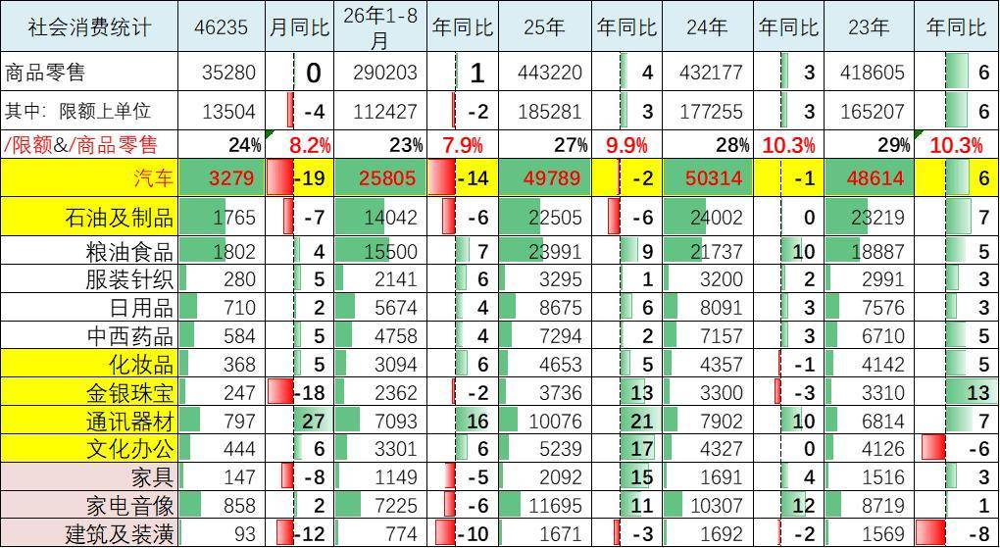

自从楼市2021年下跌以来，汽车消费从2020年的3.94万亿元上升到2025年的4.98万亿元，摆脱了2018-2020年的连续3年徘徊在3.9万亿元的被动局面。由于房地产下跌利好消费，买房投资挤压消费问题改善。2025年，社会消费品零售总额501202亿元，比上年增长3.7%。其中，汽车消费额49789亿元、同比降2%；除汽车以外的消费品零售额451413亿元，增长4.4%。

生活成本大幅上涨，衣食消费增长过快，购车消费被吃穿挤压严重。2026年1-8月车市消费降14%，目前看消费不旺的问题仍有待改善。

1—8月份，社会消费品零售总额327569亿元，同比增长1.1%。其中，汽车消费额25805亿元、同比降14%；除汽车以外的消费品零售额301764亿元，增长2.7%。8月份，社会消费品零售总额39824亿元，同比增长0.4%。其中，汽车消费额3279亿元、同比降19%；除汽车以外的消费品零售额36545亿元，增长2.5%。

2026年汽车消费呈现“政策延续、市场分化、需求承压”的复杂局面。以旧换新政策仍在持续发力，但受制于燃油车加速萎缩、价格战稀释消费信心、低端市场低迷等因素，零售端总量仍在下滑。石油制品消费的稳健增长，则反映出居民出行需求仍具刚性，汽车消费疲软更多指向耐用品消费意愿和可支配收入的边际弱化。

附：近日信息合集
