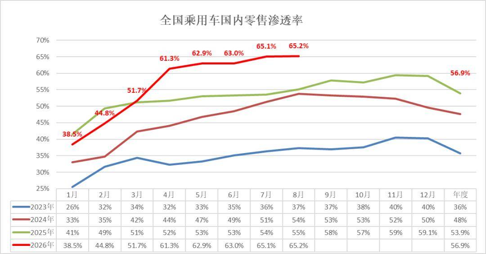
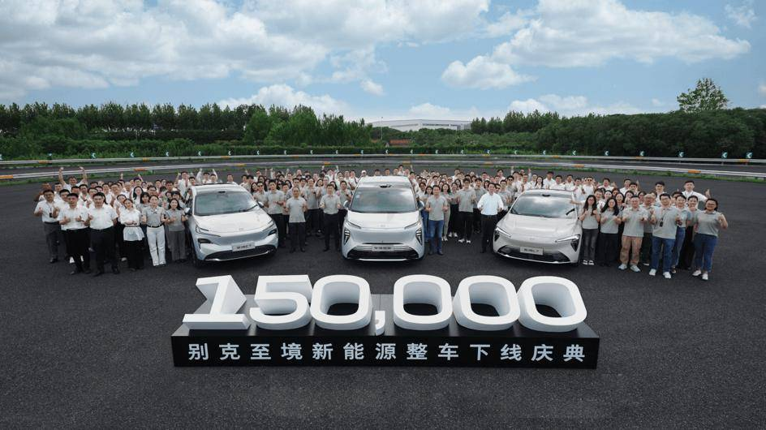
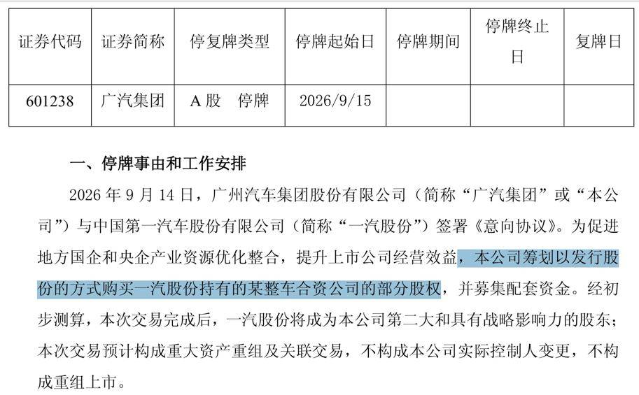

# 广汽重组公告叠加别克至境 15 万台下线，合资车企进入深度调整转型期

- 公開日時: 2026-09-17 14:53（北京時間）
- 出典: [搜狐号・崔东树](https://www.sohu.com/a/1077310650_115312)
- テーマ（自動判定）: その他
- 画像: 3枚

---

近期广汽集团发布重大资产重组公告，筹划收购一汽旗下整车合资公司部分股权，推动合资板块资源整合。几乎同一时间，别克至境新能源迎来第15 万台整车下线，品牌发布仅16 个月就实现规模化上量、25.7 万元平均成交价，量价齐升。一重组、一放量两件事放到一起看，标志国内合资车企已经告别简单的产品导入阶段，全面进入体系重构的深度转型周期。15 万台证明，合资新能源不是一道身份题，而是一道能力题。

8月新能源车在国内总体乘用车的零售渗透率65.2%，较去年同期增长10个百分点，环比增长0.1个百分点。

2026年9月16日，别克至境新能源第15万台整车下线庆典暨别克“金九狂欢季”开启活动在上海举行。活动现场，作为别克至境新能源第15万台整车下线车型——别克至境E7同步迎来第3万台整车下线。两项重要里程碑的达成，标志着别克至境品牌智电转型已迈入规模化发展的新阶段。

过去几年市场有个普遍偏见：合资做新能源基本跟不上节奏，要么产品单薄、车型零散，要么定价偏高、市场接受度弱，很多合资新能源车型属于试水性质，很难形成持续规模，更难做到量价同步提升。大众、丰田、本田、日产这些主流合资品牌，8 月销量结构就能看出差异，燃油车型依然是销量基本盘，新能源车型进入品牌销量前十的寥寥无几，有的品牌TOP10 里甚至全部是燃油车。这就是合资转型普遍面临的痛点：燃油基本盘庞大，转型顾虑多，本土响应速度慢，产品定义权不足。

广汽本次资产重组，本质是合资板块存量资源优化，解决南北同类合资主体各自为战、内耗严重的老问题。传统合资模式，外方主导产品规划，国内工厂更多承担制造职能，在新能源快速迭代环境下，决策链条长、新品落地慢，产品很难贴合中国家庭用户需求。所以才有广汽推动合资资产整合，通过股权重塑、资源集中，提升合资板块电动化投入效率。这是存量整合的路子，解决老合资的历史包袱。

而别克至境的“至境模式”，走的是另一条主动突破的路径。核心就是本土团队主导产品定义，以中国家庭需求为原点，同时保留通用全球工程品质体系，这是合资2.0 时代的典型特征，不再简单搬运海外车型，而是在中国完成架构开发、产品落地与市场迭代。

从产品布局看，至境快速搭建轿车、SUV、MPV 完整产品谱系，覆盖纯电、插混、增程三大技术路线，覆盖二人世界、三口之家、多代大家庭全周期家庭出行场景。这套完整矩阵，让它避开单一车型“单点作战” 的风险，形成持续供货、持续迭代的能力。至境E7迎来3万台下线，成为最快达成3万台里程碑的合资新能源车型；至境世家拿下上半年40 万以上豪华新能源MPV 销量冠军，不同细分市场多点开花，不是靠一款车短期爆火，而是矩阵协同持续释放势能。

增长层面，16 个月完成品牌发布、产品落地、规模上量三级跨越，打破“合资反应慢” 的刻板印象。很多合资品牌的新能源业务，是在原有燃油体系上附加新项目，决策链条长，产品迭代周期久。而别克这套模式，把产品、技术、量产决策权更多交给本土团队，实现“中国速度”，同时守住全球安全与品质底线，做到规模、价值、口碑协同增长。

更关键一点，它实现了销量规模和品牌价值同步向上，不是依靠低价换销量。连续蝉联合资新能源销冠，品牌的新能源渗透率、增速、销量快速抬升，8 月别克销量前十车型中新能源占比达到50%，在主流合资里面遥遥领先。对比其他合资品牌，很多新能源车型销量体量偏小，对大盘贡献有限，渗透率提升缓慢，本质上属于“副业式转型”；而至境属于“起步即大车”，直接冲击主流中高端市场，25.7 万的平均成交价，说明不是靠降价走量，用户认可产品价值，品牌溢价没有因为电动化而塌陷。

两大案例对比，就能看清合资转型两条路线：广汽这类是存量资产重组，优化现有合资资源，削减内耗；别克至境是重构产品开发体系，用全新品牌、全新产品矩阵打造新能源增长曲线。两种方式没有优劣，但核心前提一致：合资转型成败，不在于外资品牌光环，而在于能不能下放产品定义权，适配中国市场快速迭代的竞争环境。

当然，我们也要客观看待，至境模式是成功样本，但不等于所有合资品牌都能简单复制。这套模式需要股东双方充分放权，本土研发体系、供应链、渠道体系协同变革，还要有持续大额投入的决心。很多合资企业受全球总部决策机制、燃油业务利润保护、组织架构掣肘，很难快速完成这样的转型。

放到整个行业大格局，新能源赛道早已不是自主单方面领跑，合资品牌不是退场，而是进入加速分化阶段。一部分合资企业依靠资产重组盘活存量；另一部分像别克这样，激活本土研发能力，把全球制造底蕴和中国市场创新结合，就能在主流新能源赛道拿到市场份额。

长期看，新能源市场竞争从简单参数比拼，转向体系能力竞争。对合资品牌而言，转型的核心不在于贴一个电动化标签，而在于能不能真正做到以用户为中心、本土快速迭代，兼顾品质安全与产品价值。广汽的存量整合、别克至境的增量突破，共同印证一个结论：合资品牌只要理顺机制、找准路径，完全有能力打造出有规模、有口碑、有溢价的新能源产品，改写市场对合资新能源的固有认知。自主和合资不是非此即彼的替代关系，二者良性竞争，最终会推动国内新能源产业整体走向高质量发展。
