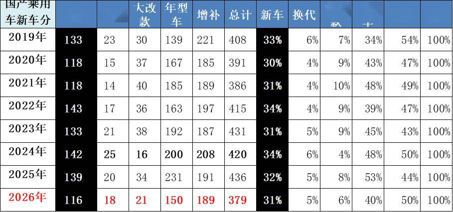
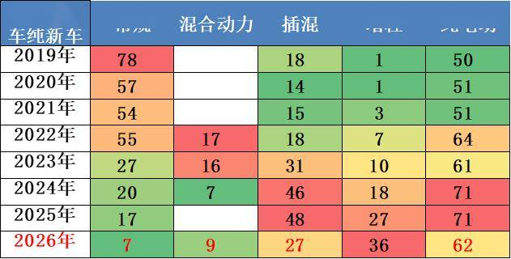
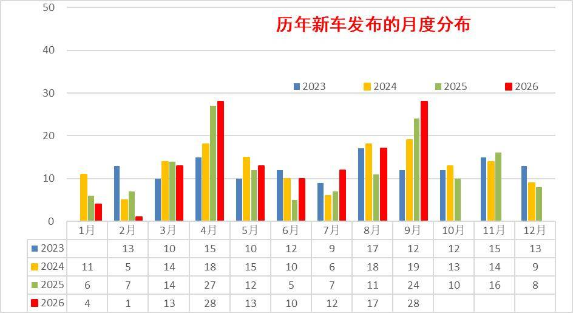
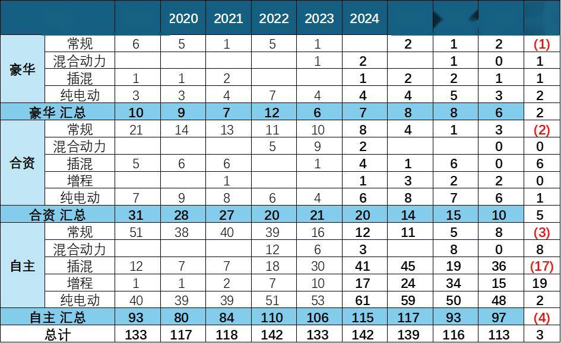
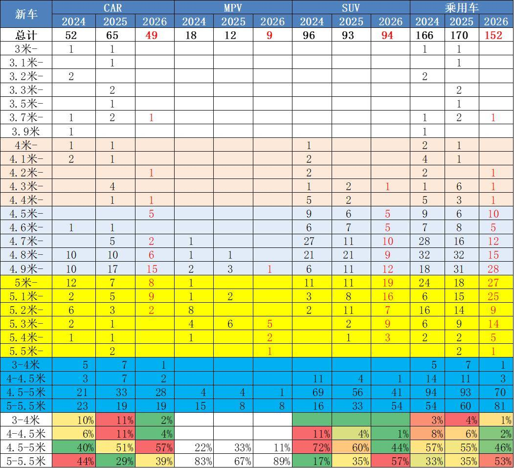
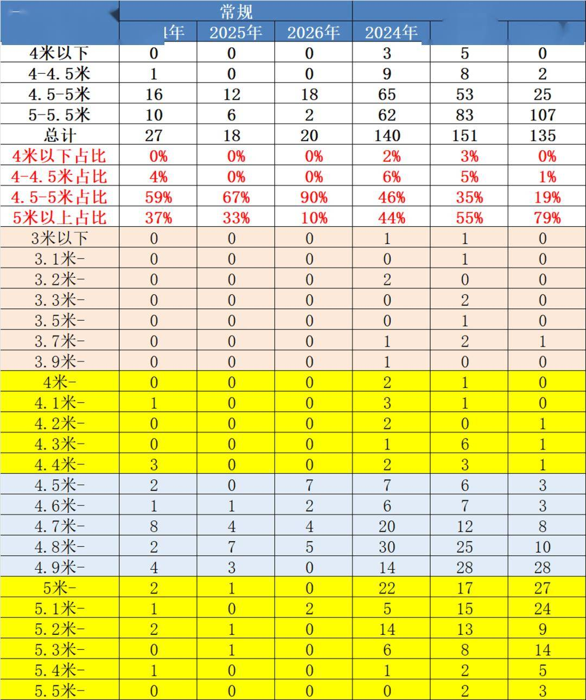
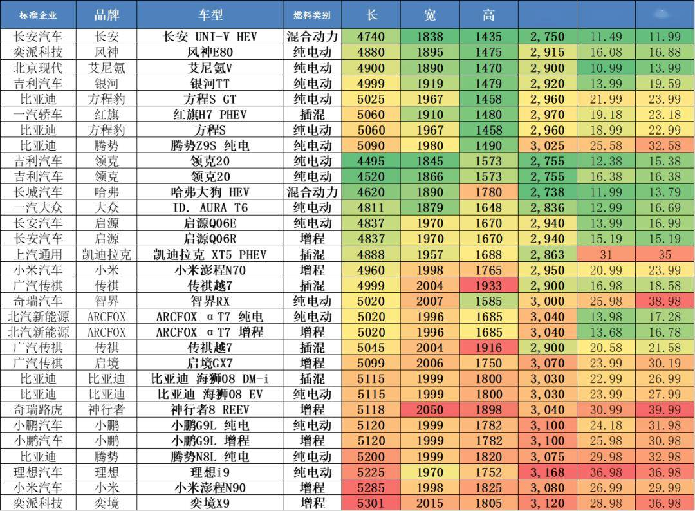
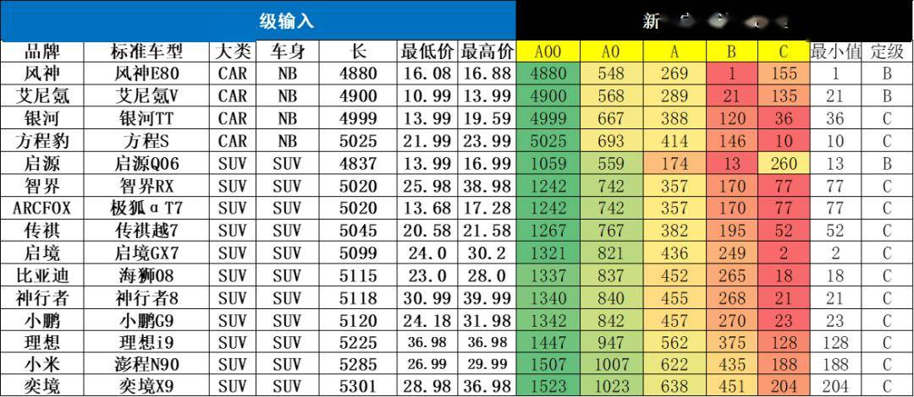
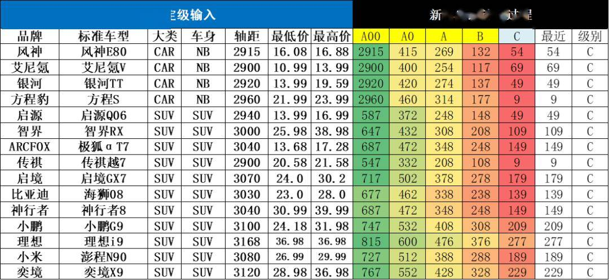
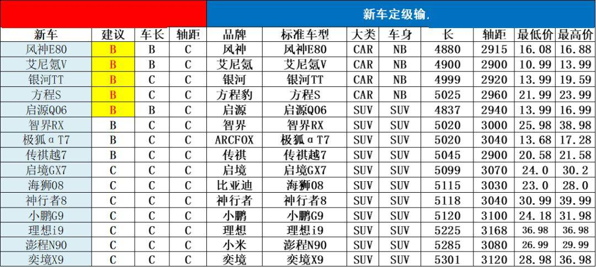

# 乘用车新车的分级测算探讨—9月

- 公開日時: 2026-10-11 19:09（北京時間）
- 出典: [搜狐号・崔东树](https://www.sohu.com/a/1086399433_115312)
- テーマ（自動判定）: セグメント・車種
- 画像: 11枚

---

注：本分析文章仅代表崔东树个人观点，如有异议，请留言。

近期乘用车市场的传统车市场推出新车型逐步放缓，新能源大幅增加新品投放。目前主力车企产品逐步进入多生孩子好竞争的局面，车企呈现剧烈的价格竞争和破圈趋势。这些传统车和新能源车的新车型如何归类也是很重要的，每家都有自己的分级模式，但我们还是习惯用行业相对主流的源自于德国大众的A00、A0、A、B、C、D分级模式作为基础，成为行业参照的公用分级方式。对这个行业分级，测算本月新车的分级如下，具体的调整也是仅供讨论。如有不同观点也可留言。

维度1：车型颗粒度（产品物理区分口径）层级由粗到细：车型→动力形式→配置款式。1.粗口径（车型）。2.中口径（车型+ 动力），区分动力，不细分高低配。3.细口径（车型+ 动力+ 配置款式），最细颗粒度，数量最大。

维度2：新车推出性质（生命周期变更口径，决定算不算“全新新车”）1.全新车型、换代车型（垂直换代）、大改款（中期改款Facelift）、年型车、参数升级、风格变化等。

分析中是用组合：维度1：车型颗粒度的中口径+维度；2：新车推出性质中的纯新车组合。

今年1-9月的新品共116款，其中增程车型36款，较去年同期多19款；混合动力车型9款，较同期多9款；狭义插混车型27款，较同期少10款；纯电动车型62款，较同期多5款；常规燃油车7款，较同期少6款。这些新车有些是新车型，有些是改款改名字的新车型，更多的是新能源车型。

2026年的自主品牌新车93款的数量较去年少4款，但新能源仍是自主几乎包揽的局面。2026年的合资车企的新品推出15款，改善主要是插混和增程的新品全面推出。今年1-9月豪华车新品有8款，较同期多2款，基本都是新能源，这些新品值得观察。

车型定级因素较复杂，主要是从车长、轴距、价格、企业内部自身车型梯度布局、竞品关系等综合考虑的。从车长轴距考虑的车型定级体现的是新车与现有市场的拟合度，但新车是引领市场变化的，因此还要从厂家定位和历史升级演变等角度论证，这也就是防止算出来的与我们的行业主流观点形成偏差，同时也是让新车引领细分市场的产品变化。

从2024-2026年的数据来看，乘用车新车长度呈现出显著的“中大型化”趋势，市场重心正向5米区间集中。最直观的变化在于，5.0-5.1米区间的车型数量由2024年的18款激增至2026年的27款，成为绝对的主力增长点。与此同时，5.1-5.2米及5.2-5.3米的大型车也稳步扩容，前者从16款增至25款，后者从9款增至14款。这表明，5米左右的车长已逐渐取代传统的4.7-4.8米，成为新一代乘用车的主流尺寸标准，反映出市场对宽敞舒适空间的需求日益旺盛。

新能源市场则呈现强劲的“大型化”爆发态势。虽然总量在2026年有所回落（135款），但结构发生根本性逆转。5米以上车型占比从2024年的44%暴涨至2026年的79%，成为绝对主流。其中，5.2-5.3米区间增长最为迅猛，从6款激增至14款。与之相对，4.5-5米区间占比从46%暴跌至19%，4米以下车型几乎绝迹。这清晰表明，新能源车已全面进入“5米+时代”，大型化、旗舰化成为竞争核心，彻底颠覆了以往以紧凑型为主的格局。

9月的新车有基本都是B级以上大型车，未来国内车市普及潜力巨大，需求的是小型车。未来政策层面应该尽量鼓励经济型车发展，我个人建议制定经济型车标准，鼓励微型电动车普及，尽量替代老头乐，这样才能实现国内的私车普及和新能源车出海发展。尤其是随着新的关税国际秩序，我们的新能源车出口还是要考虑海外的农村包围城市，欠发达国家包围发达国家的线路，直接冲击发达国家市场的难度和风险较大。

1、新车两大核心统计维度界定

维度1：车型颗粒度（产品物理区分口径）

层级由粗到细：品牌→车型→动力形式→配置款式

1.粗口径（车型）：如“比亚迪宋PLUS”，不区分动力、配置，统计数量最少；

2.中口径（车型+ 动力）：宋PLUS DM-i、宋PLUS EV，区分动力，不细分高低配；

3.细口径（车型+ 动力+ 配置款式）：宋PLUS DM-i 110KM 领先型/ 旗舰型，最细颗粒度，数量最大。 痛点：车企配置命名经常微调、选装包泛滥，选装是否算作独立款式，行业没有统一标准。

维度2：新车推出性质（生命周期变更口径，决定算不算“全新新车”）

自上而下划分行业通用分类：

1.全新车型（全新平台/ 全新车系）：从零开发，新增产品线；

2.换代车型（垂直换代）：平台、车身架构大幅调整，底盘、车身重新开发；

3.大改款（中期改款Facelift）：车身轮廓不变，外观大灯、格栅、内饰中控、动力总成优化；

4.年型车（年度改款MY）：外观无变化，配置增减、车机版本调整；

5.参数升级/ 小幅优化：电池容量微调、电机功率小幅上调、软件OTA 硬件版本变更、配色新增；

6.新增配色、新增选装包：仅外观色彩/ 选装，整车硬件不变。

关键矛盾：机构统计时阈值不统一。有的机构只统计全新车+ 换代+ 大改款；有的把年型车、参数升级全部纳入；OTA 软件升级绝大多数不认定为新车。

2、统计复杂的核心根源

A.口径无统一行业标准。不同行业机构或媒体对“新车”定义不一致，直接导致同一份市场产出数据出现几倍差异。

B.车企营销命名干扰统计。部分车企小幅配置升级直接命名“新款”，营销话术层面的“新车”≠行业产品定义里的新车型层级。

C.新能源加剧复杂度。燃油车动力方案相对稳定；新能源车频繁调整电池容量、续航、电机参数，常态化参数迭代，极易混淆“年型升级” 和“大改款”。

D.两大维度交叉叠加。同一车系中期改款（性质维度），同时推出燃油、混动、纯电三种动力，每种动力3 款配置；如果再叠加年型小幅配置调整，款式数量会快速膨胀。

3、车型颗粒度细口径+全部新车推出性质--最细分口径

这是最广义的新款车型的推出数量，按照细分车型款式计算，每个车型每次推出数款细分车型，因此数量较多。2019年达到年度3202款车型，今年1-9月有1952款车型，相对历年1-9月较少。

4、车型颗粒度粗口径+全部新车推出性质—新车型口径

这是按照车型口径统计的厂家新推出车型的统计，每个车型包含不同动力类型和款式的最粗框车型的数量，这其中的月度数据和季度数据不一致，主要是非重复计算的结果。因此数据不是简单相加。

5、新车上市的种类很多

2026年1-9月真正的新车116款，相对各类上市车型总体379款的占比为31%。相对历年的新车占比在30%-34%区间，2026年的新车占比31%相对较少。

2026年相对较高的上市车型主要是参数变化和增补车型，这些车型的含金量不高，拉动消费效果较差。

6、我们统计新车的口径是区分动力的纯新车型-车型颗粒度中口径+纯新车

我们统计新车的口径是区分动力的纯新车型，也就是车型颗粒度中口径（车型+动力组合）的纯新车，不含换代、中期改款、年型车、参数变化等。

新车型拆分动力主要是考虑动力形式是目前新能源转型的重要特征，部分企业推出新车的动力形式差异较大，推出节奏也不同，因此按新能源和燃油车的5大细分动力进行拆分，这样的新车统计比较规范，但数量因此偏多。

7、历年各月新车跟踪

2026年1季度新车发布较少，2季度相对较多，2026年9月新车发布28款，与2023年和2024年9月新车数量相比增加较多，保持历年较高水平。今年1-9月的新车发布为116款，去年1-9月新车发布113款，2024年同期142款，今年新车多于去年3款，1季度新品少，6-9月新品较多。

8、各类动力类型新车跟踪

今年1-9月的新品共116款，其中增程车型36款，较去年同期多19款；混合动力车型9款，较同期多9款；狭义插混车型27款，较同期少10款；纯电动车型62款，较同期多5款；常规燃油车7款，较同期少6款。这些新车有些是新车型，有些是改款改名字的新车型，更多的是新能源车型。近两年的汽油车的数量较前期明显减少，但今年很多混合动力新车推出，体现混合动力替代燃油车实现出口突破的新思路。

9、各类品牌新车跟踪

2026年的自主品牌新车93款的数量较去年少4款，但新能源仍是自主几乎包揽的局面。2026年的合资车企的新品推出15款，改善主要是插混和增程的新品全面推出。今年1-9月豪华车新品有8款，较同期多2款，基本都是新能源，这些新品值得观察。

10、乘用车推出的车长分析

从2024-2026年的数据来看，乘用车新车长度呈现出显著的“中大型化”趋势，市场重心正向5米区间集中。最直观的变化在于，5.0-5.1米区间的车型数量由2024年的18款激增至2026年的27款，成为绝对的主力增长点。与此同时，5.1-5.2米及5.2-5.3米的大型车也稳步扩容，前者从16款增至25款，后者从9款增至14款。这表明，5米左右的车长已逐渐取代传统的4.7-4.8米，成为新一代乘用车的主流尺寸标准，反映出市场对宽敞舒适空间的需求日益旺盛。

在整体向上的趋势下，市场结构出现明显的“剪刀差”分化。传统紧凑型及中型车区间（4.8米以下）全面萎缩。例如，4.6-4.7米车型从16款骤降至5款，4.7-4.8米车型从28款减半至12款，4.8-4.9米也由32款降至15款。从占比看，4.5-5.0米区间的份额被大幅挤压，而5.0-5.5米区间的合计占比则从2024年的约33%跃升至2026年的53%以上。这种“两头缩减、中间膨胀”的态势，说明车企正加速淘汰入门及中端尺寸，集中火力争夺大型化、高端化的市场份额。

11、新能源车推出的车长分析

常规燃油车市场呈现出显著的“规模萎缩”与“结构巨变”。总计由2024年的27款骤降至2026年的20款。结构上，4.5-5米区间成为绝对主导，占比从59%飙升至90%；而曾经的支柱5-5.5米区间则断崖式下跌，从10款降至2款，占比由37%萎缩至10%。同时，4.5米以下车型在2025-2026年完全消失。这表明常规车型正全面退守至4.5-5米的中型车腹地，彻底放弃了大型车和入门级市场。

新能源市场则呈现强劲的“大型化”爆发态势。虽然总量在2026年有所回落（135款），但结构发生根本性逆转。5米以上车型占比从2024年的44%暴涨至2026年的79%，成为绝对主流。其中，5.2-5.3米区间增长最为迅猛，从6款激增至14款。与之相对，4.5-5米区间占比从46%暴跌至19%，4米以下车型几乎绝迹。这清晰表明，新能源车已全面进入“5米+时代”，大型化、旗舰化成为竞争核心，彻底颠覆了以往以紧凑型为主的格局。

12、行业标准车型现状

近几年的新能源车的新车数量较多，这些如何分级也是需要多重考虑的。分级测算选择的主要依据是车长和轴距对应的厢型，同时区分合资与自主的类别。价格因素和排量因素实在太复杂，因此暂作为争议车型的备考指标。

根据测算，行业现有销售车辆的每个车型的车长轴距和销量，进行加权汇总测算，得出每个级别的不同国别和厢型的平均长度和轴距，作为这个细分市场的标准车指标。

有了标准车指标，就有了各类车型间的车长和轴距的差距指标，就形成测算评级的基础。

13、9月新车型现状

9月新品的重量级车型较多，其中自主与豪华车的亮点较多，形成车型序列的延展。随着以旧换新的政策推动换购，新品向高端延伸明显。SUV的主流车型的改款新品较强。

豪华品牌的新品有一定竞争力，满足多元化需求。合资新品的技术自主性相对被动，与新势力新品正面对抗的挑战不小。

14、车型分解的测算-车长

根据每个新车的车长的指标与各级别的标准指标对比，寻找车长差距最小的指标，根据车长的定级看，各车型有些定级参考，大部分测算分级基本符合直觉定位预期。

近期自主的中型SUV较多，而且偏大型化设计。由于设计车辆目标都是超越对手，因此车型跨界力度较大，产品对比的难度较大。有些产品升级的比较大型，但会对应调整到低一级的合理竞争定位。

15、新车定级-轴距

由于车身设计的差异，根据轴距测算车型的定位区间。计算基本也是有很多边缘车型。

本月的主力新品车型的产品轴距差异较大，电动车的产品特色明显，价格差异大，相对复杂。

16、车型分类的综合对比评定

9月的新车有一半是有降级考虑的，主要是从车长、轴距、价格、企业内部自身车型梯度布局、竞品关系等综合考虑的。从车长轴距考虑的车型定级体现的是新车与现有市场的拟合度，但新车是引领市场变化的，因此还要从厂家定位和历史升级演变等角度论证，这也就是防止算出来的与我们的行业主流观点形成偏差，同时也是让新车引领细分市场的产品变化。

本月新车定级比较纠结的车型较多，内资的电动车轴距较长，形成电动车的异常反差。部分车型的车身长，实际定位和价格较低，因此平衡到低一级别。考虑到弱势企业新车大型化和燃油车低迷的特征，定级也是需要共同探讨。

目前这个分级仍在讨论阶段，我们的建议分类也欢迎大家提出意见建议，根据争议情况确定车型建议级别，共同研判产品趋势。

附：近日信息合集
