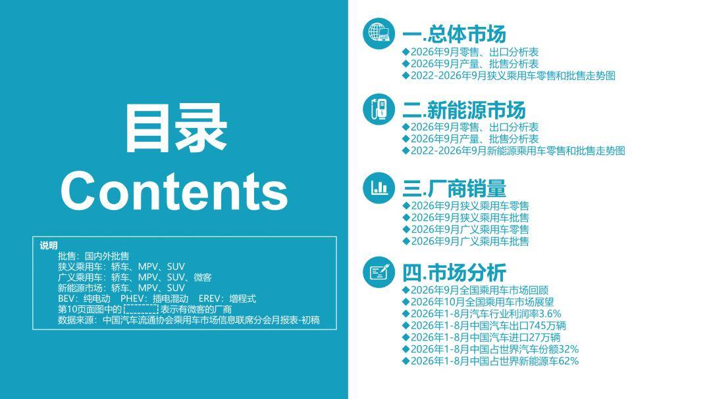
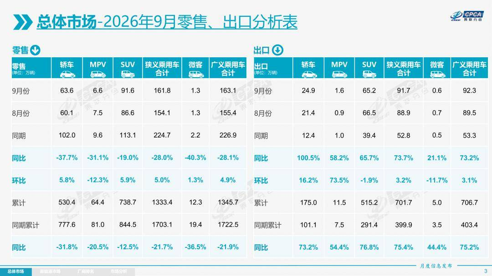
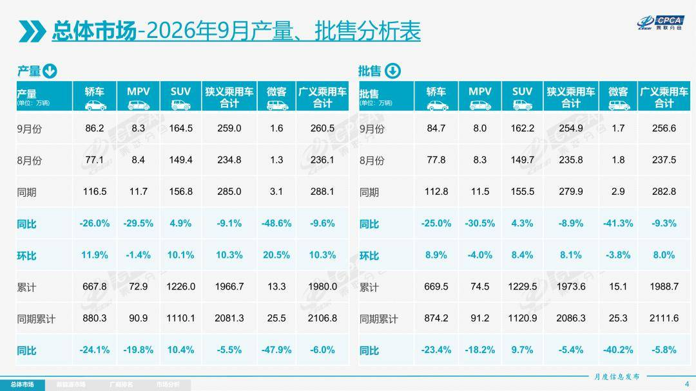
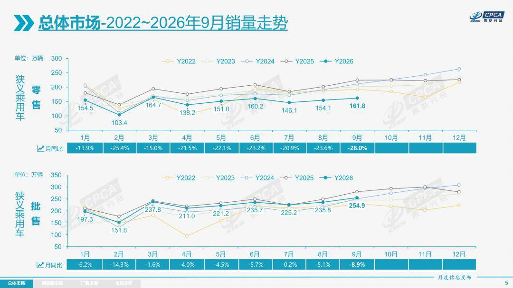
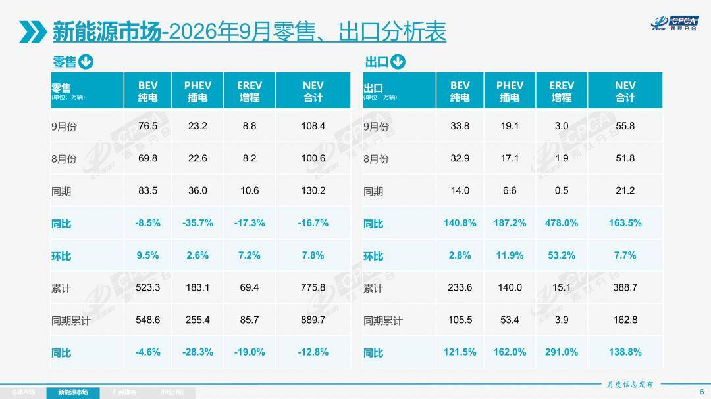
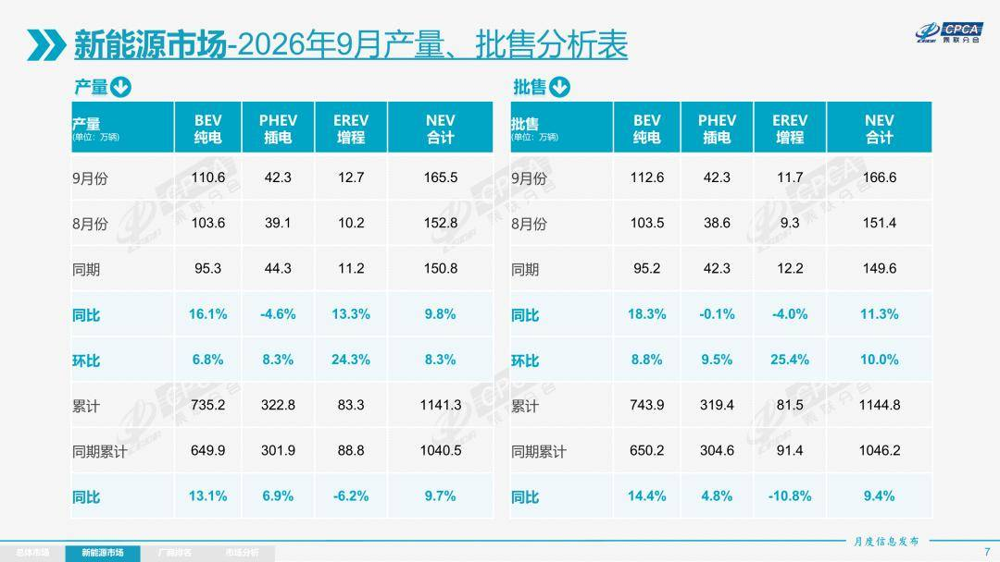
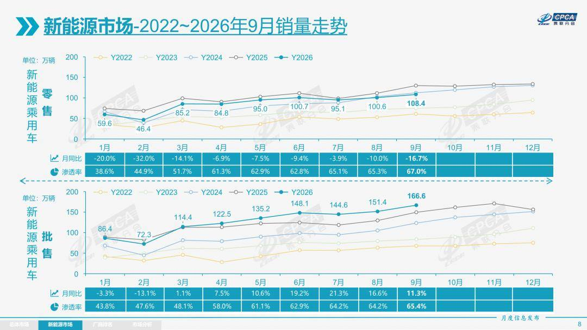
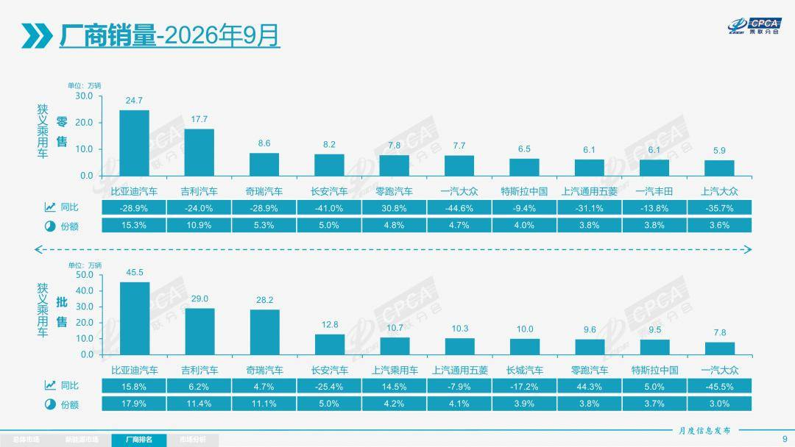
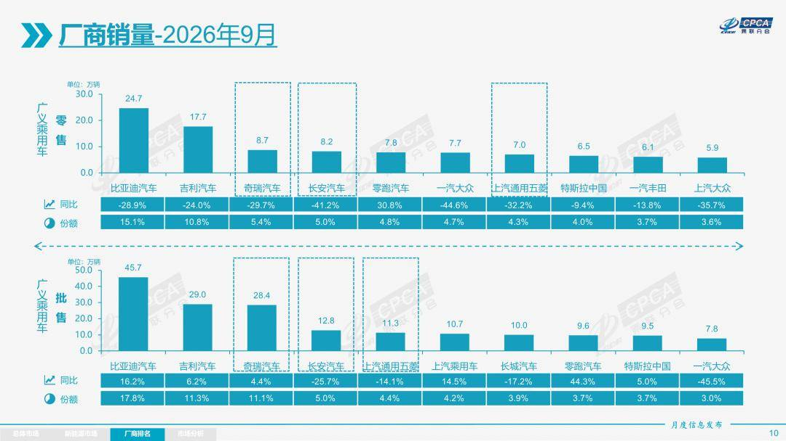

# 【月度分析】2026年9月份全国乘用车市场分析

- 公開日時: 2026-10-12 13:58（北京時間）
- 出典: [搜狐号・崔东树](https://www.sohu.com/a/1086885785_115312)
- テーマ（自動判定）: 乗用車市場
- 画像: 9枚

---

本文全文共9357字，阅读全文约需31分钟

1.2026年9月全国乘用车市场回顾

零售：2026年9月全国乘用车市场零售161.8万辆，同比下降28.0%，环比增长5.0%；1–9月乘用车累计零售1,333.4万辆，同比下降21.7%。

综合来看，9月乘用车市场呈现五大鲜明特征：一、总量同比深度承压，环比修复但力度有限，结构性分化极致放大，“燃油加速萎缩、新能源韧性领跑”成为市场主线，高油价持续加速“油电替代”节奏；二、燃油车全线收缩，纯燃料乘用车国内零售近乎腰斩式下滑，普混车型相对抗跌；三、新能源渗透率持续突破新高，9月新能源零售渗透率攀升至67.0%，批发渗透率达65.4%，均创历史新高，但同比增速较前期明显放缓；四、出口超越内需成为部分车企核心关注，出口有效稳住车企批发与利润，部分车企出口超50%，出口占车企总量70%的厂商快速增多，出口销量成为拉动车企增长的核心动力；五、行业库存持续低迷，高油价冲击燃油车明显，经销商新车进货更为谨慎，绝大部分经销商认为“金九银十”旺季效应明显弱于往年，经销商生存压力大、信心不足。但当前车市下行属于短期政策扰动与高基数叠加的阶段性现象，并非汽车普及的基本面见顶，大城市普及高县乡普及弱的“头重脚轻”特征尤为明显，下沉县域首购需求的蓝海依然广阔。

9月车市最突出的特征是“旺季不旺”，传统“金九”成色严重不足。往年“金九”是大盘普涨、首购换购一起释放，今年则是存量博弈下的此消彼长，燃油车需求持续剧烈萎缩。9月成为本轮车市零售降幅异常突出的月份，多重因素叠加所致：一是中秋假期提前到9月下旬，中秋当周销量明显走弱；二是去年9月部分省份补贴退出，催生集中抢补贴行情，形成较高对比基数；三是高油价持续抑制燃油车消费：9月末以来年内汽油累计上调2,375元/吨，燃油车消费意愿持续走低，而新能源零售渗透率已攀升至67%的高位，“油电替代”加速推进；四是受AI驱动的内存与芯片价格暴涨及供给紧张等因素导致近期新能源新品增量偏慢等，这是多重因素共同影响的的结果。

9月燃油车零售同比下降43%，其中纯燃油车同比下降49%，普通混合动力车同比增长25%。燃油车中自主同比下降47%，主流合资同比下降42%，豪华同比下降41%，均无差别地受到高油价剧烈冲击。

9月新能源车零售同比下降16.7%，其中自主下降19%，主流合资增长36%，豪华下降8%，自主A00级电动车国内零售受到补贴不利的政策影响跌幅较大。

9月自主品牌零售113万辆，同比下降25%，环比增长5%。当月自主品牌国内零售份额为69.8%，同比增长2.8个百分点。总体上自主品牌在新能源市场和出口市场表现较平稳。

9月主流合资品牌零售31万辆，同比下降36%，环比增长2%。9月德系品牌零售份额12.2%，同比下降2.0个百分点，日系品牌零售份额10.7%，同比下降0.9个百分点。美系品牌市场零售份额6.3%，同比增长0.5个百分点。低销量合资车企逐步恢复活力。

9月豪华车零售17万辆，同比下降29%，环比增长12%。随着豪华车指导价的合理回归，9月豪华品牌零售份额11%，同比下降仅0.2个百分点。

出口：根据乘联数据，9月乘用车出口（含整车与CKD）91.7万辆，同比增长73.7%，环比增长3.2%，占乘用车厂商销量36%（上月38%，2025年同期19%）。9月新能源车占出口总量的60.8%，较同期大幅增加21个百分点。9月自主品牌出口达到81.2万辆，同比增长75%；合资与豪华品牌出口10.5万辆，同比增长62%。

生产：9月乘用车生产259.0万辆，同比下降9.1%，环比增长10.3%。9月豪华品牌生产同比下降24%，环比增长5%；合资品牌生产同比下降29%，环比增长20%；自主品牌生产同比下降1%，环比增长9%。

批发：9月全国乘用车厂商批发254.9万辆，同比下降8.9%，环比增长8.1%；受出口暴增的促进激励，9月乘用车批发同比增速较零售增速高出19.1个百分点。9月自主车企批发196.5万辆，同比下降0.2%，环比增长8.0%。主流合资车企批发36.1万辆，同比下降33%，环比增长9%。豪华车批发22.2万辆，同比下降23%，环比增长12%。

9月乘用车主力厂商总体批发格局持续变化，零跑汽车、极狐汽车、广汽埃安、北汽乘用车等车企实现同比20%以上高增长。9月车市集中度相对平稳，10万辆以上批发销量的乘用车厂商6家（上月7家，去年同期7家），占整体市场份额53.6%（上月59%，同期53%）。5-10万辆批发量的乘用车厂商份额占比21.2%（上月15%，同期21%），1-5万辆批发量的乘用车厂商份额占比22.8%（上月22%，同期24%）。

库存：由于9月市场运行压力较大，9月厂商批发低于生产4.1万辆，而厂商月度国内批发高于国内零售1.4万辆。今年去库存特征突出，1-9月总体乘用车行业库存下降68万辆（2025年同期下降25万辆、2024年同期下降88万辆、2023年同期下降13万辆）。

新能源：9月新能源乘用车生产达到165.5万辆，同比增长9.8%，环比增长8.3%。1-9月累计新能源乘用车生产达到1,141.3万辆，同比增长9.7%。

9月新能源乘用车批发销量达到166.6万辆，同比增长11.3%，环比增长10.0%；1-9月新能源乘用车批发销量达到1,144.8万辆，同比增长9.4%。9月常规燃油乘用车批发销量达到88万辆，同比下降32%，环比增长5%。

9月新能源乘用车市场零售108.4万辆，同比下降16.7%，环比增长7.8%；1-9月新能源乘用车市场零售775.8万辆，同比下降12.8%。9月常规燃油乘用车零售53万辆，同比下降43%，环比下降0.3%；其中普通混合动力车同比增长25%，环比增长19%。

9月新能源乘用车厂商出口55.8万辆，同比增长163.5%，环比增长7.7%；1-9月新能源乘用车厂商出口388.7万辆，同比增长138.8%。9月常规燃油乘用车出口35.9万辆，同比增长14%，环比下降3%。

1)批发：9月新能源车厂商批发渗透率65.4%，较2025年9月提升12个百分点。9月自主品牌新能源车渗透率75.5%；豪华车中的新能源车渗透率55.4%；主流合资品牌新能源车渗透率上升到16.3%。

9月纯电动批发销量112.6万辆，同比增长18.3%，环比增长8.8%；9月狭义插混销量42.3万辆，同比下降0.1%，环比增长9.5%；9月增程式批发11.7万辆，同比下降4.0%，环比增长25.4%。9月新能源批发结构中：纯电动占67.6%(同比+4.0%，环比-0.7%)、狭义插混占25.4%(同比-2.9%，环比-0.1%)、增程式占7.0%(同比-1.1%，环比+0.9%)。

9月B级电动车批发32.9万辆，同比增长21%，环比增长9%，占纯电动份额29%，较去年同期增长0.5个百分点。纯电动市场的A00级经济型电动车市场压力较大，9月A00级批发销量7.8万辆，同比下降51%，环比增长28%，占纯电动的7%份额，较去年同期大幅下降10个百分点；A0级批发销量39.6万辆，占纯电动的35%份额，同比增长10.0%.；A级电动车26.6万，占纯电动份额24%，同比下降2个百分点；从长期普及趋势看，经济型电动车增长是最有潜力的，只有入门级电动车普及才能真正拉动车市有可持续的增量。

9月乘用车批发销量超两万辆的车型有23个（上月21个），比亚迪宋（69,266辆）、Model Y（62,948辆）、比亚迪元UP（62,711辆）、吉利星愿（60,871辆）、比亚迪海鸥（38,650辆）、比亚迪海豚（35,141辆）、瑞虎7（33,832辆）、Model 3（32,418辆）、方程豹钛7（32,144辆）、启源Q05（29,064辆）、缤越（28,879辆）、奇瑞JAECOO J5（28,794辆）、五菱缤果（28,176辆）、银河星舰7（25,892辆）、MG4 EV（25,556辆）、博越（25,110辆）、零跑A10（24,457辆）、捷途旅行者（23,644辆）、深蓝S05（22,283辆）、比亚迪海豹06（22,021辆）、比亚迪海狮06（21,186辆）、星越L（21,136辆）、比亚迪元PLUS（20,609辆）。其中新能源车型占绝对主力地位。

2）零售：9月新能源车在国内总体乘用车的零售渗透率67.0%，较去年同期增长9.1个百分点，环比增长1.7个百分点。9月国内零售，自主品牌中的新能源车渗透率84.5%；豪华车中的新能源车渗透率44.9%；而主流合资品牌中的新能源车渗透率仅上升到15.9%。从月度新能源车国内零售份额看，9月自主品牌新能源车零售份额64.5%，同比下降5.7个百分点；主流合资品牌新能源车份额4.8%，同比增长1.6个百分点；新势力份额23.6%，零跑汽车、蔚来汽车等品牌拉动新势力份额同比增长了3.4个百分点。

3）出口：9月新能源乘用车出口55.8万辆，同比增长163.5%，环比增长7.7%。占乘用车出口60.8%，较去年同期增长21个百分点；其中纯电动占新能源出口的60.5%（去年同期66.2%），作为核心焦点的A00+A0级纯电动车占纯电动出口的57.9%（去年同期49%）。伴随着中国新能源车的规模优势显现和市场需求的扩张，中国制造的新能源品牌产品越来越多地走出国门，在海外的认可度持续提升。其中狭义插混占新能源出口的34.2%（去年同期31.4%）增程占新能源出口的5.3%（去年同期2.4%）。虽然近期受到外部国家的一些干扰，但自主狭义插混出口发展中国家的数量在迅猛增长，前景光明。9月新能源出口方面优秀的企业是：比亚迪汽车（175,877辆）、奇瑞汽车（85,990辆）、吉利汽车（72,893辆）、特斯拉中国（30,529辆）、上汽乘用车（29,552辆）、长安汽车（29,325辆）、零跑汽车（27,454辆）、上汽通用五菱（16,543辆）、东风汽车（10,282辆）、小鹏汽车（10,055辆）。

从海外体系建设上看，部分自主品牌的CKD出口占比较高，国际化表现优秀。其中长城汽车CKD出口占比41.9%，上汽通用五菱CKD出口占比42.1%，零跑汽车CKD出口占比34.6%，上汽乘用车CKD出口占比15.3%。

4）车企：9月新能源乘用车企业总体走势较强，比亚迪汽车纯电动与插混双驱动夯实自主品牌新能源领先地位；以比亚迪汽车、吉利汽车、奇瑞汽车等为代表的狭义插混表现持续较强，上汽乘用车、上汽大众、上汽通用等新能源增长较强。在产品投放方面，随着自主车企在新能源路线上“多线并举”策略的实施，市场基盘持续扩大，新能源月度批发销量突破万辆的厂商达到22家（同比多2家，环比多3家），占新能源乘用车总量94.4%（上月93.6%，去年同期93.1%）。其中，比亚迪汽车（455,113辆）、吉利汽车（188,800辆）、奇瑞汽车（126,703辆）、零跑汽车（96,167辆）、特斯拉中国（95,366辆）、长安汽车（94,147辆）、上汽通用五菱（77,670辆）、上汽乘用车（61,818辆）、长城汽车（41,981辆）、小鹏汽车（40,654辆）、小米汽车（40,015辆）、广汽埃安（39,667辆）、蔚来汽车（37,408辆）、理想汽车（31,817辆）、东风汽车（30,211辆）、赛力斯汽车（25,373辆）、极狐汽车（20,021辆）、上汽通用（18,583辆）、一汽奔腾（17,985辆）、上汽大众（13,110辆）、广汽丰田（10,241辆）、一汽红旗（10,234辆）。

国内新能源乘用车零售突破2万辆的企业品牌是：比亚迪汽车（246,816辆）、吉利汽车（119,682辆）、零跑汽车（78,202辆）、特斯拉中国（64,837辆）、长安汽车（61,732辆）、上汽通用五菱（54,810辆）、奇瑞汽车（46,860辆）、上汽乘用车（40,280辆）小米汽车（40,015辆）、鸿蒙智行（37,490辆）、蔚来汽车（37,231辆）、长城汽车（32,048辆）、理想汽车（31,817辆）、小鹏汽车（30,599辆）、广汽埃安（24,539辆）、东风汽车（20,070辆）、极狐汽车（20,021辆）。

5）新势力：9月新势力零售份额23.6%，同比增长3.4个百分点。新势力车型中的纯电动销量占比75%，较同期的70%占比大幅提升；新势力纯电动车中的10-15万级别销量占比大幅增长。自主传统车企的独立新能源品牌作为创二代的表现较强，份额达15.0%，同比增长2.3个百分点。极氪、奕派科技、埃安汽车、极狐汽车、岚图汽车等自主大集团的自创新能源品牌表现优秀。

6）普混：9月普通混合动力乘用车批发12.5万辆，同比增长51%，环比增长17%。其中一汽丰田（41,897辆）、广汽丰田（30,739辆）、吉利汽车（16,809辆）、上汽乘用车（15,831辆）、长安福特（4,056辆）、长城汽车（3,749辆）、长安汽车（3,122辆）、东风本田（2,499辆）、东风汽车（1,990辆）、广汽传祺（1,982辆）、广汽本田（1,651辆）。吉利汽车、上汽乘用车、长安汽车、东风汽车等自主混动的在海外市场异军突起。

2.2026年10月份全国乘用车市场展望

今年10月工作日共18天，与去年同期持平。由于中秋节在9月下旬，传统“金九银十”消费旺季中，10月的有效销售时间更长，终端客流有望持续回暖。宏观环境的核心特征是经济弱修复、政策以存量置换刺激为主，市场处于存量博弈阶段。国际高油价持续，用车成本处于高位，燃油车消费超预期低迷。短期支撑来自国庆车展、地方补贴、车企旺季促销；中长期约束则来自居民收入信心偏弱、价格互相竞争带来的观望情绪。消费端首购增量暂时受阻，置换存量成为稳增长的重要支撑，购车决策从单纯看购车价格，转向由综合评估全周期用车成本、残值、智能体验、政策补贴与新品吸引等共同决定。

政策层面，今年以旧换新补贴持续发力，补贴数量预计呈现“前低后高”趋势，与去年10月补贴逐步退出形成较大反差，有利于车市稳定。出口方面，欧盟市场贸易压力加大，增速放缓趋势将逐步体现。与此同时，人口结构的三大趋势不可逆转——结婚总量中枢下移、结婚年龄后移、老龄化加速，车市增长动力正从“新婚首购”转向“换购增购+新能源升级+适老化出行”。从消费特征看，高油价继续抑制燃油车需求，“油电替代”加速，新能源渗透率在65%以上高位运行，消费者购车决策中用车成本权重持续上升。

A级车市场的纯电动化趋势明显，高油价下单车快充技术的提升将有效拉动A级电动车销量。换购需求挤压首购需求，“消费升级与消费降级退出并存”，B级及以上高端车型需求旺盛，但A级和A00级经济型电动车受复杂因素影响持续萎缩。近期部分车企积极布局老年友好型产品和出行服务，A0级电动车销量赢得较大增量。

期待未来政策支持经济型电动车发展，鼓励小型化，给低价车更多补贴，以推动下沉市场首购需求释放，为车市长期稳定增长提供结构性支撑。

3.2026年1-8月汽车行业利润率3.6%

1-8月份，规模以上工业企业实现营业收入93.09万亿元，同比增长6.6%；发生营业成本79.19万亿元，增长6.1%；营业收入利润率为5.66%，同比提高0.44个百分点。2026年1-8月，以人工智能为推动的电子行业利润1.1倍增长，上游原材料行业利润高增长，对行业总体利润改善促进巨大，汽车行业面临成本上涨和需求不强的双重压力，盈利表现较差。2026年8月的汽车生产270万辆，销售收入9,281亿元增长4.2%，成本8,313亿元增长5.3%，利润371亿元增长24%，销售利润率4%。2026年1-8月汽车生产2,031万辆，同比下降3%，收入70,062亿元增长2.9%，成本62,370亿元增长4%，利润2,534亿元下降16%，营业收入利润率3.6%。

从历年销售利润率走势来看，2024年汽车行业利润表现已显疲软，销售利润率仅4.3%，较历史正常水平大幅下降；2025年行业销售利润率降至4.1%。2026年1-8月行业销售利润率进一步降至3.6%，8月回升到4%，好于2025年12月1.8%的最低月度表现。历年8月一般是利润率较低的时候，今年8月燃油车生产稍有改善，但盈利压力仍巨大。

2026年各地大力推动“两新”政策落地实施，逐步有效释放内需活力，但汽车行业效益的改善明显落后于其它消费品。随着有色等原材料价格暴涨，加之AI导致的内存、芯片价格暴涨，汽车行业受上游挤压严重。油价暴涨，终端用户购车观望心态严重，车企运行面临着需求不旺带来的压力，汽车行业发展受到上下游两端的巨大冲击。

4.2026年1-8月中国汽车出口745万辆

2026年1-8月中国汽车实现出口745万辆，同比增长51%，8月中国汽车实现出口105万辆，同比增长37%，环比下降4%，同比走势总体较强,环比走势暂时受阻。今年的主要动力仍是高油价、中国产品竞争力提升和全球南方国家市场的持续增长。8月的英国、澳大利亚和菲律宾出口环比回落较大。

2026年8月中国汽车出口总量的前10国家：俄罗斯96,650辆、墨西哥56,549辆、巴西53,223辆、比利时50,842辆、英国45,259辆、澳大利亚38,166辆、阿联酋30,146辆、意大利29,091辆、哈萨克斯坦27,538辆和菲律宾26,983辆，其中本期较同期增量增长的前五是：俄罗斯38,025辆、巴西34,851辆、比利时22,560辆、墨西哥17,755辆和英国16,438辆。

2026年1-8月累计整车出口总量的前10国家：俄罗斯638,224辆、巴西480,403辆、英国365,672辆、澳大利亚326,938辆、比利时322,562辆、墨西哥320,844辆、菲律宾214,359辆、意大利209,258辆、阿联酋196,117辆和阿尔及利亚190,045辆，其中本期较同期增量增长的前五是：俄罗斯351,617辆、巴西287,195辆、英国168,659辆、澳大利亚128,153辆和意大利112,246辆。

海关数据显示今年全年各类车型增速分化，乘用车出口增速逐步回升到53%，客车出口增长26%，货车出口增长42%，货车的增速慢于乘用车，相对于国内的燃油货车平稳走势，近期电动货车出口较好。乘用车内部的几类主力车型表现较均衡，2026年乘用车出口表现较强的是9座以下小客车，2026年9座以下客车占比45%，其中8月达到49%。虽然特斯拉出口回落的影响较大，低速车出口放缓，但8月自主电动车出口增长较好。

2026年8月中国新能源汽车出口50万辆，同比增长58%；1-8月累计出口346万辆，增长70%的表现很好，8月新能源车出口环比下降8%。2026年8月中国汽车出口中纯电动占比28%（同比-1%），插混占比20%（同比+7%），混动占比7%（同比+1%），纯汽油车占比37%（同比-6%）。

2026年8月中国新能源汽车出口总量的前10国家：比利时48,740辆、英国37,419辆、巴西30,570辆、澳大利亚29,564辆、菲律宾25,265辆、泰国21,119辆、德国20,341辆、西班牙17,791辆、韩国17,136辆和意大利14,762辆，其中本期较同期增量增长的前五是：巴西22,542辆、比利时21,493辆、英国17,984辆、澳大利亚14,547辆和泰国9,811辆。

2026年1-8月中国新能源汽车出口总量的前10国家：巴西337,104辆、比利时307,357辆、英国270,090辆、澳大利亚237,140辆、菲律宾188,170辆、泰国175,741辆、德国115,917辆、韩国110,354辆、意大利109,100辆和西班牙106,409辆，其中本期较同期增量增长的前五是：巴西207,158辆、澳大利亚137,390辆、英国136,346辆、比利时104,694辆和泰国90,935辆。

5.2026年1-8月中国汽车进口27万辆

2026年8月进口车进口2.3万辆，同比下滑51%，环比下降48%，降幅惊人。2026年1-8月进口汽车27万辆，同比下降17%。乘用车中2026年1-8月进口轿车占比49%；8月，进口轿车占比降到38%；而进口9座以下小客占比24%的表现较好；今年以来进口四驱SUV占比为25%，8月回升到乘用车进口的46%。2026年1-8月进口混动获得增长8%的好成绩，纯电动乘用车下降37%，插混下降62%，进口新能源乘用车表现较弱。

8月进口车下滑压力仍较大。2026年8月进口最高的前10国家是：德国7,393辆、美国4,972辆、斯洛伐克3,645辆、英国2,366辆、日本2,173辆、墨西哥681辆、意大利335辆、奥地利306辆、泰国246辆和波兰67辆。其中本期较同期增量增长的前五是：美国2,070辆、墨西哥258辆、泰国246辆、泰国246辆和奥地利124辆。

2026年1-8月进口量最高的前10国家是：日本129,253辆、德国59,183辆、美国27,559辆、斯洛伐克19,004辆、英国16,315辆、墨西哥4,156辆、奥地利3,838辆、泰国2,260辆、意大利696辆和瑞典675辆。其中本期较同期增量增长的前五是：日本3,825辆、泰国2,021辆、奥地利1,841辆、墨西哥1,269辆和中国530辆。

6.2026年1-8月中国占世界汽车份额32%

根据世界汽车组织统计数据，全球汽车生产不断增长，2025年达到9,638万辆，较2024年的9,177万辆增长6%，中国占世界生产份额35.4%。全球汽车销量不断增长，2025年达到9,689万辆增长6%，中国占世界销量份额35.4%。2026年1-8月，世界汽车累计销量6,343万辆，同比增长2%。其中8月单月销量771.9万辆，同比仅增1%，环比下滑4.9%，全球车市增长动力偏弱。

2026年1-8月全球汽车累计销量6,343万辆。分国家来看，中国销量2,031万辆，份额32.0%，较2025年35.4%明显回落；美国销量1,094万辆，份额17.2%，小幅下滑；印度表现亮眼，份额提升至6.7%，成为增长亮点。从历年份额变化看，2022-2025年中国在全球占比持续走高，2025年达到阶段性高点。欧洲主要国家份额整体稳中有降，巴西、俄罗斯等新兴市场份额保持稳定。2026年前8月中国市场销量下滑，是全球份额变动的核心原因，印度等新兴市场的快速增长，一定程度对冲了中、美市场的增长压力，支撑全球车市维持小幅正增长。2026年1-8月全球汽车销量增长2%，其中印度汽车市场销量增长20%，泰国汽车市场增长16%，俄罗斯市场销量增长6%，越南增长28%。新兴市场拉动全球市场表现较好。

东升西降，除了丰田、现代起亚、铃木和塔塔等，其它国际品牌份额2026年出现较大幅度的下滑。相较于2019年，今年中国自主品牌已全面提升世界份额。吉利、比亚迪、奇瑞、上汽、长安等自主表现较强。世界电动化发展的趋势也导致部分国际老牌车企逐步走弱。除了铃木等印度市场较好的因素促进外，其它国际品牌份额出现全面较大的下滑。

7.2026年1-8月中国占世界新能源车62%

2026年1-8月世界新能源乘用车达到1,570万辆，同比增长15%，其中8月新能源车销量223万辆增长16%，增速回到历史正常水平。2026年1-8月的世界新能源车份额达到24.5%，其中纯电动车的占比达到17.3%，插电混动达到7.5%的汽车比例。而世界普通混合动力车型销量达到8%，表现反超插混。

初步统计欧洲新能源乘用车8月32万辆同比增长33%，2026年1-8月312万辆同比增长34%。由于高关税和新能源补贴取消等因素的制约，美国新能源车2026年8月销量11万辆同比下降44%，1-8月美国新能源车销量82万，下降31%。

世界新能源车渗透率总体呈现快速提升的趋势，2022年已经达到13.1%水平，2023年达到15.9%，2024年达到19.5%，2025年渗透率达到23.6%。2026年世界新能源车渗透率24.7%。其中，德国达到33.4%，挪威达到80%，英国36%，而美国仅有7%，日本仅有4%，由此可见世界新能源发展水平极不均衡。

2026年1-8月中国新能源乘用车世界份额达到62%。其中8月达到65.3%的较好水平。从历年销量份额看，中国的比亚迪汽车世界领先，吉利汽车迅速崛起，特斯拉下滑到第三位。近期上汽乘用车和上汽通用五菱两家自主车企海外市场表现较好。2026年中国在世界纯电动车的市场份额是59%，年初因素的中国纯电动车表现暂时较差，三季度回升到62%。2026年中国在世界插电混动市场份额达到71%的高水平，8月达到74%。

2025年自主新能源乘用车海外市场销量份额达到15.8%，提升6.2个百分点。2026年自主新能源乘用车海外市场销量份额继续大幅提升，8月达到29%，较同期大幅跃升14个百分点。
