# 2026年9月全国乘用车市场运行特征分析

- 公開日時: 2026-10-13 15:56（北京時間）
- 出典: [搜狐号・崔东树](https://www.sohu.com/a/1087234171_115312)
- テーマ（自動判定）: 乗用車市場
- 画像: 15枚

---

注：本分析文章仅代表崔东树个人观点，如有异议，请留言。

2026年9月全国乘用车市场零售161.8万辆，同比下降28.0%，环比增长5.0%；1–9月乘用车累计零售1,333.4万辆，同比下降21.7%。9月车市最突出的特征是“旺季不旺”，传统“金九”成色严重不足。往年“金九”是大盘普涨、首购换购一起释放，今年则是存量博弈下的此消彼长，燃油车需求持续剧烈萎缩。9月成为本轮车市零售降幅异常突出的月份，多重因素叠加所致：一是中秋假期提前到9月下旬，中秋当周销量明显走弱；二是去年9月部分省份补贴退出，催生集中抢补贴行情，形成较高对比基数；三是高油价持续抑制燃油车消费：9月末以来年内汽油累计上调2,375元/吨，燃油车消费意愿持续走低，而新能源零售渗透率已攀升至67%的高位，“油电替代”加速推进；四是受AI驱动的内存与芯片价格暴涨及供给紧张等因素导致近期新能源新品增量偏慢等，这是多重因素共同影响的结果。

1.近年狭义乘用车零售走势

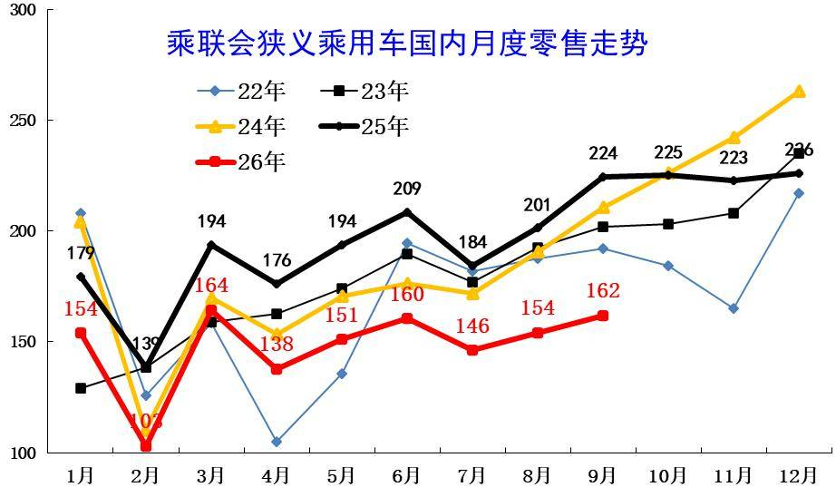

9月全国乘用车市场零售162万辆，环比增长表现较弱，脱离正常增长季节走势线路。9月持续低迷原因是多元的，首先是高油价的影响，其次是中秋假期影响，同比下滑是以旧换新的新政策规范性较强和乘用车补贴缩水，加之上游涨价的剧烈冲击，深层原因是消费能力和意愿偏低。

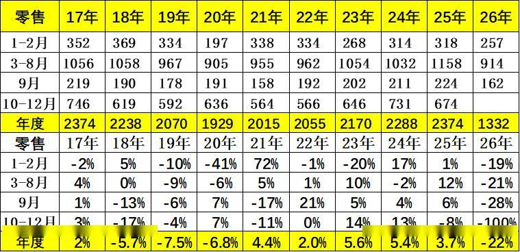

2026年9月全国乘用车市场零售161.8万辆，同比下降28.0%，环比增长5.0%；1–9月乘用车累计零售1,333.4万辆，同比下降21.7%。

2026年9月国内乘用车市场呈现总量持续承压、环比走弱、结构极致分化的运行态势，淡季下行特征凸显，行业结构性调整进一步深化。

2.近年狭义乘用车批发走势

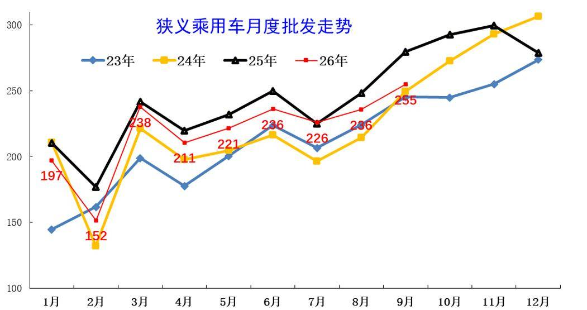

9月全国乘用车厂商批发255万辆，较同期下滑较大。历年9月的走势相对较强，今年国内低迷但出口高增长，因此总体回归平稳。由于出口超强，国内批发少，去库存效果好，渠道压力明显改善。

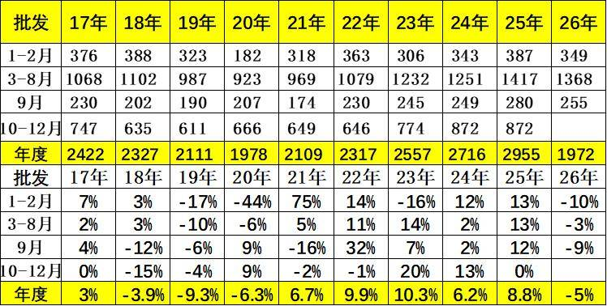

9月全国乘用车厂商批发254.9万辆，同比下降8.9%，环比增长8.1%；受出口暴增的促进激励，9月乘用车批发同比增速较零售增速高出19个百分点。

3.近年狭义乘用车生产走势

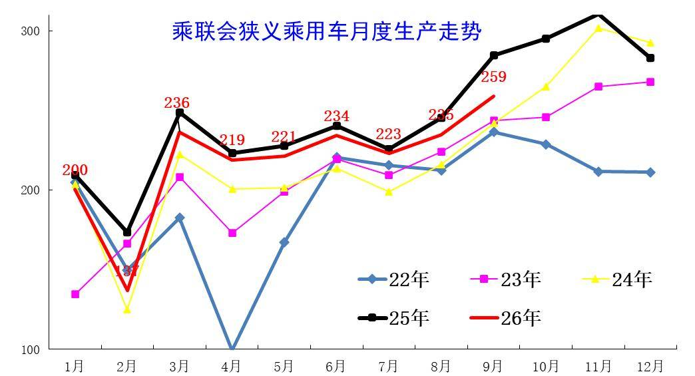

2026年乘用车生产减产力度较大。9月环比增长10.3%，走势较强。出口持续走强，导致9月生产相对创年内新高，但同比走势下滑巨大。

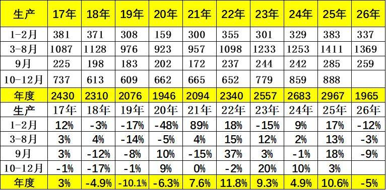

9月乘用车生产259.0万辆，同比下降9.1%，2026年累计下降5%，内需影响较大。

4.近年狭义乘用车出口走势

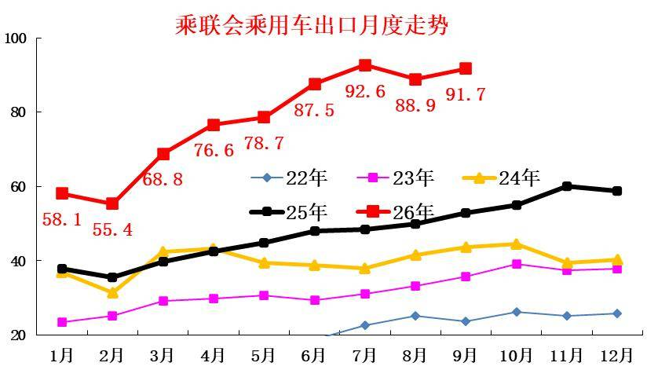

9月出口环比8月小幅回升，但连续两个月未突破7月峰值，高速环比上涨趋势改变，市场逐步进入平稳期。

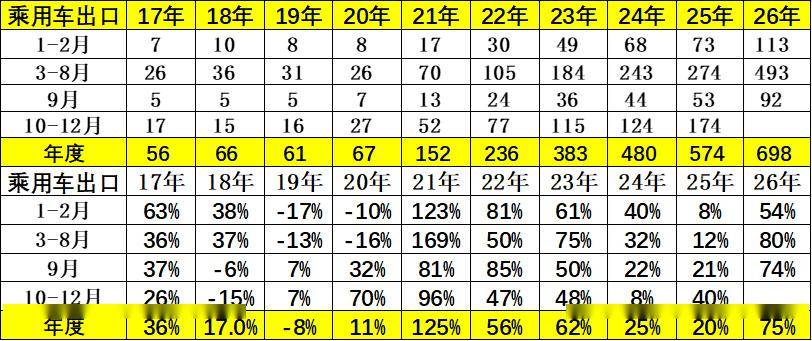

9月乘用车出口（含整车与CKD）91.7万辆，同比增长73.7%，环比增长3.2%，占乘用车厂商销量36%（上月38%，2025年同期19%）。9月新能源车占出口总量的60.8%，较同期大幅增加21个百分点。

5.产销库存月度变化特征

由于9月国内零售市场运行压力较大，9月厂商批发低于生产4.1万辆，而厂商月度国内批发高于国内零售1.4万辆。今年去库存特征突出，1-9月总体乘用车行业库存下降68万辆（2025年同期下降25万辆、2024年同期下降88万辆、2023年同期下降13万辆）。

6.狭义乘用车各级别增长特征

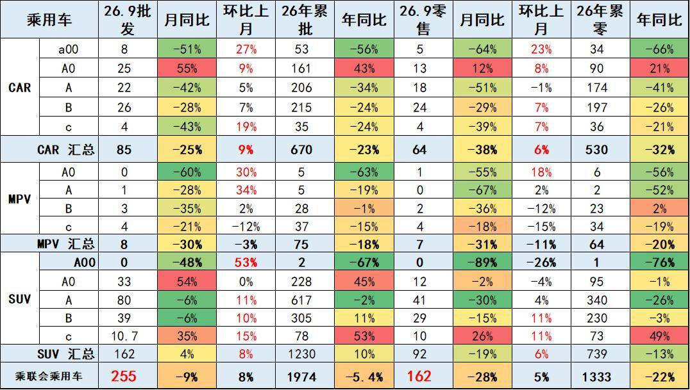

2026年9月乘用车零售降28%，批发下降9%，零售大幅弱于的批发增速,形成内冷外热格局。

入门级消费受冲击大。由于高油价冲击和补贴暂停带来零售回落，9月A级轿车零售与A00级轿车零售均较低，A0级轿车和高端车型成为9月零售主力，SUV的高端表现较强，轿车中主要是A0级轿车销量回升。

7.狭义乘用车国别增长特征

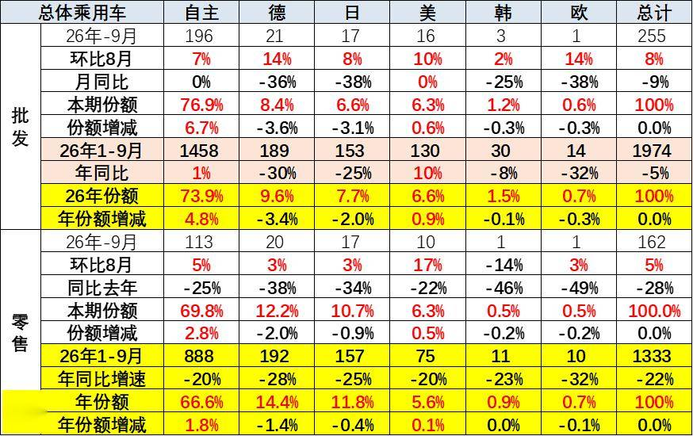

9月自主品牌零售113万辆，同比下降25%，环比增长5%。当月自主品牌国内零售份额为69.8%，同比增长2.8个百分点。总体上自主品牌在新能源市场和出口市场表现较平稳。

9月主流合资品牌零售31万辆，同比下降36%，环比增长2%。9月德系品牌零售份额12.2%，同比下降2.0个百分点；日系品牌零售份额10.7%，同比下降0.9个百分点；美系品牌市场零售份额6.3%，同比增长0.5个百分点。低销量合资车企逐步恢复活力。

8.2026年品牌产销特征

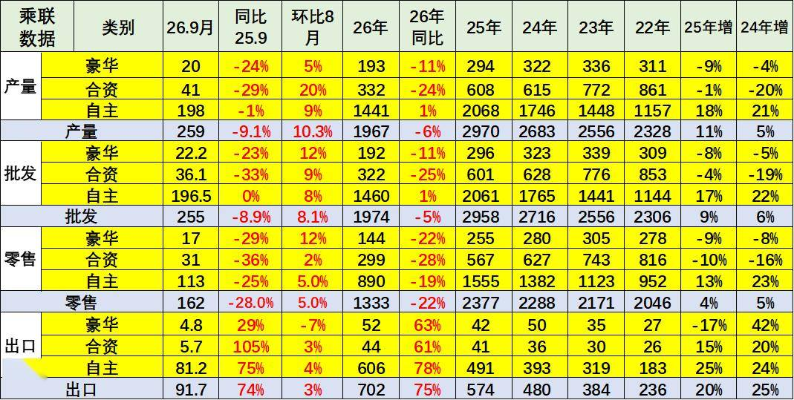

原有的品牌价值体系变化，豪华品牌近期持续压力加大，合资车企的产销走势压力持续较大，自主品牌产业链优势明显。

9月需求分化压力较大，燃油车市场环比走势较差，导致合资品牌走势恶化。自主靠新能源和出口相对表现较好。

10.全国新能源渗透率-批发

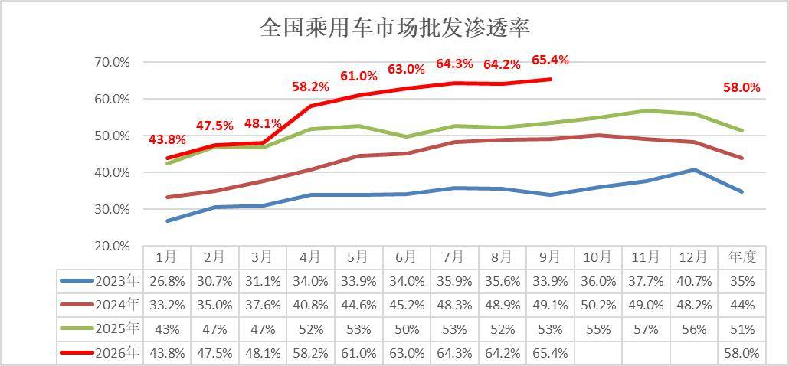

9月新能源车厂商批发渗透率65.4%，较2025年9月提升12个百分点。

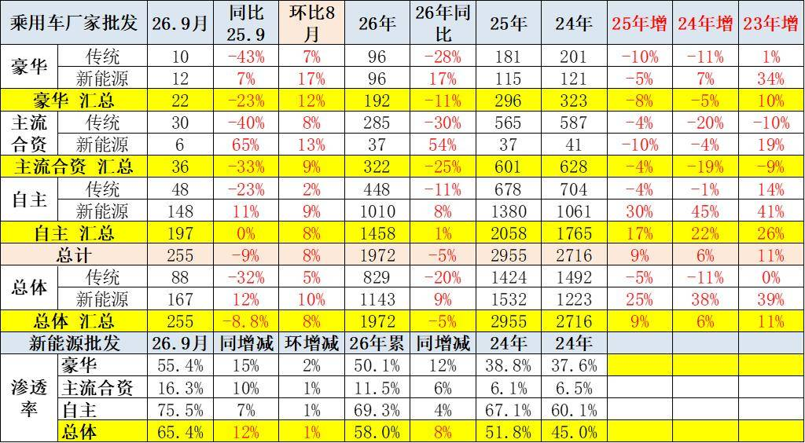

9月自主品牌新能源车渗透率75.5%；豪华车中的新能源车渗透率55.4%；主流合资品牌新能源车渗透率上升到16.3%。

9月传统车厂家批发同比降32%，而新能源车同比增12%，增速差距44个百分点，燃油车的市场持续低迷，新能源出口的贡献度大。

11.全国新能源渗透率-零售

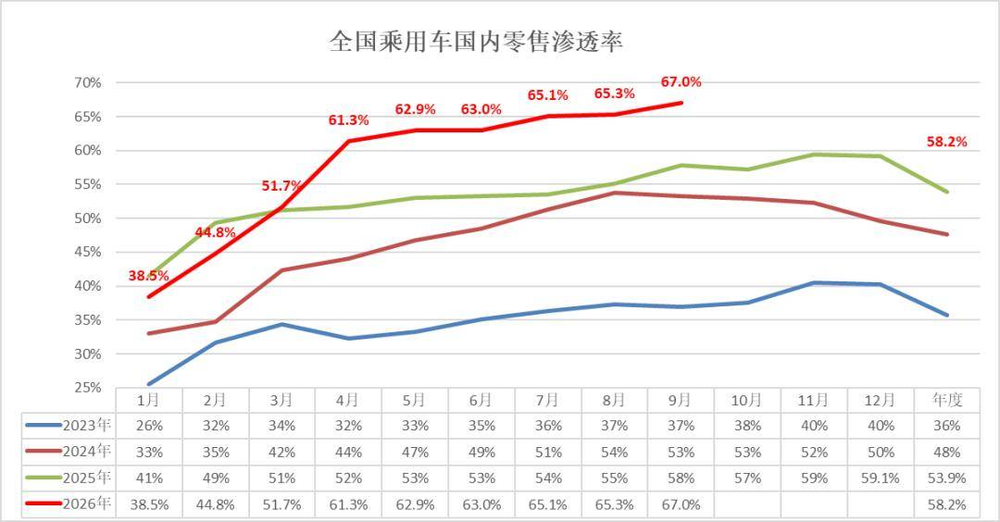

9月新能源车在国内总体乘用车的零售渗透率67.0%，较去年同期增长9.1个百分点，环比增长1.7个百分点。

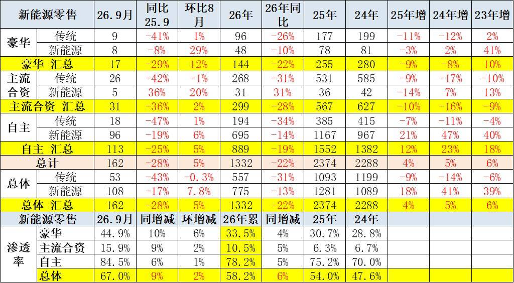

9月国内零售，自主品牌中的新能源车渗透率84.5%；豪华车中的新能源车渗透率44.9%；而主流合资品牌中的新能源车渗透率仅上升到15.9%。

附：近日信息合集
