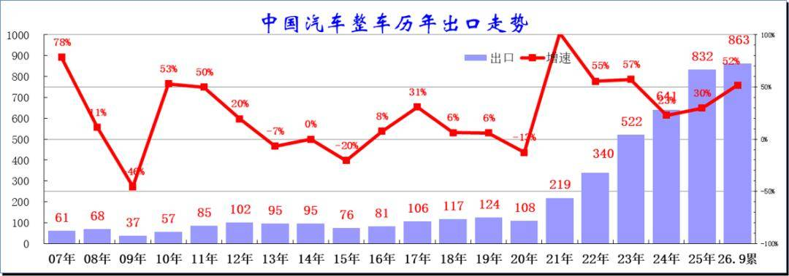
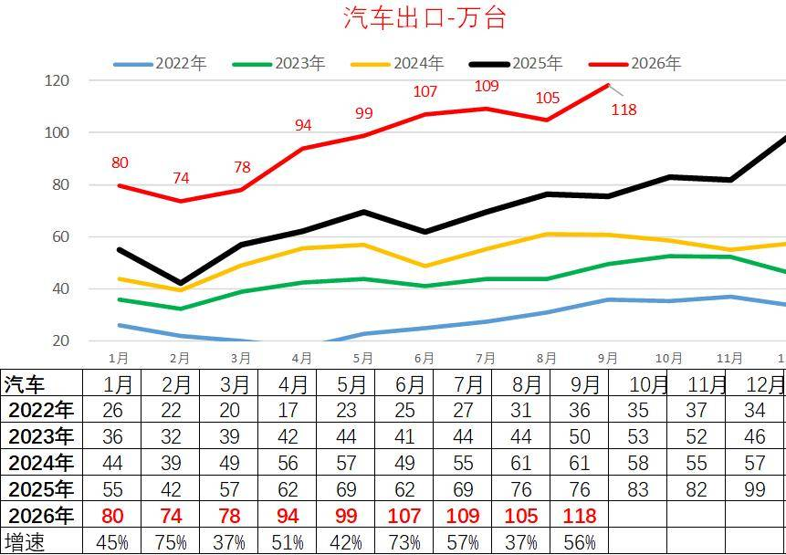
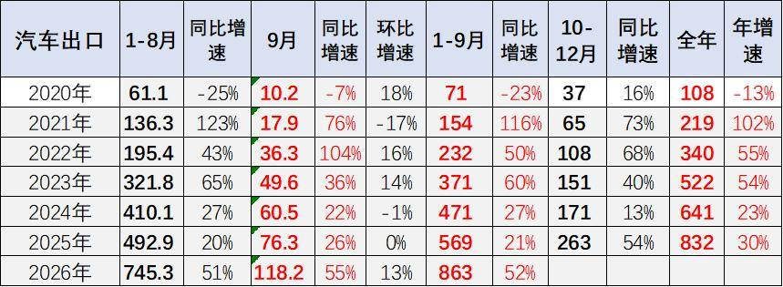
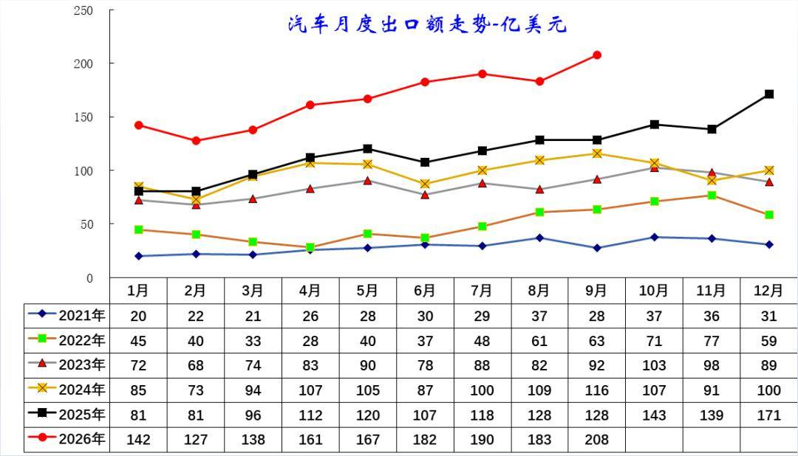
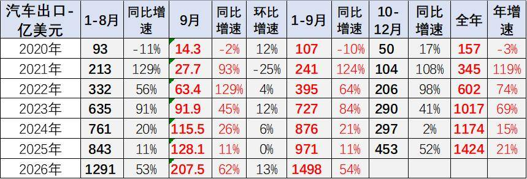
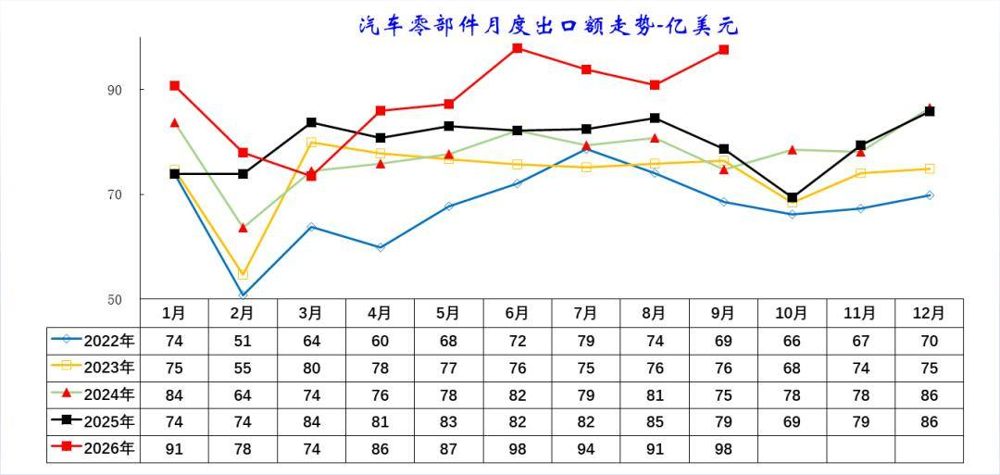
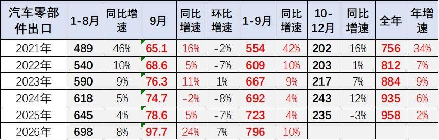

# 1-9月中国汽车出口863万台增52%，出口额1498亿美元增54%

- 公開日時: 2026-10-15 13:37（北京時間）
- 出典: [搜狐号・崔东树](https://www.sohu.com/a/1088234745_115312)
- テーマ（自動判定）: 輸出
- 画像: 7枚

---

注：本分析文章仅代表崔东树个人观点，如有异议，请留言。

2026年我国汽车出口迎来爆发式增长。2026年1-9月汽车出口863万台，同比大增52%，已经超越2025年全年出口整车规模。其中9月出口118.2万台，同比增速55%，环比大幅上升13%，增长爆发力突出。2026年1-9月汽车出口总额1498亿美元，同比大幅增长54%，增长力度重回高位。9月汽车整车出口208亿美元，同比增62%，环比正增长13%，打破2023-2025年9月季度末偏弱的规律。

2026年1-9月零部件出口总额796亿美元，同比增长10%，增速较2025年同期小幅回升。9月汽车零部件单月出口97.7亿美元，同比增24%，环比增7%，7-8月回落后的9月走势回升较大。

此次国家计划对新能源车出口退税下调，属于产业成熟后的政策回归中性，从2027 年4 月起，增值税退税率由13% 降到9%，留有半年多缓冲期。今年汽车出口将突破2000亿美元的规模，新能源汽车出口也会突破1100亿美元，退税的规模较大。本次出口退税下调属于温和下调，政策信息导向是不能依靠税收补贴打价格战，中国新能源车已经实现了技术和产业链的全面领先，要引导车企转向品牌建设、本地化运营，遏制海外市场恶性低价竞争，退税调整不是要压制新能源车出口总量。

1、中国汽车出口爆发增长

2026年1-9月汽车出口持续走高，月度数值从1月80万台升至9月118万台，仅8月小幅回调，整体增长动能强劲。

对比往年同期，2026年各月出口量全面大幅超越2022-2025年同期，单月增速均超35%，9月同比增速达56%，1-9月累计出口863万台，同比增幅52%。

海外市场需求持续释放，国产汽车出海竞争力稳步提升，4月以来的汽车出口规模、增速均创历年同期新高。

2026年我国汽车出口迎来爆发式增长。2026年1-9月汽车出口863万台，同比大增52%，大幅甩开往年同期水平。其中9月出口118.2万台，同比增速55%，环比大幅上升13%，增长爆发力突出。

复盘2019-2025年走势：2021年迎来出海爆发，后续增速逐年放缓；在历年9月环比走势基本持平的情况下，2026年9月实现环比13%正增长，国内与海外需求互补性显著增强。

2、中国汽车出口额持续提升

2026年1-9月汽车出口额持续强势走高，单月金额从1月142亿美元升至9月208亿美元，仅8月环比小幅回落，各月数值大幅领先2022-2025年同期。

对比历年，2022年出口额基数最低、全年波动平缓；2023-2025年稳步抬升，但单月峰值均低于2026年上半年水平。

出口额增速显著高于出口量增速，反映单车出口均价持续上行，新能源、高端车型占比提升，汽车出海从规模扩张转向价值提升。

2026年1-9月汽车出口总额1498亿美元，同比大幅增长54%，增长力度重回高位。9月汽车整车出口208亿美元，同比增62%，环比正增长13%，打破2023-2025年9月季度末偏弱的规律。

3、汽车零部件出口走势

2026年零部件出口额走势强劲，1月91亿美元、9月冲高至98亿美元，但2-3月和7-8月均持续小幅回调，4-9月各月数值全面高于2022-2025年同期。

往年规律为8月出口额全年高位，2026年8月91亿美元，显著低于6月，9月回升明显。2022-2025年月度规模常年维持50-80亿美元区间，2026年6-9月突破区间上限。

整车出口带动配套零部件外需提升，新能源配套零部件海外需求放量，支撑零部件出口持续走高。

2026年1-9月零部件出口总额796亿美元，同比增长10%，增速较2025年同期小幅回升。9月汽车零部件单月出口97.7亿美元，同比增24%，环比增7%，7-8月回落后的9月走势回升较大。

2022-2025年零部件出口增速持续低位徘徊，2025年6-9月同比微增长，景气度偏弱。2026 年随整车出口大幅放量，配套零部件外需同步回暖，6-9月产销配套订单集中释放，月度出口规模创近年同期新高。

作为整车出口的重要支撑，零部件出口的稳定增长，为我国汽车产业全球化布局筑牢了供应链基础，也为后续整车出海提供了持续的配套保障。

附：近日信息合集
