# 2026年9月汽车细分市场走势和厂家竞争表现分析

- 公開日時: 2026-10-16 11:39（北京時間）
- 出典: [搜狐号・崔东树](https://www.sohu.com/a/1088496431_115312)
- テーマ（自動判定）: セグメント・車種
- 画像: 17枚

---

注：本分析文章仅代表崔东树个人观点，如有异议，请留言。

9月车市最突出的特征是内外分化，内需低迷出口暴增。国内“旺季不旺”，传统“金九”成色严重不足。往年“金九”是大盘普涨、首购换购一起释放，今年则是存量博弈下的此消彼长，燃油车需求持续剧烈萎缩。9月成为本轮车市零售降幅异常突出的月份，多重因素叠加所致：一是中秋假期提前到9月下旬，中秋当周销量明显走弱；二是去年9月部分省份补贴退出，催生集中抢补贴行情，形成较高对比基数；三是高油价持续抑制燃油车消费：9月末以来年内汽油累计上调2,375元/吨，燃油车消费意愿持续走低，而新能源零售渗透率已攀升至67%的高位，“油电替代”加速推进；四是受AI驱动的内存与芯片价格暴涨及供给紧张等因素导致近期新能源新品增量偏慢等，这是多重因素共同影响的结果。

1、2026年汽车市场总体平稳

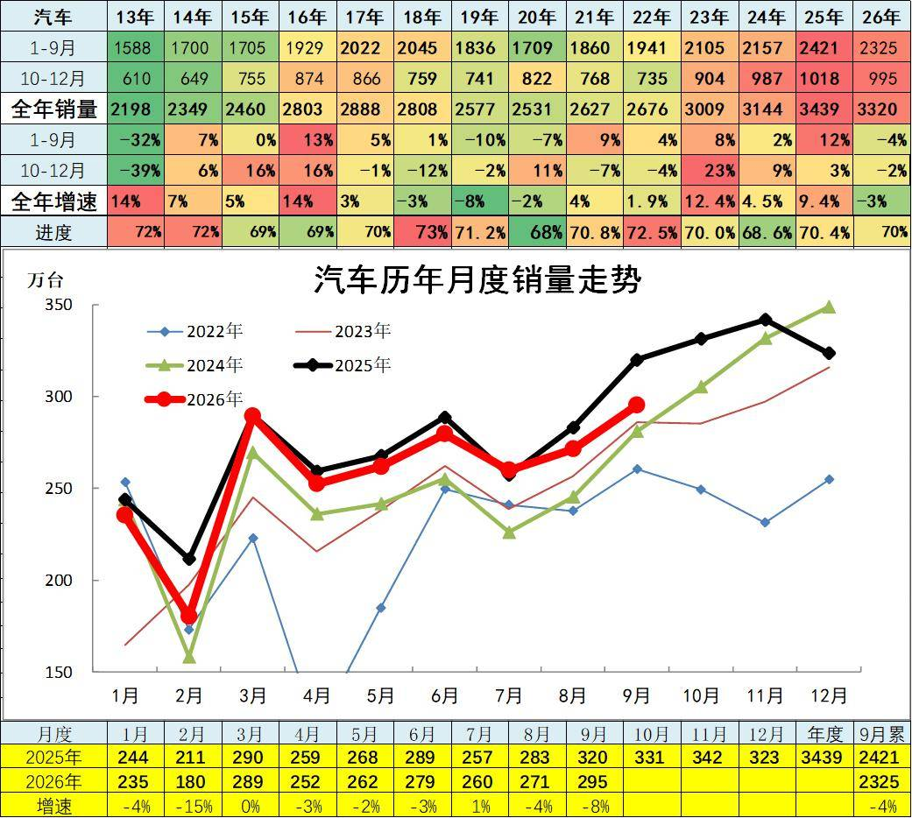

2026年9月汽车总计销量295万台，同比下降8%；2026年1-9月汽车总计销量2325万台，累计下降4%。2026年卡车和客车市场较强，乘用车市场表现稍弱，加之出口强、国内弱，最终总体厂家销量走势相对平稳。

2026年汽车集团的表现剧烈分化，比亚迪等企业快速恢复，实现回升到第一；上汽压力巨大；吉利、奇瑞等企业总体仍保持较强走势。

2、出口占总销量的比重

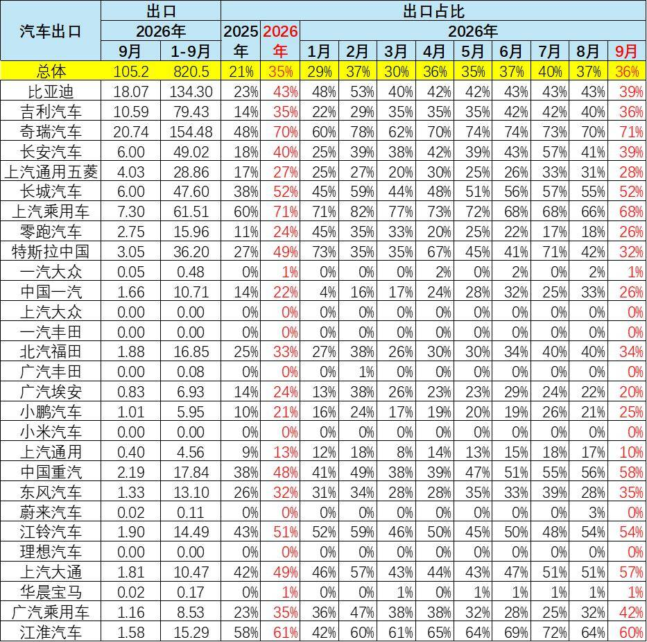

中国汽车出口近几年爆发增长，2026年9月达到出口占总量的36%的比例，较2025年的21%大幅提升，实现出口支撑中国汽车规模增长的重要组成。

3、主力车企集团的表现分化剧烈

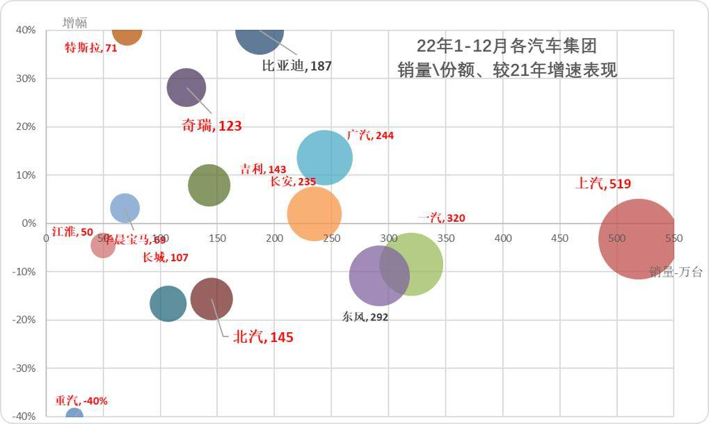

对比上面2021年图表，2022年的部分车企强势表现，行业增速分化严重。2022年年初的疫情导致传统车企压力较大，尤其新能源冲击叠加疫情影响，国有大集团表现分化，广汽和奇瑞表现优秀，其中奇瑞的商用车和乘用车版块表现均很好。北方的一汽、长城、北汽等各家表现都有压力。

2023年初新能源推动车市走势分化。央企三强总体分化，部分国企掉队。比亚迪等新能源企业的表现很好；奇瑞、特斯拉今年的表现相对较强。二线车企表现分化，因为新旧动能转换和新能源车持续亏损压力，自主品牌中小企业分化严重低迷。

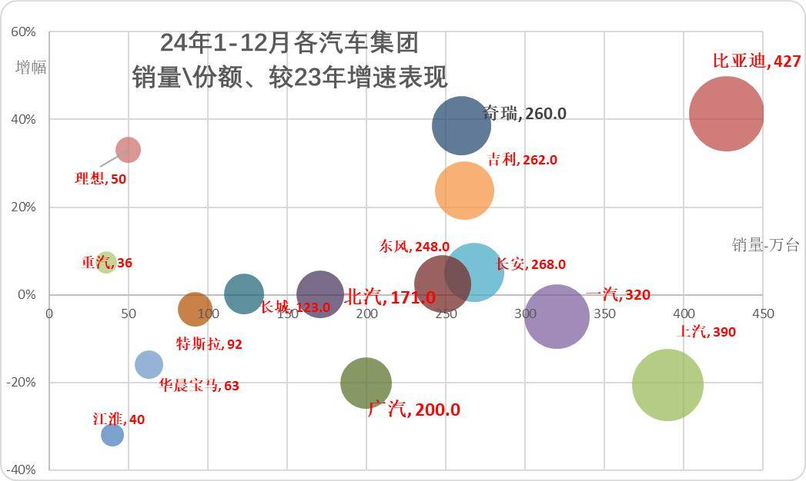

2024年的汽车集团的阵容格局全面变化，比亚迪新品降价增量，由于乘用车销售需求火爆和海外贡献，因此奇瑞、吉利和东风表现的很好，上汽仍处于剧烈下滑中。新能源车的比亚迪和特斯拉增速分化。

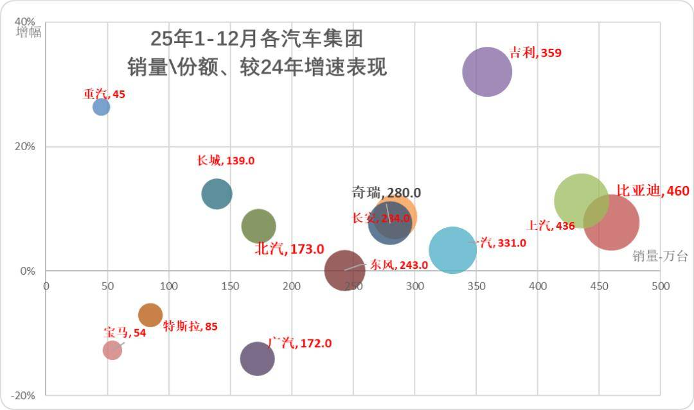

汽车市场的厂家格局巨变，行业呈现增速剧烈的分化，2025年开始的民营企业替代国企成为行业主力，吉利、比亚迪、奇瑞、长城增速保持较高水平。

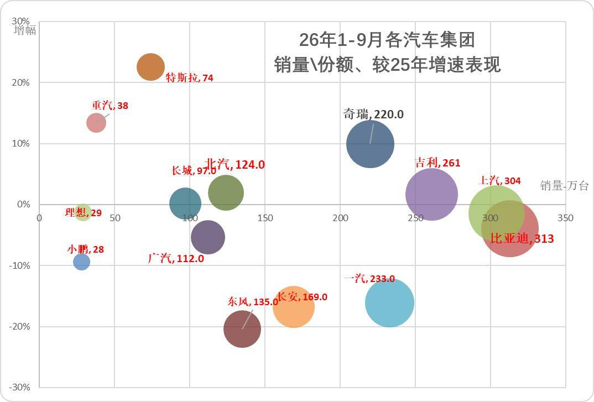

2026年销量领先是各国有企业的奋斗重点，虽然市场严峻低迷，但比亚迪回归第一。上汽和吉利、奇瑞、北汽等今年1-9月表现较强，增速改善。长城、特斯拉等总体表现优秀。

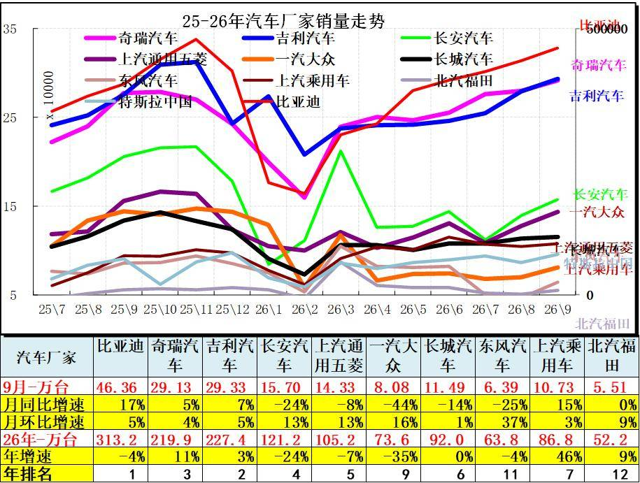

2026年汽车厂家格局相对稳定，自主地位大幅提升。9月厂家销量总体较好，但市场零售低迷拖累乘用车厂家表现。东风等部分厂家环比8月走势很强，比亚迪等同比走强。自主的强势出口企业表现优秀，有合资的集团压力巨大。

4、狭义乘用车企业产销走势

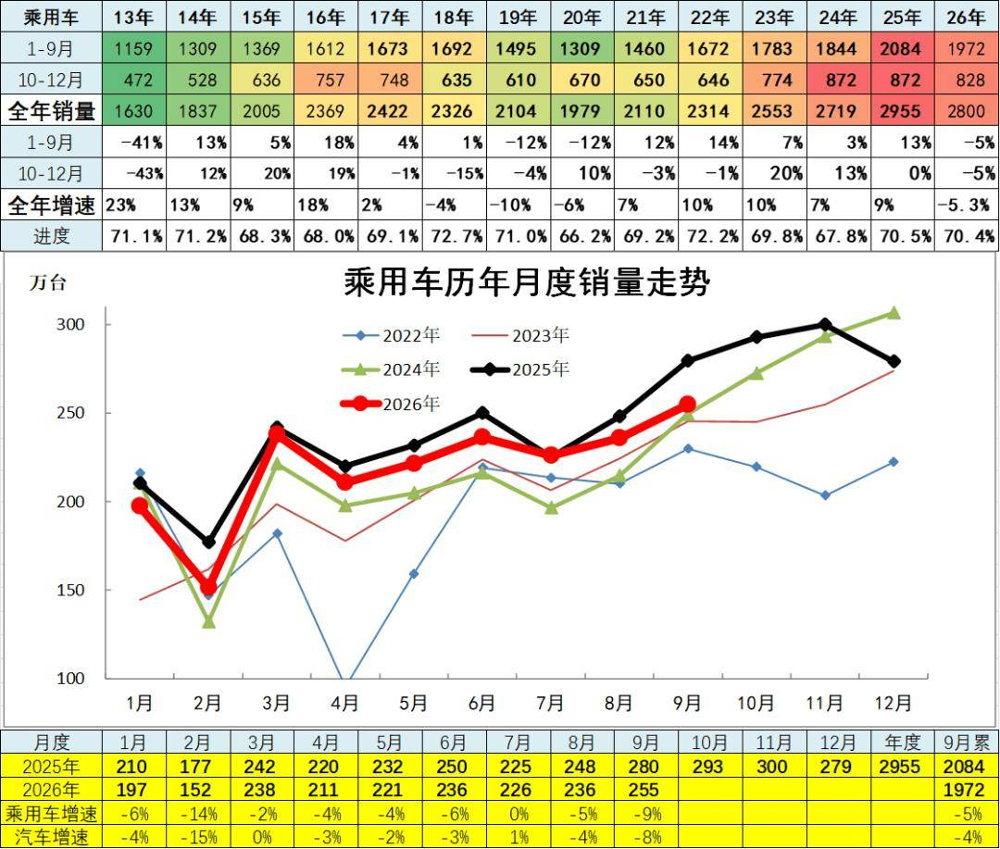

2026年9月狭义乘用车合计销量255万台，同比下降9%；2026年1-9月狭义乘用车合计销量1972万台，同比下降5%。近几年新能源车技术创新、新品竞争力不断增长，燃油车新品推出乏力。2026年年初的新能源车处于调整期， 经销商信心不足，高油价压低增速。

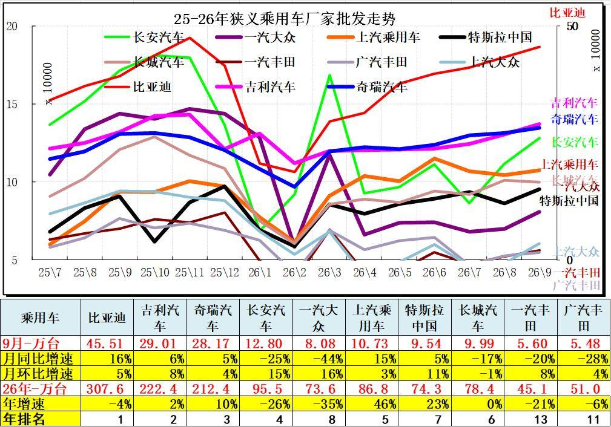

2026年乘用车自主车企全面领先。9月主力车企总体较弱，自主超强。由于高油价，合资车企9月走势较弱。比亚迪领军，吉利汽车第2名， 9月奇瑞汽车保持前3，前三的规模日益接近。合资的一汽大众和上汽大众等表现较低迷。

乘用车主力厂家阵营迅速分化，出口为主的企业和新能源车为主的厂家表现较强，合资表现分化尤为明显，一汽大众较强。

5、新能源乘用车企业产销走势

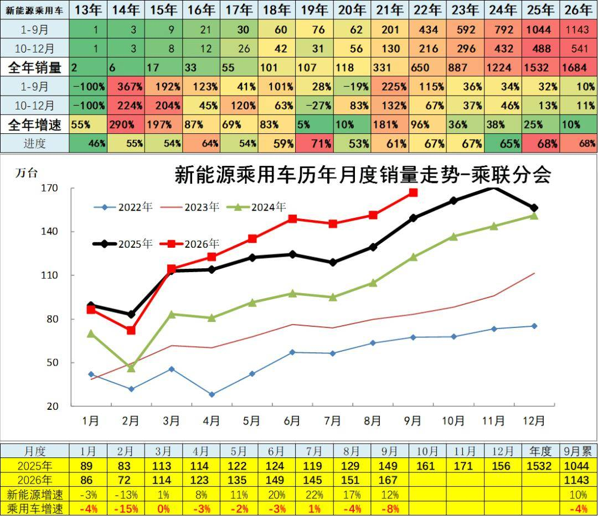

2026年9月新能源乘用车厂家销量合计167万台，同比增12%；2026年1-9月新能源乘用车厂家销量合计1143万台，同比增10%。2026年年初报废更新补贴压力大、油价暴涨、消费低迷、新能源车需求弱，2026年的新能源国内走势面临需求低迷的压力较大。

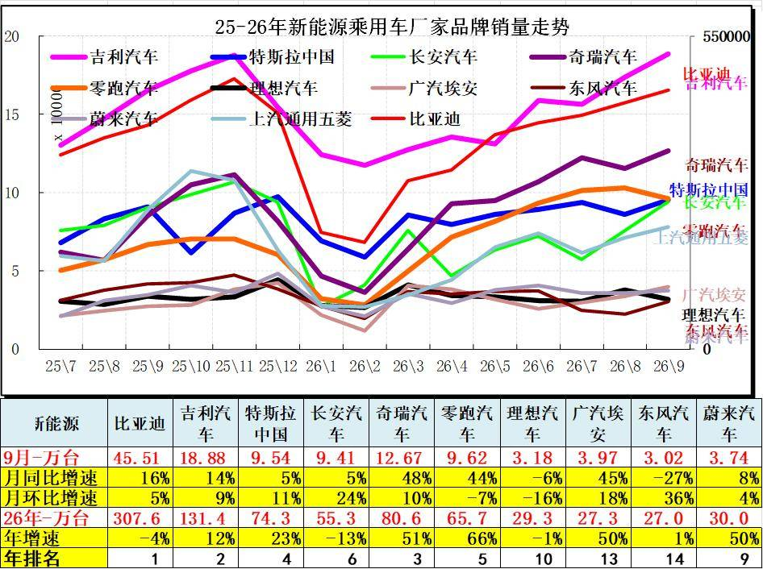

2026年比亚迪保持第一，但插混增长压力较大。奇瑞、零跑等新能源增长较强。

6、传统动力乘用车企业产销走势

2025年传统燃油狭义乘用车销量1422万台，同比下降5%，2026年1-9月829万台降20%。随着油价高企，2026年国内燃油车市场走势持续较弱。

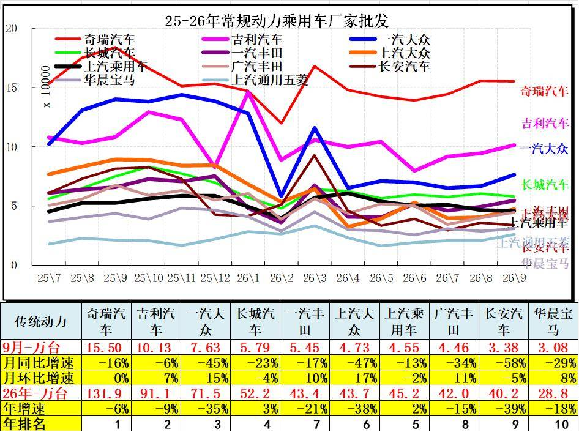

由于出口的支撑，2026年燃油车总体表现分化，自主表现超强，主力合资车企短期内迅速弱化。

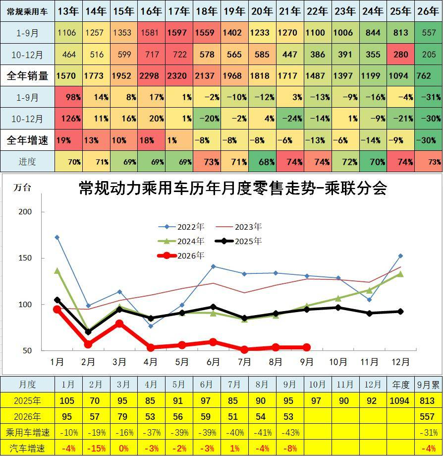

国内2026年燃油车总体表现严重低迷，3季度连续3个月是下滑40%以上，市场压力大。

7、客车企业产销分类走势

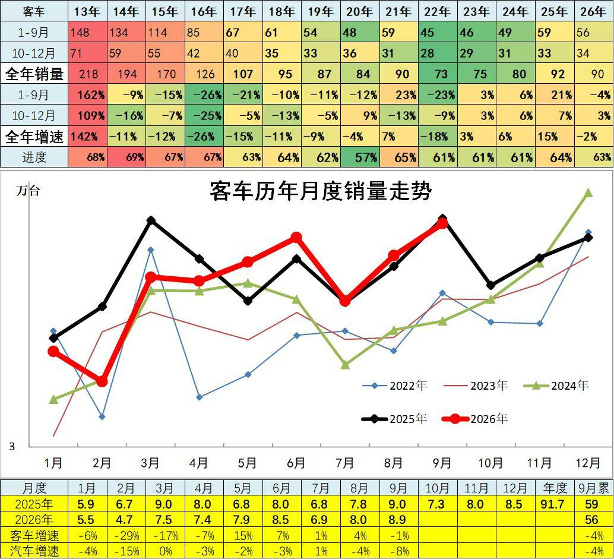

2025年全年累计客车合计销量92万台，累计增速15%；2026年1-9月客车合计销量56万台，同比降4%，出口和新能源物流车的拉动效果一般。

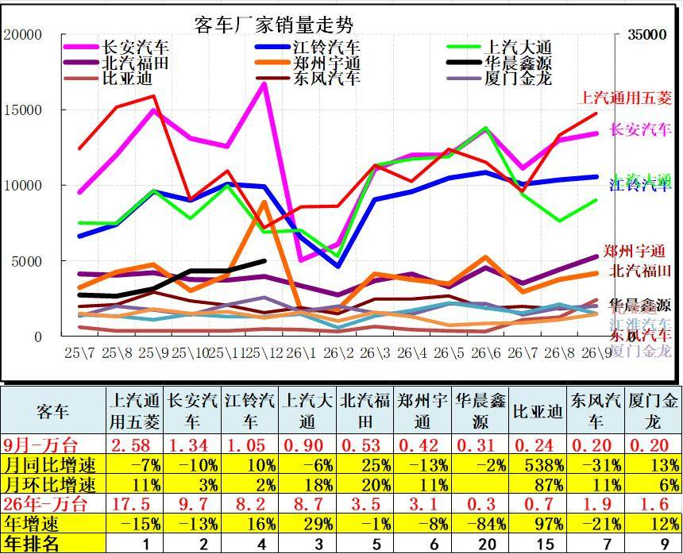

在2025年年底冲刺后，2026年客车走势逐步走强，上汽通用五菱表现很强，上汽大通等头部厂家近几个月销量总体较强，物流类轻客和微客的市场需求波动较大，出口贡献巨大。2026年江铃汽车、上汽大通的商用车走势较好，9月五菱、长安、江铃等物流车企业环比回升较大。

8、卡车企业产销分类走势

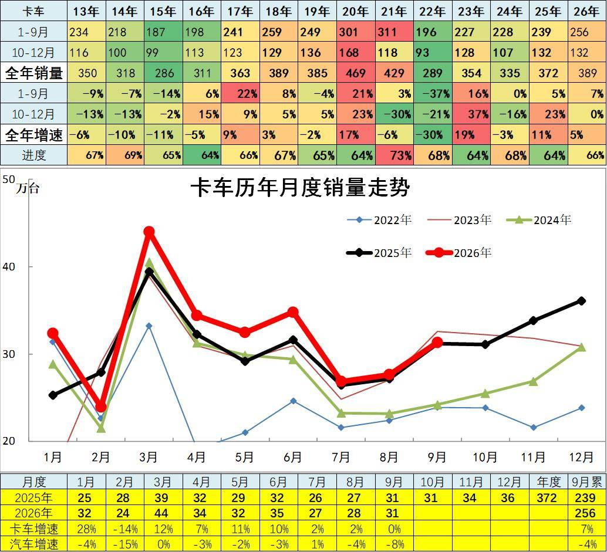

2025年卡车销量372万台，累计增速11%；2026年1-9月卡车销量256万台，同比增长7%，形成消费与生产分化，消费暴跌、生产超强增长态势。

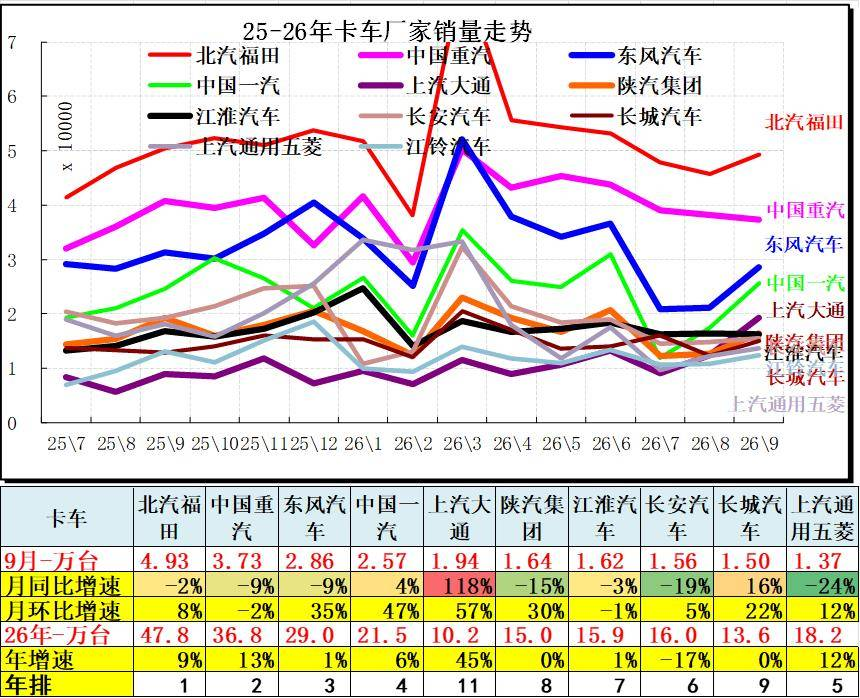

2026年的卡车主力厂家分化较明显，卡车头部厂家表现较强，大通、长城等车企同比去年9月暴增，陕汽、五菱等表现较差。

商用车补贴效果突出，2026年的重卡暴增，纯电动重卡表现很强，重汽、一汽、陕汽和的增长较强，行业格局相对稳定。

附：近日信息合集
