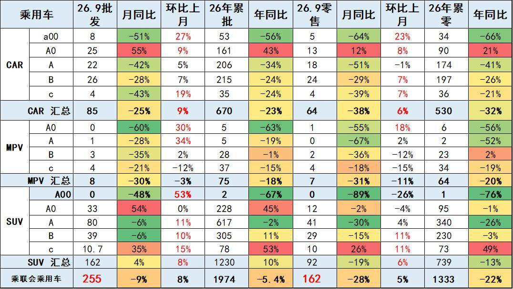
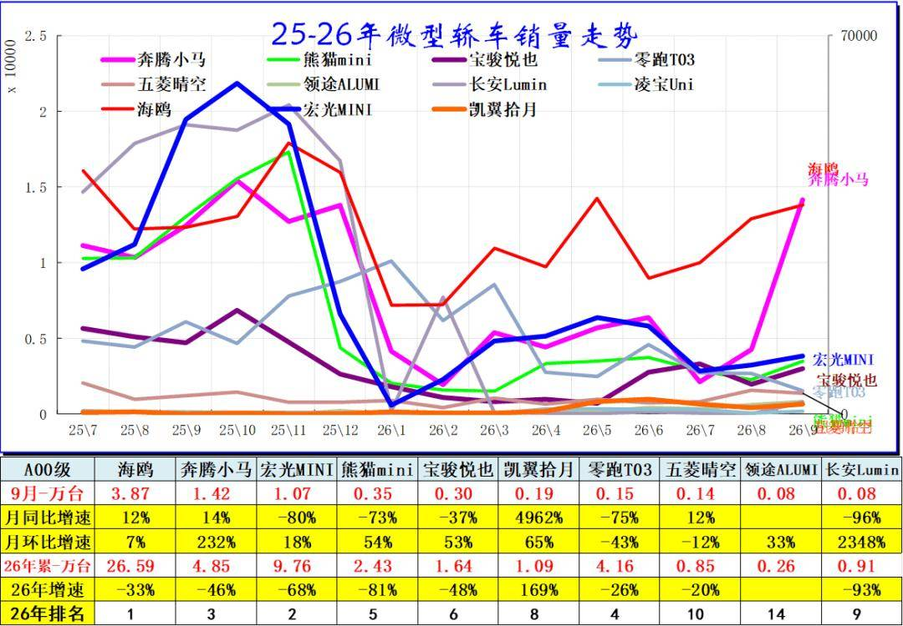
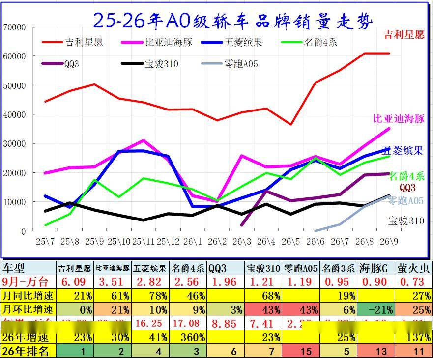
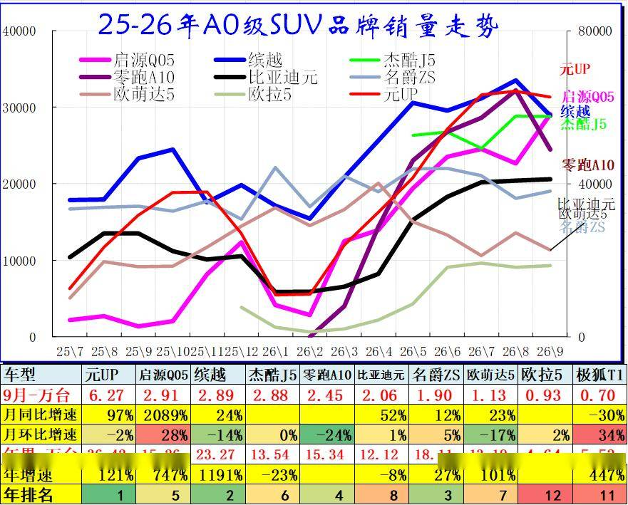
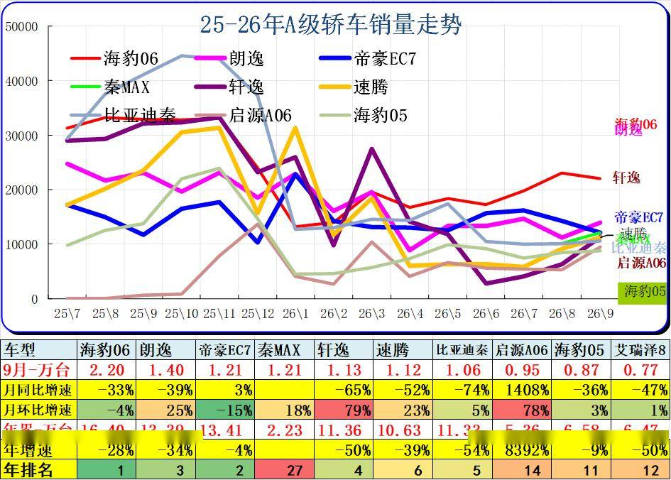
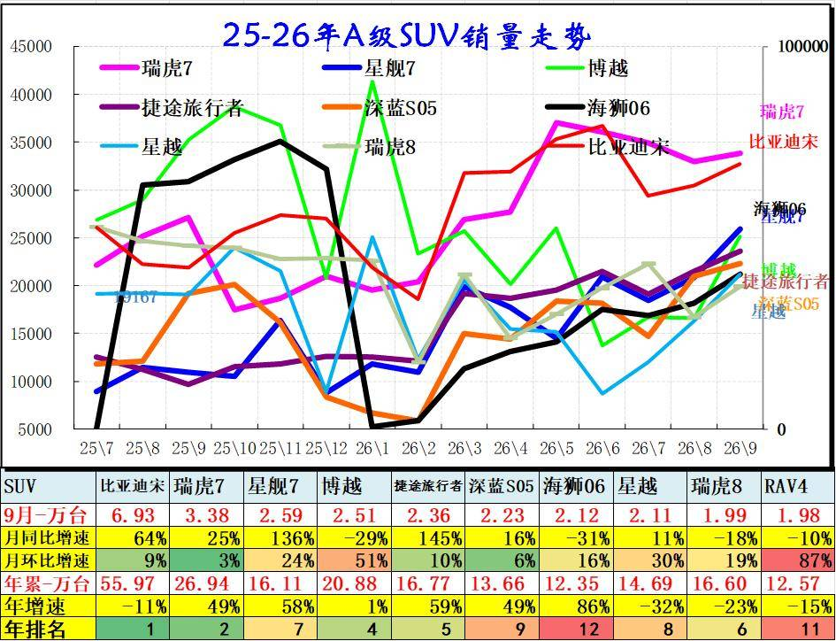
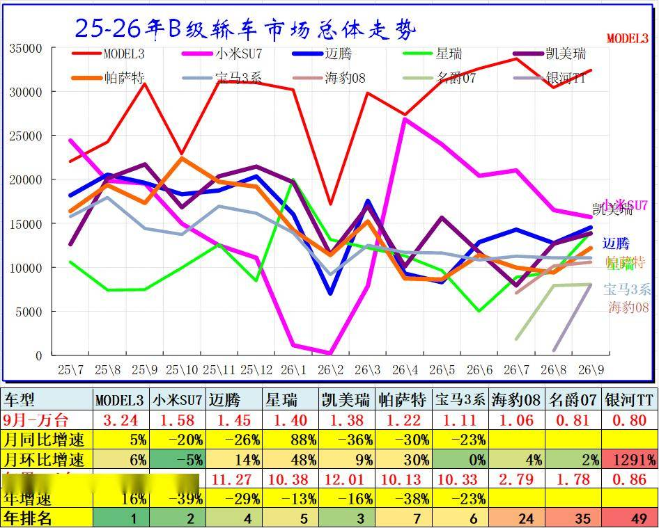
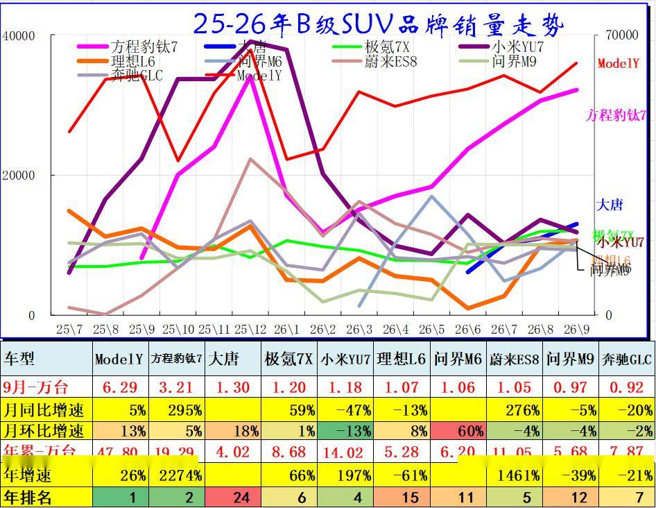
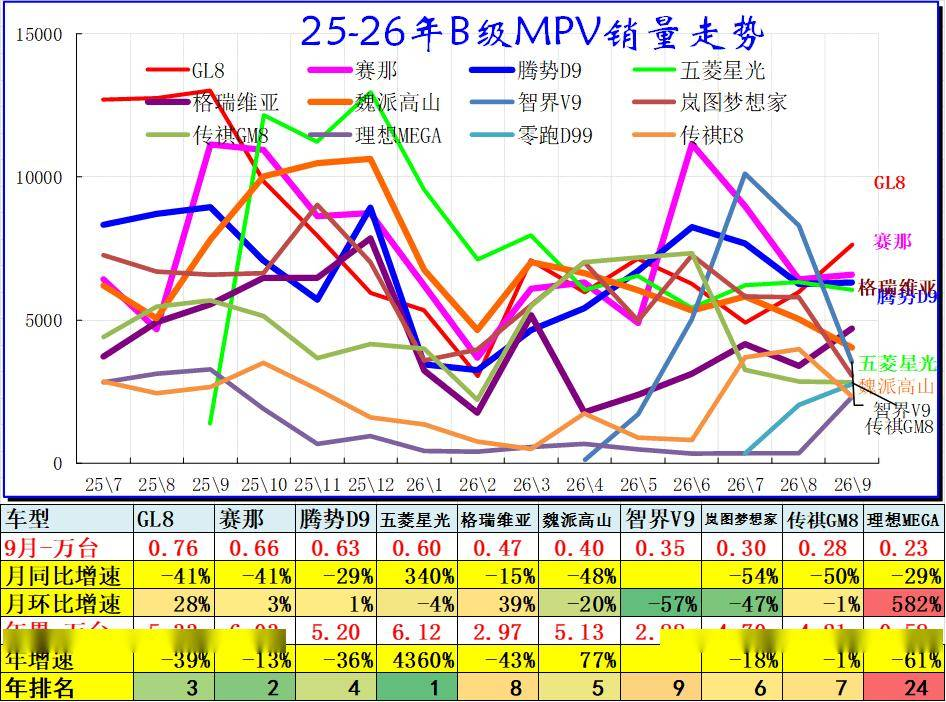

# 2026年9月乘用车细分市场车型走势

- 公開日時: 2026-10-20 15:03（北京時間）
- 出典: [搜狐号・崔东树](https://www.sohu.com/a/1090176584_115312)
- テーマ（自動判定）: セグメント・車種
- 画像: 9枚

---

注：本分析文章仅代表崔东树个人观点，如有异议，请留言。

当前国内车市存量竞争特征凸显，出口需求暴增，行业内部分化持续加剧。新能源市场告别全域增长，呈现“高端电动车爆发、微型电动车车型承压”的两极分化态势，县乡市场、入门级车型下滑过大。同时“新车效应”短期化，对市场拉动效力大幅减弱。渠道端压力持续凸显，行业被动去库存节奏加快，经销商普遍亏损、经营风险攀升。整体而言，9月车市环比走强仅为结构性修复，电动化迭代与海外出口已成为行业长期增长的核心支撑。

2026年9月乘用车零售降28%，批发下降9%，零售大幅弱于的批发增速,形成内冷外热格局。

入门级消费受冲击大。由于高油价冲击和补贴暂停带来零售回落，9月A级轿车零售与A00级轿车零售均较低，A0级轿车和高端车型成为9月零售主力，SUV的高端表现较强，轿车中主要是A0级轿车销量回升。

分结构看，大尺寸、高端的A0、B、C 级SUV 批发端增长突出，而传统轿车以及微型、小型MPV 需求走弱，反映消费向中大尺寸SUV 倾斜，批发与零售走势出现背离，渠道库存压力有所加大。

入门消费受冲击大。由于高油价冲击和补贴暂停带来零售回落，9月A级轿车零售与A00级轿车零售均较低，A0级轿车和高端车型成为9月零售主力，SUV的高端表现较强，轿车中主要是A0级轿车销量回升。

一、经济型乘用车市场走势

1、A00级轿车市场表现

2025‑2026年国内微型轿车市场销量走势，市场格局发生明显洗牌。比亚迪海鸥稳居榜首，虽整体下行，仍是微型轿车的销量支柱。曾经的爆款宏光MINI 大幅萎缩，2026 年下降68%，市场热度大幅退潮。奔腾小马、零跑T03依托出口分列三、四名，凯翼拾月实现高速增长，部分新兴车型凭借产品定位抢占份额。

多数传统微型小车出现两位数以上负增长，熊猫mini、宏光mini跌幅显著。从曲线看，2025 年多款车型冲高后，2026 年初普遍遭遇销量跳水，只有少数出口车型实现逆势增长，反映微型电动车市场竞争加剧，消费者对续航、安全、品质要求提升，低价代步小车门槛提升，消费萎缩的压力。

2、A0级轿车主力车型市场走势

2025-2026年A0级轿车逆势爆发，9月批发25万辆，同比增55%，累计增43%，是唯一高增长细分市场。吉利星愿以6.09万辆断层领跑，比亚迪海豚、五菱缤果紧随，名爵4系增速达360%。零跑A05等新秀快速上量，传统燃油车宝骏310增长乏力。市场已由自主新能源绝对主导，头部集中度持续提升。

3、A0级SUV销量走势

2025-2026年A0级SUV市场强势爆发，9月多款车型同比翻倍增长。元UP以6.27万辆断层领跑，年增速121%；启源Q05累计15.26万辆，增速高达747%，排名第2。缤越累计23.27万辆居第2，名爵ZS增速27%排名升至第3。欧萌达5增速超100%，极狐T1增速447%。整体看，自主新能源主导格局强化，头部车型集中度显著提升。

二、A级乘用车市场走势

1、紧凑型轿车主力车型市场走势

2026年A级轿车市场整体承压，头部车型普遍下滑。海豹06以累计16.40万辆居首，但年增速下降28%；帝豪EC7、朗逸分列二三位，累计均超13万辆，但年增速分别为下降4%和下降34%。启源A06累计增速高达8392%，但基数较小。轩逸、速腾、比亚迪秦年增速均大幅下滑。市场缺乏强增长引擎，仅启源A06等少数新车型表现亮眼。

2、紧凑型SUV主力车型市场走势

2025-2026年A级SUV市场分化明显，新能源车型强势增长。比亚迪宋以累计55.97万辆稳居榜首，9月销6.93万辆，同比增64%；瑞虎7累计26.94万辆，增速49%，排名第2；星舰7增速58%，排名第7；捷途旅行者、深蓝S05增速分别为59%和49%，表现稳健；海狮06增速高达86%，排名升至第12。博越累计20.88万辆，但年增速仅1%，增长乏力；星越、RAV4年增速分别下滑32%和15%。整体看，自主新能源持续挤压合资燃油车份额，头部集中度进一步提升。

三、B 级乘用车市场走势

1、B级及C级轿车市场走势

2025-2026年B级轿车市场分化加剧，头部集中度提升。特斯拉Model 3以累计26.50万辆稳居榜首，年增速16%，是唯一正增长的头部车型。小米SU7累计13.38万辆排名第2，但年增速下降39%；迈腾、星瑞分列四五位，年增速均下滑。凯美瑞、帕萨特、宝马3系年增速分别下滑16%、38%、23%。海豹08累计2.79万辆，排名第24；银河TT增速高达1291%，但基数较小。整体看，B级轿车市场增长乏力，新能源与合资燃油车均面临较大压力。

2、B级SUV市场走势

2025-2026年B级SUV市场新能源主导特征突出，头部格局清晰。Model Y以累计47.80万辆断层领跑，年增速26%，稳居第一。方程豹钛7累计19.29万辆，增速高达2274%，排名第2；小米YU7累计14.02万辆，增速197%，排名第4。蔚来ES8增速1461%，极氪7X增速66%，表现亮眼。理想L6、问界M9年增速分别下滑61%、39%，增长乏力。大唐累计4.02万辆，排名第24；奔驰GLC年增速下滑21%，合资燃油车持续承压。整体看，B级SUV市场由新能源绝对主导，头部集中度进一步提升。

3、B级及以上MPV市场走势

2025-2026年B级MPV市场整体承压，头部车型普遍下滑。五菱星光累计6.12万辆排名第1，但年增速高达4360%，表现突出；赛那累计6.03万辆排名第2，年增速下滑13%；GL8累计5.33万辆排名第3，年增速下滑39%。腾势D9、魏派高山累计均超5万辆，但年增速分别下滑36%和增长77%。格瑞维亚、岚图梦想家、传祺GM8年增速均大幅下滑。智界V9累计2.88万辆，排名第9；理想MEGA累计0.58万辆，排名第24，但月环比增速高达582%。整体看，B级MPV市场增长乏力，新能源车型逐步渗透但尚未形成绝对主导。

附：近日信息合集
