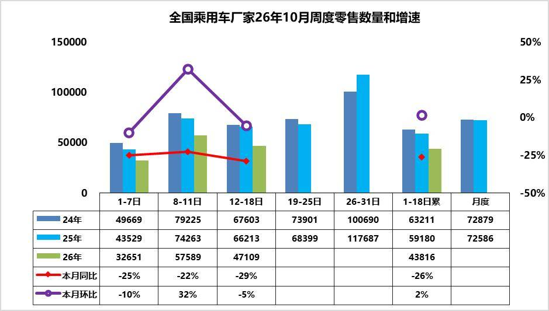
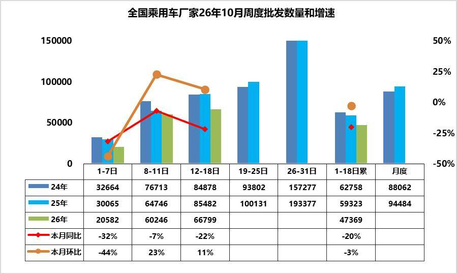
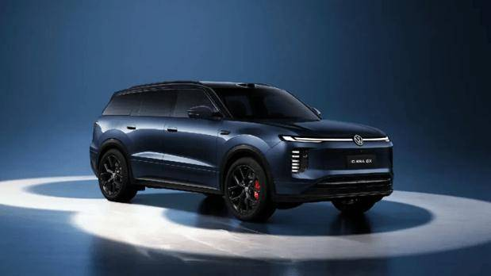
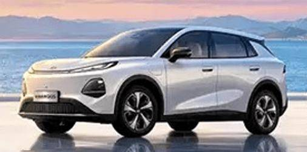
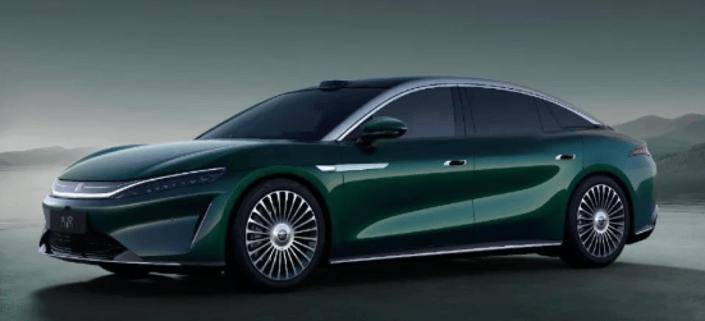
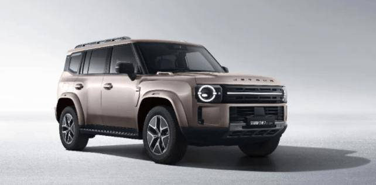
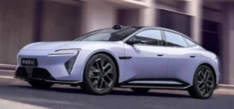
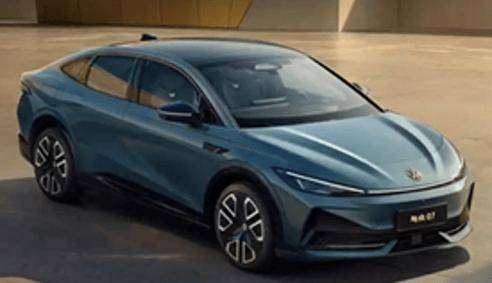
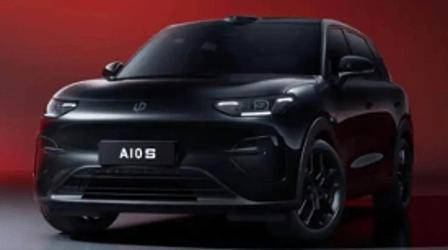

# 车市扫描-2026年40期（10月12日-10月18日）

- 公開日時: 2026-10-21 18:39（北京時間）
- 出典: [搜狐号・崔东树](https://www.sohu.com/a/1090800001_115312)
- テーマ（自動判定）: 車市スキャン（週次）
- 画像: 9枚

---

主要信息源自乘联分会每日新闻等

中国汽车流通协会

乘用车市场信息联席分会（乘联分会）

网站：http://www.cpcaauto.com

一、本周车市概述1.2026年10月全国乘用车市场零售相对平稳

【2026年10月1-18日乘联会市场分析要闻】

10月1-18日全国乘用车厂家批发85.3万辆，同比去年同期下降20%，较上月同期下降3%；今年以来乘用车累计批发2058.9万辆，同比去年同期下降6%。10月1-18日市场零售78.9万辆，同比去年同期下降26%，较上月同期增长2%；今年以来乘用车累计零售1412.3万辆，同比去年同期下降22%。

10月1-18日全国乘用车厂家新能源批发65.5万辆，同比去年同期增长5%，较上月同期增长1%；今年以来乘用车累计批发1210.4万辆，同比去年同期增长9%。10月1-18日新能源车市场零售52万辆，同比去年同期下降13%，较上月同期下降2%；今年以来乘用车累计零售827.8万辆，同比去年同期下降13%。

2026年10月1-18日全国新能源市场零售渗透率65.9%；新能源厂家批发渗透率76.8%。

10月第1-2周全国纯燃料轻型车生产15.3万辆，同比去年同期下降43%，较上月同期下降16%。10月第1-2周混合动力与插混总体生产15.2万辆，同比去年同期下降18%，较上月同期增长2%。

10月第1周乘用车市场日均零售3.3万辆，同比去年同期下降25%，较上月同期降10%。

10月第2周乘用车市场日均零售5.8万辆，同比去年同期下降22%，较上月同期增32%。

10月第3周乘用车市场日均零售4.7万辆，同比去年同期下降29%，较上月同期降5%。

10月1-18日市场零售78.9万辆，同比去年同期下降26%，较上月同期增长2%；今年以来乘用车累计零售1412.3万辆，同比去年同期下降22%。

由于中秋节在9月下旬，传统“金九银十”消费旺季中，10月的有效销售时间更长，终端客流小幅持续回暖。

国际高油价持续，用车成本处于高位，燃油车消费超预期低迷。消费端首购增量暂时受阻，置换存量成为稳增长的重要支撑。高端已经是红海，车市的机会是中低端的普及。由于北方和中西部的销售近期表现偏弱，10月回升的燃油车基础受损，10月开始的年末走强难度较大。

10月车市增长来自国庆车展、地方补贴、车企旺季促销等的推动，车市回升相对温和。近期行业舆情头部事件偏负面，或导致用户对于新能源整体产品信心出现新的犹疑观望，不利于在10月份促进成交。

2.2026年10月全国乘用车厂家销量平稳

10月第1周批发日均2.1万台，同比去年10月同期下降32%，环比上月同期下降44%。

10月第2周批发日均6.0万台，同比去年10月同期下降7%，环比上月同期增23%。

10月第3周批发日均6.7万台，同比去年10月同期下降22%，环比上月同期增11%。

10月1-18日全国乘用车厂家批发85.3万辆，同比去年同期下降20%，较上月同期下降3%；今年以来乘用车累计批发2058.9万辆，同比去年同期下降6%。

往年"金九银十"燃油车能分到的蛋糕，今年高油价下的油车需求会被进一步压缩。由于燃油车零售持续大幅度下降，10月的燃油车内需生产下降较大，因此厂家销量总体低迷，前三周燃油车厂家批发下降55%。新能源车大部分品牌目前缺乏热销车型，但厂家还要稳定的生产节奏，作为庞大的产业链体系，不可能按照订单简单的排产，还要考虑产销目标。近期碳酸锂价格回落巨大，有利于电池端的价格下降，加之新能源车出口退税的调整，有利于改善新能源车产销。

3.2026年9月汽车增加值6.7%、汽车生产降6%，消费降21%，新能源汽车渗透率61%

今年前三季度经济运行总体平稳　高质量发展取得新成效，我国消费市场发展质量不断提升，消费新业态新模式活力迸发，在国际高油价冲击下，传统汽车消费压力较大。

2026年1—9月份，汽车行业固定资产投资同比下降6.3%，仍高于-7.2%的各行业平均水平。2026年1-9月，汽车行业产能利用率为69%，同比去年下降4.2个百分点。2026年3季度，汽车行业产能利用率为66.2%，同比去年下降7.1个百分点。

今年9月份，规模以上工业增加值同比实际增长5.5%，其中9月汽车工业增加值增6.7%，去年9月需求开始低迷，但工业增加值滞后两个月，今年的压力开始体现。1—9月份，规模以上工业增加值同比增长5.3%。，汽车工业生产增长7.3%。

2026年9月汽车生产306万台，同比降6%；新能源汽车生产187万台，同比增17%，渗透率61%；燃油车生产119万台，同比降28%。2026年1-9月汽车生产2337万台，同比降4%；新能源汽车生产1246万台，同比增12%，渗透率53%；燃油车生产1092万台，同比降17%。

今年1—9月份，社会消费品零售总额370001亿元，同比增长1.1%。其中，汽车消费额29427亿元、同比降15%；除汽车以外的消费品零售额340574亿元，增长2.8%。9月份，社会消费品零售总额42433亿元，同比增长1.1%。其中，汽车消费额3641亿元、同比降21%；除汽车以外的消费品零售额38792亿元，增长3.9%。2026年汽车消费呈现“政策延续、市场分化、需求承压”的复杂局面。以旧换新政策仍在持续发力，但受制于燃油车加速萎缩、价格战稀释消费信心、低端市场低迷等因素，零售端总量仍在下滑。石油制品消费的稳健增长，则反映出居民出行需求仍具刚性，汽车消费疲软更多指向耐用品消费意愿和可支配收入的边际弱化。

由于2026年以旧换新的乘用车补贴力度远低于商用车，因此商用车补贴推动新能源零售增长特别好，新能源乘用车暴跌。目前乘用车入门级消费压力很大，而中国汽车的高端消费太强、普及水平太低，期待未来能有长效的强力接续政策，减免购车人员个税、推动新能源车下乡、设立经济型电动车标准，优化C7经济型电动车驾照申领、给200公里以下续航的合规纯电动车车购税更大优惠、鼓励结婚和生育购车等更多的改善措施，拉动购车消费促进经济增长。

4.9月全国皮卡市场分析

皮卡产销：2026年9月份皮卡市场销售6.7万辆，同比增42.5%，环比增23%，处于近5年的当月高位水平。1-9月皮卡销量52.2万台，同比增19.2%。

国内市场和出口市场格局差异化明显，出口是国内销量的2倍多，中国皮卡成为世界皮卡。长城汽车持续保持强势皮卡领军地位，国内外表现均较平稳。受出口持续同比增长促进，上汽大通、江淮汽车、郑州日产、长安汽车表现较强。在国内皮卡零售市场，长城皮卡、江铃汽车、郑州日产、雷达汽车、江西五十铃等表现较好，国内“皮卡一超多强”格局继续保持。

皮卡出口：皮卡的海外市场远大国内市场需求，不要指望国内市场的不切实际的预期，出海是皮卡企业高增长的唯一选择。2026年9月全国皮卡出口4.7万辆，同比增长85%，环比增24%；2026年1-9月全国皮31.3万辆，同比增长50%，行业出口占比继续保持高位。2024年皮卡出口占比皮卡总销量的45%，2025年皮卡出口达到50%，2026年累计皮卡出口达到55%，2026年9月皮卡出口达到71%，中国自主皮卡出口提升较好。

新能源皮卡：2024年全国新能源皮卡销量2.1万辆，同比增长170%；2025年新能源皮卡7.3万辆，增长243%；2026年9月新能源皮卡0.9万辆，同比增98%，环比增4%，2026年1-9月新能源皮卡7.1万辆，同比增33%，形成近期新能源皮卡稍弱于燃油皮卡总体增速的走势。

中国商用车的世界产销地位偏低，随着电动化和乘用化的发展，皮卡市场的海外空间仍将逐步提升。9月新能源皮卡销量中：比亚迪皮卡海外销量4000辆、吉利雷达电动皮卡2068辆、郑州日产1936辆、长安增程皮卡452辆，其它皮卡企业的新能源车也有一定规模。伴随着国内新能源皮卡市场启动，逐步培育市场，预计中国皮卡未来将会更快的发展来满足国内外需求。

5.1-9月中国汽车出口863万台增52%，出口额1498亿美元增54%，2026年预计近1200万台出口

2026年我国汽车出口迎来爆发式增长。2026 年1-9月汽车出口863 万台，同比大增52%，已经超越2025年全年出口整车规模。其中9月出口118.2万台，同比增速55%，环比大幅上升13%，增长爆发力突出。2026 年1-9月汽车出口总额1498 亿美元，同比大幅增长54%，增长力度重回高位。9月汽车整车出口208亿美元，同比增62%，环比正增长13%，打破2023-2025 年9月季度末偏弱的规律。

2026 年1-9月零部件出口总额796亿美元，同比增长10%，增速较2025 年同期小幅回升。9月汽车零部件单月出口97.7 亿美元，同比增24%，环比增7%，7-8月回落后的9月走势回升较大。

此次国家计划对新能源车出口退税下调，属于产业成熟后的政策回归中性，从2027 年4 月起，增值税退税率由13% 降到9%，留有半年多缓冲期。今年汽车出口将突破2000亿美元的规模，新能源汽车出口也会突破1100亿美元，退税的规模较大。本次出口退税下调属于温和下调，政策信息导向是不能依靠税收补贴打价格战，中国新能源车已经实现了技术和产业链的全面领先，要引导车企转向品牌建设、本地化运营，遏制海外市场恶性低价竞争，退税调整不是要压制新能源车出口总量。

二、本周上市新车1.大众ID.ERA 8X上市限时权益价20.68万-26.98万元

10月12日，大众ID.ERA 8X上市，新车共推4款，售价区间为22.68万-28.98万元，限时权益价20.68万-26.98万元。新车采用环宇光翼贯穿式灯带、六核高能格灯组、带投影灯感应式电动尾门。内饰采用15.6英寸2.5K中控双联屏、仪表魔术屏、W-HUD、门板魔术屏。配备Momenta R7世界模型、高通骁龙8295P芯片、智能婉风空调、前排双零重力座椅等。搭载EA211 1.5T增程系统，CLTC纯电续航373km，340km，451km。

2.新款长安启源Q05上市限时补贴价7.99万-9.59万元

10月13日，新款长安启源Q05上市，新车共推3款，售价区间为8.99万-10.19万元，限时补贴价7.99万-9.59万元。外观与老款车型基本保持一致。配备激光雷达、热泵空调、爆胎稳行、CarPlay和HiCar等。CLTC续驶里程为506km。

3.比亚迪大汉EV上市售价区间为23.59万-27.59万元

10月13日，比亚迪大汉EV上市，新车共推3款，售价区间为23.59万-27.59万元。新车采用2.41米贯穿日行灯、ADB智慧大灯、电吸门、130L前备厢。内饰采用真木饰板+翻毛皮车顶，12.3英寸仪表屏+17.3英寸PAD+12.3英寸副驾屏。搭载31扬声器、迪迪虾智能体、前排双零重力座椅、17.3英寸吸顶屏、调光隐私玻璃等。配备后轮主动转向、云辇-A、道路预瞄，CLTC工况续航两驱版1008km，四驱版880km。

4.全新捷途旅行者7上市超级焕新价12.59万-16.59万元

10月14日，捷途旅行者7上市，燃油版推出5款车型，售价区间13.99万-17.99万元，超级焕新价12.59万-16.59万元；插混版推出3款车型，售价区间15.29万-17.29万元，超级焕新价14.39万-16.39万元。新车采用环形复古圆形大灯+贯穿式灯带。内饰采用15.6英寸中控屏+10.25英寸液晶仪表。配备猎鹰500辅助驾驶、骁龙8255座舱芯片、女王副驾、23扬声器、双层夹胶玻璃等。燃油版有1.5T和2.0T版本，匹配7DCT或8TIP变速箱；C-DM版搭载1.5T发动机，CLTC纯电续航140km，251km。

5.新款阿维塔06上市现金权益价20.59万-21.59万元

10月15日，新款阿维塔06上市，新车共推2款，售价区间为21.99万-22.99万元，现金权益价20.59万-21.59万元。外观与老款车型基本保持一致。内饰采用35.4英寸4K全景星环屏+15.6英寸中控屏+双6.7英寸后视屏。配备华为乾崑ADS 5、主/副驾双零重力座椅、英国之宝音响等。1.5L增程版CLTC纯电续航230km，纯电版CLTC纯电续航650km。

6.新款大众安徽与众07上市售价区间9.99-14.99万元

10月17日，新款大众安徽与众07上市，新车共推4款，售价区间9.99-14.99万元。外观延续现款车型设计。内饰延续现款车型设计，采用由10.25英寸全液晶仪表+15英寸中控屏+10英寸副驾娱乐屏组合的三屏布局，搭配27英寸AR-HUD。新车升级为全新VW OS智能车机系统，内置有联发科8676芯片，搭载酷睿程HS8端到端大模型及GAIA2.0世界模型，配备地平线征程6H芯片。采用单电机后驱布局，CLTC纯电续航分别为538km和670km。

10月17日，新款大众安徽与众06上市，新车共推3款，售价区间11.99-16.99万元。新车延续现款车型设计，新增晨金与启明青2款车色。内饰延续现款车型设计，采用由10.25英寸全液晶仪表+15英寸中控屏+10英寸副驾娱乐屏组合的三屏布局，搭配27英寸AR-HUD。新车升级为全新VW OS智能车机系统，内置有联发科8676芯片，搭载酷睿程HS8端到端大模型及GAIA2.0世界模型，配备地平线征程6H芯片。采用单电机后置布局，CLTC纯电续航分别为515km和630km。

三、宏观经济与政策1.两部门：将新能源汽车的增值税出口退税率由13%下调至9%

10月12日，财政部、税务总局发布关于调整部分产品出口退税政策的公告。公告明确，自2027年4月1日起，将新能源汽车的增值税出口退税率由13%下调至9%。公告称，对征收消费税的产品，出口消费税政策不作调整，继续适用消费税退（免）税政策。

2.工信部等三部门联合调查“尊界V800汽车刹车踏板支架断裂问题”

10月15日，针对网络反映的“尊界V800汽车刹车踏板支架断裂问题”，工业和信息化部、中央网信办、市场监管总局高度重视，在前期调查工作基础上，成立联合调查组开展核查，并依法依规处理。有关情况将及时公布。

3.四部门：组织30余家车企座谈

10月16日，工信部、公安部、生态环境部、市场监管总局四部门组织30余家重点汽车生产企业开展座谈，加强汽车产品创新设计和研发测试验证管理。工信部表示，下一步，将加快推进有关标准制修订，进一步提升安全基线要求，对重点汽车生产企业持续开展监督检查，依法依规严肃处理存在问题的生产企业，并向社会公开曝光，督促汽车生产企业加强汽车产品测试验证。

4.市场监管总局无条件批准吉利控股收购FordEspaña, S.L.股权案

10月12日，市场监管总局发布2026年9月21日-9月27日无条件批准经营者集中案件列表，其中包括浙江吉利控股集团有限公司收购Ford España, S.L.股权案。吉利控股拟收购Ford España, S.L.34%的股权。目标公司在西班牙从事乘用车业务。

5.统计局：9月份全国CPI同比上涨0.9%，PPI同比上涨5%

10月14日，统计局发布数据显示，2026年9月份，CPI同比上涨0.9%，环比上涨0.2%。PPI同比上涨5.0%，环比上涨1.2%。

6.欧盟拟对中国混动汽车进口设置每年35万辆上限

欧盟计划通过保障措施，把2026年中国混动汽车的年进口量，从预估的约80万辆压到约40万辆。获批后最快今年12月就能落地。

7.上海：到2030年，小客车电动化率超过40%

10月13日，上海市人民政府办公厅印发《上海市节能降碳和循环经济发展“十五五”规划》。规划提出加力推动交通用能结构绿色化，推动城市公共领域用车全面电动化。到2030年，上海市小客车电动化率将超过40%。提升交通场站、高速公路等设施设备绿色化智能化水平，健全充换电站、岸电等设施网络。加快推进居住区充电桩建设。

四、企业信息1.比亚迪腾势将在欧洲推出“天神之眼”辅助驾驶系统

10月12日，比亚迪旗下品牌腾势宣布，将在欧洲推出“天神之眼”辅助驾驶系统，首批支持车型为Z9 GT，预计明年通过OTA更新推送。

2.比亚迪披露欧洲建厂计划

日前，比亚迪执行副总裁李柯在2026巴黎车展上表示，比亚迪将在欧洲大规模投资制造，比亚迪匈牙利工厂计划在今年第四季度启动大规模生产。同时，比亚迪也将在欧洲建立第二、第三工厂。目前，法国已进入比亚迪欧洲建厂的候选名单。

3.宝马第六代动力电池在沈阳正式下线

10月15日，2026宝马中国创新日暨第六代动力电池下线仪式在沈阳举行。2027年，中国市场将迎来近20款搭载新世代技术集群的全新和改款BMW车型。

4.长安汽车透露欧洲本地化基地产能规划

中国长安汽车总经理赵非在2026巴黎车展上表示，公司的欧洲本地化基地布局已基本确定，计划2028年建成18万辆产能，2030年规划35万辆产能落地。

5.长安汽车管理层重大调整

重庆长安汽车股份有限公司发布公告，朱华荣已申请辞去长安汽车董事长、董事、法定代表人等职务，不再担任公司及控股子公司任何职务。赵非当选长安汽车董事长、法定代表人，不再担任总裁一职。叶沛获聘长安汽车总裁，不再担任常务执行副总裁。

6.丰田将在华首试“一体化压铸”

丰田汽车计划在中国一座投资20亿美元的雷克萨斯工厂使用自有巨型压铸设备生产电动汽车。这座位于上海的工厂正在建设中，预计2027年开始生产汽车。

7.吉利控股集团与谷歌达成全球战略合作

10月16日，吉利控股集团宣布与谷歌达成全球战略合作。双方将在谷歌服务可覆盖的海外市场，为吉利控股旗下符合条件的品牌车型共建数字座舱生态。首款搭载相关服务的车型计划于2027年下半年推出，具体落地进度将视产品研发、监管合规及市场筹备情况而定。

8.理想芯片完成首轮融资

10月16日，理想汽车公告，旗下芯片子公司马赫心科技有限公司签署首轮股权融资协议，认购总额16.25亿元，最大投后估值171亿元。

9.奇瑞汽车宣布推进固态电池研发

10月12日，奇瑞汽车有关负责人确认，公司电池事业部的固态电池研发已在推进中。

10.奇瑞、博世将在欧洲就6款车型展开合作

近日，奇瑞与博世在法国巴黎签署项目定点，双方将围绕奇瑞汽车在欧洲的首批本土化ADAS项目展开合作，将搭载于奇瑞6款全新车型。该项目覆盖博世第四代多功能摄像头（MPC4）和基于该摄像头的行泊一体系统，计划于2028年启动量产，五年周期内预计总产量超80万台。

11.小鹏汽车计划2030年实现百万辆交付目标

据美媒报道，小鹏汽车CEO何小鹏表示，公司计划在2030年前实现100万辆的全球交付量，其中50万辆将来自欧洲市场。小鹏正计划扩大在欧洲的制造业务。

12.智界将获独立造车资质

10月17日，智界汽车内部人士确认，智界汽车在公示结束获批后将取得独立造车资质，“是奇瑞的工厂给到了智界”，该人士还同步确认了智界汽车未来计划独立上市的信息。

五、行业信息1.2025年欧盟进口纯电动汽车逾四成来自中国

欧盟统计局最新数据显示，2025年欧盟进口汽车中，20%是纯电动汽车，17%是插电式混合动力汽车，23%是非插电式混合动力汽车，总计占比60%，进口总值451亿欧元，较2024年增长4%。2025年欧盟纯电动汽车进口总值150亿欧元，其中42%从中国进口，27%从韩国进口，9%从日本进口，8%从美国进口。

2.英国商贸大臣：不会因欧盟的压力而对中国汽车加征关税

据英媒10月14日报道，英国商业和贸易大臣乔纳森·雷诺兹表示，英国政府不会按照其他国家的要求对中国汽车加征关税。

3.一汽-大众参编三项汽车产品碳足迹国家标准发布

近日，由全国汽车标准化技术委员会归口管理、一汽-大众作为重要起草单位参与编制的三项产品碳足迹国家标准：GB／T48217—2026《温室气体产品碳足迹量化方法与要求电动汽车》、GB／T48266—2026《温室气体产品碳足迹量化方法与要求汽车动力电池》、GB／T48267—2026《温室气体产品碳足迹量化方法与要求汽车驱动电机》正式发布。

4.巨湾技研吉瓦时级全固态电池产线正式投产

10月13日，广州巨湾技研有限公司在其广州南沙总部基地举行“全固态电池量产升级竣工投产仪式”。改造后的产线具备固液柔性切换生产能力。

六、跨国集团与国际市场1.奥迪下一代A8或将转至保时捷莱比锡工厂生产

奥迪计划将下一代A8的生产转移至保时捷位于德国莱比锡的工厂，与下一代Panamera共用平台。相关生产最早预计于2030年启动。

2.宝马第三季度全球交付量同比下滑6.3%

10月13日，宝马集团公布数据，第三季度其中国市场交付量同比大跌24.8%，至114355辆。受此影响，该季度集团全球汽车交付量同比下降6.3%，为551072辆。

3.大众汽车集团前三季度全球交付601万辆

10月12日，大众汽车集团公布，2026年前三季度全球交付汽车601.1万辆，同比下降9%。欧洲和南美市场分别增长1.7%和4.3%，中国市场交付量下降30.2%至137.9万辆，北美市场下降4%。第三季度，集团全球交付量同比下降14.3%至188.5万辆。

4.大众汽车计划在美推出下一代ID.Buzz并降低售价

10月14日，大众汽车乘用车品牌CEO施文韬表示，大众汽车计划在美国市场推出下一代ID.Buzz车型，并降低该车型的售价。

5.丰田在泰国推出低息金融方案

丰田汽车已在泰国推出一款在日本本土十分普及的汽车金融产品，旨在降低购车门槛，对抗低价中国车企带来的竞争压力。

6.墨西哥对整车装配用汽车零部件免征进口关税

墨西哥政府宣布，对用于整车装配的汽车零部件免征原10% 的进口关税，期限5 年。

7.马克龙：将很快与德国达成协议，以更好地保护欧洲汽车产业

当地时间10月12日，法国总统马克龙在巴黎车展对媒体表示：“我们目前正在与德国伙伴敲定一项协议，以便让欧洲能够向前推进，更好地保护我们的产业。”

8.特斯拉中国产Model 3因进口配额用尽，暂停加拿大市场销售

10月12日，特斯拉在官网发布通知称，由于加拿大联邦政府发放的进口配额已耗尽，特斯拉暂停在加拿大销售从中国进口的平价Model 3车型。

9.现代汽车集团将在印度投入155亿美元用于制造与研发

10月13日，现代汽车集团宣布，到2032年，将在印度投资155亿美元，用于扩大生产、研发及其他领域布局。其计划提升产能，加大面向其他新兴市场的出口规模。

附：近日信息合集
