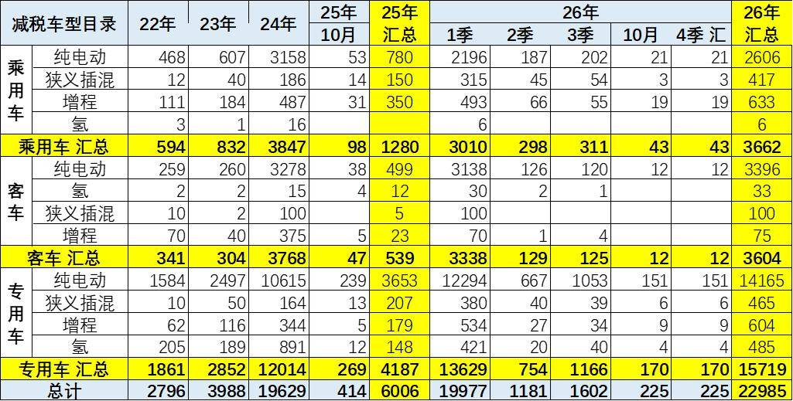
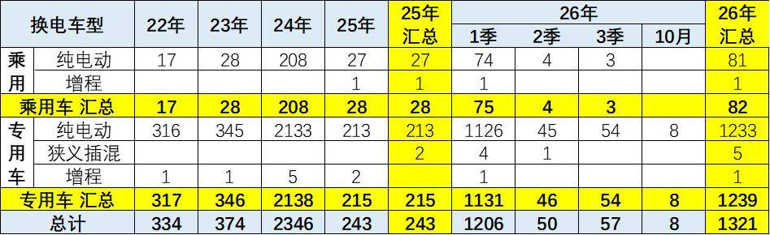
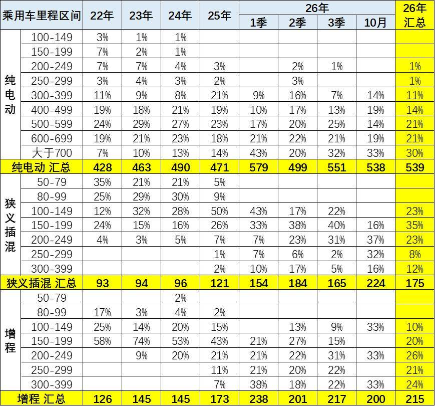
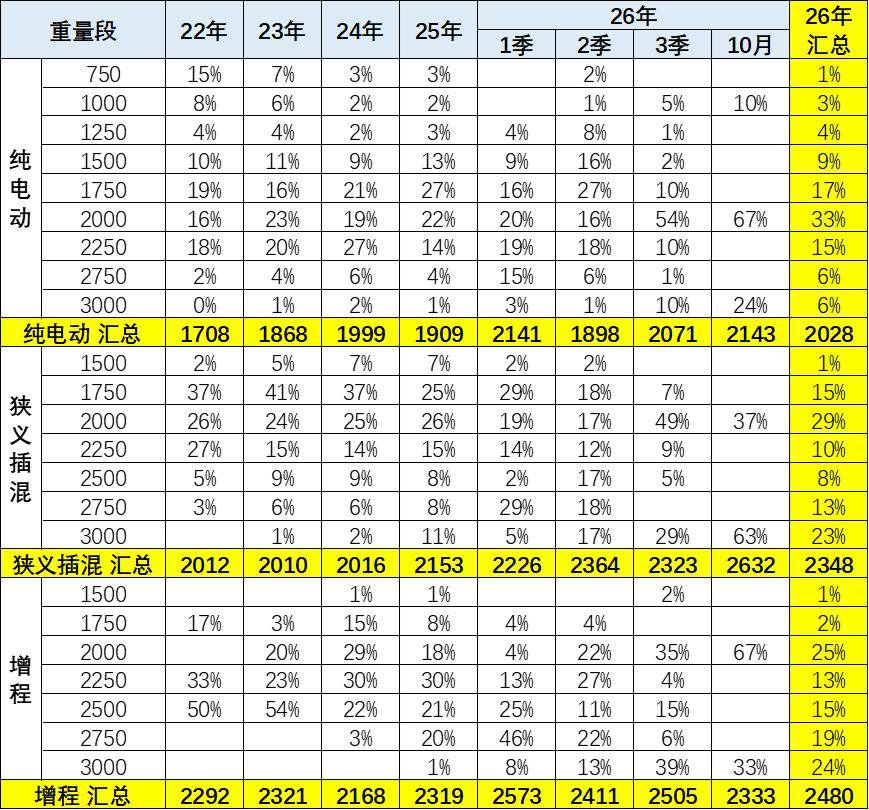
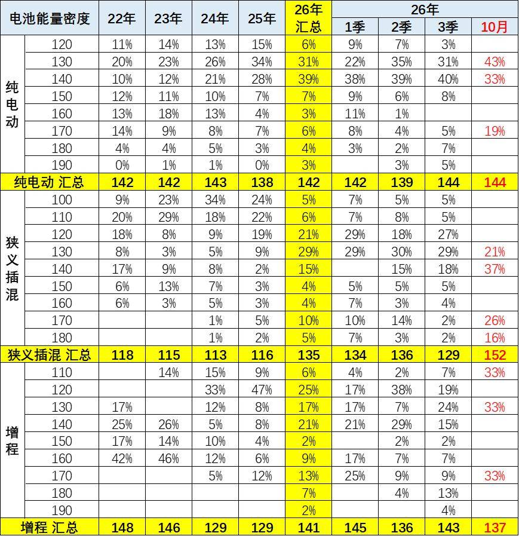
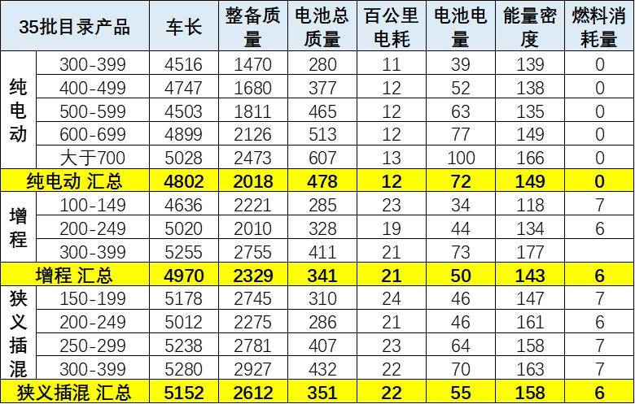
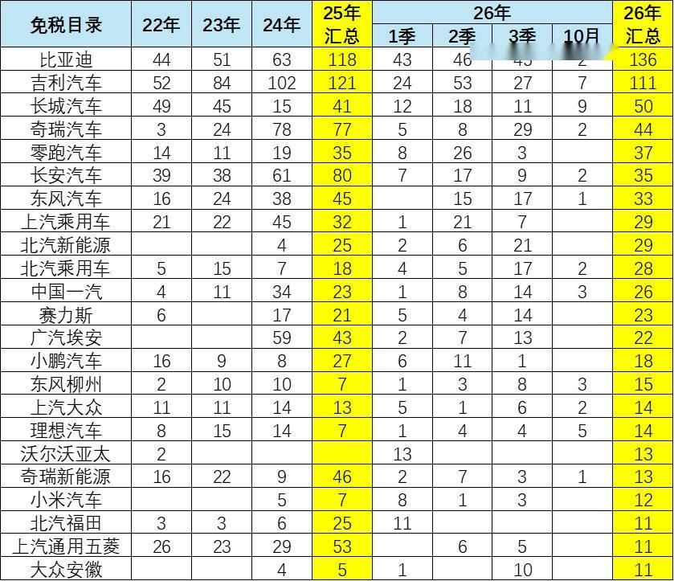
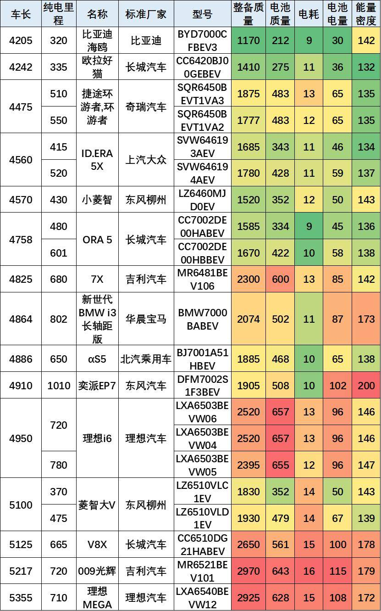
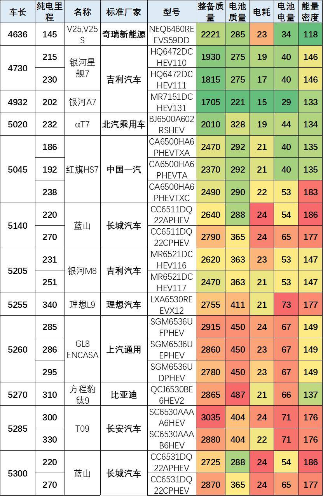

# 10月新能源新品与技术线路跟踪

- 公開日時: 2026-10-29 17:58（北京時間）
- 出典: [搜狐号・崔东树](https://www.sohu.com/a/1094497452_115312)
- テーマ（自動判定）: NEV新製品・技術
- 画像: 9枚

---

注：本分析文章仅代表崔东树个人观点，如有异议，请留言。

10月免税目录新增车型225款，较年均数量大幅下滑。分品类看：乘用车仅43款，纯电、插混、增程申报款数同步收缩；客车仅12款，投放显著降温。专用车为当月主力，合计170款，其中纯电动151款，占到当月总款数七成以上。10月车型申报结构分化明显，乘用、客车新车申报节奏放缓，专用车依旧是免购置税目录的核心支撑。

10月新增换电车型目录8款，环比3季度的月均销量下降。分品类看，乘用车没有纯电换电车型申报，投放持续低迷；专用车全部为纯电动车型，是本月换电目录的绝对主力。对比历史数据，换电车型申报主力长期在专用车领域，乘用车换电新车申报节奏偏弱，10月换电车型整体新增款数维持低位，行业新品投放偏谨慎。

10月纯电乘用车平均续航达538公里，较3季度的551公里有所下降，500公里以上区间合计占比66%；狭义插混平均续航升至224公里，200-249公里区间占比37%，一跃成为主力段；增程平均续航200公里，200-249公里占33%。整体看，三类技术路线均向更高续航区间迁移，纯电高端化、插混和增程长续航化趋势同步强化。

10月的新能源车免税目录的新车型主要是：长城汽车9款、吉利汽车7款、理想汽车5款、中国一汽3款、东风柳州3款、比亚迪2款、奇瑞汽车2款、长安汽车2款、北汽乘用车2款、上汽大众2款，自主厂家的新品推出力度较强，市场表现较好。

1、2026年免税目录总体情况

2026年1-10月新能源车免税目录共有22985款，其中10月有225款新车型，相对近三年同期处于低位。2-9月的目录资源相对2025年同期相近数量，乘用车新品丰富、10月目录规模缩减明显。

2、新车动力结构变化

由于超高的氢燃料的补贴因素，前期的氢能源商用车的表现超强，近期氢能国内外均走弱。近期乘用车氢燃料可以忽略不关心，短期没有发展空间。

10月免税目录新增车型225款，较年均数量大幅下滑。分品类看：乘用车仅43款，纯电、插混、增程申报款数同步收缩；客车仅12款，投放显著降温。专用车为当月主力，合计170款，其中纯电动151款，占到当月总款数七成以上。10月车型申报结构分化明显，乘用、客车新车申报节奏放缓，专用车依旧是免购置税目录的核心支撑。

3、换电车型跟踪

10月新增换电车型目录8款，环比3季度的月均销量下降。分品类看，乘用车没有纯电换电车型申报，投放持续低迷；专用车全部为纯电动车型，是本月换电目录的绝对主力。对比历史数据，换电车型申报主力长期在专用车领域，乘用车换电新车申报节奏偏弱，10月换电车型整体新增款数维持低位，行业新品投放偏谨慎。

4、2026年纯电动乘用车续航里程

10月的乘用车目录相对结构分化，部分类别申报较少。10月纯电乘用车平均续航达538公里，较3季度的551公里有所下降，500公里以上区间合计占比66%；狭义插混平均续航升至224公里，200-249公里区间占比37%，一跃成为主力段；增程平均续航200公里，200-249公里占33%。整体看，三类技术路线均向更高续航区间迁移，纯电高端化、插混和增程长续航化趋势同步强化。

5、2026年新能源车的车辆整备质量

10月纯电车型，2000kg区间占比高达67%，成为绝对主力，轻量化车型占比极低，平均车重维持高位。狭义插混车型3000kg区间占63%，是核心重量段。增程车型2000kg区间占67%，3000kg区间占33%，大重量车型主导。从结构可见，10月申报新车普遍偏重，纯电集中在2吨级，插混以3吨为主，增程集中在3吨级，长续航与大容量电池持续推高整车整备质量。

6、电池的能量密度

车购税减税车型的布局上呈现明显分化：10月纯电车型电池能量密度144瓦时/千克，趋稳且高度集中于140左右密度区间。10月狭义插混车型电池能量密度152瓦时/千克，提升明显。10月增程车型电池能量密度137瓦时/千克，相对较低。

7、2026年各类车型的综合对比

35批目录显示三类车型技术路线分化明显：纯电平均车长4802mm，电池电量与整备质量随续航显著递增，主打大电池规模化；增程平均车长4970mm，电池容量居中（50度），但能量密度最高（143），偏向大车身长纯电续航；狭义插混车长最长（5152mm）、质量最重（2612kg），但带电量最克制（55度），能量密度达158，纯电续航集中在150-249km，呈现“大车+小电池+高密度”的低成本合规特征，燃油消耗量均控制在6-7L。

10月的新能源车免税目录的新车型主要是：长城汽车9款、吉利汽车7款、理想汽车5款、中国一汽3款、东风柳州3款、比亚迪2款、奇瑞汽车2款、长安汽车2款、北汽乘用车2款、上汽大众2款.，自主厂家的新品推出力度较强，市场表现较好。

8、纯电动乘用车分析

35批纯电目录呈现“尺寸与能耗逐级跃升、高端车型密度突破”的阶梯特征。微型代步车（车长4.2米左右）整备质量轻，电耗低至9-11度，30-36度电即可支撑320km以上续航，能量密度集中在130-142；紧凑及中型车电池容量攀升至45-65度，电耗稳定在10-13度；中大型旗舰与MPV（车长超4.9米）整备质量达2.3-2.9吨，带电量大（96-115度），电耗升至13-16度。同时，170-200的高能量密度主要集中于宝马i3、奕派EP7等长续航或800V高压高端车型，展现了轻量化与电池技术的向上突破。

9、插混新车跟踪

35批目录（含插混/增程）呈现“中大型化与高电量、高密度并行”的特征。车型车长普遍在5-5.3米，整备质量多在1.8-3.0吨。中低端车型（如吉利银河、奇瑞）电池电量在30-44度，纯电续航140-230km，电耗相对较低（15-19度），能量密度多在130-146；中大型旗舰与MPV（如理想L9、长城蓝山、长安T09等）则走向“大电池”路线，电量高达54-73度，纯电续航突破250-340km，电耗升至21-24度。值得注意的是，长城蓝山、红旗HS7等车型能量密度高达177-186，且部分车型通过三排座位布局拉高整备质量，显示出车企在插混长纯电续航与轻量化上的技术博弈。

附：近日信息合集
