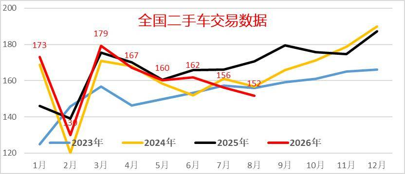
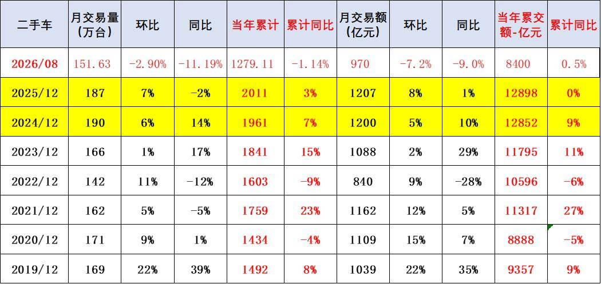
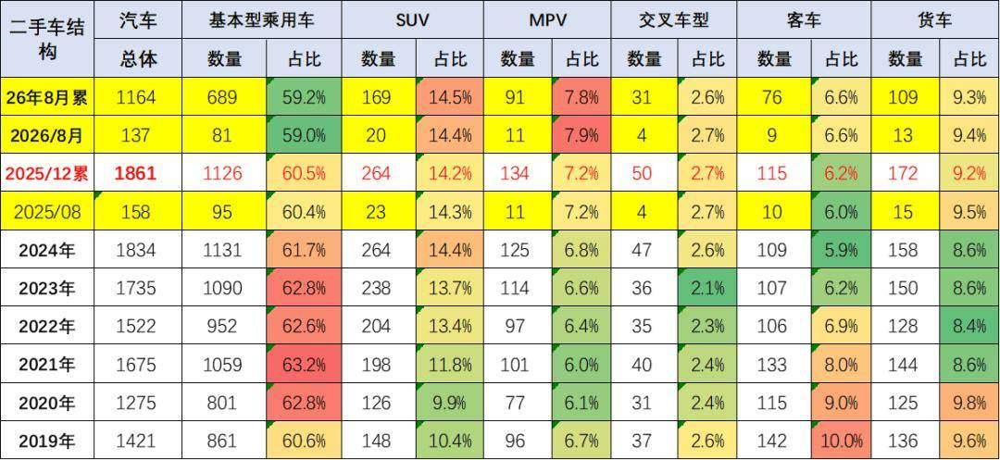
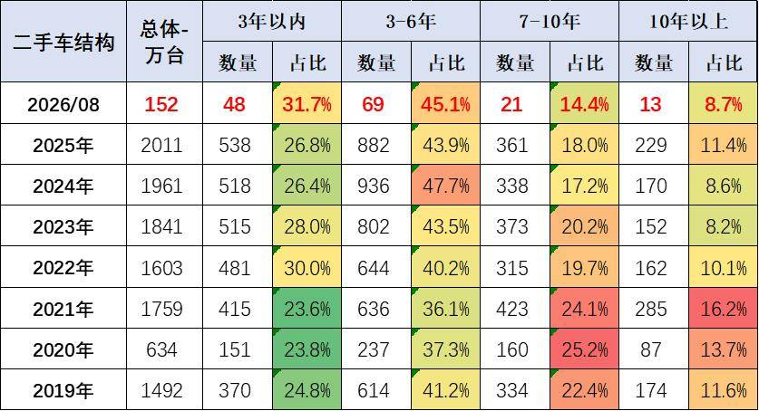
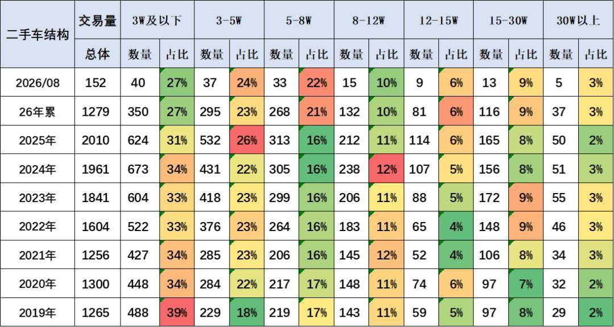
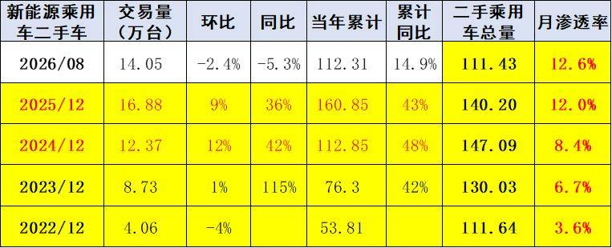
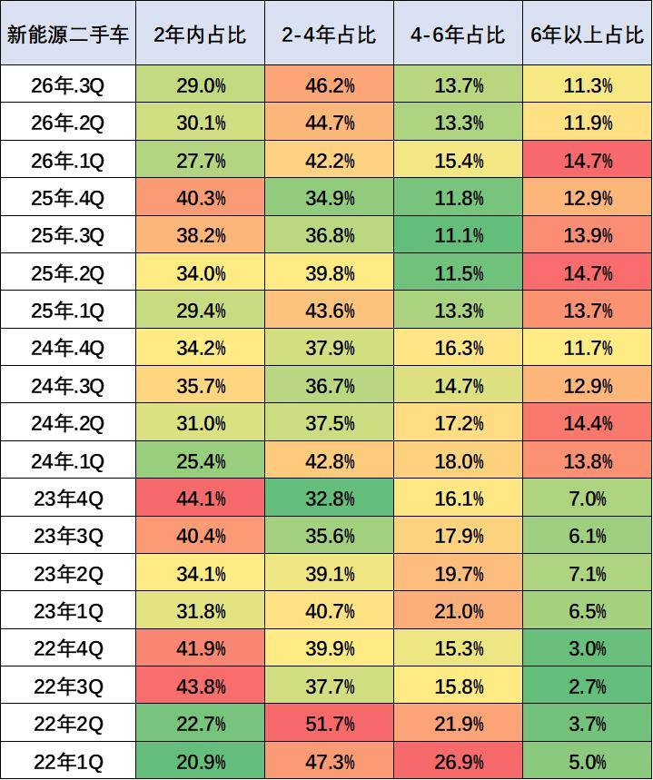
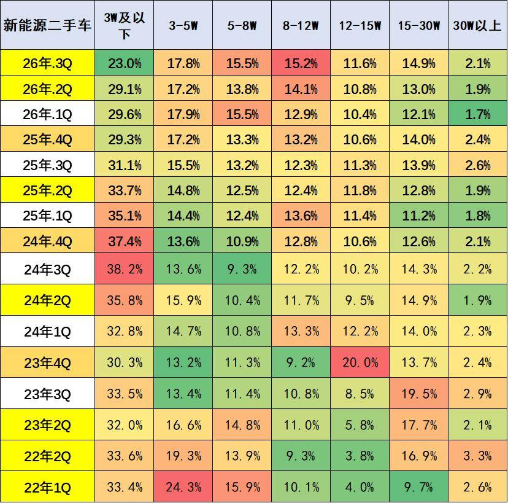
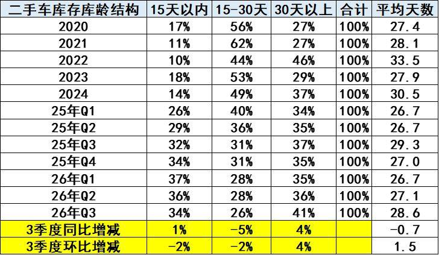
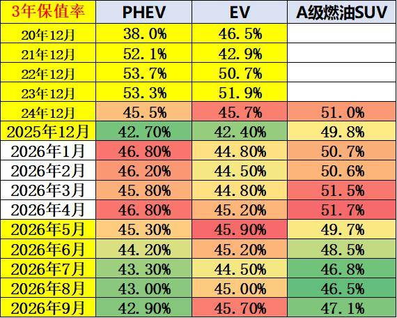

# 全国二手车市场分析-2026年8月

- 公開日時: 2026-10-30 14:08（北京時間）
- 出典: [搜狐号・崔东树](https://www.sohu.com/a/1094901713_115312)
- テーマ（自動判定）: 乗用車市場
- 画像: 10枚

---

注：本分析文章仅代表崔东树个人观点，如有异议，请留言。

2026年8月，全国二手车市场交易量151.6万台，环比降3%，同比降11%，交易金额为970亿元，同比降9%。2026年1-8月，二手车累计交易量1279万台，同比降1%，交易额8400亿元，增0.5%。

2026年8月，全国新能源二手车市场交易量14.05万台，环比降2%，同比下降5.3%，新能源渗透率12.6%。2026年1-8月，新能源二手车累计交易量112.31万台，同比增14.9%。

在中国汽车流通协会的呼吁下，二手车流通改善。各地交管部门办实事，便利群众企业办事，促进二手车流通。但与国际先进的发达国家市场相比，中国二手车的交易比例相对比较低，而中国的汽车市场起步相对较晚，二手车消费起步更晚，目前二手车正处于快速崛起阶段，未来发展潜力极其巨大。尤其是新能源车的发展，让中国的更多的普通消费者有了购车和用车的低成本的巨大优势。虽然国家报废更新政策的力度暂时放缓，但中国二手车发展潜力极其巨大，汽车经销商集团的二手车业务和汽车报废更新蓬勃发展，二手车市场必然全方位可持续增长。

1、二手车行业发展进入强势发展期

2023-2024年的二手车交易较活跃，实现了较强的增长。受春节因素，2026年1-8月的二手车交易较弱，4-6月逐步回落，7-8月的二手车走势进一步回落，车市消费较弱。

近几年二手车呈现较快发展，从2017年的1240万台一路上升到2025年的2011万台，大幅增长的表现相对较强。2026年8月，全国二手车市场交易量151.6万台，环比降3%，同比降11%，交易金额为970亿元，同比降9%。2026年1-8月，二手车累计交易量1279万台，同比降1%，交易额8400亿元，增0.5%。

由于二手车交易的品种多元化，近几年二手车交易单价相对稳定，交易量不断提升，这对车市是很好的。

2、二手车交易结构

二手车市场的格局呈现SUV、MPV市场持续增长。由于轿车占比过高，目前二手车市场结构总体与新车均向SUV和MPV的消费高端化发展。2026年的客车和货车交易比例提升明显。

3、二手车交易车龄

二手车的次新车交易表现较强，主要也是新能源车成为二手车的组成。二手车的交易结构目前来看：10年以上高车龄的二手车逐步下降， 2026年8月总体占比达到8.7%的比例，而3-6年达到45.1%的比例，3年以下车型达到31.7%的比例，处于绝对高位，两者比例都是相对较高的。

目前来看中低车龄的老旧车辆交易有所增多，而随着汽车产品技术的不断提升，高车龄产品的车质保障越来越好，未来这类中高龄车辆报废更新也有巨大增量潜力。

中国车市由于发展时间较短，相对成熟国家的二手车交易的车龄偏短，中国3-5年的二手车和1-3年的二手车交易占比均比较高，而美国等发达国家交易的二手车大部分是5年以上的，尤其是8年以上的二手车在法国和日本等均占比较高。

4、二手车交易价格走势

近两年二手车交易均价走势向务实发展，3-5万元的二手车占比明显下降，而3万元以下车型占比持续下降，今年5-8万元的产品大幅上升。

5、新能源二手车交易走强

2026年8月，全国新能源二手车市场交易量14.05万台，环比降2%，同比下降5.3%，新能源渗透率12.6%。2026年1-8月，新能源二手车累计交易量112.31万台，同比增14.9%。

随着新能源车市场的新车销量爆发增长，新能源二手车的保有量规模也在不断增大，随之而来新能源车的二手车渗透率不断提升，从2022年底的渗透率3.6%，上升到2026年8月的12.6%，相对于新能源车保有量的占比，二手新能源车的交易占比基本是同步增长。未来随着新能源车的高速增长和价格逐步趋稳，新能源二手车的发展潜力巨大。

6、新能源二手车车龄走势

2026年3季度，全国新能源二手车使用年限在2年以下的占比29%，较去年同期下降9.2个百分点。

2026年3季度，使用年限在2-4年占比46.2%，较去年同期增加9.4个百分点。

2026年3季度，使用年限在4-6年的交易量占13.7%，较去年提升2.7个百分点。

2026年3季度，6年以上的占比达到11.3%，较去年下降2.6个百分点。

整体来看2026年，新能源二手车车龄结构中低龄二手车增多，市场较活跃。

7、新能源二手车交易价格

新能源二手车交易价格明显提升，近期8-12万元车型的交易占比大幅提升。随着报废更新和以旧换新政策推动了老旧新能源二手车的增长，近期3万元以下车型销量下降。

目前的新能源车报废的残值优势逐步体现，报废更新政策推动更多的二手车加速报废更新。

8、二手车转籍比例

二手车的转籍比例前期一直在25%—30%之间波动的趋势，2026年3季度达到31.3%的当期历史高位。目前来看，由于二手车转籍便利提升，二手车转籍的比例回升到了较高的水平。

目前北京、上海是二手车交易两大主要的流出地区，而安徽和山东，吉林等也是二手车交易流入的主要区域，北京地区的二手车流出力度是比较强的，始终占据第一位的水平，体现了北京市场的二手车外流的规模相对是比较强的。

9、二手车库存时间

二手车的库存目前来看处于平稳状态之中，2026年3季度的二手车库存压力相对更大，尤其是2026年3季度的30天以上的二手车的库存占比41%，相对去年同期结构性增多；15-30天的二手车库存有26%的较低比例；而15天以内的二手车的比例34%，目前感觉短库龄车减少，2026年的整个二手车的运行压力仍相对较大。随着新车政策的逐步推动，导致二手车的交易价格实际上受到新车实际成交价格下移的影响，而带来二手车的价差的缩小，对二手车的经营也带来一定的压力。

10、二手车保值率

在经过2026年的价格调整之后，各品牌、厂商都找到了新的市场定位，竞争格局恢复到“有序”的状态。目前新能源车的三年保值率总体处于较低水平，这在快速发展的市场中完全正常的。

混动车的“内卷”仍在继续，二手车普遍存在技术落后，能耗偏高的问题，对于消费者缺乏吸引力。

由于新能源车是宝矿，二手电动车电池残值贵，新能源车残值更高。随着碳酸锂价格的炒作上涨，新能源车长车龄车辆的保值优势也会有所体现。目前新能源车报废数量微乎其微，长车龄新能源车仍有价值。

附：近日信息合集
