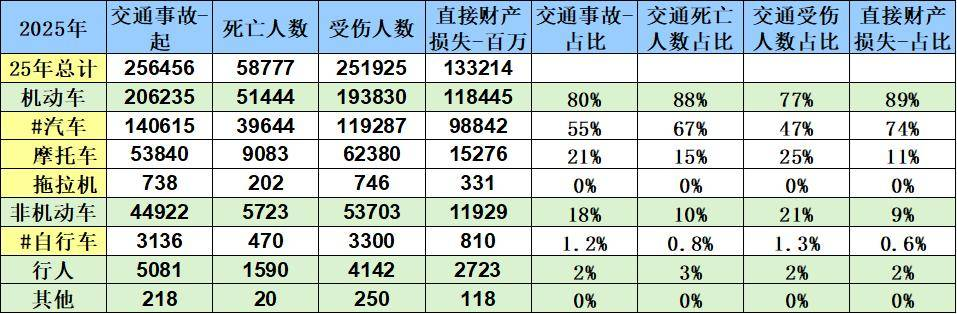

# 全国历年交通事故分析-汽车更安全了

- 公開日時: 2026-11-06 12:34（北京時間）
- 出典: [搜狐号・崔东树](https://www.sohu.com/a/1097984520_115312)
- テーマ（自動判定）: その他
- 画像: 1枚

---

注：本分析文章仅代表崔东树个人观点，如有异议，请留言。

根据中国统计年鉴的2018-2025年各类交通事故数据，虽然汽车保有量快速增长，但我国道路交通安全呈现“汽车安全水平显著提升、非机动车风险快速攀升”的结构性分化特征。整体看，汽车的安全进步有效压降了机动车事故大盘，而非机动车与摩托车的快速扩张正成为新的风险主战场，未来交通安全治理应重点聚焦电动自行车路权、加大汽车普及力度。

第一，汽车安全性能的实质性改善是整体事故下降的核心支撑。 八年来，汽车事故起数下降15.8%，受伤人数大幅下降29.4%，死亡人数减少约14.1%，直接财产损失从11.87亿元降至9.88亿元，各项占比全面收缩（事故占比68.1%→54.8%，受伤占比65.4%→47.4%）。这一成绩的背后，是车身结构优化、安全气囊普及、AEB等主动安全技术以及辅助驾驶系统在高速、拥堵等场景中的提前干预，推动汽车安全从“碰撞后保护”向“碰撞前预防”转型，让“车更安全”从理念变为数据现实。

第二，风险正从机动车向非机动车与摩托车转移，治理重心需相应调整。 同期非机动车事故激增75.8%，受伤人数增长85.3%，事故占比从10%升至18%；摩托车事故亦增长17.4%，受伤占比升至25%。与之形成对比的是，摩托车死亡占比由17%降至15%，说明头盔等防护措施见效，但事故基数仍在扩大。

1、2025年总体交通事故状态分析

基于2025年交通事故统计数据，机动车是绝对的事故主力，其事故起数、伤亡人数及财产损失占比均在77%以上。其中，汽车（事故占比55%、死亡占比67%）与摩托车（事故占比21%、死亡占比15%）构成了核心风险源。值得注意的是，非机动车事故占比约18%，且自行车的伤亡占比（1.3%）略高于其事故占比（1.2%）；行人虽事故占比仅2%，但死亡人数占比达3%，属于典型的高风险弱势群体。

从致死风险特征来看，不同交通方式的危险程度存在显著差异。摩托车事故起数占比达21%，但死亡人数占比仅15%，其单起事故致死率（约0.17人/起）明显低于汽车（约0.28人/起）；自行车的单起致死率最低（约0.15人/起）。整体而言，汽车是交通事故与财产损失的首要来源，而摩托车与行人的致死风险相对更为突出，在交通安全治理中需予以重点关注。

2、汽车交通事故占比

基于2018-2025年汽车保有量与事故率数据，交通事故特征呈现鲜明的“车增事故率降”的良性态势，汽车安全性提升效果明显。

汽车保有量激增但事故率断崖式下降，技术安全红利充分释放。 八年间，汽车保有量从2.32亿台增至3.59亿台，增长约54.7%；而每万台汽车事故率从7.2起大幅降至3.9起，降幅达45.8%。在汽车总量大幅扩张的背景下，事故起数反而下降15.8%，受伤人数下降29.4%，这充分说明车辆被动安全（车身结构、气囊）与主动安全（AEB、辅助驾驶）技术的普及，使单车风险显著降低，“车更安全”有了最直观的数据注脚。

事故后果全面收敛，但汽车仍是伤亡与损失的主体，安全升级需持续深化。 汽车事故占比由68.1%降至54.8%，受伤占比从65.4%降至47.4%，财产损失占比由85.7%降至74.2%，各项指标全面改善。但汽车死亡占比仍高达67.4%，单起致死率未见明显下降，且绝对数值仍占据大盘主导。未来应继续以智能辅助驾驶降低高风险场景事故概率，同时补齐非机动车安全治理短板。

3、摩托车交通事故占比

基于2018-2025年摩托车交通事故数据，呈现“总量走高但致死改善”的复杂特征：

第一，事故与受伤规模持续扩张，占比显著抬升。八年间，摩托车事故起数从45868起增至53840起，涨幅约17.4%；受伤人数从55071人升至62380人，增幅约13.3%。其事故占比从19%升至21%，受伤人数占比从21%跃升至25%，直接财产损失占比也从8%升至11%，成为道路交通中不可忽视的风险增长点。

第二，死亡人数与占比逐年下降，安全防护成效显现。与事故总量上升相反，摩托车死亡人数从10663人降至9083人，降幅约14.8%；死亡人数占比由17%降至15%。单起事故致死率从约0.23人/起降至约0.17人/起，改善明显。这反映出头盔强制佩戴、ABS等安全配置普及以及骑手安全意识提升，正有效降低摩托车事故的致命后果。总体而言，摩托车呈现“事故多发但致死可控”的特征，治理重点应转向降低事故发生率与保障骑手路权。

4、非机动车交通事故占比

基于2018-2025年非机动车交通事故数据，特征呈现明显的“逆势攀升”态势，具体分析如下：

第一，事故规模与各项占比持续走高。 八年间，非机动车事故起数从25556起激增至44922起，增幅约75.8%；受伤人数由28987人升至53703人，增幅达85.3%。在整体事故盘子中的占比全面扩大，事故占比从10%升至18%，受伤人数占比更是从11%跃升至21%，直接财产损失占比从4%翻倍至9%，说明非机动车已成为增长最快的风险源。

第二，致死风险同步上升，安全短板亟待补齐。 死亡人数从3741人增至5723人，增幅约53%；死亡人数占比从6%升至10%。值得注意的是，非机动车事故的单起致死率（约0.13人/起）虽低于机动车，但其增速之快、占比扩张之猛，反映出电动自行车保有量激增与骑行安全防护（如头盔佩戴、路权保障）之间的突出矛盾。非机动车安全治理正从“补充项”变为“必答题”。

附：近日信息合集
