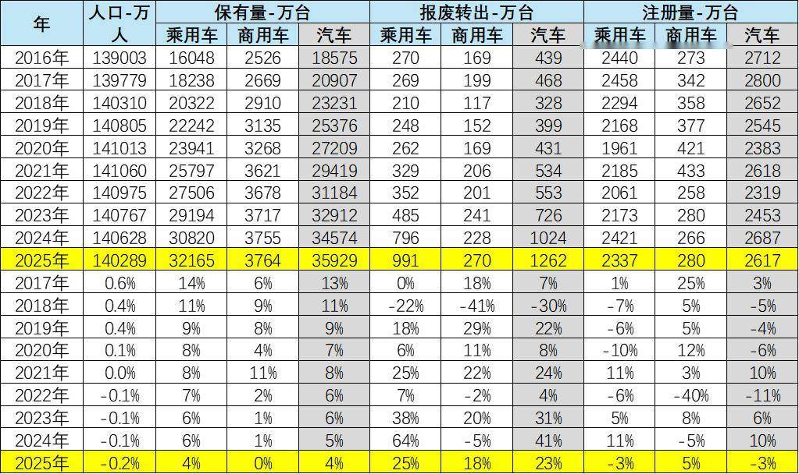
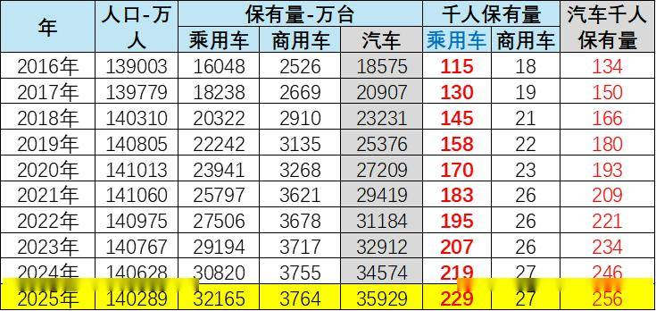
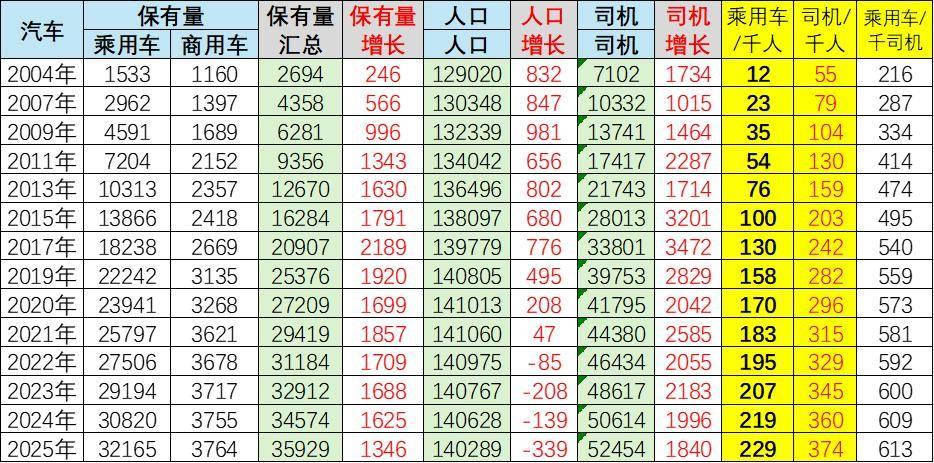
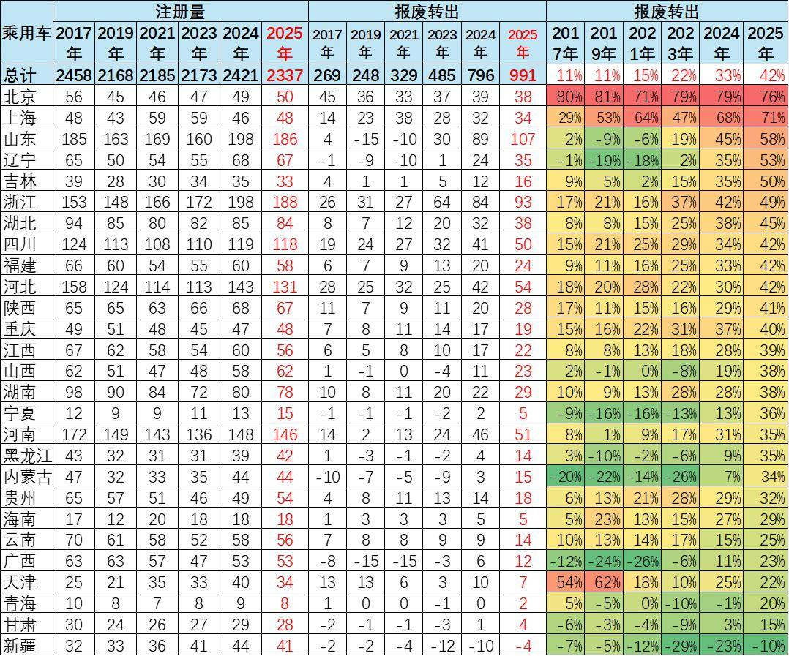
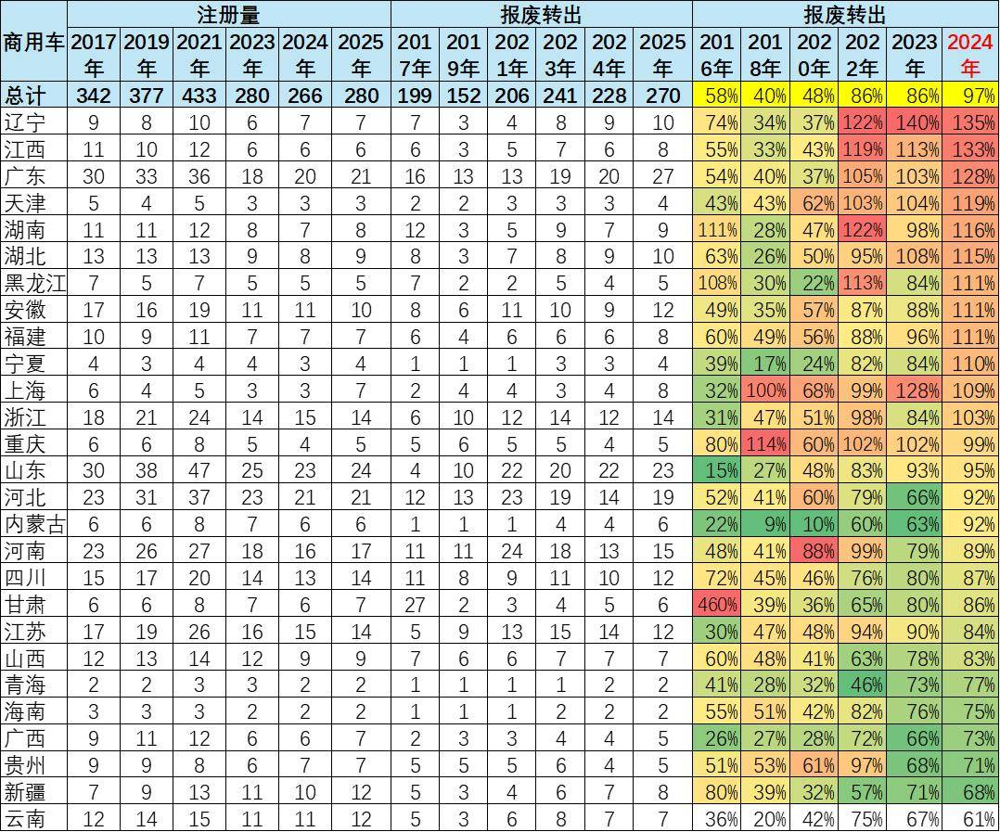
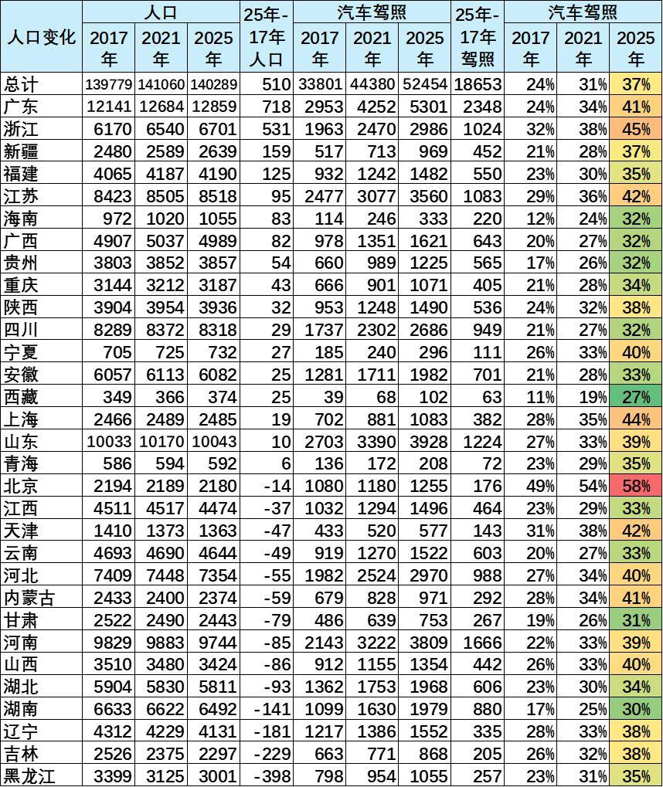
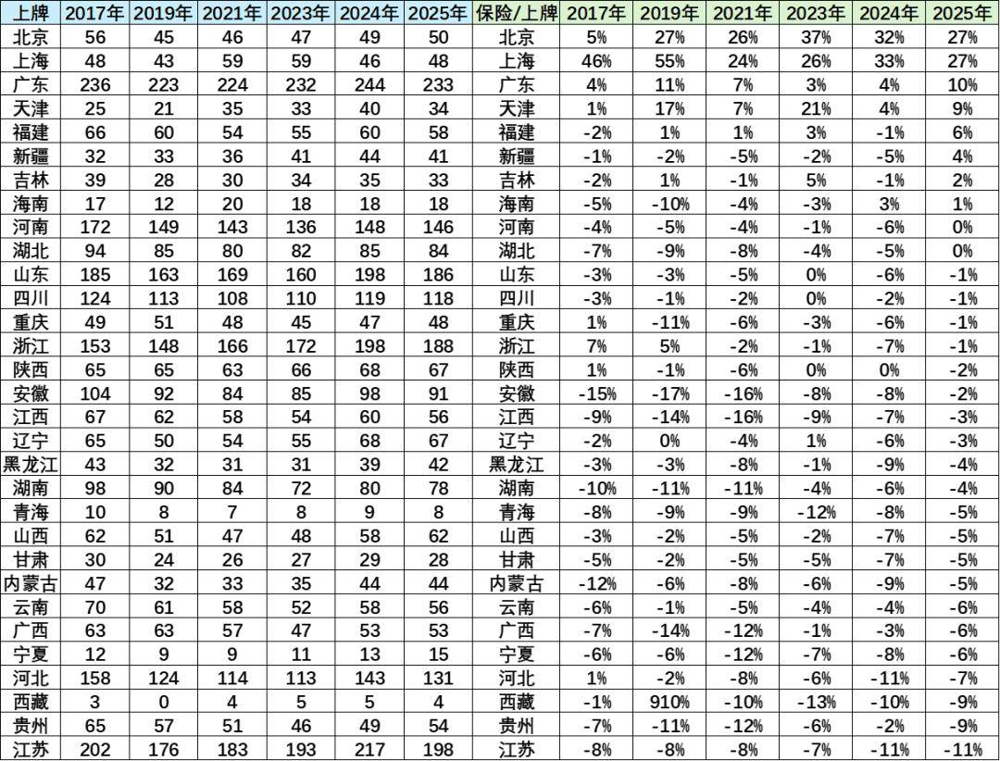

# 汽车保有上牌报废出口组合分析

- 公開日時: 2026-11-07 15:57（北京時間）
- 出典: [搜狐号・崔东树](https://www.sohu.com/a/1098497556_115312)
- テーマ（自動判定）: 輸出
- 画像: 7枚

---

注：本分析文章仅代表崔东树个人观点，如有异议，请留言。

综合来看，我国汽车市场已彻底告别高速扩张期，全面进入“存量博弈、置换主导”的成熟阶段。人口总量在2025年微降至14.03亿，且区域分化显著，增长向广东、浙江等地集中，而东北、中部部分省份持续收缩。然而，汽车总保有量仍攀升至3.59亿辆，增速放缓至4%。人均层面，每千人汽车保有量从2016年的134辆增至256辆，乘用车是绝对主力，商用车增长平缓；同时，每千人司机数达374人，驾照普及率（持证人口占比）升至37%，但“有本无车”的群体依然庞大，为存量置换提供了基础。

市场呈现出极其鲜明的“报废攀升、新增下滑”结构性特征。2025年新注册量仅2617万辆，同比下降3%，而报废转出量却高达1262万辆，同比大增23%。乘用车报废率从2017年的11%飙升至42%，商用车更是逼近97%的“一换一”临界点。北京、上海等一线城市乘用车报废率超70%，辽宁、广东等地商用车报废率突破120%，以旧换新与老旧车淘汰政策效应集中释放。

总体而言，未来的汽车销量增长将彻底脱离单纯的首购普及，转而深度绑定存量更新节奏。新车市场的韧性将取决于置换需求的释放速度和消费升级的力度，行业竞争将更加聚焦于存量用户的争夺。

1、汽车保有上牌预报废的总体情况

2025年汽车总保有量约3.59亿辆，增速已放缓至4%，人口则小幅降至14亿出头。最值得关注的是报废端和新车端的一升一降：报废转出量达到1262万辆，同比大增23%，老旧车辆淘汰明显提速；而新注册量仅2617万辆，同比下降3%，购车热情有所降温。

分车型看，乘用车保有量仍稳步增长4%，商用车则基本持平，新车注册仅微增5%，受经济环境影响更大。整体而言，市场正从“卖新车”转向“换新车”，存量更新特征愈发明显，未来增长更多要靠置换需求来带动。

2、乘用车千人保有量偏低

2025年，汽车总保有量约3.59亿辆，人口小幅降至14亿出头。对应到人均层面，每千人汽车保有量已从2016年的134辆升至256辆，其中乘用车从115辆增至229辆，普及程度持续走高；商用车则从18辆缓慢升至27辆，增长相对平缓。

从趋势看，乘用车千人保有量的提升是拉动整体增长的主力，十年间几乎翻倍，说明居民用车需求仍在稳定释放。不过近几年增速已明显放缓，叠加人口微降，市场正从“首次购车”向“存量更新”过渡，未来千人保有量的提升空间更多取决于置换和消费升级，而非简单的新增普及。

3、司机与总人口保有量关系

2025年，汽车总保有量约3.59亿辆，较上年增长1346万辆，人口则降至14亿出头、减少339万。从人均看，每千人汽车保有量已升至256辆，乘用车为229辆，商用车仅27辆，普及水平持续走高但近年增量明显放缓。

另一个值得关注的变化在司机端：2025年持证司机达5.25亿人，同比增长1840万，每千人司机数已达374人，而乘用车/千人司机比升至613辆，意味着“有本无车”的空间在收窄。结合人口负增长、保有量增速回落来看，市场正从首购扩张转向存量更新，未来增长更多依赖置换和消费升级，而不是简单的新增普及。

4、乘用车报废出口分析

2025年乘用车注册量达到2337万辆，较2024年小幅回落，但报废转出量却快速攀升至991万辆，报废率由2017年的11%升至42%，旧车淘汰节奏明显加快。分地区看，北京、上海等一线城市报废率已高达76%和71%，置换需求占据主导；山东、浙江、江苏等汽车大省报废率也普遍升至49%—58%，更新换代成为市场主力。

值得注意的是，多数省份报废率在近三年集中跃升，如辽宁从2%跳至53%，天津从10%升至25%，政策推动和以旧换新效应明显。相比之下，新疆报废率仍为负值，甘肃、青海等地也处于低位，区域间淘汰进度差异较大。整体看，市场正从“增量普及”转向“存量置换”，报废更新对新车销售的支撑作用越来越突出。

5、商用车报废出口分析

2025年商用车注册量维持在280万辆，与上年相比小幅增长，报废转出量则升至270万辆，报废率从2016年的58%一路走高至97%，几乎接近“一换一”的临界点。分地区看，辽宁、江西、广东三地报废率均超过125%，天津、湖南、湖北等也普遍在110%以上，老旧车辆集中淘汰的特征十分明显。

值得注意的是，多数省份报废率在近三年集中冲高，如江西从43%跃升至133%，广东从37%升至128%，政策推动和更新需求叠加效应突出。相比之下，云南、新疆等地报废率仍在70%以下，区域间淘汰节奏差异较大。整体看，商用车市场已进入高报废、低增量的替换阶段，新增需求有限，未来销量更多取决于存量更新节奏。

6、各地人口变化与司机增减关系

2025年全国人口约14.03亿，较2017年净增510万，增长主要集中在广东、浙江、新疆、福建等地，而黑龙江、吉林、辽宁、湖南等省份人口持续收缩，区域分化明显。

驾照方面，全国持证人数从2017年的3.38亿增至5.25亿，有驾照人口占总人口的比例由24%升至37%。分地区看，北京持证比例高达58%，上海44%，浙江、江苏、广东等地普遍在41%—45%，驾驶普及程度领先；而湖南、甘肃、西藏等地占比仍在30%左右，区域间差距较大。整体来看，驾照普及率仍在稳步提升，但人口收缩地区与高普及率地区叠加，未来购车需求将更多依赖存量驾驶人群的置换升级。

7、各地人口变化与司机增减关系

2025年，全国乘用车上牌量整体呈“总量微调、区域分化”态势。江苏、浙江、广东等经济大省上牌量仍居前列，但江苏、浙江较2024年分别回落至198万辆和188万辆；山东、北京、天津则逆势小幅增长，北京上牌量升至50万辆。海南、新疆等省份上牌量保持稳定，西藏等基数较小地区波动明显。
