# 乘用车新车的分级测算探讨—10月

- 公開日時: 2026-11-08 11:23（北京時間）
- 出典: [搜狐号・崔东树](https://www.sohu.com/a/1098754201_115312)
- テーマ（自動判定）: セグメント・車種
- 画像: 11枚

---

注：本分析文章仅代表崔东树个人观点，如有异议，请留言。

近期乘用车市场的传统车市场推出新车型逐步放缓，新能源大幅增加新品投放。目前主力车企产品逐步进入多生孩子好竞争的局面，车企呈现剧烈的价格竞争和破圈趋势。这些传统车和新能源车的新车型如何归类也是很重要的，每家都有自己的分级模式，但我们还是习惯用行业相对主流的源自于德国大众的A00、A0、A、B、C、D分级模式作为基础，成为行业参照的公用分级方式。对这个行业分级，测算本月新车的分级如下，具体的调整也是仅供讨论。如有不同观点也可留言。

维度1：车型颗粒度（产品物理区分口径）层级由粗到细：车型→动力形式→配置款式。1.粗口径（车型）。2.中口径（车型+ 动力），区分动力，不细分高低配。3.细口径（车型+ 动力+ 配置款式），最细颗粒度，数量最大。

维度2：新车推出性质（生命周期变更口径，决定算不算“全新新车”）1.全新车型、换代车型（垂直换代）、大改款（中期改款Facelift）、年型车、参数升级、风格变化等。

分析中是用组合：维度1：车型颗粒度的中口径+维度；2：新车推出性质中的纯新车组合。

今年1-10月的新品共129款，其中增程车型42款，较去年同期多26款；混合动力车型10款，较同期多10款；狭义插混车型31款，较同期少6款；纯电动车型68款，较同期多11款；常规燃油车9款，较同期少4款。这些新车有些是新车型，有些是改款改名字的新车型，更多的是新能源车型。近两年的汽油车的数量较前期明显减少，但今年很多混合动力新车推出，体现混合动力替代燃油车实现出口突破的新思路。

车型定级因素较复杂，主要是从车长、轴距、价格、企业内部自身车型梯度布局、竞品关系等综合考虑的。从车长轴距考虑的车型定级体现的是新车与现有市场的拟合度，但新车是引领市场变化的，因此还要从厂家定位和历史升级演变等角度论证，这也就是防止算出来的与我们的行业主流观点形成偏差，同时也是让新车引领细分市场的产品变化。

从2024-2026年的数据来看，乘用车新车长度呈现出显著的“中大型化”趋势，市场重心正向5米区间集中。首先，SUV是绝对主力且疯狂膨胀。SUV新车数量远超轿车和MPV，是上新最密集的品类，其5-5.5米大型化趋势最为夸张，占比从2024年的17%飙升至2026年的56%；而4.5-5米的中型SUV新品占比则从72%暴跌至45%。这说明SUV市场已全面转向中大型“大六座/七座”的高利润混战，紧凑型红利已被吃尽。常规燃油车彻底放弃小型车，死守中大型。4.5米以下新车连续三年为零，主力全部集中在4.5-5.5米（占比超80%）。在新能源挤压下，燃油车企只能通过推大尺寸车型维持高溢价和利润。

新能源车呈现极端的“哑铃型”撕裂。一方面，4米以下微型车和4-4.5米小车新车数量断崖式下跌，受补贴退坡与成本压力影响，车企加速抛弃低端；另一方面，5米以上大车迎来井喷，占比从2024年的34%飙升至2026年的58%。5.1米至5.5米的全尺寸SUV/MPV新品密集扎堆，成为车企卷技术、保利润的核心战场。而处于中间的4.5-5米市场，份额从55%暴跌至40%，成为竞争最惨烈的坍陷区。

10月的新车基本都是4.8米以上大型车，未来国内车市普及潜力巨大，需求的是小型车。未来政策层面应该尽量鼓励经济型车发展，我个人建议制定经济型车标准，鼓励微型电动车普及，尽量替代老头乐，这样才能实现国内的私车普及和新能源车出海发展。尤其是随着新的关税国际秩序，我们的新能源车出口还是要考虑海外的农村包围城市，欠发达国家包围发达国家的线路，直接冲击发达国家市场的难度和风险较大。

一、上市车型为何这样多

1、车型颗粒度细口径+全部新车推出性质--最细分口径

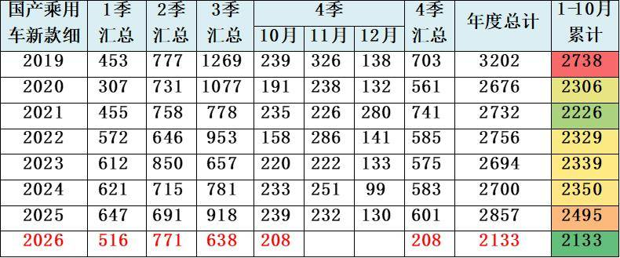

这是最广义的新款车型的推出数量，按照细分车型款式计算，每个车型每次推出数款细分车型，因此数量较多。2019年达到年度3202款车型，今年1-10月有2133款车型，相对历年1-10月较少。

2、车型颗粒度粗口径+全部新车推出性质—新车型口径

这是按照车型口径统计的厂家新推出车型的统计，每个车型包含不同动力类型和款式的最粗框车型的数量，这其中的月度数据和季度数据不一致，主要是非重复计算的结果。因此数据不是简单相加。

3、新车上市的种类很多

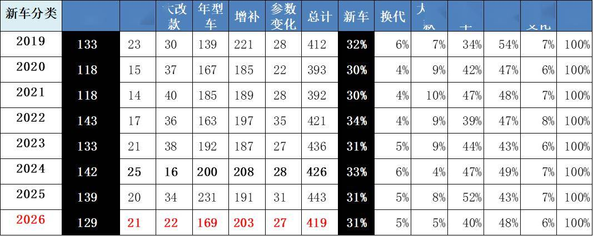

2026年1-10月真正的新车129款，相对各类上市车型总体419款的占比为31%。相对历年的新车占比在30%-34%区间，2026年的新车占比31%相对较少。

2026年相对较高的上市车型主要是参数变化和增补车型，这些车型的含金量不高，拉动消费效果较差。

4、我们统计新车的口径是区分动力的纯新车型-车型颗粒度中口径+纯新车

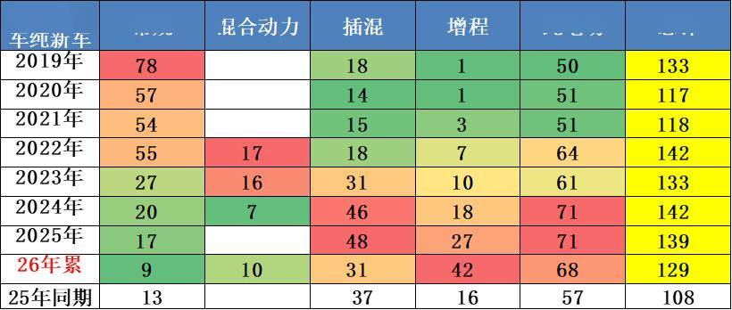

我们统计新车的口径是区分动力的纯新车型，也就是车型颗粒度中口径（车型+动力组合）的纯新车，不含换代、中期改款、年型车、参数变化等。

今年1-10月的新品共129款，其中增程车型42款，较去年同期多26款；混合动力车型10款，较同期多10款；狭义插混车型31款，较同期少6款；纯电动车型68款，较同期多11款；常规燃油车9款，较同期少4款。这些新车有些是新车型，有些是改款改名字的新车型，更多的是新能源车型。近两年的汽油车的数量较前期明显减少，但今年很多混合动力新车推出，体现混合动力替代燃油车实现出口突破的新思路。

新车型拆分动力主要是考虑动力形式是目前新能源转型的重要特征，部分企业推出新车的动力形式差异较大，推出节奏也不同，因此按新能源和燃油车的5大细分动力进行拆分，这样的新车统计比较规范，但数量因此偏多。

二、规范的新车统计分析

1、历年各月纯新车跟踪

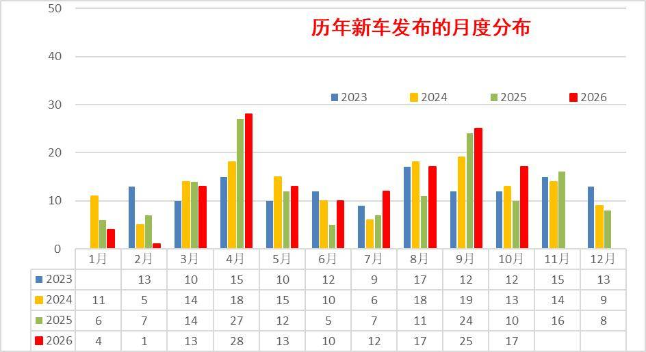

2026年1季度新车发布较少，2季度和3季度相对较多，2026年10月新车发布17款，新车数量相比同期大幅增加，保持历年较高水平。今年1-10月的新车发布为129款，去年1-10月新车发布108款，今年新车多于去年21款。

2、各类品牌新车跟踪

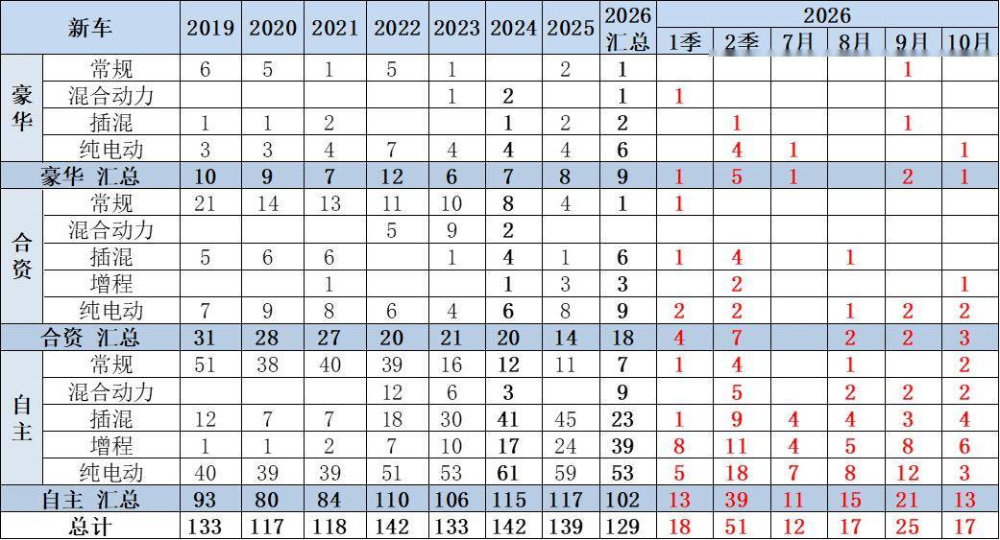

2026年的自主品牌新车102款的数量较去年少一些，但新能源仍是自主几乎包揽的局面。2026年的合资车企的新品推出18款，改善主要是插混和增程的新品全面推出。今年1-10月豪华车新品有9款，较同期多2款，基本都是新能源，这些新品值得观察。

3、乘用车推出的车长分析

从2024-2026年的数据来看，乘用车新车长度呈现出显著的“中大型化”趋势，市场重心正向5米区间集中。首先，SUV是绝对主力且疯狂膨胀。SUV新车数量远超轿车和MPV，是上新最密集的品类，其5-5.5米大型化趋势最为夸张，占比从2024年的17%飙升至2026年的56%；而4.5-5米的中型SUV新品占比则从72%暴跌至45%，这说明SUV市场已全面转向中大型“大六座/七座”的高利润混战，紧凑型红利已被吃尽。

其次，轿车与MPV双双走向“大车专属”。轿车总量下滑，4.5米以下廉价轿车几近清盘（仅占3%），主力全部集中在4.5米以上（占比超90%）。MPV的新车总量萎缩至个位数，但5米以上车型占比高达89%，彻底放弃了中小型家用定位，成为纯高端商务/全尺寸的小众市场。

4、新能源车推出的车长分析

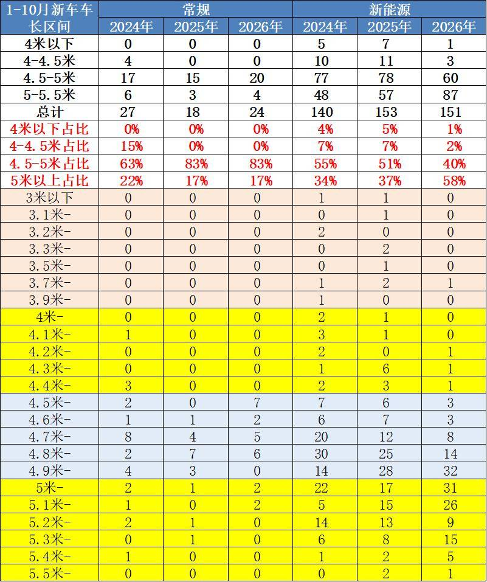

常规燃油车彻底放弃小型车，死守中大型。4.5米以下新车连续三年为零，主力全部集中在4.5-5.5米（占比超80%）。在新能源挤压下，燃油车企只能通过推大尺寸车型维持高溢价和利润。

新能源车呈现极端的“哑铃型”撕裂。一方面，4米以下微型车和4-4.5米小车新车数量断崖式下跌，受补贴退坡与成本压力影响，车企加速抛弃低端；另一方面，5米以上大车迎来井喷，占比从2024年的34%飙升至2026年的58%。5.1米至5.5米的全尺寸SUV/MPV新品密集扎堆，成为车企卷技术、保利润的核心战场。而处于中间的4.5-5米市场，份额从55%暴跌至40%，成为竞争最惨烈的坍陷区。

三、行业新车级别划分

1、行业标准车型现状

近几年的新能源车的新车数量较多，这些如何分级也是需要多重考虑的。分级测算选择的主要依据是车长和轴距对应的厢型，同时区分合资与自主的类别。价格因素和排量因素实在太复杂，因此暂作为争议车型的备考指标。

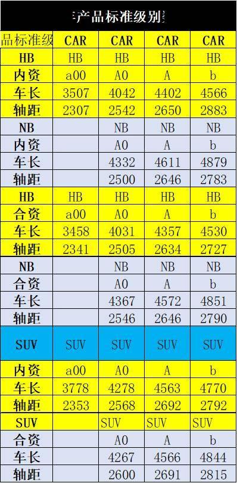

根据测算，行业现有销售车辆的每个车型的车长轴距和销量，进行加权汇总测算，得出每个级别的不同国别和厢型的平均长度和轴距，作为这个细分市场的标准车指标。

有了标准车指标，就有了各类车型间的车长和轴距的差距指标，就形成测算评级的基础。

2、10月新车型现状

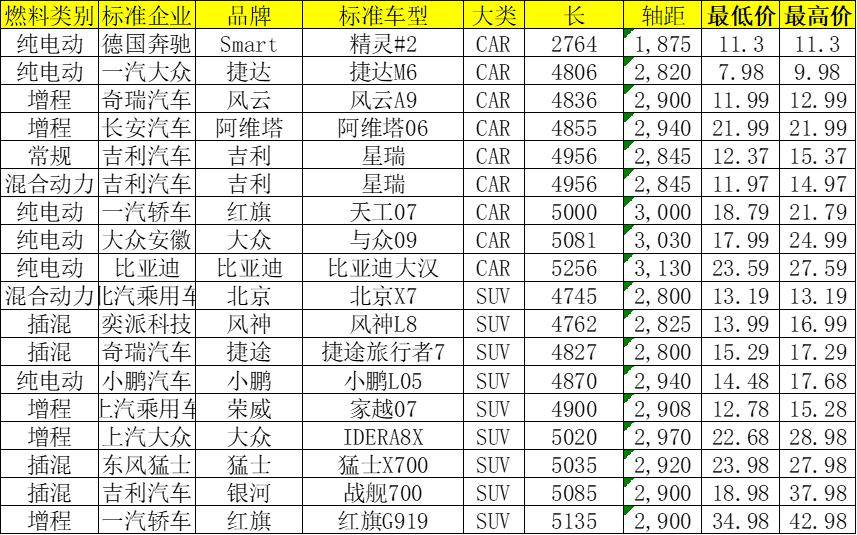

10月新品的重量级车型较多，其中自主与大众品牌的亮点较多，形成车型序列的延展。随着以旧换新的政策推动换购，新品向高端延伸明显。SUV的主流车型的改款新品较强。

合资品牌的新品有一定竞争力，满足多元化需求。但合资新品的技术自主性相对被动，与新势力新品正面对抗的挑战不小。

3、车型分解的测算-车长

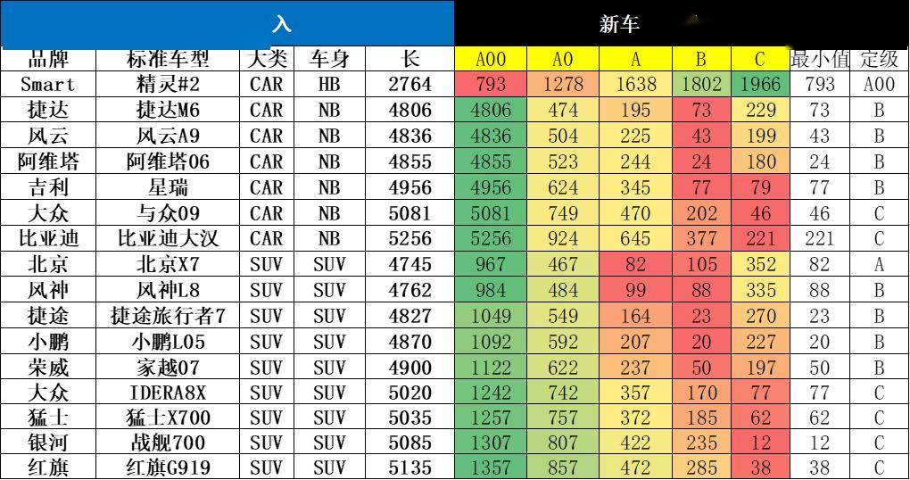

根据每个新车的车长的指标与各级别的标准指标对比，寻找车长差距最小的指标，根据车长的定级看，各车型有些定级参考，大部分测算分级基本符合直觉定位预期。

近期自主的中型SUV较多，而且偏大型化设计。由于设计车辆目标都是超越对手，因此车型跨界力度较大，产品对比的难度较大。有些产品升级的比较大型，但会对应调整到低一级的合理竞争定位。

4、新车定级-轴距

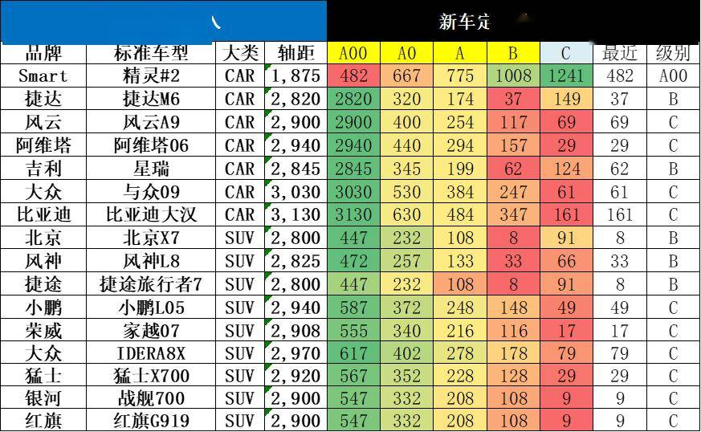

由于车身设计的差异，根据轴距测算车型的定位区间。计算基本也是有很多边缘车型。

本月的主力新品车型的产品轴距差异较大，电动车的产品特色明显，价格差异大，相对复杂。

5、车型分类的综合对比评定

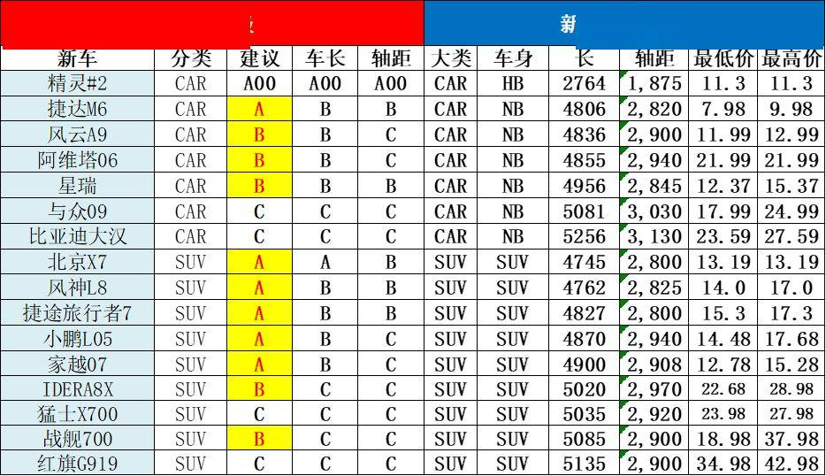

10月的新车有一半是有降级考虑的，主要是从车长、轴距、价格、企业内部自身车型梯度布局、竞品关系等综合考虑的。从车长轴距考虑的车型定级体现的是新车与现有市场的拟合度，但新车是引领市场变化的，因此还要从厂家定位和历史升级演变等角度论证，这也就是防止算出来的与我们的行业主流观点形成偏差，同时也是让新车引领细分市场的产品变化。

本月新车定级比较纠结的车型较多，内资的电动车轴距较长，形成电动车的异常反差。部分车型的车身长，实际定位和价格较低，因此平衡到低一级别。考虑到弱势企业新车大型化和燃油车低迷的特征，定级也是需要共同探讨。

目前这个分级仍在讨论阶段，我们的建议分类也欢迎大家提出意见建议，根据争议情况确定车型建议级别，共同研判产品趋势。

附：近日信息合集
