# 2026年10月汽车细分市场走势和厂家竞争表现分析

- 公開日時: 2026-11-13 16:38（北京時間）
- 出典: [搜狐号・崔东树](https://www.sohu.com/a/1101143360_115312)
- テーマ（自動判定）: セグメント・車種
- 画像: 18枚

---

注：本分析文章仅代表崔东树个人观点，如有异议，请留言。

10月车市最突出的特征是“旺季不旺”，传统“银十”成色严重不足。由于中秋在9月，10月的销售时间长，环比9月表现较好。秋收后收入落袋和天气转冷，用车需求应该凸显，但今年支撑秋冬季车市增长的首购群体的购买表现较差，A00级和A级市场的低迷说明车市的政策近期主要是在支持消费升级，补贴指标门槛提升对没车群体的购车需求有一定的抑制。燃油车市场长期缺乏新品投放，且使用成本在上升，不利于首购群体的购买力全面释放。近期油价处于高位、有色与矿端涨价，消费者购买力和购买意愿均偏低。

1、2026年汽车市场总体平稳

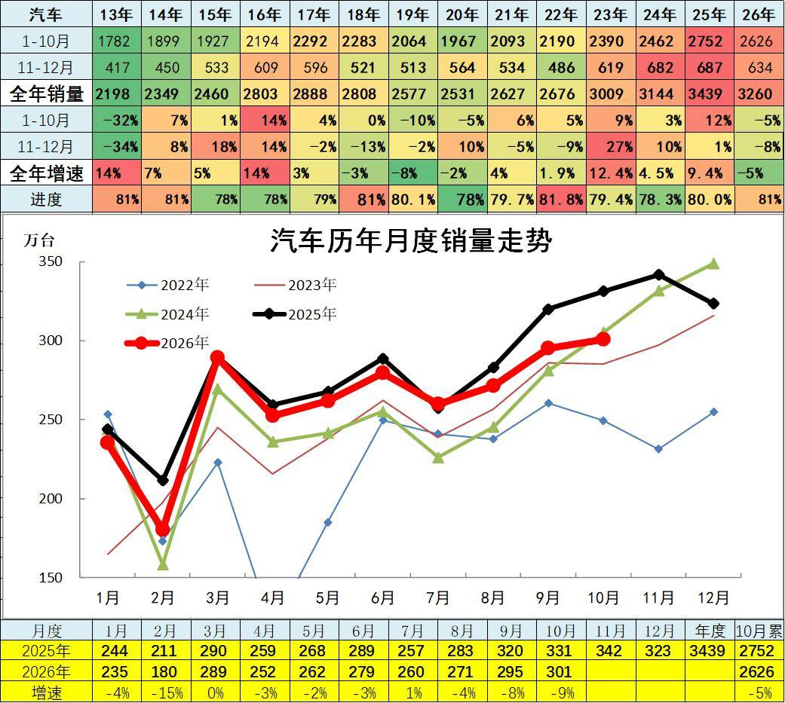

2026年10月汽车总计销量301万台，同比下降9%；2026年1-10月汽车总计销量2626万台，累计下降5%。2026年卡车和客车市场较强，乘用车市场表现稍弱，加之出口强、国内弱，最终总体厂家销量走势相对平稳。

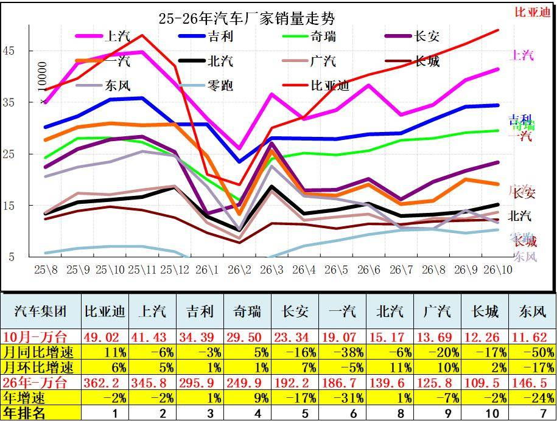

2026年汽车集团的表现剧烈分化，比亚迪等企业快速走强，第一地位日益强化；上汽等传统大集团压力巨大；吉利、奇瑞等企业总体仍保持较强走势。

2、出口占总销量的比重

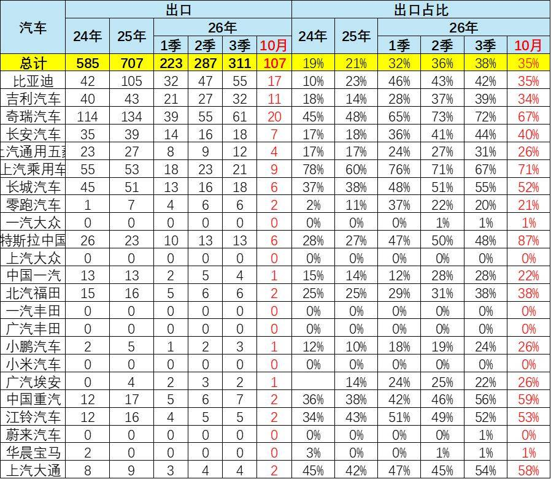

汽车企业的出口占比大幅提升，10月占比达到35%，但稍低于3季度的出口占比，国内车市年末走强。10月 “出口超越内需”成为部分车企核心关注，出口有效稳住车企批发与利润，部分车企出口超50%，出口占车企总量60%的厂商快速增多，出口销量成为拉动车企增长的核心动力。

3、主力车企集团的表现分化剧烈

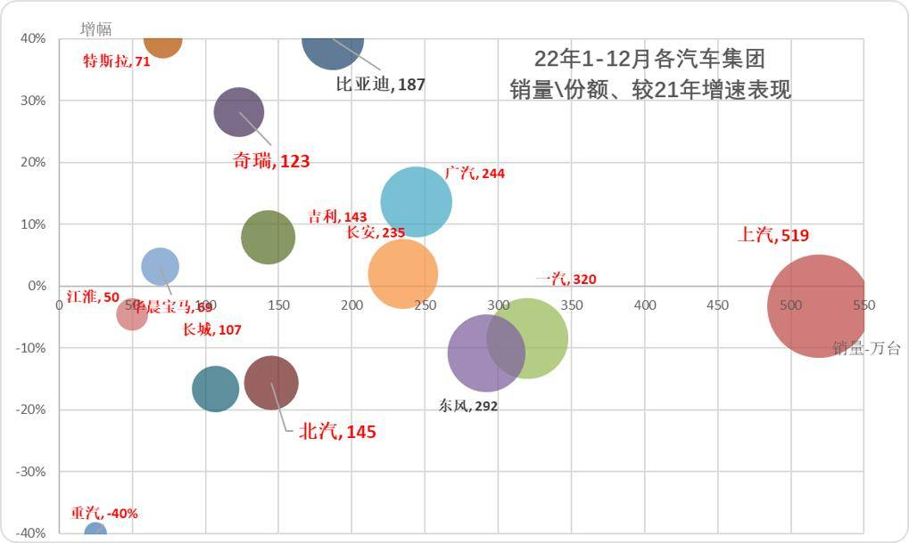

对比上面2021年图表，2022年的部分车企强势表现，行业增速分化严重。2022年年初的疫情导致传统车企压力较大，尤其新能源冲击叠加疫情影响，国有大集团表现分化，广汽和奇瑞表现优秀，其中奇瑞的商用车和乘用车版块表现均很好。北方的一汽、长城、北汽等各家表现都有压力。

2023年初新能源推动车市走势分化。央企三强总体分化，部分国企掉队。比亚迪等新能源企业的表现很好；奇瑞、特斯拉今年的表现相对较强。二线车企表现分化，因为新旧动能转换和新能源车持续亏损压力，自主品牌中小企业分化严重低迷。

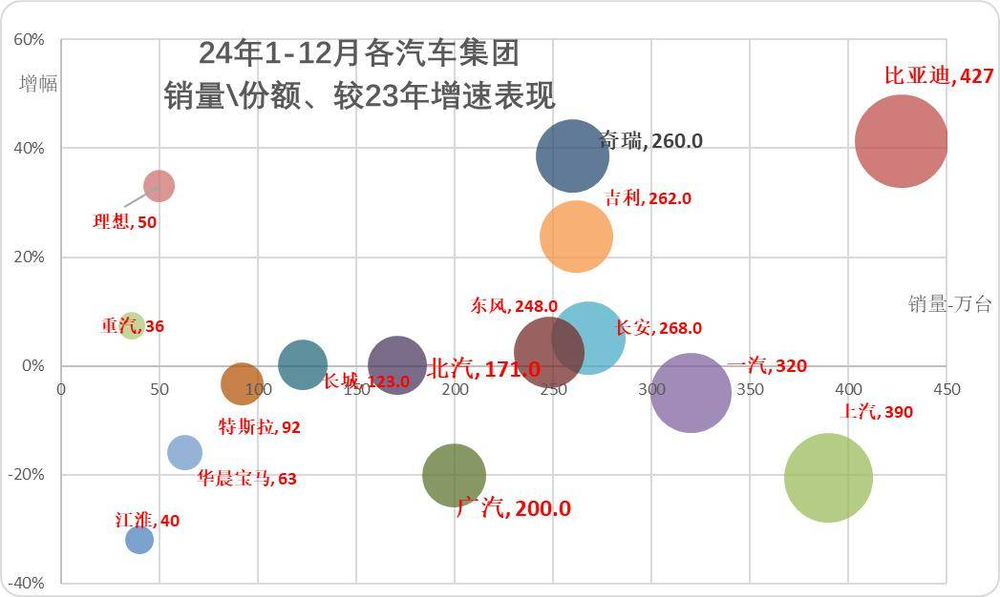

2024年的汽车集团的阵容格局全面变化，比亚迪新品降价增量，由于乘用车销售需求火爆和海外贡献，因此奇瑞、吉利和东风表现的很好，上汽仍处于剧烈下滑中。新能源车的比亚迪和特斯拉增速分化。

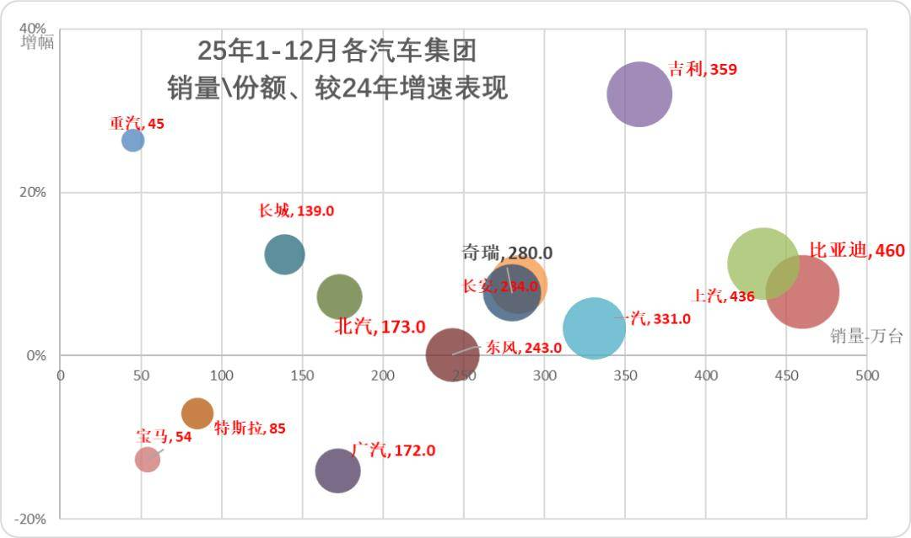

汽车市场的厂家格局巨变，行业呈现增速剧烈的分化，2025年开始的民营企业替代国企成为行业主力，吉利、比亚迪、奇瑞、长城增速保持较高水平。

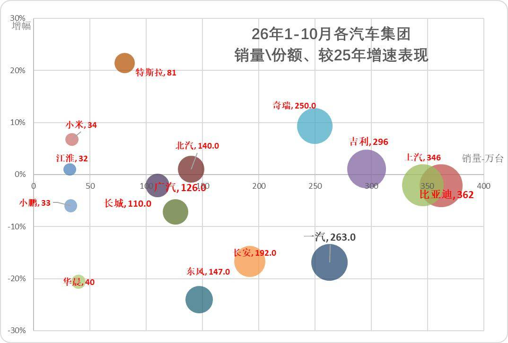

2026年销量领先是各国有企业的奋斗重点，虽然市场严峻低迷，但比亚迪回归第一。上汽和吉利、奇瑞、北汽等今年1-10月表现较强，增速改善。小米、特斯拉等总体表现优秀。

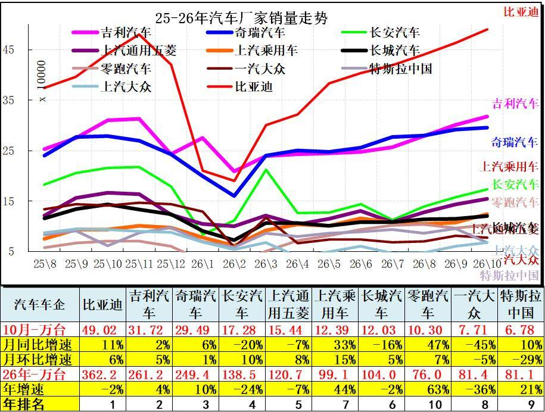

2026年汽车厂家格局相对稳定，自主地位大幅提升。10月厂家销量总体较好，但国内市场零售低迷拖累乘用车厂家表现。长安等部分厂家环比9月走势很强，比亚迪、吉利等同比走强。自主的强势出口企业表现优秀，有合资的集团压力巨大。

4、狭义乘用车企业产销走势

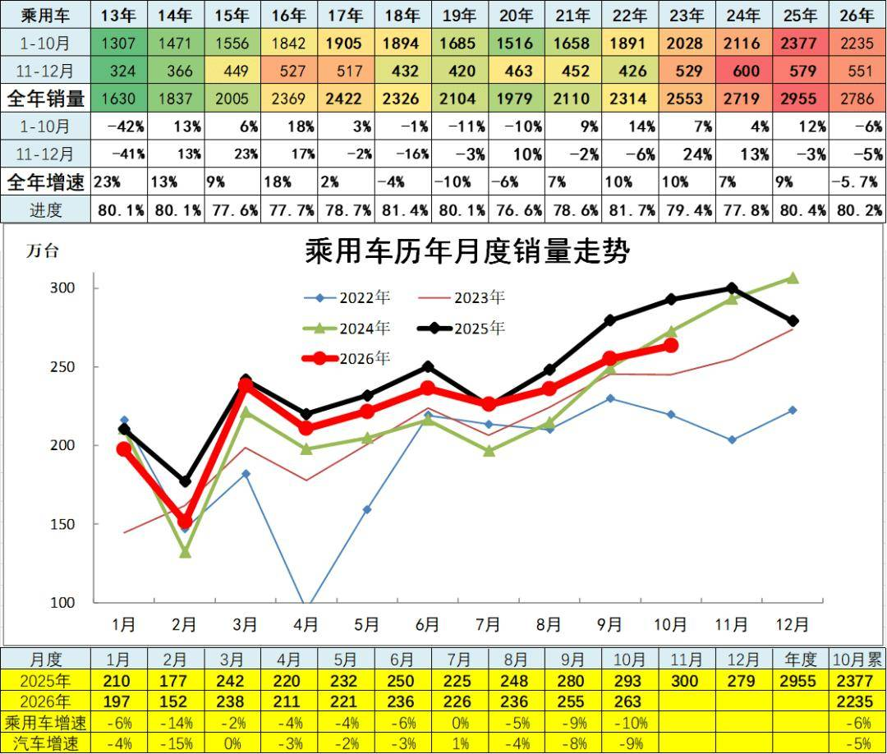

2026年10月狭义乘用车合计销量263万台，同比下降10%；2026年1-10月狭义乘用车合计销量2235万台，同比下降6%。近几年新能源车技术创新、新品竞争力不断增长，燃油车新品推出乏力。2026年年初的新能源车处于调整期， 经销商信心不足，高油价压低增速。

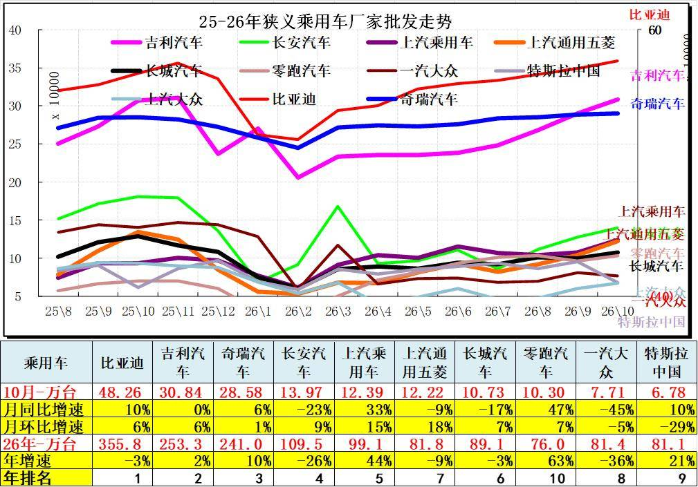

2026年乘用车自主车企全面领先。10月主力车企总体较弱，自主超强。由于高油价，合资车企10月走势较弱。比亚迪领军，吉利汽车第2名， 10月奇瑞汽车保持前3，前三的规模日益接近。合资的一汽大众和上汽大众等表现较低迷。

乘用车主力厂家阵营迅速分化，出口为主的企业和新能源车为主的厂家表现较强，合资表现分化尤为明显，一汽大众和特斯拉较强。

5、新能源乘用车企业产销走势

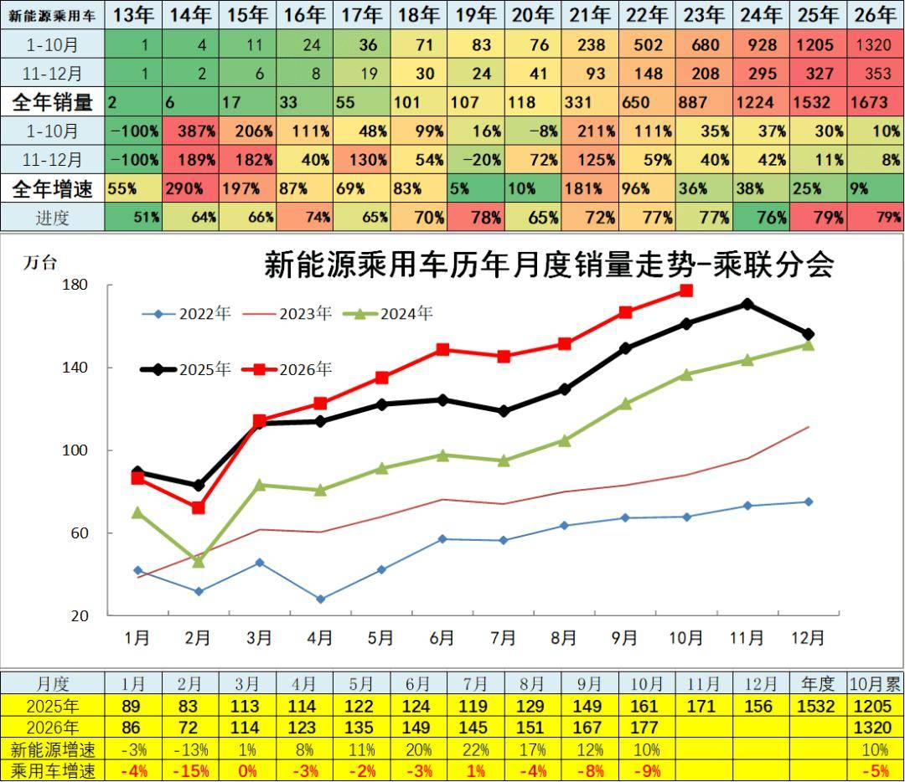

2026年10月新能源乘用车厂家销量合计177万台，同比增10%；2026年1-10月新能源乘用车厂家销量合计1320万台，同比增10% 。2026年报废更新补贴压力大、油价暴涨、消费低迷、新能源车需求弱，出口暴增，新能源车内销与出口反差巨大。

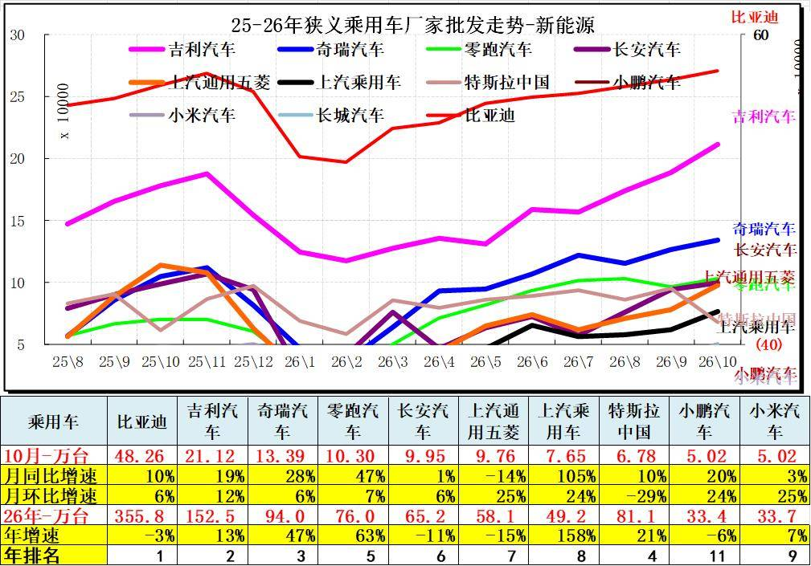

2026年比亚迪保持绝对领先，但插混增长压力较大。吉利总体较强，奇瑞、零跑等新能源增长较强。

6、传统动力乘用车企业产销走势

2025年传统燃油狭义乘用车销量1422万台，同比下降5%，2026年1-10月915万台降22%。随着油价高企，2026年国内燃油车市场走势持续较弱，出口较强，支撑燃油车总体相对平稳。

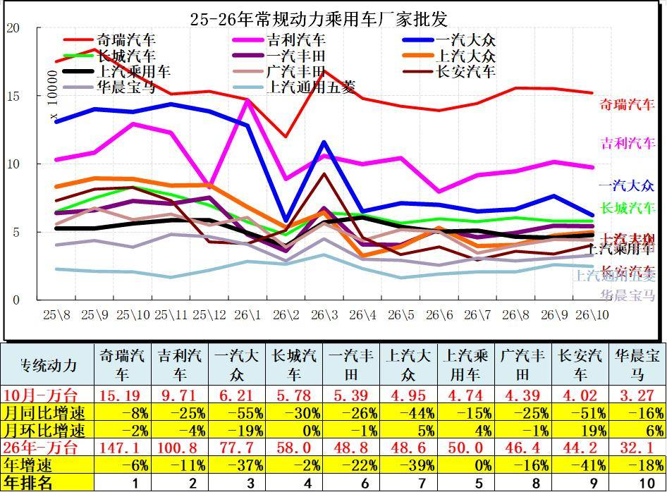

由于出口的支撑，2026年燃油车总体表现分化，自主表现超强，主力合资车企短期内迅速弱化。

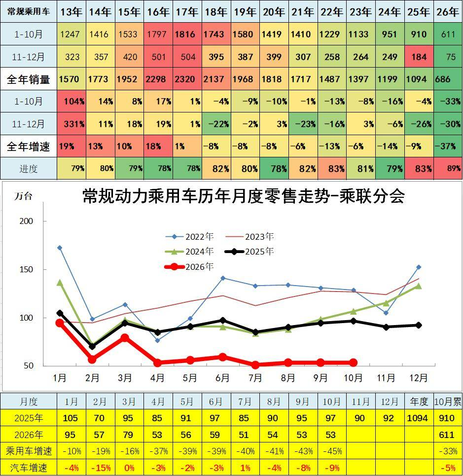

由于3月以来高油价的持续冲击，国内2026年燃油车总体表现严重低迷，4月以来连续7个月是下滑40%左右，市场压力大。

7、客车企业产销分类走势

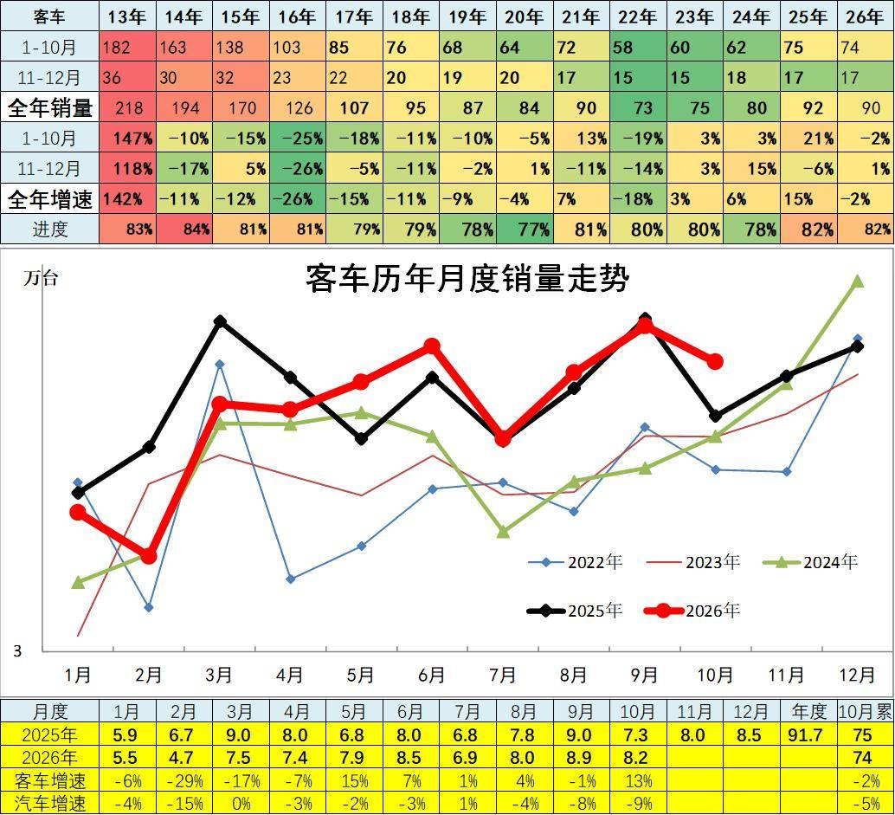

2025年全年累计客车合计销量92万台，累计增速15%；2026年1-10月客车合计销量74万台，同比降2%，出口和新能源物流车的拉动效果较好。

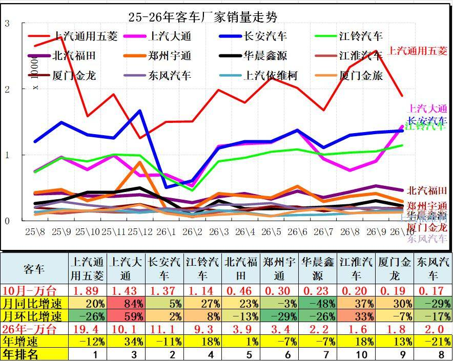

在2025年年底冲刺后，2026年客车走势逐步走强，上汽通用五菱表现很强，上汽大通等头部厂家近几个月销量总体较强，物流类轻客和微客的市场需求波动较大，出口贡献巨大。2026年江铃汽车、上汽大通的商用车增速走势较好，10月五菱、长安、大通等物流车企业总体地位领先。

8、卡车企业产销分类走势

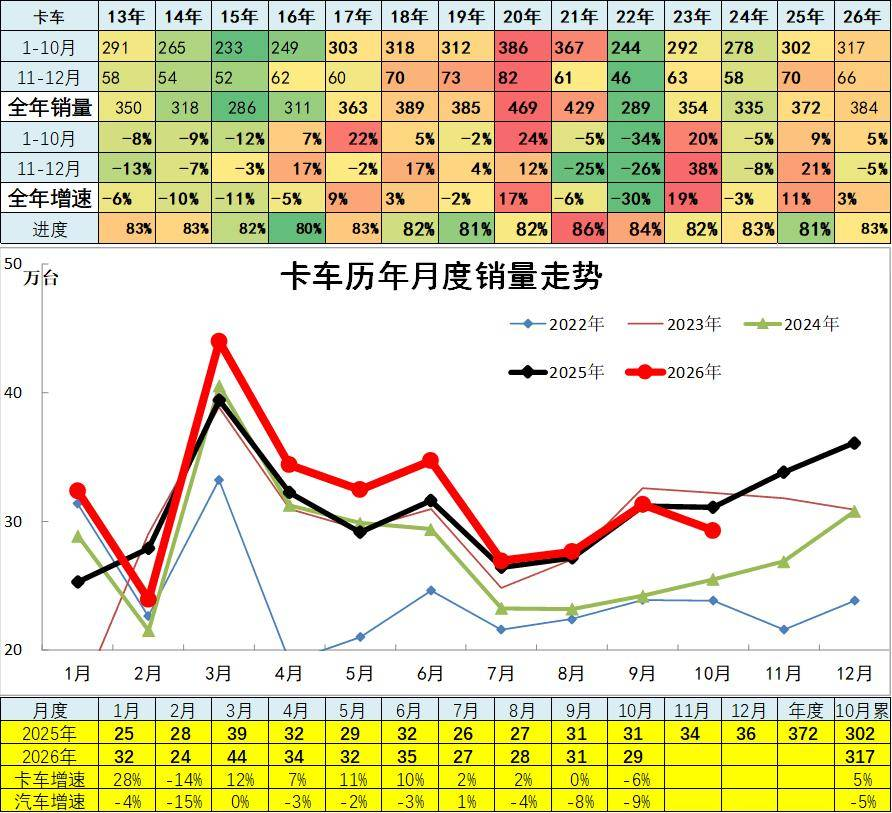

2025年卡车销量372万台，累计增速11%；2026年1-10月卡车销量317万台，同比增长5%，形成消费与生产分化，消费暴跌、生产超强增长态势。10月卡车29万台，同比下降6%。

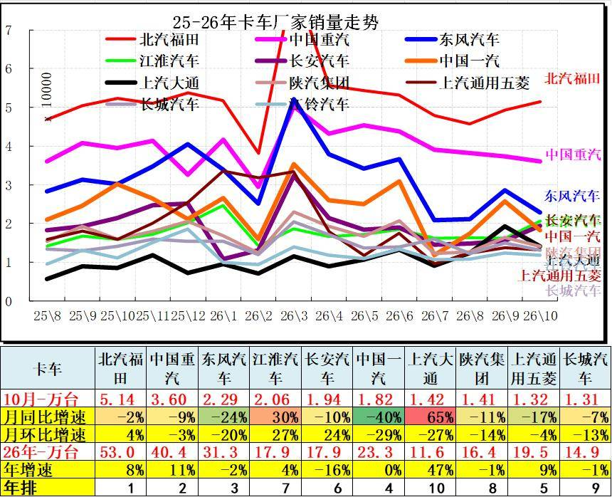

2026年的卡车主力厂家分化较明显，卡车头部厂家表现较强，大通、江淮汽车等车企同比去年10月暴增，陕汽、五菱等表现较差。

商用车补贴效果突出，2026年的重卡暴增，纯电动重卡表现很强，福田、重汽、一汽、陕汽的增长较强，行业格局相对稳定。

附：近日信息合集
