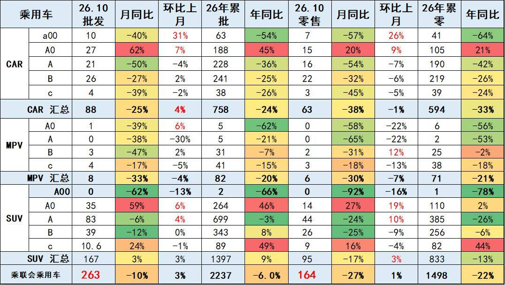
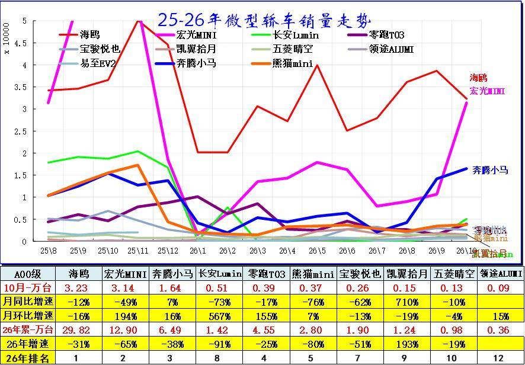
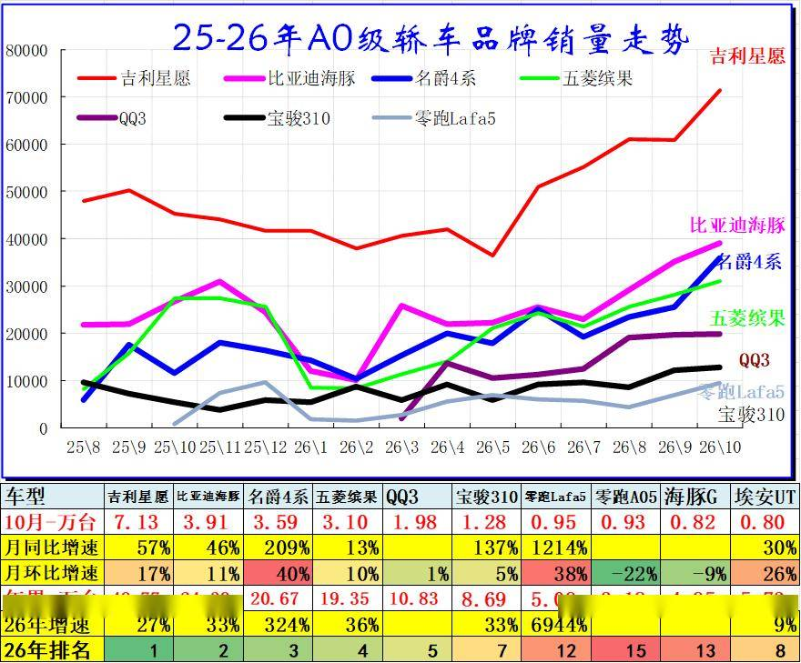
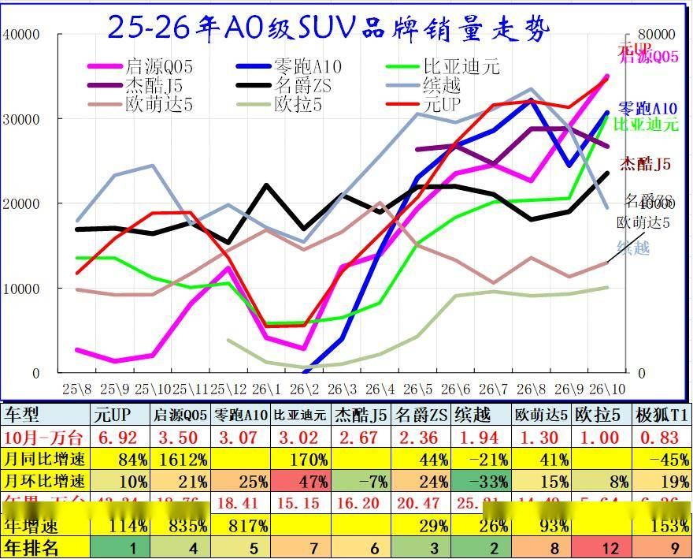
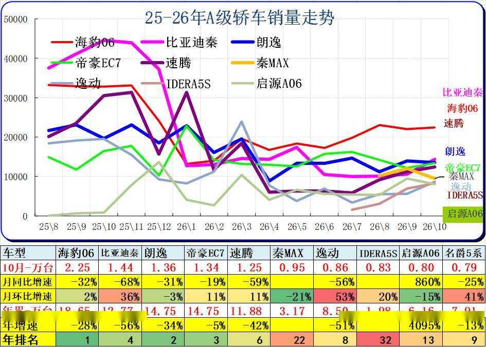
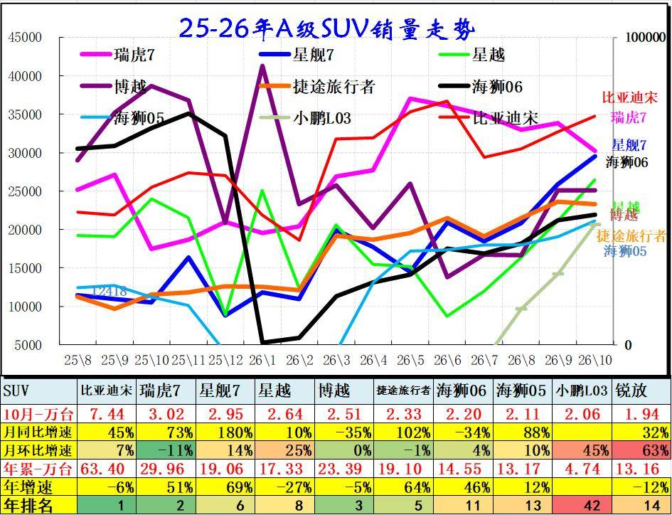
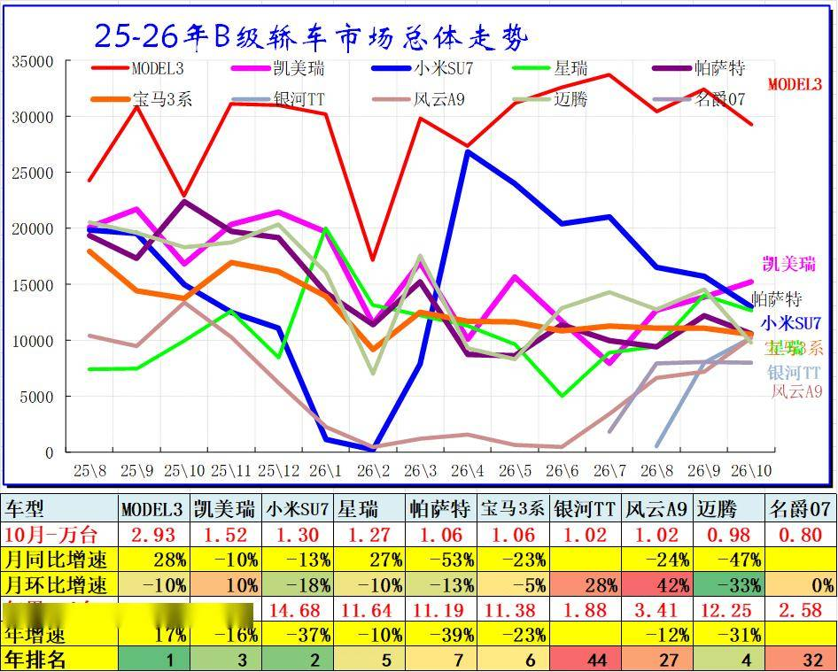
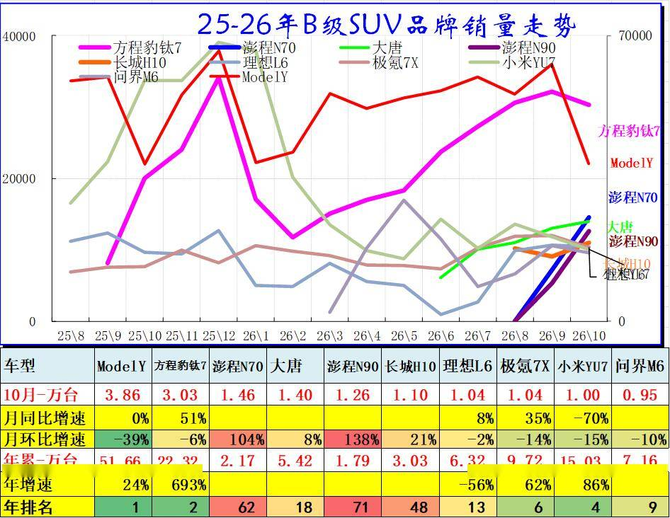
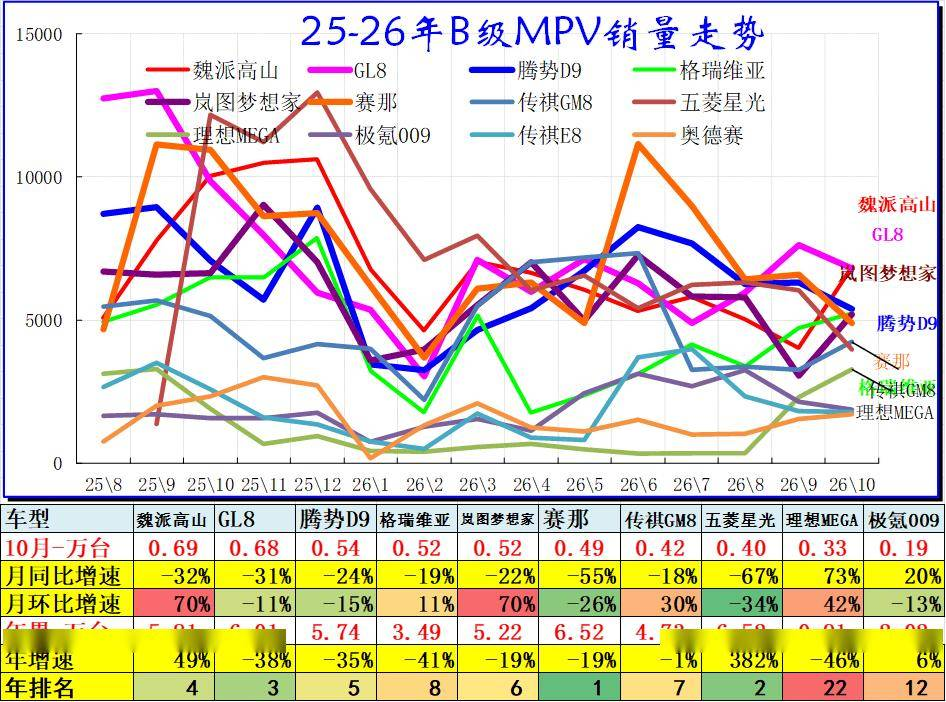

# 2026年10月乘用车细分市场车型走势

- 公開日時: 2026-11-14 21:38（北京時間）
- 出典: [搜狐号・崔东树](https://www.sohu.com/a/1101612641_115312)
- テーマ（自動判定）: セグメント・車種
- 画像: 9枚

---

注：本分析文章仅代表崔东树个人观点，如有异议，请留言。

当前国内车市存量竞争特征凸显，出口需求暴增，行业内部分化持续加剧。新能源市场告别全域增长，呈现“高端电动车爆发、微型电动车车型承压”的两极分化态势，县乡市场、入门级车型下滑过大。同时“新车效应”短期化，对市场拉动效力大幅减弱。渠道端压力持续凸显，行业被动去库存节奏加快，经销商普遍亏损、经营风险攀升。整体而言，10月车市环比走强仅为结构性修复，电动化迭代与海外出口已成为行业长期增长的核心支撑。

2026年10月乘用车零售降27%，批发下降10%，零售大幅弱于的批发增速,形成内冷外热格局。

入门级消费受冲击大。由于高油价冲击和补贴暂停带来零售回落，10月A级轿车零售与A00级轿车零售均较低，A0级轿车和高端车型成为10月零售主力，SUV的高端表现较强，轿车中主要是A0级轿车销量回升。

分结构看，大尺寸、高端的A0、B、C 级SUV 批发端增长突出，而传统轿车以及微型、小型MPV 需求走弱，反映消费向中大尺寸SUV 倾斜，批发与零售走势出现背离，渠道库存压力有所加大。

入门消费受冲击大。由于高油价冲击和补贴暂停带来零售回落，10月A级轿车零售与A00级轿车零售均较低，A0级轿车和高端车型成为10月零售主力，SUV的高端表现较强，轿车中主要是A0级轿车销量回升。

一、经济型乘用车市场走势

1、A00级轿车市场表现

A00级微型轿车市场呈现“双寡头垄断，内部加速洗牌”的极致分化态势。从数据看，海鸥与宏光MINI以绝对优势领跑（月销双双破3万），奔腾小马异军突起稳居第三，而尾部如五菱晴空、领途AUMI月销已不足千辆，断层严重。

竞争格局极其残酷，增速两极分化：奔腾小马、凯翼拾月同比增长，而老牌选手长安Lumin同比暴跌73%。这表明该细分市场已告别早期的“野蛮生长”，正加速从低价内卷转向品质与性价比的综合比拼，缺乏产品迭代能力的弱势车型正被加速淘汰出局。

2、A0级轿车主力车型市场走势

A0级轿车市场呈现“一超多强、整体强劲上扬”的格局。吉利星愿以月销超7万的绝对优势断层领跑，比亚迪海豚与名爵4系紧随其后稳居第二梯队。市场内部洗牌剧烈，名爵4系同比激增324%，而尾部新老车型交替频繁。整体来看，该细分市场马太效应凸显，头部爆款通吃，同时高性价比与产品迭代的竞争已进入白热化阶段。

3、A0级SUV销量走势

2025-2026年A0级SUV市场强势爆发，A0级SUV市场呈现“一超多强、新旧势力剧烈交替”的态势。比亚迪元UP以月销近7万辆的绝对优势断层领跑。同时，新能源新车型爆发力惊人，零跑A10与启源Q05年增速分别高达817%和835%，强势抢占头部位置。

二、A级乘用车市场走势

1、紧凑型轿车主力车型市场走势

A级轿车市场呈现“头部集体衰退，新老势力交替”的疲软态势。主流爆款全面承压，海豹06、比亚迪秦、朗逸、速腾等昔日霸主同比跌幅普遍高达30%-60%以上，市场整体缺乏向上动能。传统合资燃油轿车与前期新能源车型同步陷入增长瓶颈，只能依靠降价与市场惯性维持基盘。唯独启源A06凭借极低基数逆势暴涨（同比860%），成为全场唯一黑马。这标志着A级车固化的格局正被打破，在极度内卷下，唯有极具杀伤力的纯电动新产品才能突围。

2、紧凑型SUV主力车型市场走势

A级SUV市场呈现“新能源绝对主导，新老爆款剧烈交替”的格局。比亚迪宋以月销超7万的断层优势领跑，同时星舰7（同比+180%）、捷途旅行者等新锐车型爆发力极强，强势上攻。反观博越等传统热门车型则遭遇同比大幅下滑。该细分市场马太效应极度凸显，爆款通吃，缺乏智能化与新能源转型迭代的传统车型正面临被边缘化的危机。

三、B 级乘用车市场走势

1、B级及C级轿车市场走势

B级轿车市场呈现“特斯拉领跑，传统合资全面溃败，新势力加速洗牌”的剧烈分化格局。Model 3以近3万辆断层领先；反观帕萨特、迈腾、宝马3系等传统燃油主力，同比普遍暴跌20%-50%以上，昔日溢价体系正被击穿。新势力内部亦剧烈动荡，小米SU7累计虽居前列但单月现疲态，银河TT、风云A9等新锐车型正快速上量。这表明B级车已彻底转向新能源主导，缺乏智能化代际优势的传统车型正加速出清。

2、B级SUV市场走势

B级SUV市场呈现“一超多强、新老剧烈交替”的洗牌态势。特斯拉Model Y以近4万月销断层霸榜；方程豹钛7化身最强黑马（年增693%）紧随其后。极氪7X、小米YU7等新锐势力快速上量，而理想L6等老款则遭遇断崖式下滑。尾部新秀（如彭程系列）单月冲量凶猛，市场趋势性很强，缺乏智能化代际优势的车型正加速边缘化。

3、B级及以上MPV市场走势

2026年高端MPV市场呈现“极度分散、存量厮杀”的混战特征。头部无绝对霸主，魏派高山、GL8等月销均在七千辆左右，且整体大盘严重承压，赛那、GL8等传统合资主力同比暴跌超30%，昔日红利见顶。格局正剧烈重塑，魏派、岚图凭借新能源优势单月环比暴增70%强势反弹，理想MEGA同比回暖。市场已彻底告别单极化时代，进入新能源替代与产品价值重构的残酷淘汰期。

附：近日信息合集
