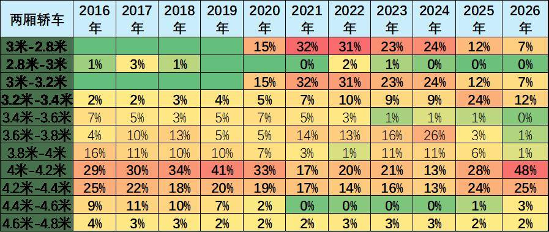
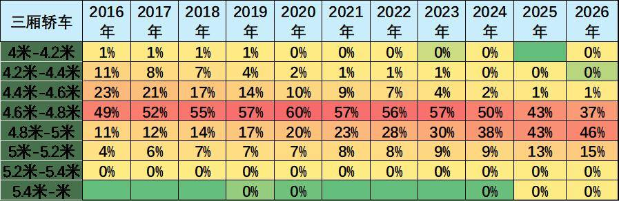

# 中国乘用车零售市场车长变化分析

- 公開日時: 2026-11-15 16:43（北京時間）
- 出典: [搜狐号・崔东树](https://www.sohu.com/a/1101874141_115312)
- テーマ（自動判定）: 乗用車市場
- 画像: 2枚

---

中国乘用车市场正经历一场由新能源技术与消费升级驱动的“形态革命”。十年间，新车平均车长增至4.72米，大盘格局被彻底颠覆：SUV以56%份额强势称王；MPV告别低端，全面走向5.2米以上的极致豪华；传统三厢轿车退守，两厢跨界车逆势上扬。整体结构上，4.5-4.8米的传统“黄金尺寸”遭遇严重挤压，市场呈现出向4.8米以上越级大车与4.5米以下纯电代步车两极分化的“哑铃型”特征。尺寸膨胀的本质，是纯电平台空间释放与车企“越级内卷”降维打击的共同结果，标志着中国车市已告别按轴距划分级别的旧时代，全面迈入大空间与智能化深度融合的场景竞争新纪元。

一、国内零售的车身结构变化

2016-2026年乘用车三大品类及车身形式的结构演变表，中国车市的底层消费逻辑和形态发生了颠覆性的重塑。2026年的乘用车市场已彻底摆脱了“轿车主导”的传统格局。“SUV化”和“两厢化/跨界化”成为两大鲜明标签。这不仅仅是尺寸的改变，更是新能源技术普及后，消费者对汽车“空间利用率”和“实用形态”的重新投票。

1. 品类大盘：SUV强势称王，轿车退守，MPV边缘化。SUV狂飙：从2016年的38%一路攀升至2026年的56%，占据绝对主导。这印证了前文的分析——中国消费者对“大空间、高视野、多功能”的诉求不可阻挡，叠加新能源大SUV（理想、问界等）的爆发，SUV彻底吞噬了轿车的基盘。

CAR（轿车）失守：从52%萎缩至40%，跌破半壁江山。MPV持续萎缩：从11%跌至5%。虽然前文指出MPV在向高端大尺寸集中，但总量上的萎缩说明其家用市场已被大六座/七座SUV严重分流。

2. 轿车内部裂变：两厢车迎来“史诗级逆袭”。两厢车：从2016年的15%一路攀升至2026年的35%。在传统燃油车时代，两厢车（除高尔夫、飞度外）因“没屁股”不受待见；但在新能源时代，纯电平台带来的短悬长轴设计、以及海豚、海鸥、甚至特斯拉/小米等掀背轿跑的流行，让两厢车（包含跨界车）焕发了第二春。三厢车：从85%的绝对垄断，跌落至65%。传统燃油A级/B级三厢轿车的地盘被不断蚕食。

2022-2026年国内零售车长结构体现了中国乘用车市场正在经历一场“全面膨胀与结构重塑”的深刻变革。这不仅仅是尺寸的简单放大，更是新能源技术赋能后，消费需求形态的彻底重构。

大盘趋势：平均车长突破“4.7米”大关。从2022年的4.61米一路攀升至2026年的4.72米，五年间平均车长增加了11厘米。在造车物理空间受限的背景下，这是一个极其夸张的跨越，标志着中国车市正式进入“大车时代”。

传统“黄金尺寸”瓦解，4.8-5米成为新主流。过去，4.5-4.8米（如轩逸、卡罗拉、CR-V）是绝对的销量基石。但该区间份额从2022年的61.3% 断崖式下跌至2026年的50.0%。取而代之的是4.8-5米区间，份额从16.0%暴涨至26.6%。这意味着，曾经的B级车尺寸，如今已彻底沦为A级或主流家用车的标配（如比亚迪秦L、极氪7X等）。

极度高端化：5.2米以上车型爆发。这是表格中最震撼的数据：5.2米以上超大型乘用车，从2022年的1.5%飙升至2026年的6.7%（2026年10月单月甚至高达7.5%）。理想L9、问界M9、腾势D9等全尺寸SUV/MPV的井喷，证明了中国消费者对“大六座/大七座”高端移动空间的强劲购买力。

哑铃型结构凸显：4-4.5米的小型车韧性十足。在大型化趋势下，4.0-4.5米区间在2026年依然保持了17.1% 的份额。这主要得益于纯电平台的赋能，海豚、吉利星愿等A0级纯电车凭借极致的空间利用率，在城市代步市场站稳了脚跟。而3-4米的微型车（如宏光MINI）在经历爆发后，份额已回落至2.2%。

两厢轿车市场的消费升级/空间需求增加：市场明显向4米-4.4米的中型两厢车集中。曾经在2020-2022年短暂风靡的微型/小型车（3米-3.2米，如五菱宏光Mini EV等微型电车），受政策和成本压力而大幅消退。

极两端市场萎缩：超短车长（<3米）和较长车长（>4.4米）的两厢车在市场份额中一直处于边缘化地位。2026年，仅“4米-4.2米”这一个区间就吃掉了近一半的市场份额，AO级级车的家用第二辆车需求显著。

三、三厢轿车的车长变化

2016-2026年三厢轿车（Sedan）的车长分布表，轿车市场的尺寸演变呈现出“向大而生，中端膨胀”的特征。与SUV和MPV的极端扩张不同，轿车受限于操控和风阻，尺寸有明确的物理天花板，但内部结构已完成大换血。三厢轿车完成了从“入门代步”向“高端越级”的转型。在国产新能源轿车（如比亚迪汉、小米SU7等）的“降维打击”下，4.8-5.2米的大空间、高智能车型成为了市场绝对主力，而曾经霸榜的4.6-4.8米合资B级车和4.6米以下的入门车，双双走向衰退。

紧凑型及以下（4.6米以下）彻底边缘化。2016年，4.0-4.6米区间合计占据35%的份额，但到2026年已跌至仅剩1%。这表明A级及以下的入门级三厢轿车（如传统的桑塔纳、捷达、入门家轿等）基本退出了主流舞台，其生态位被纯电小车（A00级）或紧凑型SUV完全取代。

传统“B级黄金尺寸”（4.6-4.8米）份额严重缩水。该区间在2019年巅峰时占据57%的绝对统治地位（如雅阁、凯美瑞、迈腾等），但到2026年已下滑至37%。传统合资B级车的护城河正被尺寸更大的新能源轿车快速瓦解。

中大型轿车（4.8-5.2米）迎来爆发式膨胀。这是轿车市场最大的变量。4.8-5米区间从2016年的11%，狂飙至2026年的46%；5-5.2米区间也从6%翻倍至15%。两者合计占据了61%的绝对主导权。

2016-2026年的MPV车长数据，呈现出极端的 “断崖式向上迁移”特征，MPV市场完成了从“工具属性”向“高端豪华属性”的彻底跃迁：MPV市场的底层逻辑已被彻底颠覆。过去作为“多拉快跑”的生产工具，如今在新能源（如魏牌蓝山、腾势D9等）和智能化加持下，全面转向了高附加值、大空间的“高端家庭与商务出行”场景。低端MPV被淘汰，全尺寸MPV称王，市场消费升级极度彻底。

中小型MPV（4.8米以下）遭遇毁灭性出清。2016年，4.2-4.8米区间占据绝对主力（合计高达91%），多为拉货或低端载客的“面包车”形态。但到2026年，这一区间暴跌至仅剩13%，传统的低端商务/工具车市场几乎完全萎缩。

中大型与全尺寸MPV（5米以上）实现绝对统治。5-5.2米区间从5%稳步攀升至26%；更震撼的是，5.2-5.4米的超大型MPV，从2016年的1%狂飙至2026年的48%，几乎占据半壁江山。

国内SUV市场呈现出极为显著的“尺寸膨胀、结构剧变”特征。SUV的底层消费逻辑已彻底改变。随着新能源化与智能化推进，“大六座/七座”的高端化需求（如理想L9、问界M9等5.2米+车型）成为核心增量，而低端小型SUV生存空间被极限挤压，市场呈现极端的“哑铃型”向“倒金字塔”演变的态势。

AO级SUV（4.6米以下）遭遇断崖式萎缩。 2016年4.6米以下车型合计占据半壁江山（54%），但到2026年已暴跌至23%。其中4米-4.2米几乎清零，4.4-4.6米从30%腰斩至14%，说明基础代步型SUV正被轿车或新能源小车严重分流。

A级为主的SUV传统“黄金尺寸”（4.6-4.8米）份额触顶回落。 该区间长期是市场绝对主力（如CR-V、哈弗H6），2023年巅峰时达50%。但到2026年下滑至39%，表明消费者已不再满足于标准的5座中型SUV。

B级中大型及全尺寸SUV（4.8米以上）迎来爆发式增长。 4.8-5米区间从2016年的5%飙升至2026年的22%。更夸张的是5米以上区间，从早年的0%跃升至2026年的15%（其中5.2-5.4米高达8%）。
