# 2026年10月汽车增加值0.9%、汽车生产降8%，消费降21%，新能源汽车渗透率67%

- 公開日時: 2026-11-16 11:39（北京時間）
- 出典: [搜狐号・崔东树](https://www.sohu.com/a/1102134629_115312)
- テーマ（自動判定）: 産業統計
- 画像: 11枚

---

今年1-10月生产供给平稳增长，市场销售规模扩大，对外贸易快速增长，就业物价总体稳定，新质生产力茁壮成长，国民经济运行延续总体平稳、向新向优发展态势。但在国际高油价冲击下，传统汽车消费压力较大。

2026年1-10月汽车生产2641万台，同比降4%；新能源汽车生产1448万台，同比增13%，渗透率55%；燃油车生产1193万台，同比降19%。2026年10月汽车生产305万台，同比降8%；新能源汽车生产203万台，同比增17%，渗透率67%；燃油车生产102万台，同比降35%。10月汽车工业增加值增0.9%，1—10月份，汽车工业增加值增长6.5%,表现较强。

汽车行业去产能力度较强。2026年1—10月份，汽车行业固定资产投资同比下降7.9%，仍高于-8.1%的各行业平均水平，但高于制造业-2.4%的投资下滑幅度。

26年10月份，社会消费品零售总额46463亿元，同比增长0.4%。其中，汽车消费额3301亿元、同比降21%；除汽车以外的消费品零售额43162亿元，增长2.5%。1—10月份，社会消费品零售总额416464亿元，同比增长1.0%。其中，汽车消费额32653亿元、同比降16%；除汽车以外的消费品零售额383811亿元，增长2.8%。

2026年汽车消费呈现“政策延续、市场分化、需求承压”的复杂局面。以旧换新政策仍在持续发力，但受制于燃油车加速萎缩、价格高企打压消费信心、低端市场低迷等因素，零售端总量仍在下滑。石油制品消费的稳健增长，则反映出居民出行需求仍具刚性，汽车消费疲软更多指向耐用品消费意愿和可支配收入的边际弱化。

由于2026年以旧换新的乘用车补贴力度远低于商用车，因此商用车补贴推动新能源零售增长特别好，新能源乘用车暴跌。目前乘用车入门级消费压力很大，而中国汽车的高端消费太强、普及水平太低，期待未来能有长效的强力接续政策，减免购车人员个税、推动新能源车下乡、设立经济型电动车标准，优化C7经济型电动车驾照申领、给200公里以下续航的合规纯电动车车购税更大优惠、鼓励结婚和生育购车等更多的改善措施，拉动购车消费促进经济增长。

1.汽车消费相对平稳下行

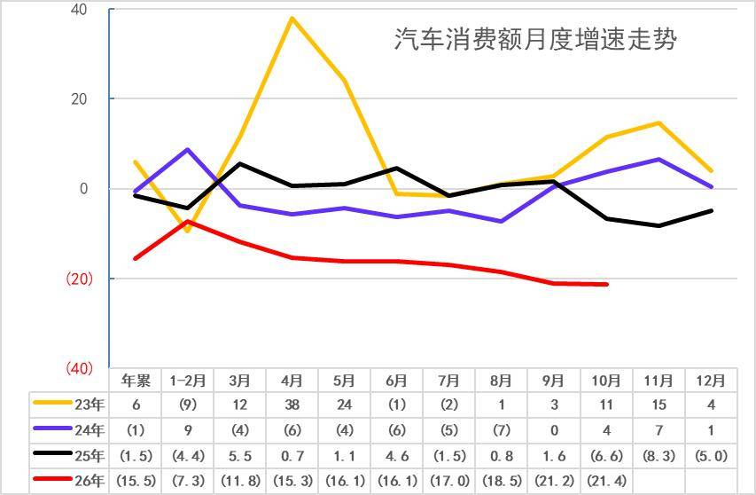

自从楼市2021年下跌以来，汽车消费从2020年的3.94万亿元上升到2024年的5.03万亿元，摆脱了2018-2020年连续3年徘徊在3.9万亿元的被动局面。由于房地产下跌利好消费，买房投资挤压消费问题改善，目前看消费不旺的问题稍有改善。

2026年1-10月份，汽车消费同比降15.5%,10月汽车消费同比降21.4%,基数连续拉高后，今年的回落较大，2025年的3月和6月、9月的高基数压力最大，今年10月的基数不高，但汽车零售的走势压力仍较大，高油价的消费冲击剧烈。

2.2026年汽车产量走势偏弱

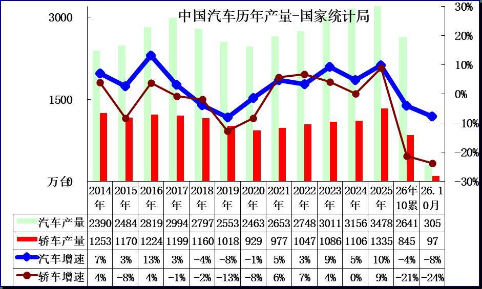

分产品看，10月份，规模以上工业626种产品中有254种产品产量同比增长。其中，汽车304.5万辆，下降7.7%，其中新能源汽车202.7万辆，增长17.1%；发电量7940亿千瓦时，下降2.1%；原油加工量5830万吨，下降8.1%。。

3.2026年汽车增加值表现变化较大

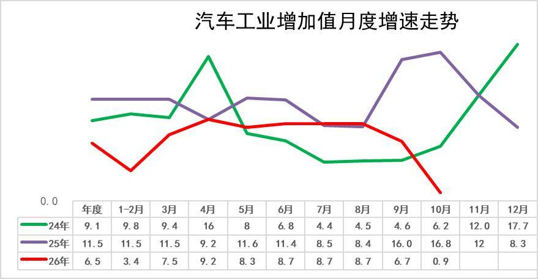

2020年汽车工业增加值增6.6%；2021年增速徘徊在5.5%的水平；2022年的汽车增加值6.3%，较强；2023年汽车业增加值增13%，实现超强增长；2024年的9.1%的汽车增加值相对提升较好；2025年的汽车工业增加值增11.5%。

26年1—10月份，规模以上工业增加值同比增长5.3%.10月份，规模以上工业增加值同比实际增长4.8%。,其中10月汽车工业增加值增0.9%，去年10月需求开始低迷，但工业增加值滞后两个月，今年的压力开始体现。1—10月份，规模以上工业增加值同比增长5.3%。，汽车工业生产增长6.5%。

4.汽车产能利用率相对平稳

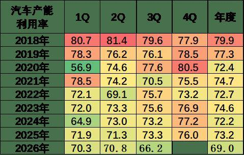

2020-2024年全国工业产能利用率保持在72.4—74.6的较小波动范围内。2024年四季度，全国规模以上工业产能利用率为76.2%，比上年同期上升0.3个百分点，比三季度上升1.1个百分点。2025年全国规模以上工业产能利用率为74.4%。分主要行业看，2025年汽车行业产能利用率73.2%，相对处于较低水平。

2026年1-9月，汽车行业产能利用率为69%，同比去年下降4.2个百分点.。2026年1季度，汽车行业产能利用率为70.3%，同比去年下降1.6个百分点；2026年2季度，汽车行业产能利用率为70.8%，同比去年下降0.5个百分点。2026年3季度，汽车行业产能利用率为66.2%，同比去年下降7.1个百分点。

5.汽车生产具体情况相对正常

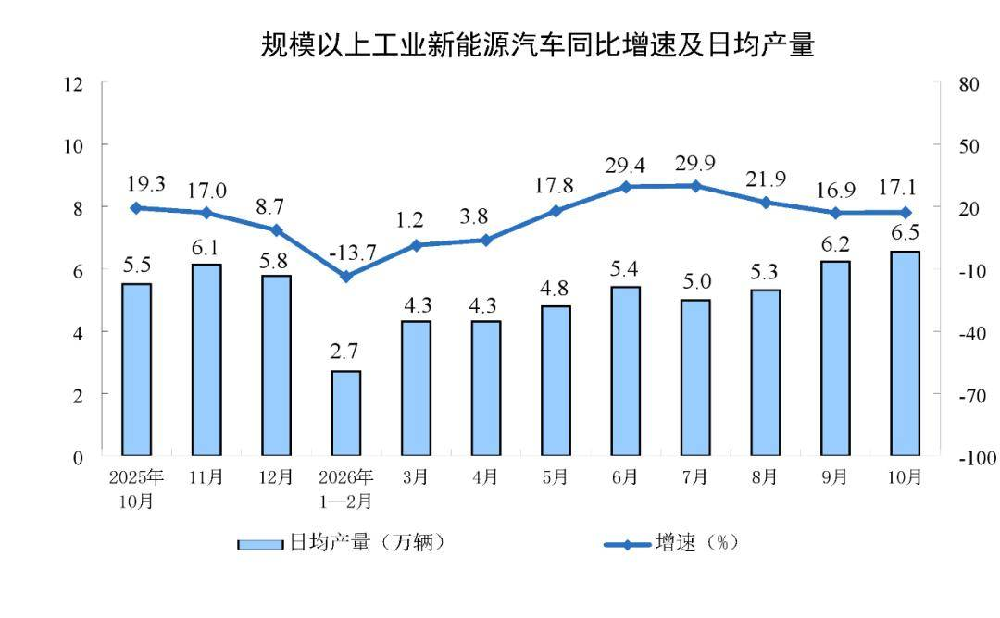

2026年10月份日均新能源汽车生产6.5万台，同比增17.1%。由于新能源轿车的去年基数较高，今年生产波动较大。2025年新能源车的生产较好是小微型电动车，需求也是中低端的需求较强，因此销售额增速稍低于销量增速。今年补贴锐减的小微型冲击较大，但商用车补贴高，新能源商用车市场暴涨。

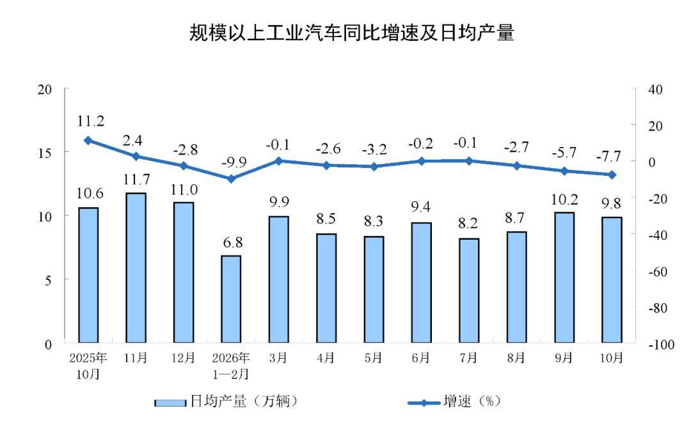

分产品看，2026年10月份，汽车日均9.8万辆，降7.7%，考虑到2025年1-10月基数抬高，2026年年政策性补贴收缩，今年1-10月增速的表现较弱。

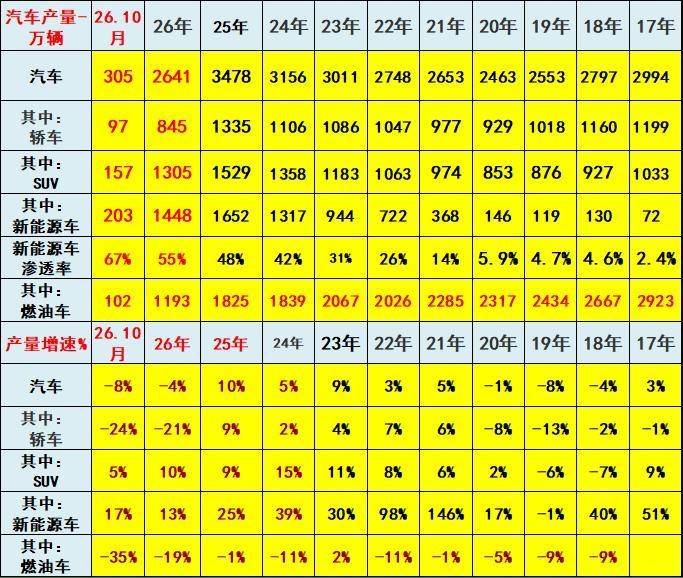

2022年汽车生产2748万台，同比增3%；新能源汽车生产722万，同比增98%，渗透率26%；燃油车生产2026万台，同比降11%。

2023年汽车生产3011万台，同比增9%；新能源汽车生产944万台，同比增30%，渗透率31%；燃油车生产2067万台，同比增2%。

2024年汽车生产3156万台，同比增5%；新能源汽车生产1317万台，同比增39%，渗透率42%；燃油车生产1839万台，同比降11%。

2025年汽车生产3478万台，同比增10%；新能源汽车生产1652万台，同比增25%，渗透率48%；燃油车生产1825万台，同比降1%。

2026年1-10月汽车生产2641万台，同比降4%；新能源汽车生产1448万台，同比增13%，渗透率55%；燃油车生产1193万台，同比降19%。

2026年10月汽车生产305万台，同比降8%；新能源汽车生产203万台，同比增17%，渗透率67%；燃油车生产102万台，同比降35%。

6.2026年汽车投资持续回落

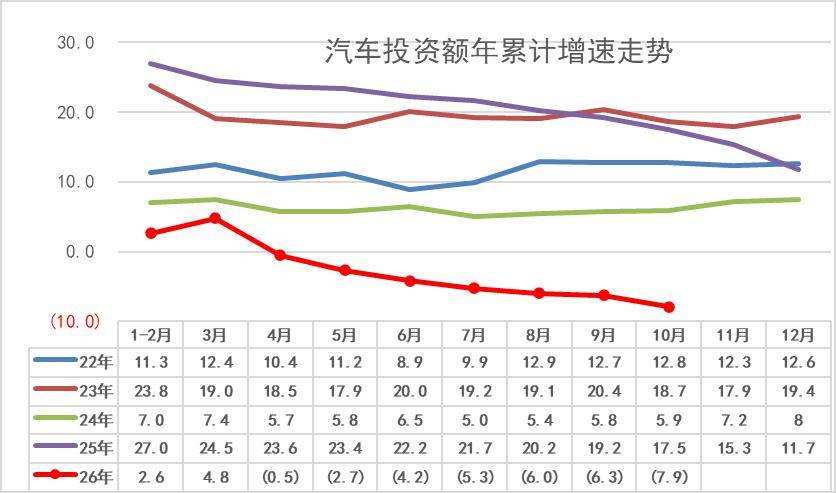

1—10月份，全国固定资产投资（不含农户）364824亿元，同比下降8.1%。第一产业投资7018亿元，同比下降6.1%；第二产业投资142333亿元，下降3.6%；第三产业投资215473亿元，下降10.9%。工业投资同比下降3.6%。其中，制造业投资下降2.9%。1—10月份，民间固定资产投资同比下降11.4%。

2026年1—10月份，汽车行业固定资产投资同比下降7.9%，仍高于-8.1%的各行业平均水平，但高于制造业的投资下滑。

7.房地产的消费挤压问题稍有改善

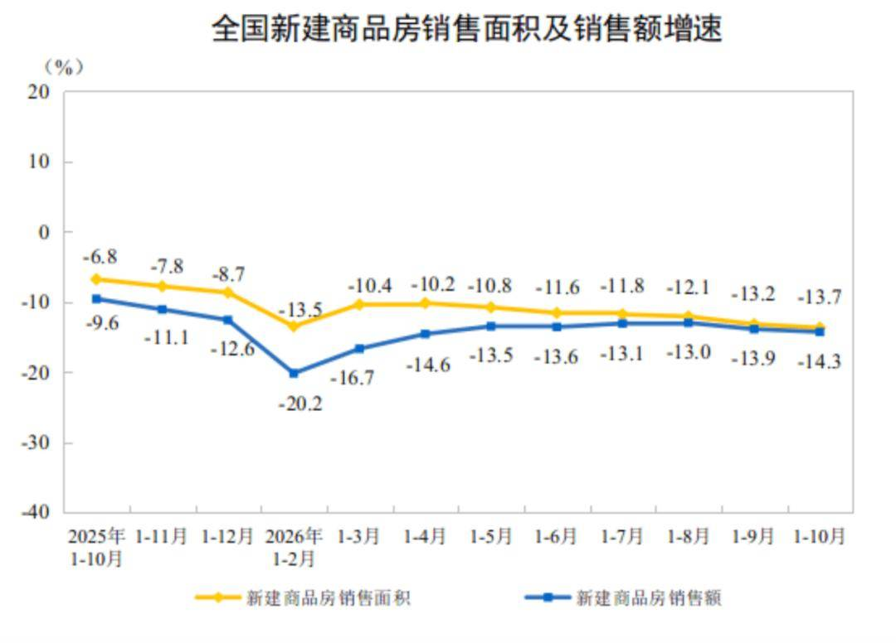

1—10月份，全国房地产开发投资57215亿元，同比下降21.6%（按可比口径计算，详见附注5）；其中，住宅投资44102亿元，下降21.4%。1—10月份，房地产开发企业房屋施工面积568164万平方米，同比下降13.0%。

1—10月份，新建商品房销售面积61358万平方米，同比下降13.7%；其中住宅销售面积下降14.2%。新建商品房销售额58550亿元，下降14.3%；其中住宅销售额下降14.1%。

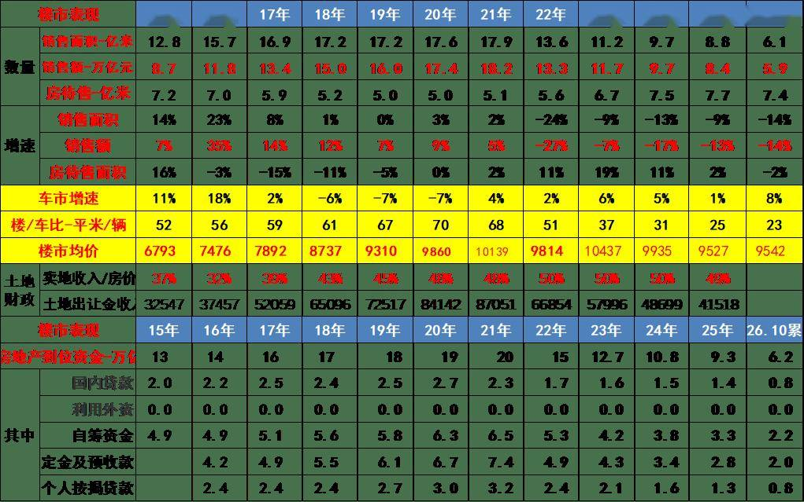

2021年土地出让金收入87051亿元，占房地产销售额48%；2023年土地出让金收入57996亿元，占房地产销售额50%；2024年土地出让金收入48699亿元，占卖房收入50%，房地产对地方财政贡献巨大。2025年卖地收入数据仍占房价49%。

目前，2026年1-10月汽车销量与房地产销量关系是23平米房/1辆车，销量的对比不合理现象有所改善。虽然房车比最高时的2020年70平米房/1辆车有所改善，但前期的债务压力和目前万元均价的楼市挤压消费压力仍大，导致车市需求因债务压力低迷。

楼市的财富效应对高端车需求有一定的促进效果，近期居民的楼市债务压力下降和购房需求减弱，对改善车市消费也带来一定潜在利好。

8.车市消费需要有持续政策支持

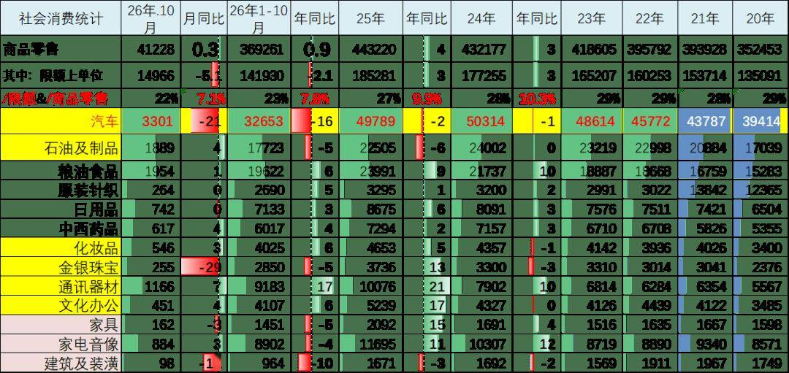

自从楼市2021年下跌以来，汽车消费从2020年的3.94万亿元上升到2025年的4.98万亿元，摆脱了2018-2020年的连续3年徘徊在3.9万亿元的被动局面。由于房地产下跌减少消费者购房的预期，释放消费潜力，利好消费，买房投资挤压消费问题改善。2025年，社会消费品零售总额501202亿元，比上年增长3.7%。其中，汽车消费额49789亿元、同比降2%；除汽车以外的消费品零售额451413亿元，增长4.4%。

生活成本大幅上涨，衣食消费增长过快，购车消费被吃穿挤压严重。2026年1-10月车市消费降15%，目前看消费不旺的问题仍有待改善。

26年10月份，社会消费品零售总额46463亿元，同比增长0.4%。其中，汽车消费额3301亿元、同比降21%；除汽车以外的消费品零售额43162亿元，增长2.5%。　1—10月份，社会消费品零售总额416464亿元，同比增长1.0%。其中，汽车消费额32653亿元、同比降16%；除汽车以外的消费品零售额383811亿元，增长2.8%。

2026年汽车消费呈现“政策延续、市场分化、需求承压”的复杂局面。以旧换新政策仍在持续发力，但受制于燃油车加速萎缩、价格战稀释消费信心、低端市场低迷等因素，零售端总量仍在下滑。石油制品消费的稳健增长，则反映出居民出行需求仍具刚性，汽车消费疲软更多指向耐用品消费意愿和可支配收入的边际弱化。
