# 全国乘用车行业2026年10月末库存334万辆、库存60天、满意度21%

- 公開日時: 2026-11-17 09:41（北京時間）
- 出典: [搜狐号・崔东树](https://www.sohu.com/a/1102550582_115312)
- テーマ（自動判定）: 在庫
- 画像: 15枚

---

注：本分析文章仅代表崔东树个人观点，如有异议，请留言。

2026年10月末全国乘用车行业库存334万辆，环比上月增13万辆，同比2025年10月下降7万辆，形成9-10月库存持续回升的特征。预测团队2025年对市场预测很乐观，2025年10月开始满意度持续暴跌到低位。2026年10月乐观度23%，11月初的10月月后满意度为21%，预期低但满意度也差，主要是高油价的冲击太大。

根据2026年10月底的库存与未来3个月国内零售量综合预估的现有库存支撑未来销售天数在60天，相对于2023年10月的50天、2024年10月的49天，2025年10月的61天，今年10月的总体库存天数相对仍有压力。

从仅生产新能源车的企业的库存变化特征分析看，2023年年初库存20万辆，随后进入库存快速增长期，2025年4月仅生产新能源车的企业的库存达到88万辆，这是近期的峰值。随着反内卷的推动，2026年10月仅生产新能源车的企业的总库存上升到98万辆，环比上月增10万台，较2025年11月峰值78万库存增20万辆，创历史新高。

1.近年狭义乘用车零售走势

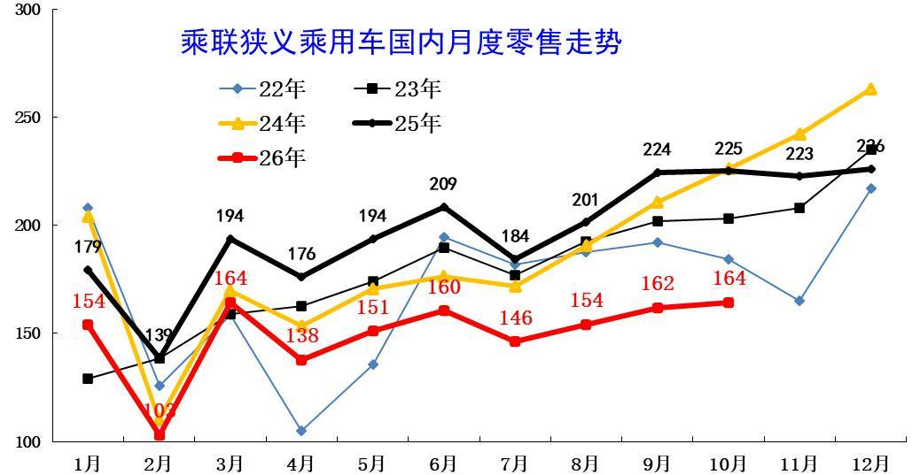

10月全国乘用车市场零售164万辆，8-10月持续低位走强，但未高于3月的零售。10月销量偏低原因是多元的，主要是高油价的影响，深层原因是消费能力和意愿偏低。

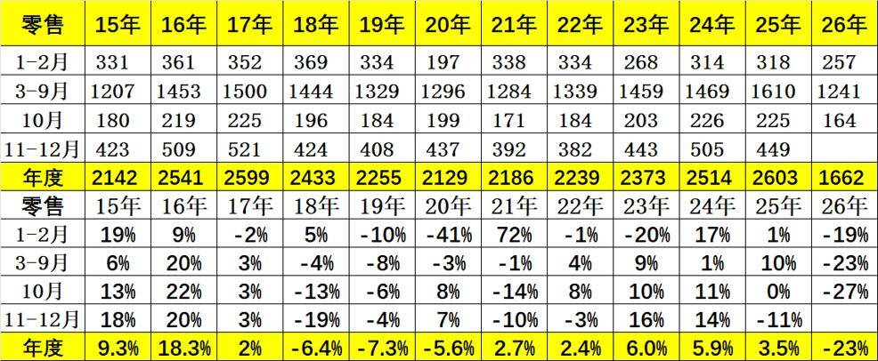

2026年10月全国乘用车市场零售164.3万辆，同比下降27%，环比增长1%；1–10月乘用车累计零售1662万辆，同比下降23%。

2026年10月国内乘用车市场呈现总量持续承压、环比走强、结构极致分化的运行态势。

2.近年狭义乘用车批发走势

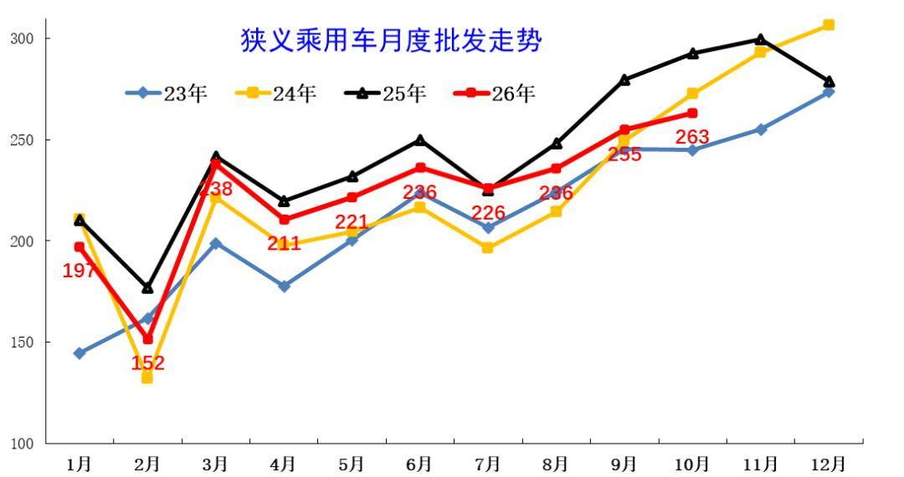

10月全国乘用车厂商批发263万辆，较同期下滑较大。历年10月的走势相对较强，今年国内低迷但出口高增长，因此总体回归平稳。由于出口超强，国内批发少，去库存效果好，渠道压力明显改善。

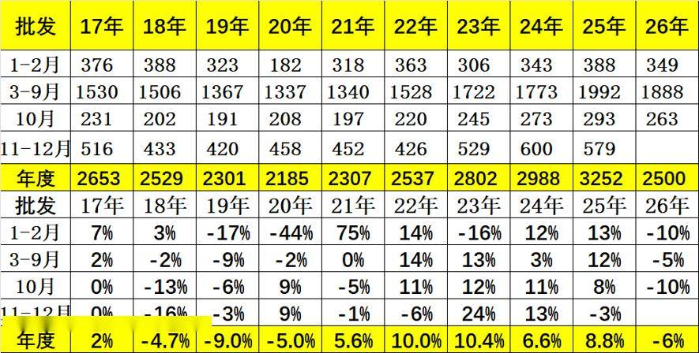

10月全国乘用车厂商批发263.3万辆，同比下降10.2%，环比增长3.3%，受出口暴增的促进激励，10月乘用车批发同比增速较零售增速高出17个百分点。

3.近年狭义乘用车生产走势

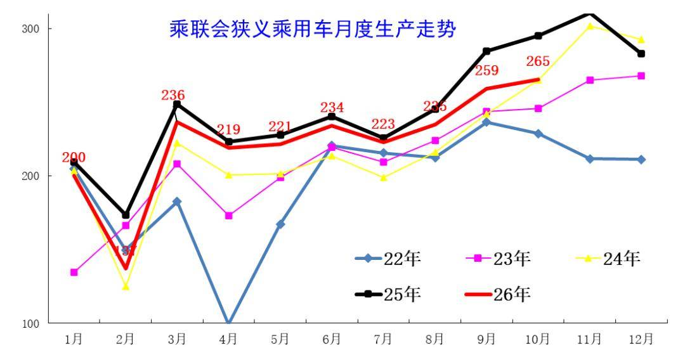

2026年乘用车生产减产力度较大。9-10月生产提升较平稳，较2025年的强势拉升形成较大反差。今年出口持续走强，导致10月生产相对创年内新高，但同比走势下滑巨大。

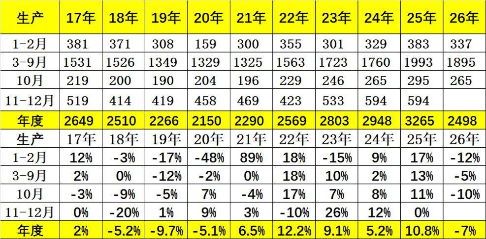

10月乘用车生产265万辆，同比下降10%，2026年累计下降7%，在2025年10月超高基数下的下滑较大。

4.近年狭义乘用车出口走势

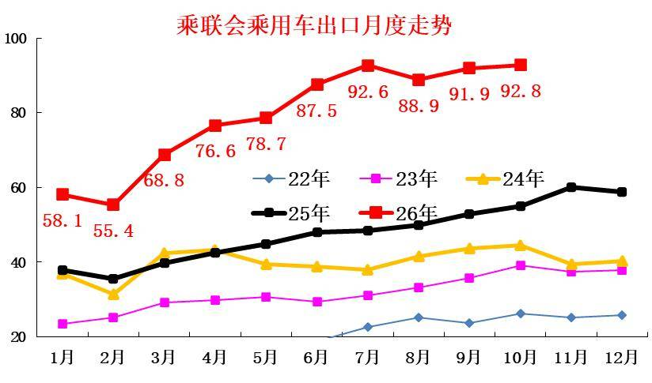

10月出口环比9月小幅回升，但连续4个月基本走强，月度环比高速环比上涨趋势改变，市场逐步进入平稳期。

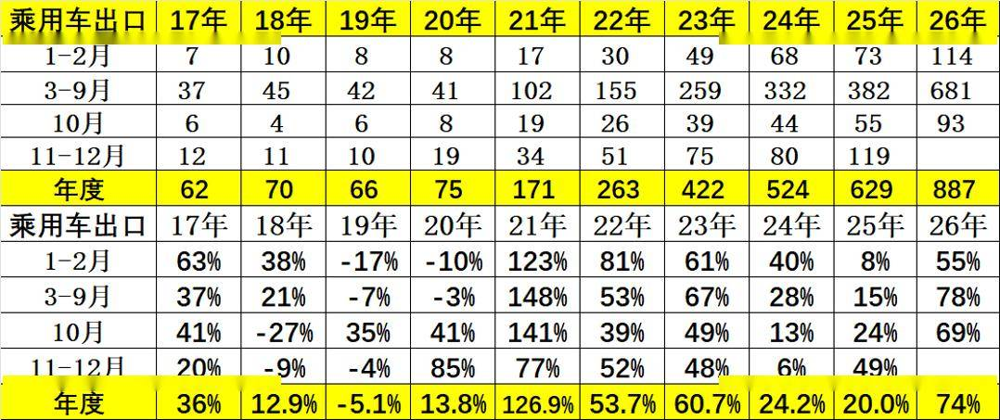

10月乘用车出口（含整车与CKD）达到92.8万辆，同比增长68.5%，环比增长1.0%，占乘用车厂商销量35%（上月36%，2025年同期19%）。

5.全国乘用车行业库存跟踪

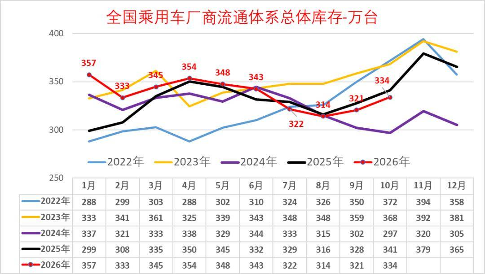

2026年10月末全国乘用车行业库存334万辆，环比上月增13万辆，同比2025年10月下降7万辆，形成9-10月库存持续回升的特征。2025年的以旧换新政策启动带来厂商的总体乐观，以旧换新推动的销量较高，厂家生产相对谨慎，形成5-10月持续去库存。由于去年11月以来市场严重低于预期，11月库存创近两年新高，随后生产下调力度大，但市场零售下滑也超预期，因此上半年库存处于高位，7-10月减产力度大，库存较同期库存的降幅明显。今年的库存变化特征与过去几年的走势相对温和。

6.全国乘用车厂商库存跟踪

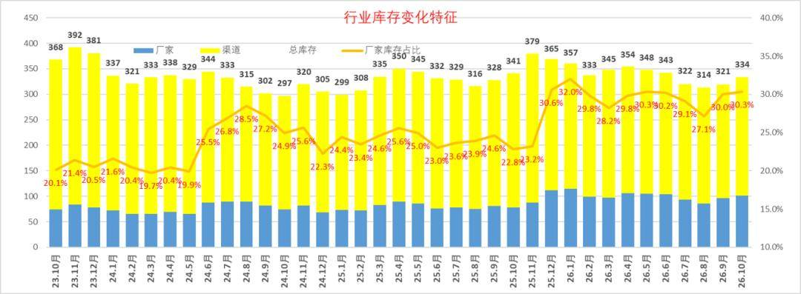

2023年以来乘用车行业整体库存保持相对平稳状态，2024年10月回落在297万辆左右,2025年11月回升到379万辆，随后回落，2026年10月的库存下降到334万辆，其中厂家库存占比30.3%，9月厂家休假的库存在10月补了回来。

由于前期市场预期较好，厂商生产热情较高，总体行业库存压力相对不可控。目前厂家库存占比逐步提升，市场严重低迷，厂家减产，未来几个月销量转旺的消化库存压力总体可控。

7.全国乘用车市场预测指数与满意度指数

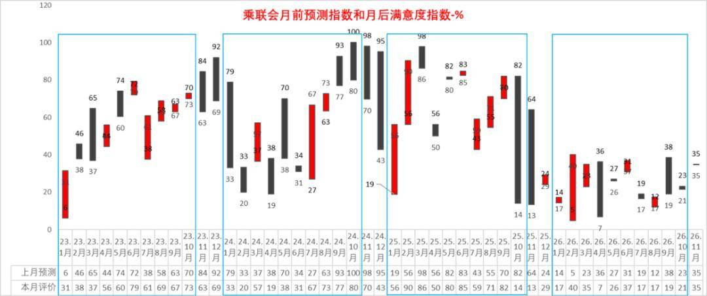

我们按照PMI指数的设定方式和评价结果评价月度市场表现。根据厂家内部人员的预测汇总测算，乘联分会预测团队2025年初以来对市场预测很乐观，逐步悲观，预测团队2025年1-10月对市场预测很乐观，2025年10月开始满意度持续暴跌到低位。2026年10月乐观度23%，11月初的10月月后满意度为21%，预期低但满意度也差，主要是高油价的冲击太大。

团队对11月市场的乐观度回升到35%，这是近期市场乐观度判断的偏高预测指数，但低于9月的38%，体现大家更谨慎了。

从目前的334万辆的库存水平和预期的到未来几个月的市场增长的判断，行业库存消化压力不。鉴于目前销量持续低于预期的现状，车企需及时跟踪政策环境与市场变化，谨慎设定产销节奏，根据经销商库存结构，谨慎增加库存，及时清理历史库存。

8.全国乘用车市场总体库存特征

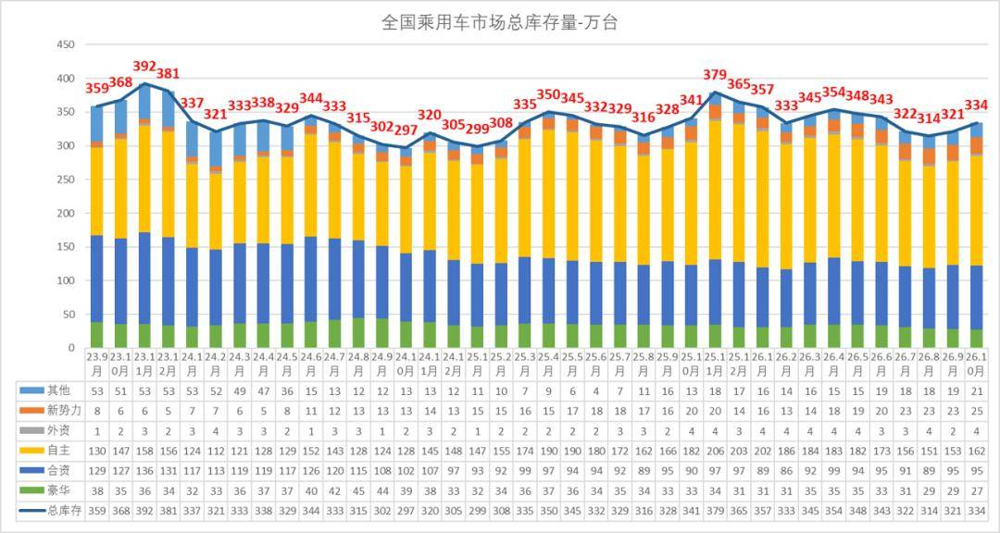

随着新能源车的占比提升，燃油车销量下降，对应的库存占压也逐步减少。从库存周期看，从2023年4月的325万辆，随后回升到2023年11月392万辆，随后下行到2024年10月的297万辆的库存低位。

2025年-2026年初仍属加库存周期，行业压力持续加大，2025年11月达到379万辆的近期高点。2026年车市下滑较大，由于燃油车萎缩较严重，虽然库存下降，但库存的压力也并未有效缓解。

9.美国乘用车行业库存对比

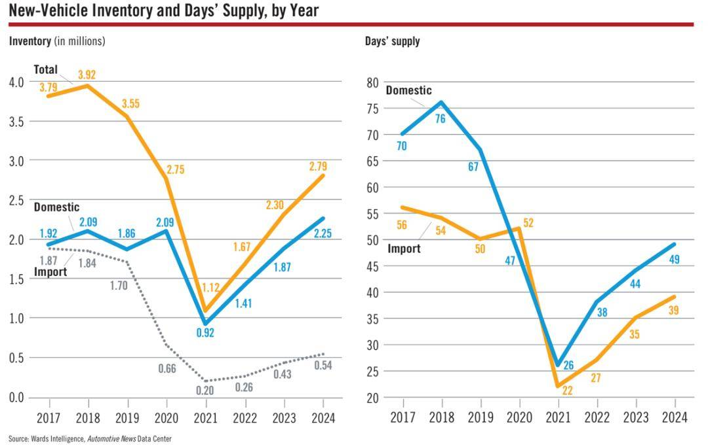

美国的库存目前是在40-50天，总体的库存压力不大，这也是中国车市参考的对象。

10.全国乘用车市场库存天数小幅回落

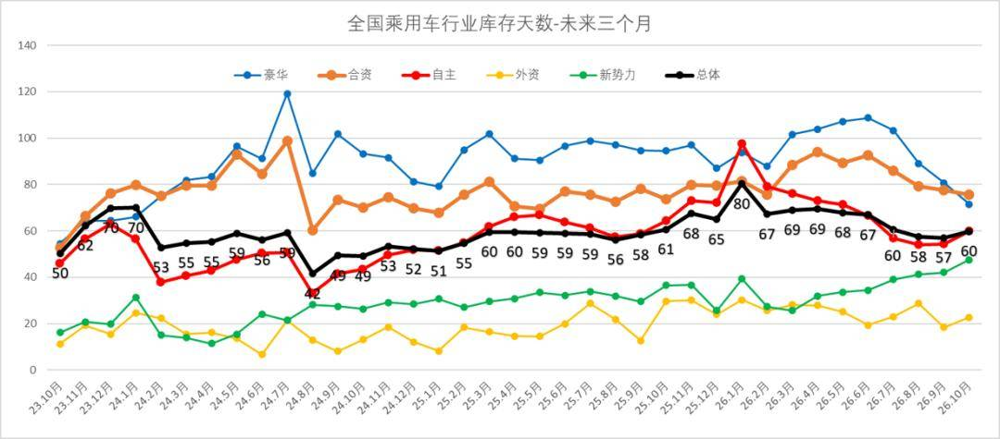

我们测算的库存天数是根据未来3个月的销量动态滚动，但由于10月零售低于预期，因此对应的库存天数也会因此变化，也就是10月底的库存多不多，主要看未来3个月的销量预期。随着2025年市场回暖的如期到来，生产走势较强，前期的去库存的特征改变，反内卷带来行业库存控制，库存增长相对温和。2025年4季度，虽然有免税政策的到期促进，但走势实际低于预期，行业库存天数峰值回升到80天，2026年生产减产力度大。因此根据2026年10月底的库存与未来3个月国内零售量综合预估的现有库存支撑未来销售天数在60天，相对于2023年10月的50天、2024年10月的49天，2025年10月的61天，今年10月的总体库存天数相对仍有压力。

11.全国新能源乘用车库存持续上升

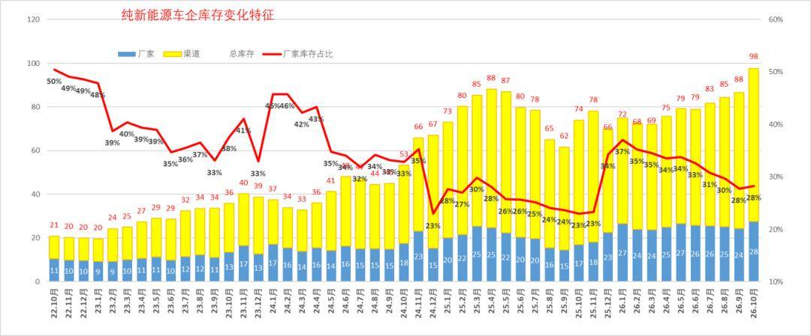

从仅生产新能源车的企业的库存变化特征分析看，2023年年初库存20万辆，随后进入库存快速增长期， 2025年4月仅生产新能源车的企业的库存达到88万辆，这是近期的峰值。随着反内卷的推动，行业库存2025年9月降到62万辆，2026年10月仅生产新能源车的企业的总库存上升到98万辆，环比上月增10万辆，较2025年11月峰值78万辆库存增20万辆，创历史新高。近期新能源经销商的厂家和渠道库存面临市场零售低于预期，行业库存总体压力较大。

附：近日信息合集
