# 全国商用车国内保险特征—10月重卡新能源渗透率58%

- 公開日時: 2026-11-21 15:48（北京時間）
- 出典: [搜狐号・崔东树](https://www.sohu.com/a/1104564175_115312)
- テーマ（自動判定）: 商用車
- 画像: 13枚

---

注：本分析文章仅代表崔东树个人观点，如有异议，请留言。

根据国家金融局交强险数据，2026年10月商用车交强险销量为23万辆，同比下降6%，环比下降12%，年末表现疲软；1-10月累计销量达250.0万辆，同比微降2%。整体来看，经历二季度短暂回暖后，下半年下行压力显著放大，市场重回存量博弈。

2026 年 10 月新能源商用车交强险销量 12.10 万台，较 9 月 13.07 万台小幅回落，但仍维持高位。1-10 月累计98万台增44%的表现亮眼，仅 2 月为低点，3 月起持续站稳 9 万台以上，整体远高于 2023-2025 年同期水平，新能源商用车渗透增长态势强劲。2026 年 10 月新能源商用车渗透率达 52.2%，持续走高，纯电动是绝对主力，插混、氢能源占比小幅稳定。1-10 月累计渗透率 39.1%，较往年大幅提升，商用车电动化转型提速。车板块渗透率 86%，电动化基础扎实；卡车板块渗透率 41%，其中重卡渗透率高达 58%，轻卡、微卡也达到 35%，皮卡、中卡相对偏低。重卡电动化突破是本轮渗透率提升的核心亮点。

2026 年 10 月商用车市场竞争结构与乘用车剧烈反差，乘用车天翻地覆剧烈变化，商用车基本稳定。头部福田、五菱、重汽等多数企业同比承压；吉利、徐工、长安跨越、湖南汽车等企业增长亮眼，新能源转型带动份额快速提升，市场分化加剧，新势力与转型车企表现更强。

1、全国商用车市场交强险数据分析

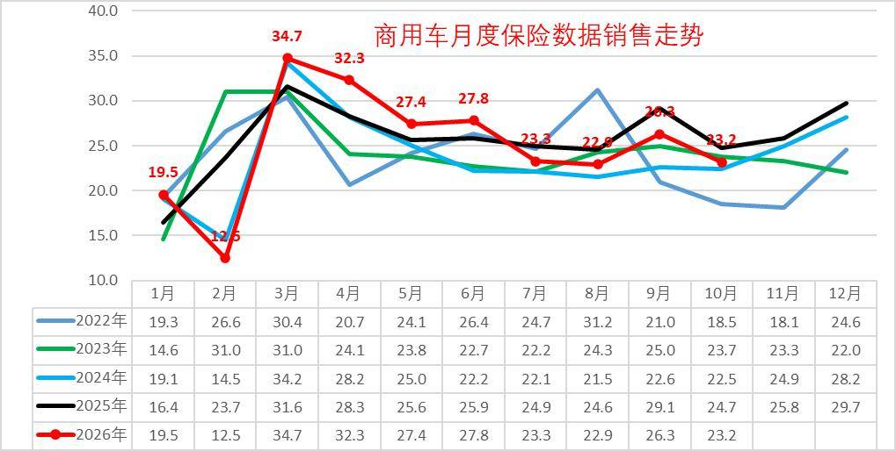

2026年商用车市场呈现明显的阶段性波动特征，走势明显强于乘用车。受春节错峰因素影响， 1-2月行业整体销量同比下滑明显。3月市场快速回暖，3-6月销量保持高位，7- 10月走势显著低于历年同期季节性水平，走出独立下行行情。

2026年商用车市场整体承压。10月单月交强险销量为23万辆，同比下降6%，环比下降12%，旺季表现疲软；1-10月累计销量达250.0万辆，同比微降2%。整体来看，经历二季度短暂回暖后，下半年下行压力显著放大，市场重回存量博弈。

2、全国新能源商用车市场销量分析

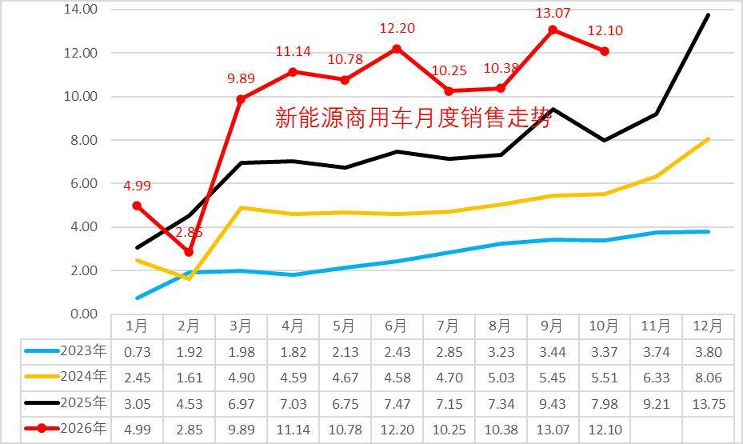

2026年，新能源商用车延续波动上行走势，1月凭借年初采购热潮销量冲高至5万台，创下阶段性高位；2月受春节假期、终端停工等季节性因素影响销量明显回落；3-10月市场迎来爆发式增长，单月销量保持10万台，形成异常超强走势。在整体商用车市场小幅下滑的背景下，新能源赛道逆势高增，成为行业唯一增长板块。

2026 年 10 月新能源商用车交强险销量 12.10 万台，较 9 月 13.07 万台小幅回落，但仍维持高位。1-10 月累计98万台增44%的表现亮眼，仅 2 月为低点，3 月起持续站稳 9 万台以上，整体远高于 2023-2025 年同期水平，新能源商用车渗透增长态势强劲。

3、全国商用车市场结构分析

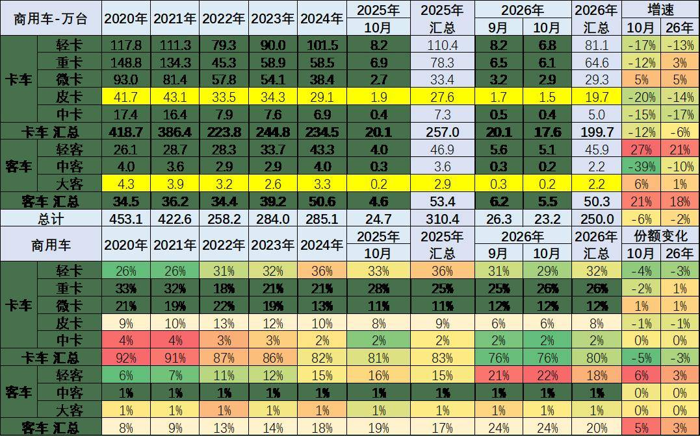

2026 年 10 月商用车总计 23.2 万台，同比下滑 6%，1-10 月累计 250 万台，同比降 2%。结构分化明显：轻客高增 27%，客车板块表现亮眼；轻卡、皮卡、中卡承压下滑，重卡小幅负增，卡车整体拖累大盘。客车份额持续抬升，卡车占比有所收缩。

4、新能源商用车渗透率

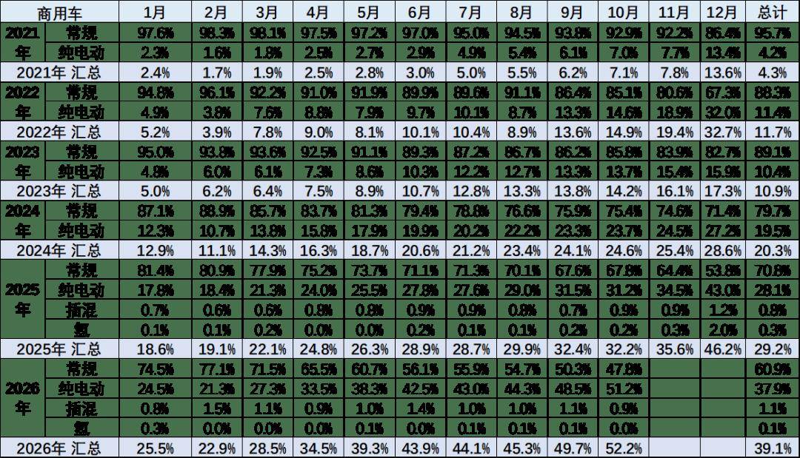

2026 年 10 月新能源商用车渗透率达 52.2%，持续走高，纯电动是绝对主力，插混、氢能源占比小幅稳定。1-10 月累计渗透率 39.1%，较往年大幅提升，商用车电动化转型提速，传统燃油商用车份额持续收缩，电动化渗透节奏明显快于前期。

5、商用车市场变化分析

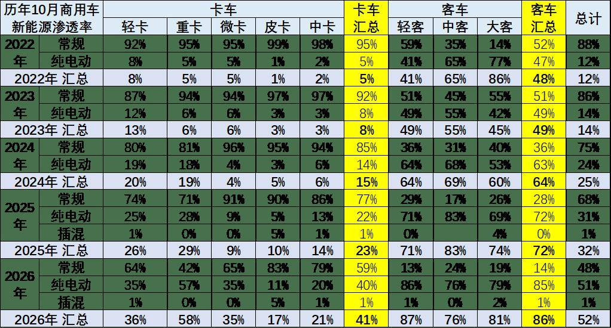

2026 年 10 月商用车新能源渗透率 52%，结构分化显著。客车板块渗透率 86%，电动化基础扎实；卡车板块渗透率 41%，其中重卡渗透率高达 58%，轻卡、微卡也达到 35%，皮卡、中卡相对偏低。重卡电动化突破是本轮渗透率提升的核心亮点。

6、商用车竞争结构变化分析

2026 年 10 月商用车市场总量 23.2 万台，同比下滑 6%、环比微增 1%。头部福田、五菱、重汽等多数企业同比承压；吉利、徐工、长安跨越、湖南汽车等企业增长亮眼，新能源转型带动份额快速提升，市场分化加剧，新势力与转型车企表现更强。

7、中重型卡车区域市场结构

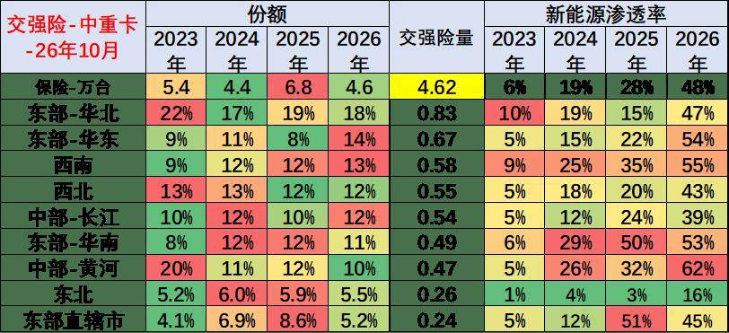

2026 年 10 月中重卡交强险 4.62 万台，新能源渗透率 48%，电动化提速明显。区域分化突出：黄河流域渗透率 62% 最高，华东、西南、华南均超 50%；东北仅 16%，电动化推进偏慢。华北仍是销量最大区域，华东份额提升，高渗透率区域集中在运力流转活跃的干线市场。

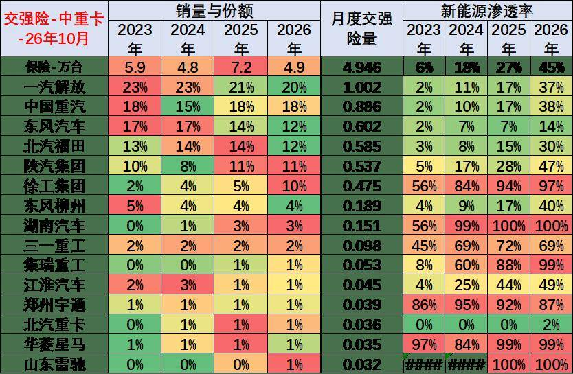

2026 年 10 月中重卡交强险 4.946 万台，行业新能源渗透率 45%。传统龙头份额稳中有降，徐工、湖南汽车等转型企业快速上量，徐工渗透率高达 97%、湖南汽车 100%，电动化布局领先；解放、重汽、东风渗透率偏低，传统大厂电动转型节奏仍有差距。

8、轻型卡车区域市场结构

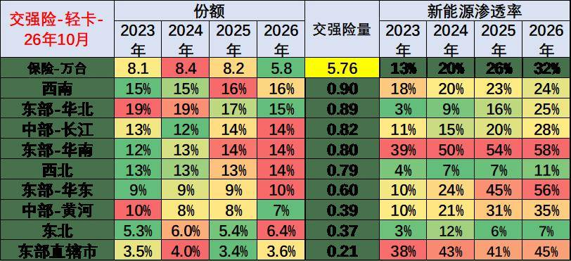

2026 年 10 月轻卡交强险 5.76 万台，行业新能源渗透率 32%。区域差异明显，华南、华东渗透率突破 55%，城配电动化普及度高；西北、东北仅 11%、7%，电动化推进缓慢。西南、华北是轻卡销量主力市场，华南、华东份额稳步抬升。

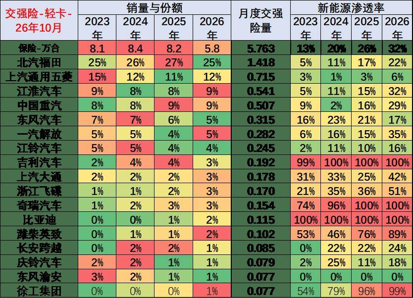

2026 年 10 月轻卡交强险 5.763 万台，行业新能源渗透率 32%。福田稳居份额龙头，但渗透率仅 22%；吉利、比亚迪、奇瑞等新势力渗透率 100%，飞碟、徐工也接近高电动化水平。传统轻卡龙头电动转型节奏偏慢，纯电品牌依靠城配优势快速抢占市场。

9、轻型客车区域市场结构

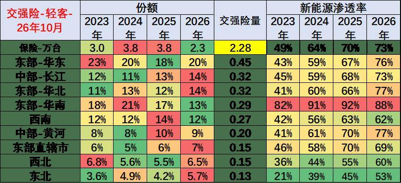

2026 年 10 月轻客交强险 2.28 万台，行业新能源渗透率 73%，是商用车电动化程度最高的细分板块。华南渗透率高达 88% 领跑，华东、华北、黄河流域均在 75% 左右；东北、西北相对偏低。华东仍是销量第一大区，城配场景驱动轻客电动化持续渗透。

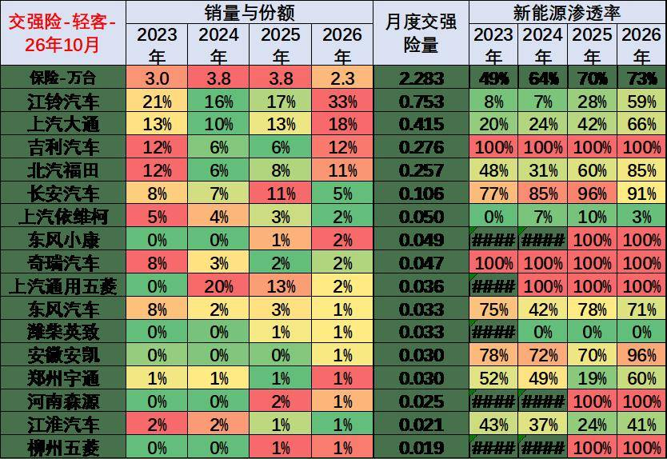

2026 年 10 月轻客交强险 2.283 万台，行业新能源渗透率 73%。江铃份额大幅提升至 33%，龙头地位稳固，渗透率 59%；吉利、奇瑞保持 100% 纯电，福田、长安、安凯渗透率超 85%。上汽依维柯转型偏慢，仅 3%，企业电动化节奏分化明显。

10、大中型客车区域市场结构

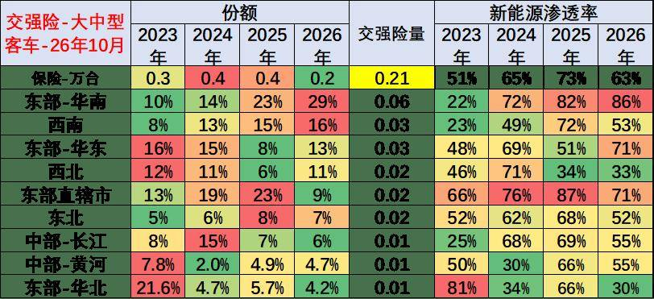

2026 年 10 月大中型客车交强险 0.21 万台，行业新能源渗透率 63%。华南份额提升至 29%、渗透率 86% 遥遥领先；华东、直辖市渗透率超过 70%。西北、华北渗透率偏低，仅 33%、30%，区域分化明显。华南公交、旅游客车电动化需求支撑其高渗透表现。

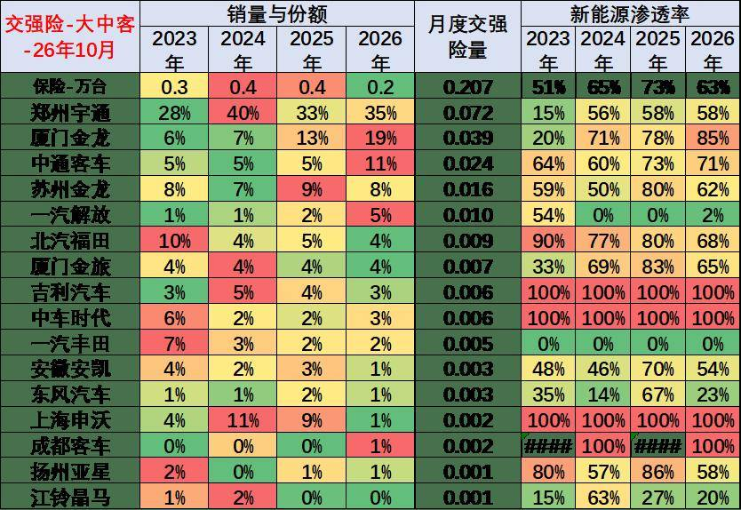

2026 年 10 月大中客交强险 0.207 万台，行业新能源渗透率 63%。传统车企市场表现平稳。宇通份额 35% 稳居第一，渗透率 58%；厦门金龙份额升至 19%，渗透率 85% 表现突出。吉利、中车时代、上海申沃保持纯电；一汽丰田无新能源，头部客车企业电动化节奏差异显著。

附：近日信息合集
