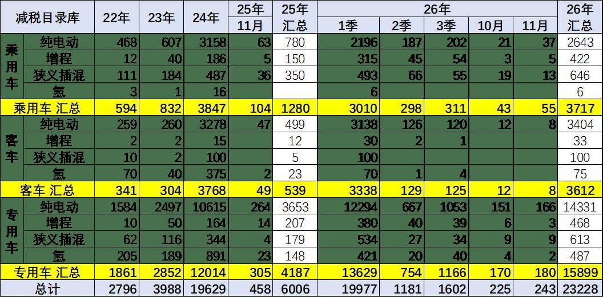
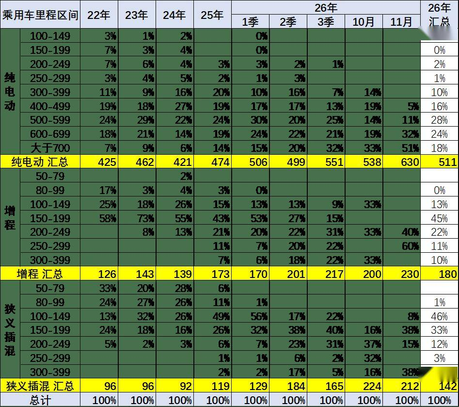
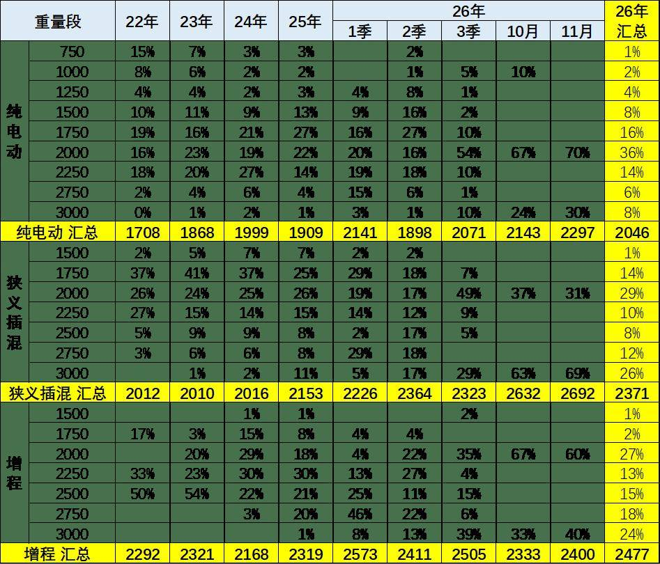
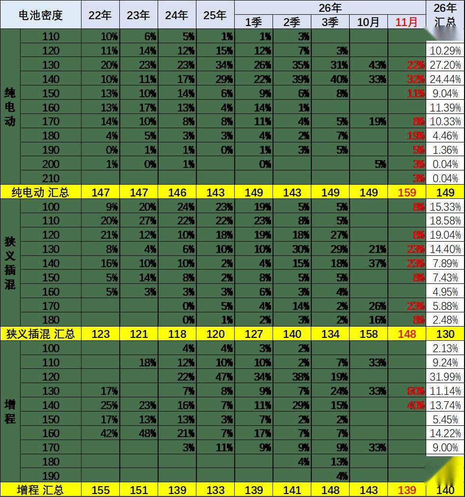
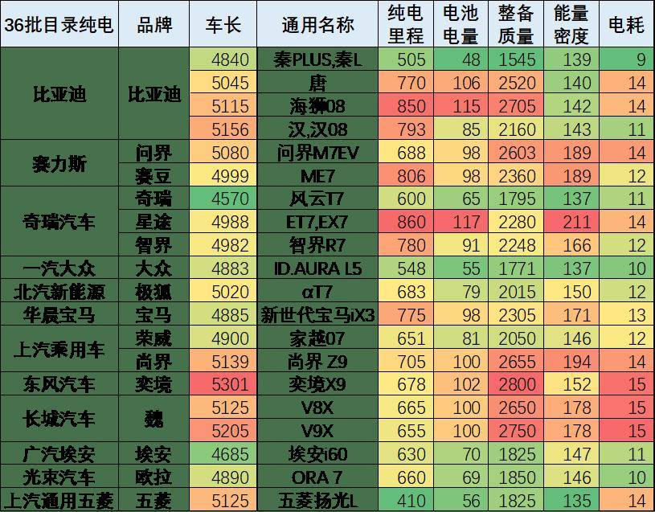

# 11月新能源新品与技术线路跟踪

- 公開日時: 2026-11-22 10:13（北京時間）
- 出典: [搜狐号・崔东树](https://www.sohu.com/a/1104761949_115312)
- テーマ（自動判定）: NEV新製品・技術
- 画像: 5枚

---

注：本分析文章仅代表崔东树个人观点，如有异议，请留言。

2026年1-11月新能源车免税目录共有23228款，其中11月免税目录新增车型243款，较年均数量大幅下滑。分品类看：乘用车仅55款，纯电、插混、增程申报款数同步收缩；客车仅8款，投放显著降温。专用车为当月主力，合计180款，其中纯电动166款，占到当月总款数七成以上。

11月新增换电车型目录17款，环比3季度的月均销量下降。分品类看，乘用车只有1款纯电换电车型申报，投放持续低迷。

11月乘用车中比亚迪9款、奇瑞汽车6款、北汽新能源6款、赛力斯6款、长城汽车5款、一汽大众4款、华晨宝马4款、上汽乘用车3款、吉利汽车3款、上汽通用2款。11月纯电乘用车平均续航达630公里，较3季度的551公里继续提升；500公里以上区间合计占比95%，长续航化趋势明确。狭义插混平均续航升至212公里，较2025年的119公里提升明显。增程平均续航230公里，2025年是173公里。整体看，三类技术路线均向更高续航区间迁移，纯电高端化、插混和增程长续航化趋势同步强化。

11月纯电车型，2000kg以上区间占比高达100%，成为绝对主力，轻量化车型占比极低，平均车重维持高位。狭义插混车型3000kg区间占69%，是核心重量段。增程车型2000kg以上区间占100%，3000kg区间占40%，大重量车型主导。从结构可见，11月申报新车普遍偏重，纯电集中在2吨级，插混以2吨为主，增程大量突破3吨，长续航与大容量电池持续推高整车整备质量。

1、2026年免税目录总体情况

2026年1-11月新能源车免税目录共有23228款，其中11月免税目录新增车型243款，较年均数量大幅下滑。

2、新车动力结构变化

由于超高的氢燃料的补贴因素，前期的氢能源商用车的表现超强，近期氢能国内外均走弱。近期乘用车氢燃料可以忽略不关心，短期没有发展空间。

11月免税目录新增车型243款，较年均数量大幅下滑。分品类看：乘用车仅55款，纯电、插混、增程申报款数同步收缩；客车仅8款，投放显著降温。专用车为当月主力，合计180款，其中纯电动166款，占到当月总款数七成以上。11月车型申报结构分化明显，乘用、客车新车申报节奏放缓，专用车依旧是免购置税目录的核心支撑。

3、换电车型跟踪

11月新增换电车型目录17款，环比3季度的月均销量下降。分品类看，乘用车只有1款纯电换电车型申报，投放持续低迷；专用车全部为纯电动车型，是本月换电目录的绝对主力。对比历史数据，换电车型申报主力长期在专用车领域，乘用车换电新车申报节奏偏弱，11月换电车型整体新增款数维持低位，行业新品投放偏谨慎。

4、2026年纯电动乘用车续航里程

11月的乘用车目录相对结构分化，部分类别申报较少。11月纯电乘用车平均续航达630公里，较3季度的551公里继续提升；500公里以上区间合计占比95%，长续航化趋势明确。狭义插混平均续航升至212公里，较2025年的119公里提升明显。增程平均续航230公里，2025年是173公里。整体看，三类技术路线均向更高续航区间迁移，纯电高端化、插混和增程长续航化趋势同步强化。

5、2026年新能源车的车辆整备质量

11月纯电车型，2000kg以上区间占比高达100%，成为绝对主力，轻量化车型占比极低，平均车重维持高位。狭义插混车型3000kg区间占69%，是核心重量段。增程车型2000kg以上区间占100%，3000kg区间占40%，大重量车型主导。从结构可见，11月申报新车普遍偏重，纯电集中在2吨级，插混以2吨为主，增程大量突破3吨，长续航与大容量电池持续推高整车整备质量。

6、电池的能量密度

车购税减税车型的布局上呈现明显分化：纯电车型数量趋稳且高度集中于130-140黄金密度区间（占比达54%），插混增程的电池密度变化较小。

7、2026年各类车型的综合对比

36批目录显示三类车型技术路线分化明显：纯电平均车长5006mm，电池电量与整备质量随续航显著递增，主打大电池规模化；增程平均车长5022mm，电池容量居中（50度），但能量密度最高（139），偏向大车身长纯电续航；狭义插混车长最长（5144mm）、质量最重（2528kg），但带电量最克制（48度），能量密度达148，纯电续航相对分散，呈现“大车+小电池+高密度”的低成本合规特征，燃油消耗量均控制在6-7L。

8、纯电动乘用车分析

9、插混新车跟踪

36批目录狭义插混呈现“中大型化与高电量、高密度并行”的特征。车型车长普遍在5-5.3米，整备质量多在1.8-3.0吨。

10、增程新车跟踪

36批目录增程呈现“中大型化与高电量、低密度并行”的特征。车型车长普遍在5米，整备质量多在2吨以上。

附：近日信息合集
