# 新能源车锂电池市场分析-2026年10月

- 公開日時: 2026-11-23 12:00（北京時間）
- 出典: [搜狐号・崔东树](https://www.sohu.com/a/1105168884_115312)
- テーマ（自動判定）: 電池
- 画像: 12枚

---

注：本分析文章仅代表崔东树个人观点，如有异议，请留言。

10月动力电池产量245.1GWh，同比增44%。其中，磷酸铁锂213.1GWh（+56%），三元锂31.7GWh（-6%）。1-10月累计产量2078.1GWh（+61%），磷酸铁锂累计1736.4GWh（+70%）。

2026年10月动力电池装车99GWh，同比增18%。结构极度分化：磷酸铁锂装车86GWh（占87%），同比大增28%；三元锂仅13GWh，同比下滑22%。1-10月累计装车676GWh（同比+17%），其中磷酸铁锂达564GWh（占83%），三元仅111GWh。市场呈现“铁锂绝对主导、三元持续萎缩”的格局。

2026年10月内销产量143.9万台，同比降10%，环比增14%。纯电乘用车稳盘（91.6万台，降2%），纯电货车大增41%。1-10月累计981.6万台（同比-12%）。

2026年4季度的电池能量密度160以上的车型占比6%，相对于2025年同期的10%出现了明显的下降，这主要还是三元的高端需求偏弱。而125以下的能量密度的产品2026年下降到了0%的比例。

2026年动力电池市场呈现“双雄份额松动，二线梯队加速崛起”的态势。宁德时代虽仍以44.0%的份额居首，但环比逐季下滑（Q4降至40.5%）；比亚迪微升至19.1%。与此同时，国轩高科（6.1%）、亿纬锂能（5.5%）、吉利耀宁（2.5%）等二线企业份额显著提升。

1、动力电池的总体生产特征分析

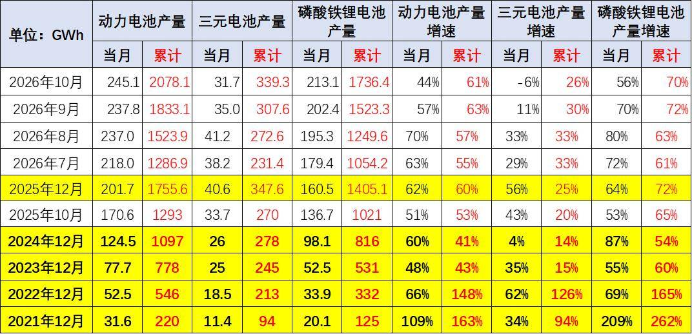

10月动力电池产量245.1GWh，同比增44%。其中，磷酸铁锂213.1GWh（+56%），三元锂31.7GWh（-6%）。1-10月累计产量2078.1GWh（+61%），磷酸铁锂累计1736.4GWh（+70%）。总盘子维持高增长，但结构极度分化：磷酸铁锂呈压倒性主导，而单月三元锂已现负增长。

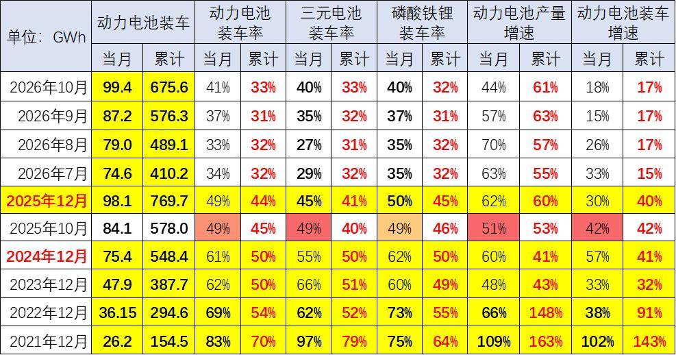

前期动力电池的产量中装车的比例在不断地降低，9月以来有所改善。2026年10月动力电池装车量达99.4GWh，逼近百GWh大关，同比增长18%，当月装车率为41%。1-10月累计装车675.6GWh，同比增长17%，累计装车率降至33%。

整体来看，装车绝对量维持高位，但增速较去年同期（42%）大幅放缓。同时，产量增速（61%）远超装车增速，供需错配下，产业链去库存压力愈发显现

今年动力电池装车景气度波动，随着货车补贴的启动，储能的需求下降，近期的装车占比逐步提升。

随着储能等产业的发展，尤其是俄乌危机带来的世界能源危机，储能等产业的电池需求增长很快，导致装车的电池占比下降较明显，但年初的市场回落带来占比的下降。动力电池和储能电池都是生产过剩和库存相对表现压力较大的。2021年和2022年动力电池的增速低于整车增速，2023年和2024年的动力电池装车偏低，电池产量持平于装车增速。2026年电池生产较多，装车起步较低，2026年年初装车率降到近期低位，10月恢复较好。

2、内销车型合格证电池装车的三元占比偏低

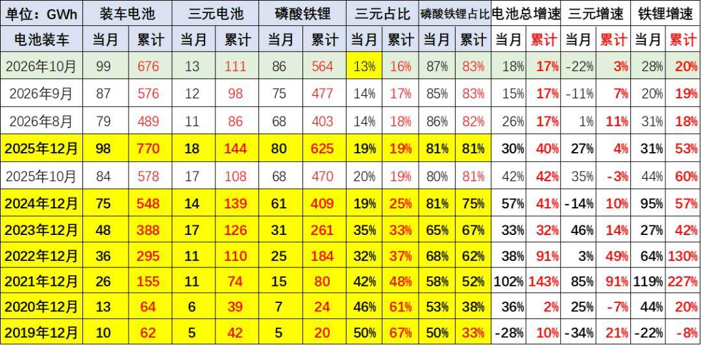

2026年10月动力电池装车99GWh，同比增18%。结构极度分化：磷酸铁锂装车86GWh（占87%），同比大增28%；三元锂仅13GWh，同比下滑22%。1-10月累计装车676GWh（同比+17%），其中磷酸铁锂达564GWh（占83%），三元仅111GWh。市场呈现“铁锂绝对主导、三元持续萎缩”的格局。

3、汽车电池需求增长放缓

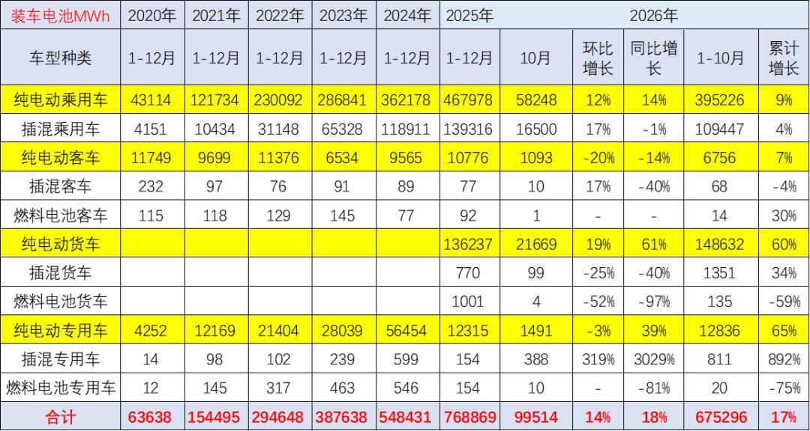

2026年10月动力电池装车量达99.5GWh，同比增18%；1-10月累计675.3GWh，同增17%。结构上，纯电动乘用车稳固基本盘（累计+9%）；纯电动货车（累计+60%）与纯电专用车（累计+65%）爆发力极强，成为拉动大盘高增的核心引擎；插混乘用车10月单月同比微跌1%，纯电客车则下滑14%。

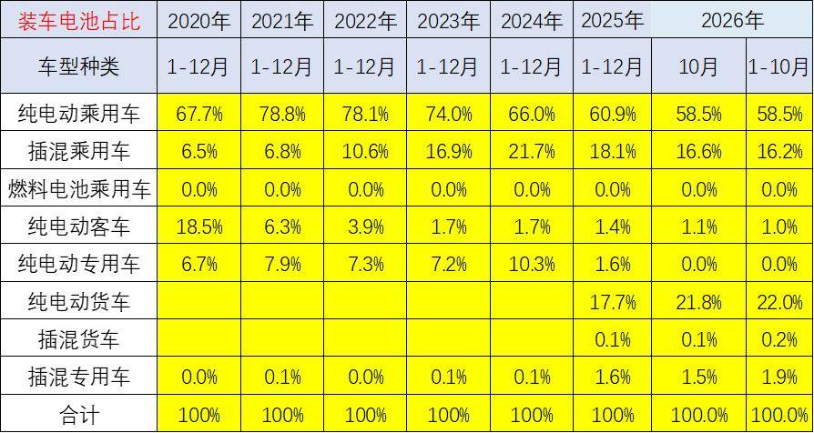

2026年10月及1-10月，纯电动乘用车仍是绝对主力，但份额已从早期的近80%降至58.5%。最显著的结构性变化来自货车：纯电动货车占比高达21.8%（累计22.0%），跃升为第二大装车细分市场；插混乘用车稳定在16%左右；而纯电动客车及纯电动专用车份额持续探底（均降至1.5%以下）。市场呈现“乘用车守住基本盘、电货车强势爆发、客车严重边缘化”的格局。

4、汽车合格证产量

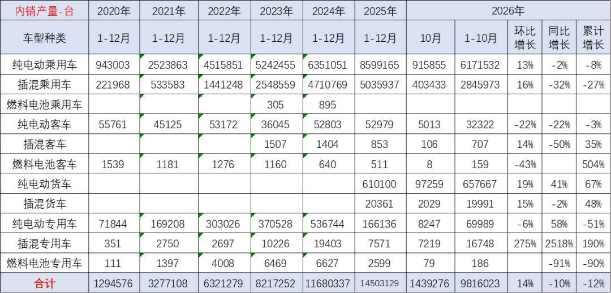

2026年10月内销产量143.9万台，同比降10%，环比增14%。纯电乘用车稳盘（91.6万台，降2%），纯电货车大增41%。1-10月累计981.6万台（同比-12%），纯电乘用车降8%；插混重挫27%；纯电货车逆势大增67%（累计65.8万台），成为最强增长极。整体呈现乘用车承压、货车高增的结构分化。

5、配套电池企业远未充分竞争

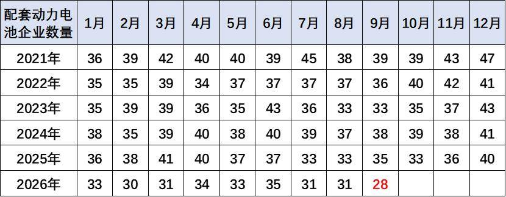

过去几年，电池市场的竞争格局并没有发生明显的变化。2026年10月配套电池企业是达到28家的年内低位。由于动力电池市场的价格有所差异，而规模增长特征相对明显，加之储能等新产业需求发展，因此电池企业获得了较强的生产和装车数量增长的特征。

6、各类车型配套电池带电量分化

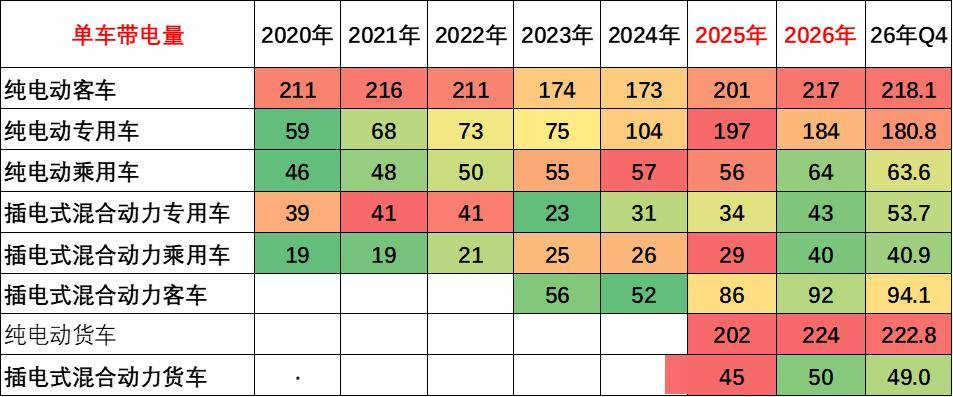

随着电池价格下跌，电动车续航里程不断增长。目前电动汽车市场高端化的需求十分强烈，而是类似于“老头乐”升级为小微型汽车、政策压力较大，导致高端化明显。2024年下半年，随着以旧换新等政策推动，小车市场回暖，微型电动车火爆，带动装机电池下降。随着电动车的成本优势体现，纯电动专用车的结构向重卡发展，带动带电量暴增。

就供应链问题来看，未来整车企业将日益强大，对电池企业、对上游产业链的控制能力会进一步加强，同时对下游的品牌营销能力的掌控也在进一步加强。在新能源的体系下，“整车为王”的特征将进一步持续体现。

7、高能量密度的电池需要回升

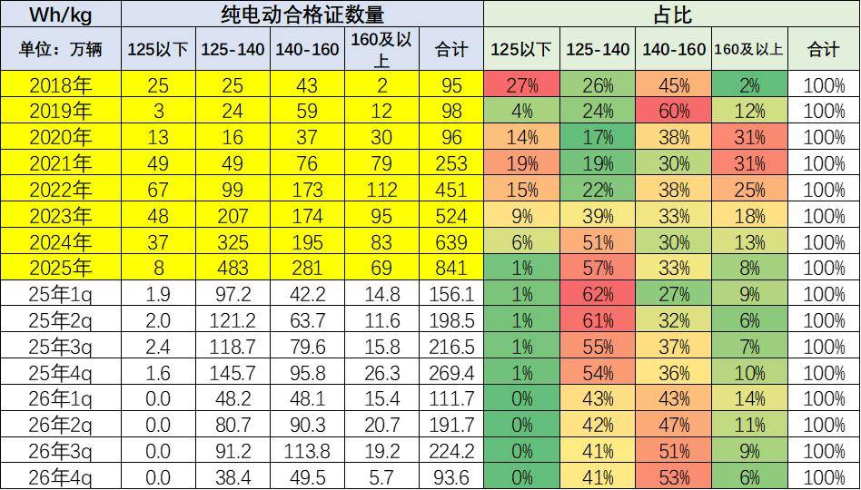

纯电动车目前主力电池能量密度区间在125到160之间。尤其2026年4季度表现比较突出的是140到160的电池占比达到53%，同比上升17个百分点。

2026年4季度的电池能量密度160以上的车型占比6%，相对于2025年同期的10%出现了明显的下降，这主要还是三元的高端需求偏弱。而125以下的能量密度的产品2026年下降到了0%的比例。

8、电池企业格局

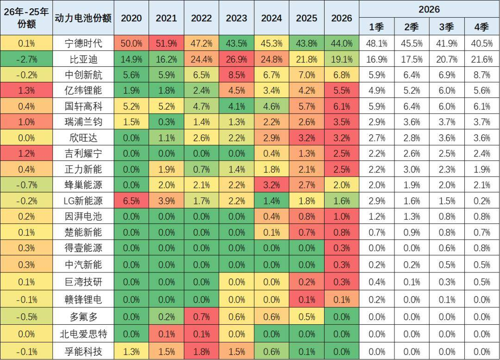

2026年动力电池市场呈现“双雄份额松动，二线梯队加速崛起”的态势。宁德时代虽仍以44.0%的份额居首，但环比逐季下滑（Q4降至40.5%）；比亚迪微升至19.1%。与此同时，国轩高科（6.1%）、亿纬锂能（5.5%）、吉利耀宁（2.5%）等二线企业份额显著提升。尾部企业（如多氟多、孚能科技）份额基本清零。行业整体集中度下降，竞争更趋多元化。

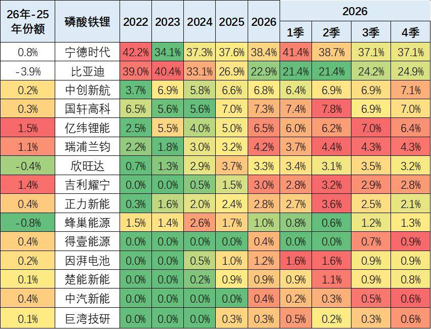

2026年磷酸铁锂电池市场维持“宁德时代+比亚迪”双寡头格局，但内部走势显著分化。宁德时代份额稳定在38.4%，稳居第一；比亚迪则从2022年39.0%的高点下滑至22.9%，不过2026年内部呈现“前低后高”（Q4回升至24.9%）的修复态势。

与此同时，二线梯队加速扩张。亿纬锂能（6.5%）、国轩高科（7.3%）、吉利耀宁（3.0%）等厂商份额明显提升。整体呈现“头部份额松动、二线强势抢食、尾部加速出清”的激烈博弈态势。

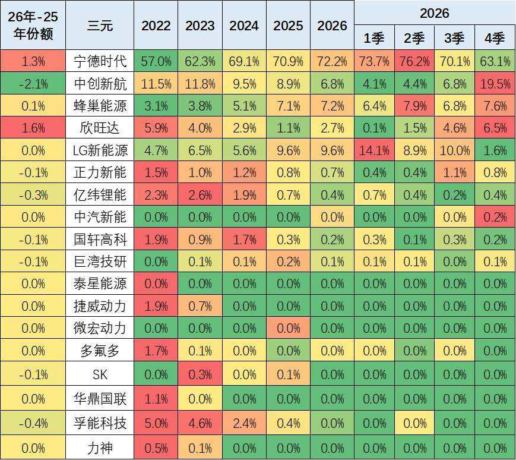

2026年三元电池市场呈现“一超主导、尾部出清、年底剧烈洗牌”的特征。宁德时代以72.2%的绝对份额稳居霸主地位，且较往年持续提升。

但内部格局在四季度发生剧变：宁德时代Q4份额环比回落至63.1%；而中创新航（Q4暴涨至19.5%）与欣旺达（Q4冲至6.5%）在年底强势抢量。与此同时，LG新能源由于特斯拉内销转出库而遭遇断崖式下跌（Q1达14.1%，Q4仅剩1.6%）。此外，孚能、力神、多氟多等尾部企业份额已彻底清零。受铁锂挤压，三元赛道整体缩容，车企定点切换直接引发了头部份额的剧烈重组。

附：近日信息合集
