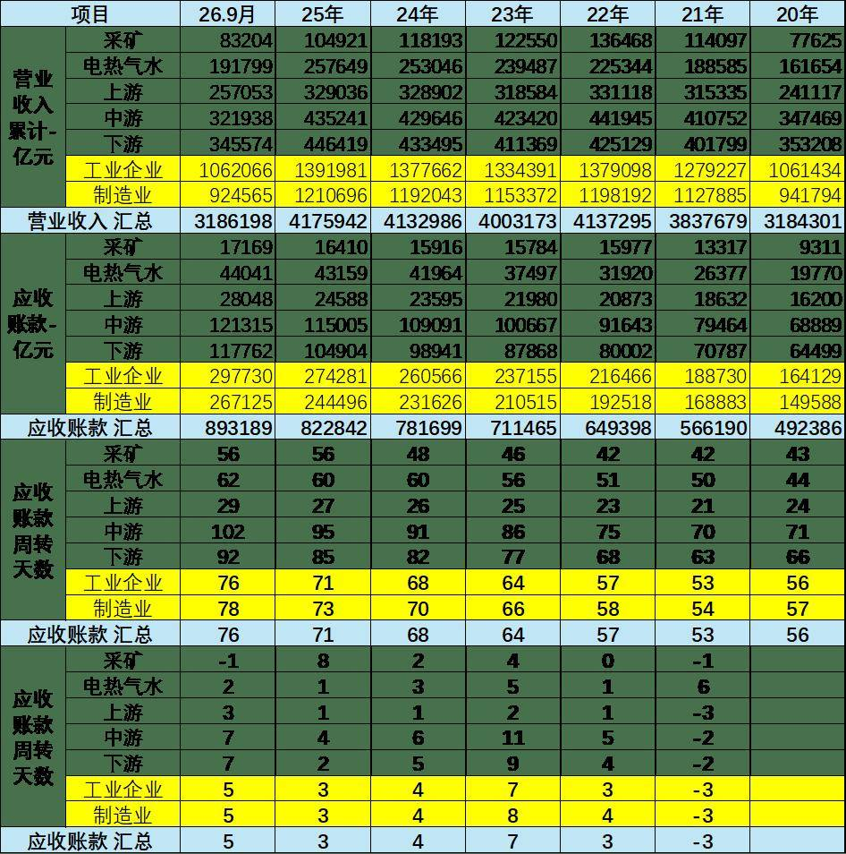
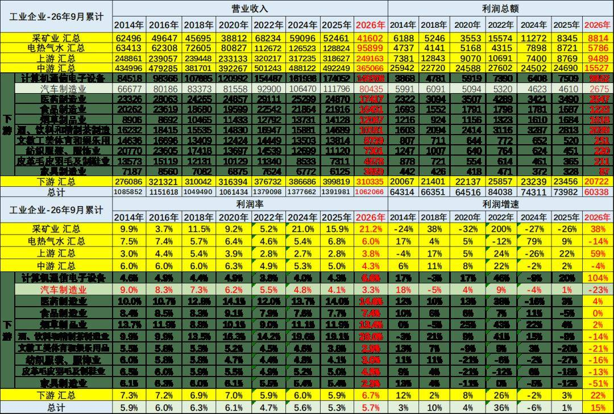
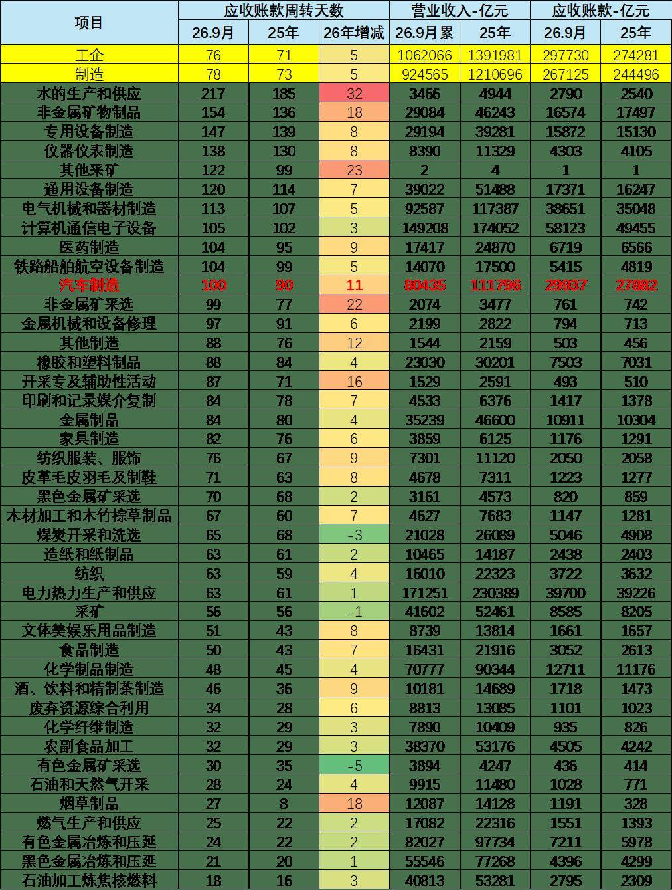
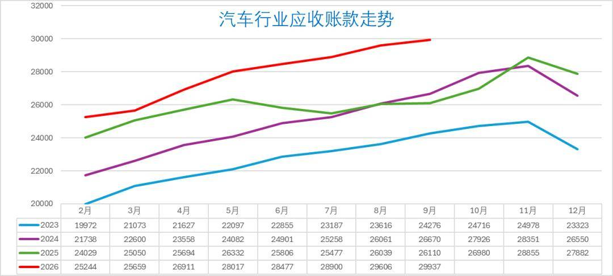
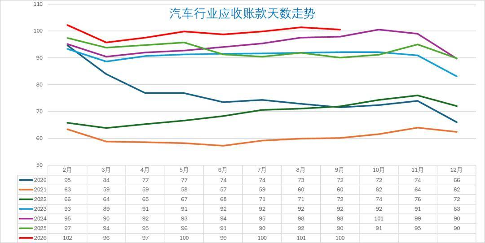

# 制造业应收账款天数变化分析-9月汽车业100天

- 公開日時: 2026-11-24 22:52（北京時間）
- 出典: [搜狐号・崔东树](https://www.sohu.com/a/1105889707_115312)
- テーマ（自動判定）: その他
- 画像: 5枚

---

注：本分析文章仅代表崔东树个人观点，如有异议，请留言。

根据国家统计局最新数据，2026年9月末，我国工业企业与制造业应收账款周转天数分别达76天和78天，应收账款总额逼近30万亿元。其中，中游（102天）与下游（92天）账期较往年持续拉长，创出历史新高。

作为国民经济的支柱产业，汽车制造业的数据尤为引人注目：2026年9月末，汽车制造业应收账款逼近3万亿元大关，周转天数高悬在100天（同比增加11天）。对比历史数据，2020年汽车行业的应收账款周转天数为66天，在当时甚至优于计算机通讯电子设备业（90天），堪称“优等生”。然而短短几年间，汽车行业账期大幅拉长了34天，现已逼近计算机通信电子（105天）和医药制造（104天）的水平。

这组看似枯燥的财务数据，实际上精准折射出了当前汽车产业转型期特有的“结构性阵痛”。在终端惨烈的价格战与新能源高研发投入的双重挤压下，整车企业利润极度承压（1-9月利润下滑23%，销售利润率仅3.3%）。为了自保，产业链资金流呈现出明显的“向链主集中”特征，部分主机厂将资金压力向中上游供应商传导，强压库存、拉长账期。

国家近期力推的“反内卷”及汽车企业账期严控政策，正是切中了这一产业要害。治理账期的核心，并非否定正常的商业信用，而是旨在纠正利用市场支配地位恶意拖欠、强制使用商业汇票等违规行为。这不仅是在保护中小企业的生存底线，更是在为整车厂“治病”——如果底层供应商被资金压力拖垮，主机厂面临的必将是断供和质量降级。

落实国家的严控政策，汽车产业必须从“终端稳销量”深入到“供应链治账期”。只有严格执行《保障中小企业款项支付条例》，让资金活水在产业链中健康流转，打破“互相伤害”的零和博弈，中国汽车产业才能真正从“低价内耗”迈向共生共赢的高质量竞合，携手去赚全球市场的钱。

1、工业企业总体营收账款分析

根据国家统计局的行业统计数据：2026年9月，工业企业与制造业应收账款周转天数分别达76天和78天，应收账款总额逼近30万亿。其中，中游（102天）与下游（92天）账期较往年持续恶化，创出新高。

2026年1-9月总体下游工业利润增22%，计算机通讯行业利润出现增104%的异常良好的增长态势。而汽车业利润降23%，销售利润率3.3%（2014年9%），仍低于下游总体6.7%的利润率水平，也大幅低于烟、酒、药等其它下游企业。

结合工信部近期力推的“反内卷”政策方向，这组数据深刻揭示了行业“内卷”的实质——下游整车厂在终端低迷中利润受挤压，正利用强势地位向中游零部件供应商转嫁资金压力，强压库存并拉长账期。近30万亿的应收账款，严重拖累了实体制造的现金流。

2、2026年主力行业的应收和应收账款变化分析

2026年1-9月，工业企业应收账款周转天数达76天，制造业78天，下游92天。其中，汽车制造业高达100天（同比增加11天），远超下游平均水平，但好于计算机通信电子设备的105天和医药行业的104天，尤其是好于专用设备制造业的147天和通用设备制造业的120天。

3、2020-2026年主力行业的应收账款周转天数变化分析

汽车行业2026年生存相对艰难，尤其是2026年的销量压力较大。2020年的汽车行业在应收账款66天还是优等生，比计算机通讯电子设备业的90天好很多，但这几年压力太大，汽车应收账款周转天数增加了34天，和医药行业的104天（2020年68天）差不多。最惨的是水的生产与供应业的应收账款周转天数达到217天，较2020年的85天增加133天。

4、汽车行业应收账款走势压力加大

2026年汽车行业应收账款呈现“陡峭攀升”态势，9月已达近3万亿元高位，且显著高于前三年同期水平。这深刻反映了当前价格战下，整车厂将资金压力向中游零部件企业强力转嫁的“内卷”现实。

国家统计局这组数据精准戳中了当前产业“反内卷”的痛点：整车在流血，中游在垫资。汽车行业近3万亿的应收账款余额，说明汽车产业链的资金流转正处于极度紧绷的状态。

落实工信部反内卷要求，必须从根源上治理这种不健康的资金占压。若任由账款淤积，中小供应商现金流将面临断裂风险，全行业也会丧失技术创新的造血能力。

5、应收账款周转天数不断上升

2026年车市分化，商用车补贴政策特别好，但乘用车行业补贴暴降，市场走势极其严峻。2026年汽车行业应收账款周转天数（红线）始终高悬在100天左右（9月为100天），较2025年（约90天）拉长了11天，更是远超2020年（约70天）的水平。

落实工信部“反内卷”政策，必须从终端“稳价格”深入到供应链“治账期”。 超百天的账期严重抽干了中小企业的现金流，让他们没钱搞研发。只有严格执行《保障中小企业款项支付条例》，严治恶意拖欠，让产业链资金健康流转，中国汽车才能从“低价内耗”走向高质量发展。

附：近日信息合集
