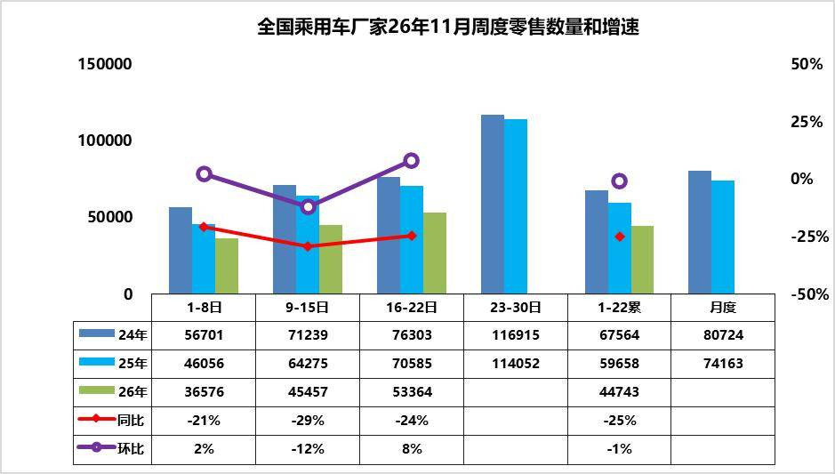
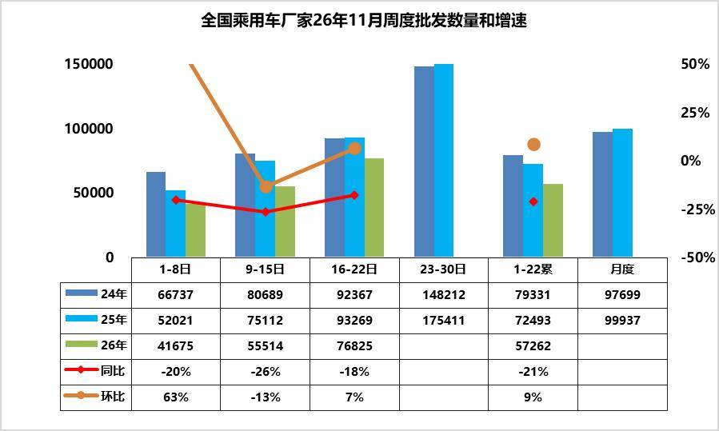
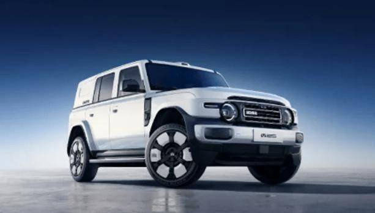
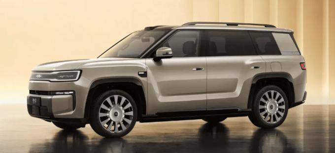
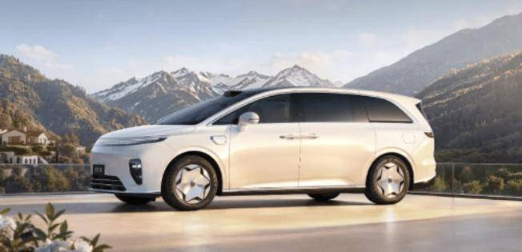
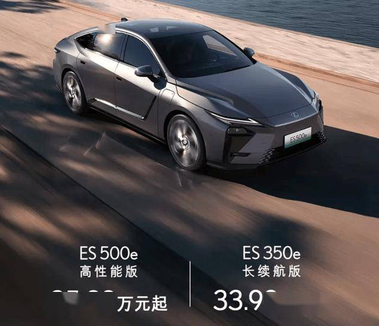
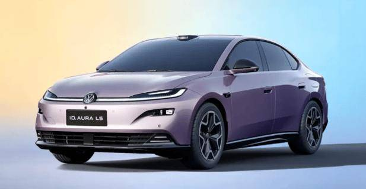

# 车市扫描-2026年45期（11月16日-11月22日）

- 公開日時: 2026-11-25 17:33（北京時間）
- 出典: [搜狐号・崔东树](https://www.sohu.com/a/1106298469_115312)
- テーマ（自動判定）: 車市スキャン（週次）
- 画像: 7枚

---

主要信息源自乘联分会每日新闻等

中国汽车流通协会

乘用车市场信息联席分会（乘联分会）

网站：http://www.cpcaauto.com

一、本周车市概述1.2026年11月全国乘用车市场零售相对平稳

【2026年11月1-22日乘联会市场分析要闻】

11月1-22日全国乘用车厂家批发126.0万辆，同比去年同期下降21%，较上月同期增长9%；今年以来乘用车累计批发2363万辆，同比去年同期下降7%。11月1-22日市场零售98.4万辆，同比去年同期下降25%，较上月同期下降1%；今年以来乘用车累计零售1596.2万辆，同比去年同期下降22%。

11月1-22日全国乘用车厂家新能源批发96.5万辆，同比去年同期增长3%，较上月同期增长13%；今年以来乘用车累计批发1418.8万辆，同比去年同期增长9%。11月1-22日新能源车市场零售70.2万辆，同比去年同期下降13%，较上月同期增长7%；今年以来乘用车累计零售957万辆，同比去年同期下降13%。

2026年11月1-22日全国新能源市场零售渗透率71.3%；新能源厂家批发渗透率76.6%。

10月第1-4周全国纯燃料轻型车生产38.6万辆，同比去年同期下降52%，较上月同期下降1%。10月第1-4周混合动力与插混总体生产39.7万辆，同比去年同期下降21%，较上月同期增长20%。

11月第1周乘用车市场日均零售3.7万辆，同比去年同期下降21%，较上月同期增2%。

11月第2周乘用车市场日均零售4.5万辆，同比去年同期下降29%，较上月同期下降12%。

11月第3周乘用车市场日均零售5.3万辆，同比去年同期下降24%，较上月同期增8%。

11月1-22日市场零售98.4万辆，同比去年同期下降25%，较上月同期下降1%；今年以来乘用车累计零售1596.2万辆，同比去年同期下降22%。

11月国内零售呈现“政策托底、弱修复、结构极致分化”的特征。11月零售同比依然显著负增。11月增量支撑主要来自“双11”金融与置换权益集中释放，但前两周零售表现疲软。后续看广州车展新品上市集客效应，以及以旧换新补贴政策在年内截止带来的“末班车”置换刚需。减量约束明显，居民收入预期偏弱导致消费观望情绪浓厚，置换周期拉长；油价虽短期下调但中枢仍处高位，压制燃油车消费，燃油车份额进一步萎缩。

结构与竞争特征：新能源渗透率继续创出新高，成为唯一的确定性增量。价格战边际效用见底，竞争从“全域降价”转向分层肉搏——高端拼智驾与体验，中端拼综合置换方案，尾部燃油与弱品牌加速出清。整体看，11月车市是依靠政策窗口和年末冲量维持的“结构性托底”，市场并未反转，纯电/混动等产品力强的车型才能获得客户，行业已彻底进入淘汰赛阶段。

2.2026年11月全国乘用车厂家销量平稳

11月第1周批发日均4.2万台，同比去年11月同期下降20%，环比上月同期增63%。

11月第2周批发日均5.6万台，同比去年11月同期下降26%，环比上月同期下降13%。

11月第3周批发日均7.7万台，同比去年11月同期下降18%，环比上月同期增7%。

11月1-22日全国乘用车厂家批发126.0万辆，同比去年同期下降21%，较上月同期增长9%；今年以来乘用车累计批发2363万辆，同比去年同期下降7%。

11月厂家批发呈现“开局较弱、后劲承压”的弱修复特征。11月主要受工作日增加、广州车展新车预热及年末销量目标压力倒逼。供给端，高爆款车型进入产能拉升阶段，厂家加快新车上市节奏以支撑批发数据。然而，这本质上是厂家向渠道转移库存的“强推”行为。

当前经销商普遍面临资金链紧绷与高库存压力，叠加前期政策透支，燃油车产销低迷，终端接车意愿下降。虽然新能源批发占比持续走高，但“批零剪刀差”较大，说明批发的增长并非终端真实消化的反映，经销商生存艰难，渠道蓄水池见顶，后续批发增速将受制于零售疲软。

3.全国商用车国内保险走势远强于乘用车—10月重卡新能源渗透率58%

根据国家金融局交强险数据，2026年10月单月交强险销量为23万辆，同比下降6%，环比下降12%；1-10月累计销量达250.0万辆，同比微降2%。整体来看，经历二季度短暂回暖后，市场重回存量博弈，商用车表现远强于乘用车。

2026 年10 月新能源商用车交强险销量12.10 万台，较9 月13.07 万台小幅回落，但仍维持高位。1-10 月累计98万台增44%的表现亮眼，仅2 月为低点，3 月起持续站稳9 万台以上，整体远高于2023-2025 年同期水平，新能源商用车渗透增长态势强劲。2026 年10 月新能源商用车渗透率达52.2%，持续走高，纯电动是绝对主力，插混、氢能源占比小幅稳定。1-10 月累计渗透率39.1%，较往年大幅提升，商用车电动化转型提速。客车板块渗透率86%，电动化基础扎实；卡车板块渗透率41%，其中重卡渗透率高达58%，轻卡、微卡也达到35%，皮卡、中卡相对偏低。重卡电动化突破是本轮渗透率提升的核心亮点。

2026 年10 月商用车市场竞争结构与乘用车剧烈反差，乘用车天翻地覆剧烈变化，商用车基本稳定。头部福田、五菱、重汽等多数企业同比承压；吉利、徐工、长安跨越、湖南汽车等企业增长亮眼，新能源转型带动份额快速提升，市场分化加剧，新势力与转型车企表现更强。

4.2026年10月新能源车锂电池市场分析

10月动力电池产量245.1GWh，同比增44%。其中，磷酸铁锂213.1GWh（+56%），三元锂31.7GWh（-6%）。1-10月累计产量2078.1GWh（+61%），磷酸铁锂累计1736.4GWh（+70%）。

2026年10月动力电池装车99GWh，同比增18%。结构极度分化：磷酸铁锂装车86GWh（占87%），同比大增28%；三元锂仅13GWh，同比下滑22%。1-10月累计装车676GWh（同比+17%），其中磷酸铁锂达564GWh（占83%），三元仅111GWh。市场呈现“铁锂绝对主导、三元持续萎缩”的格局。

2026年10月内销产量143.9万台，同比降10%，环比增14%。纯电乘用车稳盘（91.6万台，降2%），纯电货车大增41%。1-10月累计981.6万台（同比-12%）。

2026年4季度的电池能量密度160以上的车型占比6%，相对于2025年同期的10%出现了明显的下降，这主要还是三元的高端需求偏弱。而125以下的能量密度的产品2026年下降到了0%的比例。

2026年动力电池市场呈现“双雄份额松动，二线梯队加速崛起”的态势。宁德时代虽仍以44.0%的份额居首，但环比逐季下滑（Q4降至40.5%）；比亚迪微升至19.1%。与此同时，国轩高科（6.1%）、亿纬锂能（5.5%）、吉利耀宁（2.5%）等二线企业份额显著提升。

5.2026年11月新能源新品大型化、重型化延续

2026年1-11月新能源车免税目录共有23228款，其中11月免税目录新增车型243款，较年均数量大幅下滑。分品类看：乘用车仅55款，纯电、插混、增程申报款数同步收缩；客车仅8款，投放显著降温。专用车为当月主力，合计180款，其中纯电动166款，占到当月总款数七成以上。

11月新增换电车型目录17款，环比3季度的月均销量下降。分品类看，乘用车只有1款纯电换电车型申报，投放持续低迷；

11月乘用车中比亚迪9款、奇瑞汽车6款、北汽新能源6款、赛力斯6款、长城汽车5款、一汽大众4款、华晨宝马4款、上汽乘用车3款、吉利汽车3款、上汽通用2款。11月纯电乘用车平均续航达630公里，较3季度的551公里继续提升；500公里以上区间合计占比95%，长续航化趋势明确。狭义插混平均续航升至212公里，较2025年的119公里提升明显。增程平均续航230公里，2025年是173公里。整体看，三类技术路线均向更高续航区间迁移，纯电高端化、插混和增程长续航化趋势同步强化。

11月纯电车型，2000kg区间占比高达100%，成为绝对主力，轻量化车型占比极低，平均车重维持高位。狭义插混车型3000kg区间占69%，是核心重量段。增程车型2000kg区间占100%，3000kg区间占40%，大重量车型主导。从结构可见，11月申报新车普遍偏重，纯电集中在2吨级，插混以2吨为主，增程大量突破3吨，长续航与大容量电池持续推高整车整备质量。

二、本周上市新车1.iCAR V25上市售价12.98万-15.98万元

11月19日，iCAR V25上市，共推4款，售价12.98万-15.98万元，超级红包价11.98万-14.98万元。采用复古圆灯、双拼色格栅、包覆式机盖、D柱盲窗饰板可拆卸设计。内饰采用15.4英寸2.5K中控屏、8英寸液晶仪表。配备超级猎鹰700+辅助驾驶、高通8538芯片、15扬先锋音响+40W车外扬声器。搭载1.5T增程动力，CLTC纯电续航里程210km、200km。

2.方程豹钛9上市售价27.99万-32.99万元

11月19日，方程豹钛9上市，新车共推3款，售价区间为27.99万-32.99万元，置换价27.39万-32.39万元。新车采用家族式设计风格，竖向立体分体尾灯、天地尾门。内饰采用30英寸大联屏+12.3英寸仪表+AR-HUD/PHUD天际屏、折叠方向盘。配备天神之眼B、31扬帝瓦雷音响、21.4英寸吸顶屏、14个生态点位、线控数字底盘等。首发搭载DMS混动平台，搭载1.5T发动机+双电机插混系统，CLTC纯电续航400km。

三、宏观经济与政策1.九部门：推动新能源汽车“车电一体报废”回收拆解

11月17日，商务部等九部门发布《关于深入推进再生资源回收体系建设 促进回收行业高质量发展的意见》。其中提出，加强废旧动力电池回收处理。修订实施《报废机动车回收管理办法实施细则》，推动新能源汽车“车电一体报废”回收拆解。研究制定新能源汽车动力电池数字身份证管理制度及相关行政法规。

2.加拿大承诺不对中国太阳能产品和半导体征税，并扩大电动汽车进口

当地时间16日，加拿大总理卡尼表示，如果与美国总统特朗普的贸易谈判未能保住北美一体化汽车产业，加拿大可能转向中国汽车制造商寻求合作。与美国的谈判仍是他的首要任务，但谈判结果可能决定加拿大是否会寻求与欧洲、中国或日本汽车制造商合作的替代方案。

加拿大总理办公室官网日前发布公告，加拿大将部分中国钢铝产品现有关税减免措施延长两年，并将减免范围扩大至另外32个关税税目。此外，加拿大承诺不对中国太阳能产品和半导体加税，并扩大中国电动汽车进口。

四、新品信息跟踪1.一汽-大众ID.AURA L5正式开启盲订

11月16日，一汽-大众旗下全新纯电轿车ID.AURA L5正式开启盲订，新车计划于年内完成上市。是该序列首款纯电家轿，基于大众CMP纯电平台开发，采用全新设计语言，并搭载带激光雷达的高阶智能辅助驾驶系统，CLTC续航全系为580km。

五、企业信息1.比亚迪RACCO斩获日本年度进口车奖

第36届日本RJC年度车评选（2027年度）结果在栃木县揭晓，比亚迪专为日本市场打造的纯电轻型车BYD RACCO（海獭）荣获“年度进口车”奖，其搭载的新一代一体化电驱系统X-PACK同步入选RJC年度技术六佳，实现车型与技术双获奖。

2.深蓝汽车首家品牌中心开业

11月19日，深蓝汽车首家品牌中心正式开业。该中心面积超4000平方米，集销售、交付、维保、用户体验四大功能于一体，定位为深蓝品牌中高端形象的具象载体和“百万用户新家”，深蓝汽车正推动品牌、产品、服务全面升维。

3.腾势正式进入印度市场

11月17日，比亚迪集团旗下豪华品牌DENZA宣布已正式进入印度市场，并同步发布旗舰车型DENZA Z9 GT与DENZA D9。按照腾势规划，除产品导入外，其还将推进印度本地化服务网络与售后体系建设，覆盖购车、用车及售后环节，以支撑豪华品牌定位。

4.特斯拉计划继续增加上海工厂产量

特斯拉首席执行官马斯克11月19日到访上海超级工厂，马斯克承诺，特斯拉将继续增加在中国的产量。

5.小鹏集团第三季度营收242.8亿元

11月16日，小鹏集团公告，2026年第三季度实现总收入242.8亿元，同比增长19.1%，环比增长23.0%；其中汽车销售收入216.3亿元，同比增长19.8%，环比增长26.9%。第三季度净亏损8.7亿元，上年同期净亏损3.8亿元，亏损同比扩大127.9%，环比收窄35.1%。

六、行业信息1.智界获道路机动车辆独立生产资质

据工信部最新公告，安徽智界新能源汽车有限公司获得道路机动车辆生产企业准入资质。在此之前，智界S7、智界R7等车型均依托奇瑞的整车资质申报上市，车辆铭牌与车尾必须标注“奇瑞汽车”。随着独立资质落地，智界后续推出的全新车型，将直接以安徽智界新能源汽车主体申报公告，车尾铭牌不再强制标注奇瑞。

2.岚图汽车获得道路机动车辆独立生产资质

11月17日，岚图汽车在港交所公告，中华人民共和国工业和信息化部于11月16日正式发布2026年第31号公告，公布《道路机动车辆生产企业及产品》（第412批）目录，公司已被列入该批次道路机动车辆生产企业准入名单，正式取得道路机动车辆生产企业准入资格。

3.中汽协会将对17家重点汽车企业的供应商账款支付情况开展调研评估

11月16日，中国汽车工业协会发布通知，将对17家重点汽车企业的供应商账款支付情况开展调研评估，推动汽车企业规范供应商账款支付。

七、跨国集团与国际市场1.宝马押注高端品牌Alpina

知情人士透露，宝马计划2027年在印度引入豪华品牌Alpina并作为独立品牌在10座城市布局，以吸引高收入消费者，提升在印度汽车市场的销量。2026年上半年宝马在印度销量9075辆，同比增长17%，逼近同期增长9%、销量9768辆的奔驰。据悉，印度与欧盟即将敲定贸易协定，豪华车现行100%进口关税将大幅下调至30%至35%。

2.大众汽车计划将车载地图替换VW-Navi导航

11月18日，大众汽车计划于2027年10月完成MQBevo平台燃油车型对谷歌汽车服务的适配。高尔夫、途观、帕萨特等车型将配备基于谷歌地图的导航系统，放弃VW-Navi导航系统。此次升级需要硬件替换，无法仅通过软件更新实现。

3.大众汽车在劳资谈判中寻求冻结员工薪资并延长工时

大众汽车日前表示，计划在即将开启的劳资谈判中提出未来两年冻结员工薪资、提高工作时间灵活性，并取消一项员工福利奖金。员工已威胁从明年1月起采取罢工行动。

4.丰田、铃木等依靠日元贬值维持利润增长

日本七大主流车企陆续公布的2026上半财年（2026年4-9月）数据显示，若没有日元贬值增益，整体营业利润将同比下滑，汇率贡献约占利润总额三分之一。含丰田、本田在内的七大车企上半财年总营业利润约为3.4万亿日元。同比增长约20%，其中日元走弱贡献1.1万亿日元，创四年新高。剔除汇率因素后，丰田、铃木、斯巴鲁、三菱四家利润同比下滑。

5.韩国1-10月新能源汽车出口量超去年全年

韩国产业通商部发布数据显示，韩国今年1-10月新能源汽车累计出口量达88.44万辆，已超过去年全年水平。10月，新能源汽车出口额同比增长49%，为31亿美元。其中，混动汽车同比增长53.1%，为20.6亿美元；电动汽车同比增长41.6%，为10.4亿美元。在新能源汽车的助推下，10月整体汽车出口额同比增长18.1%，为65.5亿美元，创历年同期最高纪录。

SSIST PRO成为首个获得德国联邦机动车运输管理局（KBA）批准、可在德国提供点到点辅助驾驶功能的驾驶辅助系统。

6.欧盟委员会发布《网络弹性法案》适用指南，明确汽车零部件适用范围

11月17日，欧盟委员会关于《网络弹性法案》的适用指南刊登于《欧盟官方公报》。该指南为横向网络安全合规指引，其第9.3.1节专门规定与机动车型式批准法规的衔接，明确专为已型式批准车辆设计制造的零部件可排除在法案适用范围之外，而通过零售、线上等面向公众渠道销售的通配件则被纳入，为零部件出口企业划出合规边界。

7.欧洲车企提前争夺2027年汽车存储芯片

11月19日，据中国台湾《电子时报》英文版报道，由于AI数据中心对高带宽存储器（HBM）的需求快速增长，三星电子、SK海力士、美光等存储芯片厂商正在将更多资源转向利润率更高的AI相关产品，因此，欧洲汽车制造商正在提前锁定2027年及以后的存储芯片供应，部分车企高管已经直接与芯片供应商沟通，争取获得稳定供应。

8.日本车企计划统一钢材、树脂和线束标准

11月19日，日本汽车工业协会宣布，将推动旗下14家成员企业对部分汽车材料和零部件建立共同标准，首批涉及钢材、树脂和线束。日本汽车制造商和零部件企业希望通过跨企业协作，减少各家车企在基础材料和零部件规格上的重复要求，降低跨品牌采购与制造成本。

9.特斯拉最早12月启动车主Robotaxi试运营

当地时间11月16日，马斯克在社交平台X上回复一位奥斯汀Uber司机时表示，特斯拉最早可能于12月启动个人车主车辆接入Robotaxi网络的试运营，允许车主将自有车辆投入无人驾驶出租车队接单赚钱。

10.特斯拉计划量产Cybercab

当地时间11月16日，特斯拉宣布，计划投资30亿欧元扩建德国超级工厂，并将于2029年启动Cybercab无人驾驶出租车生产，年产能目标最高达100万辆。

11.特斯拉FSD V15正式推送

特斯拉正式宣布在美国市场开始推送FSD（监督式完全自动驾驶）V15版本，首批面向早期体验计划（EAP）成员。特斯拉官方称，此次更新“升级了端到端驾驶网络的每一个部分”，对安全关键场景的处理能力提升25倍，关键人工干预率获得大幅改善。

附：近日信息合集
